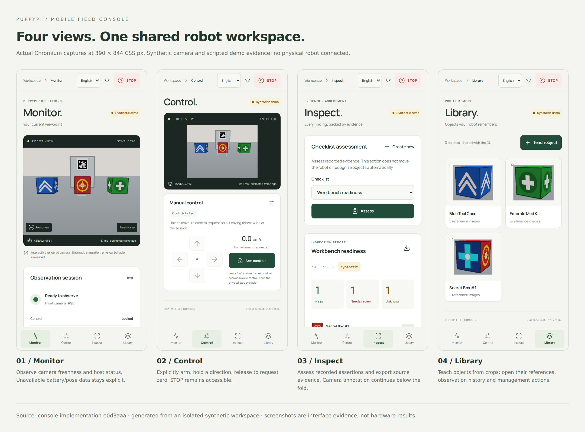
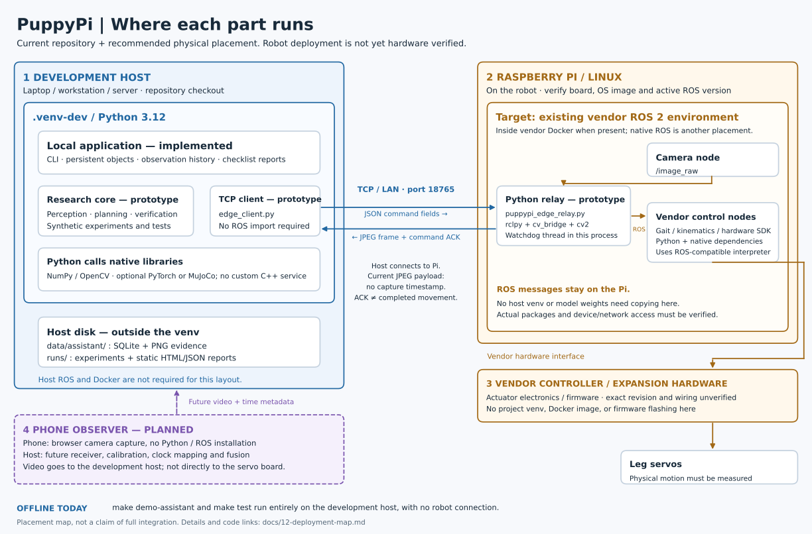

# Embodied Scout PuppyPi

An application and R&D platform for **Hiwonder PuppyPi**, built on the existing
**Teach and Find** Python core. The roadmap combines object search, temporal
memory, interactive clarification, workspace inspection, and active vision.

## Current capability

The [current code-integrity audit](docs/review/2026-11-01-code-integrity-audit.md)
maps actual runtime methods to sources. The app exposes the same method inventory:
custom Python/OpenCV baselines, operator/script assertions and genuine optional
Mind Palace inference are explicitly distinguished.

The optional [combined visual inspection profile](docs/24-yoloe-vision.md) runs
actual author YOLOE proposals, DINOv2 reference descriptors and ByteTrack in a
separate CPU worker. Its [real rendered-camera app execution](docs/research/2026-11-01-dual-vision-app/report.md)
includes screenshots, raw comparisons and required-model failures. The explicit
custom cosine/margin rule supports candidates; exact identity still fails on
indistinguishable visible objects and recall drops under some viewpoints. No
autonomous patrol, predictive world model or RL locomotion is established.


The repository contains a software prototype for synthetic few-shot object
search, multi-view verification, topological planning, AprilTag recovery, and a
ROS 2/TCP bridge with a tested loopback watchdog. It also includes synthetic
experiment artifacts and MuJoCo CAD visualizations.

The local CLI now adds persistent object enrollment and management, timestamped
observation history, checklist rules, and portable HTML/JSON reports with images.
Inspection evaluates recorded assertions; autonomous visual inspection and
physical robot validation are pending. Historical benchmark scores describe the
supplied synthetic scenario. Read [capability and evidence status](docs/00-project-status.md).

The mobile **Field Console** adds camera monitoring, manual hold-to-drive,
image-backed inspection, object management, and report downloads. It is a
Preact/TypeScript PWA served by FastAPI on the host.



See the [eight-screenshot walkthrough](docs/14-mobile-console-gallery.md) and
[visual architecture/control/evidence guide](docs/13-mobile-console.md).
These are actual browser captures using a synthetic robot and scripted evidence.

Start with a synthetic robot:

```bash
make app-setup
make app-build
make app
```

Open `http://127.0.0.1:8080` and enter the code printed in the terminal. For a phone
on the same network, run `make app APP_ARGS="--host 0.0.0.0"` and open the host's
LAN address. See the [app guide and architecture](docs/13-mobile-console.md) for
HTTPS installation, isolated demo data, explicit relay selection and validation.
The app does not yet run autonomous search or use the phone camera as an external
viewpoint.

## Recorded memory with Mind Palace

The optional [recorded-memory app profile](docs/22-mind-palace-app.md) now uses
actual pinned Mind Palace components and `gpt-6-luna` API inference. Capture
camera observations into episodes, ask about saved images, and inspect answers,
citations and execution traces in Room memory. The separate worker needs an API
key; no local GPU is required. Default app startup does not enable paid inference.

[Execution evidence and comparison](docs/research/2026-11-01-mind-palace-app/report.md)
use explicitly synthetic input. Real-room recognition quality, active exploration
and physical validation remain open; this is not a learned predictive world model.

## Where the software runs

Start with the [visual deployment map](docs/12-deployment-map.md) for the physical
machines, Python environments, Docker/ROS boundary, native libraries, and exact
code entry points. The [mobile console map](docs/13-mobile-console.md) adds the
implemented browser-to-host path; physical robot and external camera integration
still need hardware validation.



The development host runs the application in `.venv-dev`. The Pi's existing ROS
environment is the intended location for the Python relay and vendor drivers.
The project has no custom C++ service or Docker image. The phone browser runs
the operator app; using the phone as a third-person camera is still planned.

Monitor now includes **Room memory**: regions, evidence timeline, saved historical
answers and image analysis with explicit operator confirmation. See
[the application delivery plan](docs/19-application-delivery-plan.md) for available
workflows and the monitoring, phone-observer and patrol sequence. Candidates use
the local appearance baseline; physical perception and patrol remain unverified.

## Application and research tracks

| Track | Intended application | Research question |
| --- | --- | --- |
| Memory Scout | Remember and find objects after they move | When should old observations be checked again? |
| Look-or-Ask | Resolve ambiguity through a view or question | How should information, movement and human effort be traded off? |
| Inspect and Explain | Check presence, placement and visible states | Which observations distinguish meaningful changes from nuisances? |
| Body-aware Active Vision | Change pose or wait for a stable image | Which feasible action improves recognition per unit time? |
| Phone Observer | Use a fixed phone as an external viewpoint | When does another camera reduce travel, ambiguity, and wrong confirmations? |

The [39-feature inventory](docs/06-feature-roadmap.md) records status, priority,
dependencies, and acceptance criteria. Features share one perception, evidence,
mission, and motion stack.

The [skill-based deep review](docs/18-deep-research-room-intelligence.md) records
27 sources, claim/evidence ledgers, a counterfactual-history figure and a
temporal-coverage/acquisition proposal, with [HTML](docs/research/2026-10-31-deep-room/report.html)
and [PDF](docs/research/2026-10-31-deep-room/report.pdf) reading copies. These are
research documents, not newly delivered robot features.

The [deep prior-art audit](docs/17-deep-research-active-room-inspection.md)
compares twelve related works and their source availability, then proposes an
illustrated joint room-change/source-diagnosis experiment with strong baselines.
Patrol, persistent graphs and active fault diagnosis have close precedents;
the research contribution remains a hypothesis.

The [Room Patrol proposal](docs/16-room-patrol-world-model-proposal.md) develops
a taught-room inspection mission and a temporal world model with geometry,
object relationships, uncertainty and measured action outcomes. F38/F39 remain
Planned; the proposal includes source research, an illustrated design and
hardware/experiment acceptance gates.

The confirmed platform is **PuppyPi Standard**, with more than three months for
development. The [Phone Observer plan](docs/11-phone-observer-research.md) records
related work, reusable code, a fixed-phone baseline, and an adjustable 16-week
schedule. Phone streaming/fusion remains planned; it is not part of the CLI demo.

## Quick start

Python 3.12 is the reference interpreter. Install `uv` and run from this directory:

```bash
make setup
make check
make test
make build
make hooks
```

Commands use `.venv-dev/`, preserving an existing `.venv/`. `uv.lock` pins core,
development, and optional simulator dependencies. Default tests use synthetic
images and a loopback relay; they do not actuate hardware or invoke paid APIs.
ROS 2 and pretrained GPU models are optional deployment integrations.

```bash
make benchmark       # heuristic/oracle fixture ablation; writes runs/heuristic-ablation/
make render-3d       # optional authored MuJoCo storyboard; writes runs/authored-storyboards/
make tags            # regenerate printable AprilTags
make demo-assistant  # persistent library + synthetic inspection report
```

The renderer regenerates ignored `assets/mujoco_generated/` for the checkout path.
Historical tracked outputs are preserved. New experiment/storyboard outputs are ignored;
review their method disclosures before preparing evidence.

The assistant demo prints a local HTML report path and records one pass, two
failures, and one unknown from scripted synthetic observations. It creates a new
ignored run directory each time. See [operator workflows](docs/10-operator-workflows.md)
for enrollment, history, inspection, export, and their current limitations.

## Project map

- `teach_and_find/`: perception, memory, planning, missions, adapters, simulation.
- `scripts/`: experiments, visualization, marker generation, relay, checks.
- `tests/`: software and mock-relay regressions.
- `assets/`: CAD snapshot with [provenance notes](assets/README.md).
- `outputs/`: reviewed [historical synthetic evidence](outputs/README.md).
- `docs/`: status, feature roadmap, research, architecture, acceptance.

Start with [the documentation index](docs/README.md),
[the research program](docs/07-research-program.md), and
[the shared architecture](docs/08-system-evolution.md).
See [CONTRIBUTING.md](CONTRIBUTING.md) and [AGENTS.md](AGENTS.md) for development
and commit rules.

This directory is its own Git repository, independent of the surrounding ECUS
repository. The bootstrap configures no remote. Source assets retain their
original ownership and terms.
