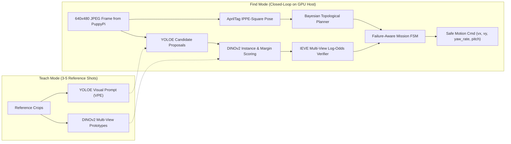

# 01. Open-Source Stack & Related Work ("Standing on the Shoulders of Giants")

Rather than training detectors from scratch or writing custom SLAM on an unequipped quadruped, **PuppyPi Teach & Find** combines proven open-source vision and navigation building blocks into a closed-loop active search system.

---

## 1. Recommended Open-Source Repositories by Module

| System Layer | Primary Giant (GitHub + Paper) | Alternative / Complement | Role in PuppyPi Teach & Find |
| :--- | :--- | :--- | :--- |
| **1. Few-Shot Candidate Detection** *(No retraining)* | [**THU-MIG/yoloe**](https://github.com/THU-MIG/yoloe) *(ICCV 2025 — Real-Time Seeing Anything; built into `ultralytics` via `YOLOEVPSegPredictor`)* | [**mlzxy/devit**](https://github.com/mlzxy/devit) *(CoRL — DE-ViT: Detect Everything with Few Examples)* | Extracts Visual Prompt Embeddings (`VPE`) from 3–5 taught crops and detects candidate bounding boxes in real time on the laptop GPU. |
| **2. Instance-Level Prototype Matching** | [**facebookresearch/dinov2**](https://github.com/facebookresearch/dinov2) *(TMLR 2024 + ICLR 2024 Registers `dinov2_vits14_reg`)* | [**nv-nguyen/cnos**](https://github.com/nv-nguyen/cnos) *(ICCVW 2023 — FastSAM + DINOv2 Novel Object Segmentation)* | Fine-grained multi-view cosine matching to separate the exact taught *instance* from same-category or same-color distractors. |
| **3. Active View Verification** | [**XiaohanLei/IEVE**](https://github.com/XiaohanLei/IEVE) *(CVPR 2024 — Instance-aware Exploration-Verification-Exploitation)* | Sequential Probability Ratio Test (SPRT) / Bayesian Log-Odds | Theoretical grounding for switching from `Explore` to `Verify` ("get closer and change viewing angle before confirming"). |
| **4. RGB Topological Navigation** | [**oravus/RoboHop**](https://github.com/oravus/RoboHop) *(ICRA 2024 — Segment-based Topological Map)* | [**robodhruv/visualnav-transformer**](https://github.com/robodhruv/visualnav-transformer) *(ViNT / NoMaD)* | Reference architecture for topological graph navigation using monocular RGB without 2D LiDAR metric SLAM. |
| **5. Fiducial 6-DoF Pose** | `cv2.aruco` (`DICT_APRILTAG_36h11` + `SOLVEPNP_IPPE_SQUARE`) | [**christianrauch/apriltag_ros**](https://github.com/christianrauch/apriltag_ros) *(ROS 2 Humble)* | Subpixel `tag36h11` detection + planar IPPE-Square pose estimation without fragile C-extension builds. |

---

## 2. Architecture: How the Pretrained Blocks Connect

---

## 3. Defensible Thesis Novelty vs. Existing Repos

> [!IMPORTANT]
> Pretrained models (`YOLOE`, `DINOv2`, `CNOS`) solve **static single-frame perception**, while `IEVE` evaluates **discrete actions inside the Habitat simulator**. None of them solve closed-loop physical search on a low-cost 8-DOF quadruped with a 480p monocular camera.

Your concrete, measurable engineering & algorithmic contributions are:

1. **Two-Stage Open-Set Instance Memory on Low-Res 480p Video:** Pairing `YOLOE` visual-prompt proposals with `DINOv2` multi-angle prototype banks and distractor margin scoring so the robot neither retrains weights nor confuses look-alike boxes from a single frontal glimpse.
2. **Active Multi-View Verification Adapted to 8-DOF Kinematics:** Translating `IEVE`'s verification concept into continuous lateral arc trajectories (`/puppy_control/velocity_move` + counter-yaw) with distance- and angle-diversity-weighted Bayesian log-odds.
3. **Prior- & Cost-Aware Topological Search:** Replacing sequential station polling (`A -> B -> C`) with Bayesian belief updates under imperfect detection recall and travel cost Trade-offs.
4. **Failure-Aware Quadruped Execution:** Explicit recovery when `tag36h11` markers drop out of the narrow 480p field of view during body pitch/roll oscillation.
