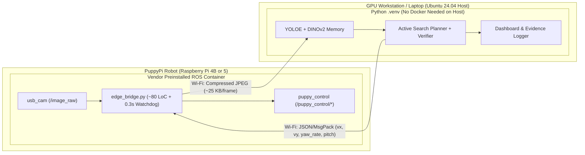

# 02. Deployment Architecture & Hiwonder Source Audit

## 1. Host vs. Robot Deployment: Why "Zero Docker on Host" Wins

### Hardware & OS Context
- **GPU Workstation (`ganryu`):** Ubuntu 24.04 LTS (Noble), Python 3.12, 3× NVIDIA RTX 6000 Ada GPUs. Native ROS 2 on Ubuntu 24.04 is **Jazzy**, which is wire-incompatible with **ROS 2 Humble** and **ROS 1 Noetic**.
- **PuppyPi Standard Robot:**
  - **Raspberry Pi 5 version:** Runs Hiwonder's preinstalled **ROS 2 Humble Docker container** on Raspberry Pi OS.
  - **Raspberry Pi 4B version:** Runs **ROS 1 Noetic**.

### Recommended Split: Offboard `.venv` Brain + Onboard Edge Bridge

In modern embodied AI systems (`VLFM`, `LeRobot`, `OK-Robot`, `RoboHop`), running heavy PyTorch vision models in a clean host `.venv` and talking to the robot's internal ROS stack over a lightweight socket (`WebSocket` / `ZeroMQ`) is strongly preferred over stretching ROS 2 DDS across Wi-Fi.



### Comparison: Hybrid Edge Socket vs. Distributed ROS 2 Docker

| Criterion | Option 1: `.venv` on Host + Edge Socket *(Recommended)* | Option 2: ROS 2 Humble Docker on Host (`--net=host`) |
| :--- | :--- | :--- |
| **Docker needed on GPU PC?** | **No** — runs directly in `/home/nguyentnt/PDWAIA/ecus/hi/.venv` | **Yes** — requires `ros:humble` + `nvidia-container-toolkit` (~12–15 GB image) |
| **Python / NumPy conflicts** | **None** — Python 3.12 + PyTorch 2.13 + NumPy 2.x run natively | **Severe** — `ros-humble-cv-bridge` requires Python 3.10 + NumPy 1.x |
| **Works on both Pi 4B & Pi 5?** | **Yes** — only the 80-line `edge_bridge.py` adapts to `rospy` or `rclpy` | **No** — only works if robot runs ROS 2 Humble |
| **Defense-room Wi-Fi reliability** | **High** — ~25 KB/frame unicast TCP/WebSocket (~6 Mbps at 30 FPS) | **Fragile** — raw `/image_raw` (~220 Mbps) + DDS multicast often blocked on campus Wi-Fi |
| **Safety on Wi-Fi drop** | **Hardware safe** — onboard 300 ms watchdog halts servos immediately | **Risky** — last velocity command latches if remote node disconnects |

> [!TIP]
> During algorithm development and ablation benchmarking, you only run **one `.venv` process on the host** against `teach_and_find/sim/world3d.py`. When switching to the physical robot, the exact same host process listens on a port while `edge_bridge.py` runs inside Hiwonder's existing container on the robot.

---

## 2. Critical Findings from Auditing `Hiwonder/PuppyPi` (`ros2` Branch)

Direct inspection of Hiwonder's official `ros2` branch revealed four implementation traps that would silently break naive controllers:

### Trap 1: `/puppy_control/velocity` Silently Drops Lateral Motion (`y != 0`)
In `src/driver/puppy_control/puppy_control/puppy.py` (`VelocityFun`, line 832):
```python
elif abs(msg.x) <= 35 and abs(msg.y) == 0 and abs(msg.yaw_rate) <= np.radians(51):
```
- **Impact:** Publishing any lateral strafe velocity (`msg.y != 0`) to `/puppy_control/velocity` fails the `abs(msg.y) == 0` guard and is **completely ignored without warning**.
- **Fix (implemented in `teach_and_find/ros2_bridge.py`):** Route any command with `vy_cm_s != 0` (such as sideways arc motion during Active View Verification) to **`/puppy_control/velocity_move`** (`VelocityMoveFun`, line 789), which forwards `(x, y, yaw_rate)` directly to `self.puppy.move(...)`.
- **Units:** `x` and `y` are in **cm/s** (keep `|x| <= 14 cm/s`, `|y| <= 8 cm/s` for smooth camera frames); `yaw_rate` is in **rad/s**.

### Trap 2: `/puppy_control/pose` Silently Rejects Body Yaw (`yaw != 0`)
In `src/driver/puppy_control/puppy_control/puppy.py` (`PoseFun`, line 938):
```python
if (abs(msg.roll) <= math.radians(31) and abs(msg.pitch) <= math.radians(31)
        and abs(msg.yaw) == 0 and -15 <= msg.height <= -5 ...):
```
- **Impact:** PuppyPi Standard has 8 leg servos, no neck pan servo, and `PoseFun` rejects `yaw != 0`. Attempting to pan the camera left/right via `Pose(yaw=...)` does nothing.
- **Fix:** Always publish `Pose.yaw = 0.0`. Use `Pose.pitch` (`[-28°, +15°]`) for vertical gaze adjustments and in-place `yaw_rate` rotation for horizontal scanning.

### Trap 3: Blocking `time.sleep(1)` Inside Hiwonder's `apriltag_tracking_demo.py`
In `example/example/opencv_course/apriltag_tracking_demo.py` (lines 214–255):
- `apriltagDetect()` executes `time.sleep(1)` whenever `len(detections) == 0` **inside `image_callback` while holding `self.lock`**, throttling the camera pipeline to 1 FPS whenever a tag leaves the frame.
- It also controls only forward/backward `x = ±5.0` without bearing (`yaw_rate`) alignment.
- **Fix:** Keep camera ingestion lock-free (latest-frame buffer, QoS `BEST_EFFORT`, `depth=1`) and run proportional visual servoing on both depth error and horizontal bearing error in a separate timer loop.

### Trap 4: Tag Size & Mounting Height on the 640×480 Camera
From `src/peripherals/config/camera_info.yaml`, PuppyPi's camera has `640×480` resolution with `fx ≈ 473.5 px`, `fy ≈ 474.2 px`:
- Hiwonder's stock `3.3 cm` (`0.033 m`) tag projects to `< 15 px` beyond `1.0 m`, causing frequent detection dropouts.
- **Fix 1 (Size):** Print **`10 cm` (`0.10 m`) `tag36h11` station markers** (`~22 px` even at `2.1 m`, reliable 6-DoF pose out to `2.2 m`).
- **Fix 2 (Mounting Height):** Mount station AprilTags at **`z = 28–35 cm` above the floor** (above floor objects sitting at `z = 0–15 cm`) so foreground object bounding boxes never merge with the station marker card during oblique `-55° / +55°` verification views.

---

## 3. First-Day Hardware Verification Checklist (On PuppyPi)

Run these commands once via SSH on your PuppyPi to confirm board revision, ROS version, camera stream, and whether your Standard unit populates the IMU topic:

```bash
# 1. Check Raspberry Pi model (Pi 4B vs Pi 5)
cat /proc/device-tree/model

# 2. Check running ROS container (if Pi 5 factory image)
docker ps

# 3. Inside the robot's ROS 2 shell: check camera & IMU data
ros2 topic list
ros2 topic hz /image_raw
ros2 topic echo /ros_robot_controller/imu_raw --once
```
