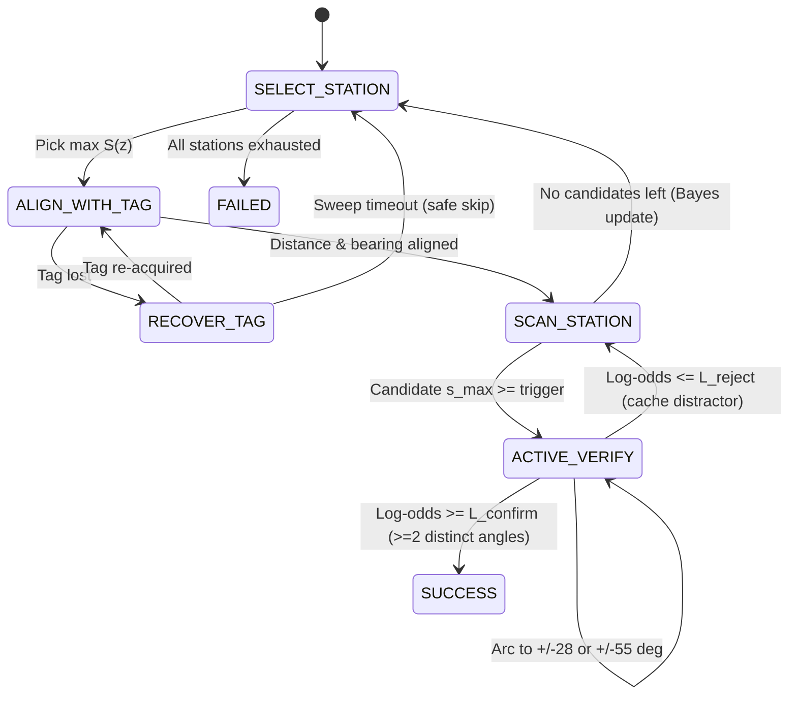

# 03. Core Algorithms, Code Mapping & Ablation Plan

## 1. Codebase Mapping (`teach_and_find/`)

| Module | File | Responsibility |
| :--- | :--- | :--- |
| **Settings** | `teach_and_find/config.py` | Calibrated `camera_info.yaml` intrinsics, hardware-safe `puppy.py` velocity/pose clamps, planner & verifier hyperparameters. |
| **6-DoF AprilTag** | `teach_and_find/apriltag_pose.py` | `AprilTagPoseEstimator`: `DICT_APRILTAG_36h11` subpixel corner detection + `SOLVEPNP_IPPE_SQUARE` metric pose & viewing angle. |
| **Proposals** | `teach_and_find/perception/proposals.py` | `CandidateProposalGenerator`: AprilTag-masked foreground saliency proposals (plug-in interface ready for `YOLOE`). |
| **Visual Encoders** | `teach_and_find/perception/encoder.py` | `SpatialAppearanceEncoder` (fast CPU baseline) and `TorchHubBackboneEncoder` (GPU `DINOv2` via environment settings). |
| **Algo 1: Memory** | `teach_and_find/perception/memory.py` | `ObjectMemoryBank`: Multi-angle prototype bank, negative distractor margin scoring, and Dirichlet semantic station priors. |
| **Algo 2: Verifier** | `teach_and_find/verification.py` | `VerificationSession`: IEVE-inspired sequential Bayesian log-odds accumulator with distance and angle-novelty weighting. |
| **Algo 3: Planner** | `teach_and_find/planner.py` | `ActiveSearchPlanner` vs. `SequentialSearchPlanner` (`A -> B -> C` ablation baseline) over `TopologicalGraph`. |
| **Algo 4: FSM** | `teach_and_find/mission.py` | `FailureAwareMissionController`: Full state machine with `RECOVER_TAG` sweep, arc viewpoint commands, and evidence reporting. |
| **ROS 2 Bridge** | `teach_and_find/ros2_bridge.py` | `translate_action_to_ros_payload` & `create_ros2_node` with automatic `/puppy_control/velocity_move` routing. |
| **3D Visual Arena** | `teach_and_find/sim/world3d.py` | Pinhole `640×480` 3D renderer with perspective-warped `tag36h11` markers and look-alike decoy boxes (`secret_box_1` vs `lookalike_red_box`). |

---

## 2. Mathematical Formulation of the Four Algorithms

### Algorithm 1 — Few-Shot Multi-Prototype Memory with Distractor Margin
Given $K \in \{3, \dots, 5\}$ L2-normalized reference view embeddings $\{p_1, \dots, p_K\}$ for target $T$ and competitor/rejected embeddings $\mathcal{D}$:
$$s_{\max}(x) = \max_{k \in \{1..K\}} \langle e(x), p_k \rangle, \qquad m(x) = s_{\max}(x) - \max_{q \in \mathcal{D}} \langle e(x), q \rangle$$
Keeping individual view prototypes $\{p_k\}$ instead of collapsing them into a single mean vector preserves distinct front vs. side appearance modes.

### Algorithm 2 — Active View Verification (Sequential Bayesian Log-Odds)
For candidate observations $(x_1, \dots, x_t)$ captured at distances $d_t$ and relative arc angles $\psi_t$:
$$L_t = L_{t-1} + w_d(d_t)\, w_\psi(\psi_t)\, \frac{(s_{\max}(x_t) - s_0) + 0.45\,(m(x_t) - m_0)}{\tau}$$
- **Distance weight $w_d(d_t)$:** Rewards closer inspection (`0.40–0.50 m`) where 480p textures are sharp.
- **Angular novelty weight $w_\psi(\psi_t)$:** Downweights redundant frames (`|Δψ| < 18°`) to `0.20` and requires **at least 2 distinct viewing angles** before crossing $L_{\text{confirm}}$, preventing frontal look-alike decoys from triggering false positives.

### Algorithm 3 — Active Topological Search Planner
At topological node $u$, each unexhausted station $z$ is scored by:
$$S(z) = \alpha P(\text{target} \mid z) - \beta \tilde{D}(u, z) + \gamma U(z)$$
where $\tilde{D}(u, z) \in [0, 1]$ is normalized Dijkstra shortest-path distance and $U(z)$ is visibility-weighted binary Shannon entropy $H_2(P(z))$. When station $z$ is searched without confirming the target, all station beliefs update via Bayes' rule with effective recall $r_z$:
$$P'(z) = \frac{(1 - r_z) P(z)}{1 - r_z P(z)}, \qquad P'(z' \neq z) = \frac{P(z')}{1 - r_z P(z)}$$

---

## 3. Thesis Ablation Study Matrix (30+ Trials per Variant)

| Variant | Station Search | Candidate Verification | Expected Behavior & Failure Mode |
| :--- | :--- | :--- | :--- |
| **V0 — Baseline** | Fixed `A -> B -> C` | Single frontal view (`0°`) | High false-verification rate when encountering `lookalike_red_box` before true target; wasted travel. |
| **V1 —Planner Only** | Active `S(z)` + Priors | Single frontal view (`0°`) | Lower average stations visited & travel distance, but still fooled by frontal look-alike decoys. |
| **V2 — Multi-View Only** | Fixed `A -> B -> C` | IEVE Multi-View Log-Odds | Eliminates look-alike false positives via oblique side views, but incurs higher travel distance than V3. |
| **V3 — Full Teach & Find** | Active `S(z)` + Priors | IEVE Multi-View Log-Odds | Highest end-to-end task completion rate, lowest false verification rate, and shortest search time/distance. |
