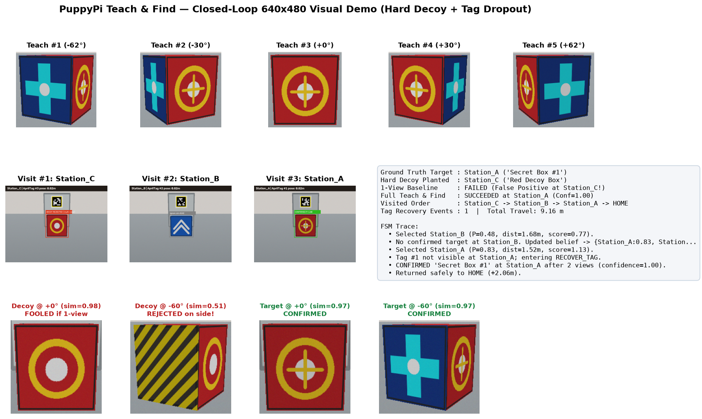
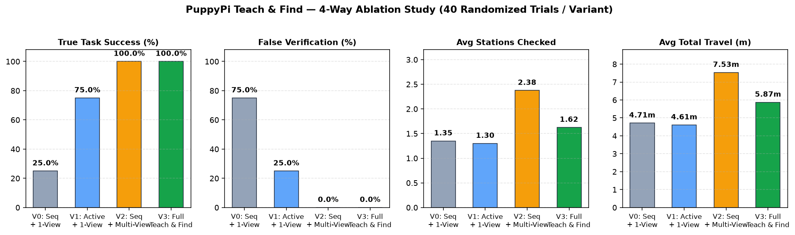
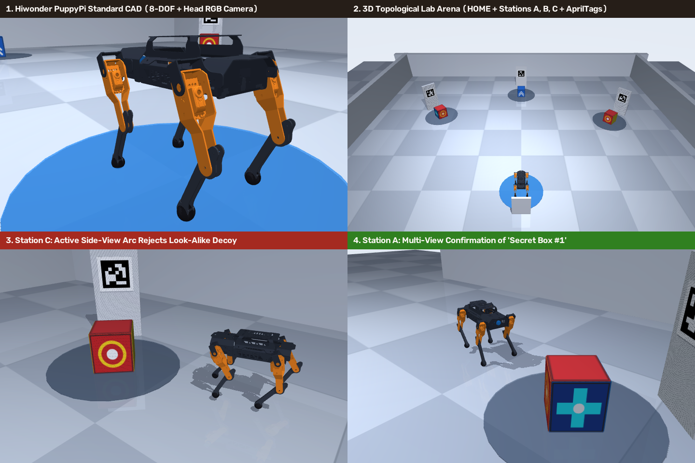

# 04. Experimental Results (Closed-Loop 3D Visual Simulation & Ablation)

Reproducible command:
```bash
source /home/nguyentnt/PDWAIA/ecus/hi/.venv/bin/activate
pytest
python scripts/run_experiments.py
```

---

## 1. Visual Walkthrough Demo (`outputs/demo_mission_dashboard.png`)



### Scenario Setup
- **Taught Target (`Secret Box #1`):** Enrolled from 5 multi-angle views (`-62°, -30°, 0°, +30°, +62°`), featuring a crimson-and-gold ring front face and cyan cross-bar side panels.
- **Hard Look-Alike Decoy (`Red Decoy Box`):** Placed at `Station_C` (closest station from `HOME`). Shares a nearly identical crimson-and-gold ring front face (`frontal cosine sim = 0.98`), but has yellow/slate hazard stripes on its side panels.
- **Clutter Distractor (`Blue Tool Case`):** Placed at `Station_B`.
- **Hidden True Target (`Secret Box #1`):** Hidden at `Station_A` with an injected **AprilTag occlusion/dropout** on arrival to test `RECOVER_TAG`.

### Observed Behavior
1. **1-View Baseline Failure:** Approaches `Station_C` (`0°`), sees `sim = 0.98` on `Red Decoy Box`, and **falsely reports success at `Station_C`** (False Positive Verification).
2. **Full Teach & Find (`V3`):**
   - Visits `Station_C` first (`d = 2.02 m`), sees ambiguous frontal match (`0.98`), arcs laterally to `-60°` via `/puppy_control/velocity_move`, observes similarity drop to **`0.51`**, and **rejects the decoy** (`posterior = 0.00`).
   - Updates Bayesian station beliefs to `{Station_A: 0.48, Station_B: 0.48, Station_C: 0.05}`, checks `Station_B` (`Blue Tool Case` ignored at `sim = 0.42`), and shifts belief on `Station_A` to **`0.83`**.
   - Arrives at `Station_A`, triggers `RECOVER_TAG` when `tag36h11 #1` drops out, re-acquires `AprilTag #1` (`0.82 m`), confirms `Secret Box #1` across `0°` (`sim = 0.97`) and `-60°` (`sim = 0.97`, **`posterior = 1.00`**), and returns safely to `HOME`.

---

## 2. 4-Way Ablation Study (`40` Randomized Trials / Variant = `160` Episodes)



Each trial randomizes target hiding location (with non-uniform realistic station priors), decoy station placement, ambient illumination (`0.84x – 1.15x`), camera Gaussian noise, and periodic AprilTag dropouts:

| Variant | Station Planner | Verification | True Success (%) | False Verification (%) | Avg Stations Checked | Avg Travel Distance (m) | Tag Recoveries |
| :--- | :--- | :--- | :---: | :---: | :---: | :---: | :---: |
| **V0 (Baseline)** | Sequential (`A→B→C`) | Single-View (`0°`) | `25.0%` | `75.0%` | `1.35` | `4.71 m` | `4` |
| **V1 (+Planner)** | Active `S(z)` + Priors | Single-View (`0°`) | `75.0%` | `25.0%` | `1.30` | `4.61 m` | `5` |
| **V2 (+Multi-View)** | Sequential (`A→B→C`) | IEVE Multi-View | **`100.0%`** | **`0.0%`** | `2.38` | `7.53 m` | `8` |
| **V3 (Full System)** | Active `S(z)` + Priors | IEVE Multi-View | **`100.0%`** | **`0.0%`** | **`1.62`** | **`5.87 m`** | `6` |

### Key Takeaways for Thesis Defense
- **Why Active View Verification (`V2`, `V3`) is indispensable:** Single-view matching (`V0`, `V1`) suffers `25%–75%` false verifications whenever a visually similar object sits along the search path. Multi-angle log-odds verification reduces false verifications to **`0.0%`**.
- **Why Bayesian Active Search (`V3` vs. `V2`) matters:** At identical `100%` accuracy, `ActiveSearchPlanner` reduces average stations inspected by **`31.9%`** (`2.38 → 1.62`) and cuts total robot walking distance by **`22.0%`** (`7.53 m → 5.87 m`), directly saving servo heat and battery on PuppyPi Standard.

---

## 3. 3D MuJoCo Simulation with Official Hiwonder PuppyPi Standard CAD

Reproducible command (headless GPU EGL rendering, works directly over VS Code Remote SSH):
```bash
MUJOCO_GL=egl python scripts/render_3d_puppypi_sim.py
```



- **Official 8-DOF Robot Meshes:** Assembled in `teach_and_find/sim/mujoco_arena.py` (`assets/mujoco_generated/puppypi_arena.xml`) from Hiwonder's `puppypi_description` STL CAD assets (`base_link.STL`, `camera_link.STL`, `lf/rf/lb/rb_link1..2.STL`).
- **4-Panel 3D Overview:** `outputs/puppypi_3d_overview.png`
- **Split-Screen 3D Animated Mission Replay (61 frames):** `outputs/puppypi_3d_mission.gif` (3D third-person chase camera + live onboard nose RGB camera with `AprilTag` pose readout + bird's-eye arena with Bayesian station belief bars).
- **Interactive 3D Viewer (when connected with local GUI / X11 forwarding):**
  ```bash
  python -m mujoco.viewer --mjcf=assets/mujoco_generated/puppypi_arena.xml
  ```
