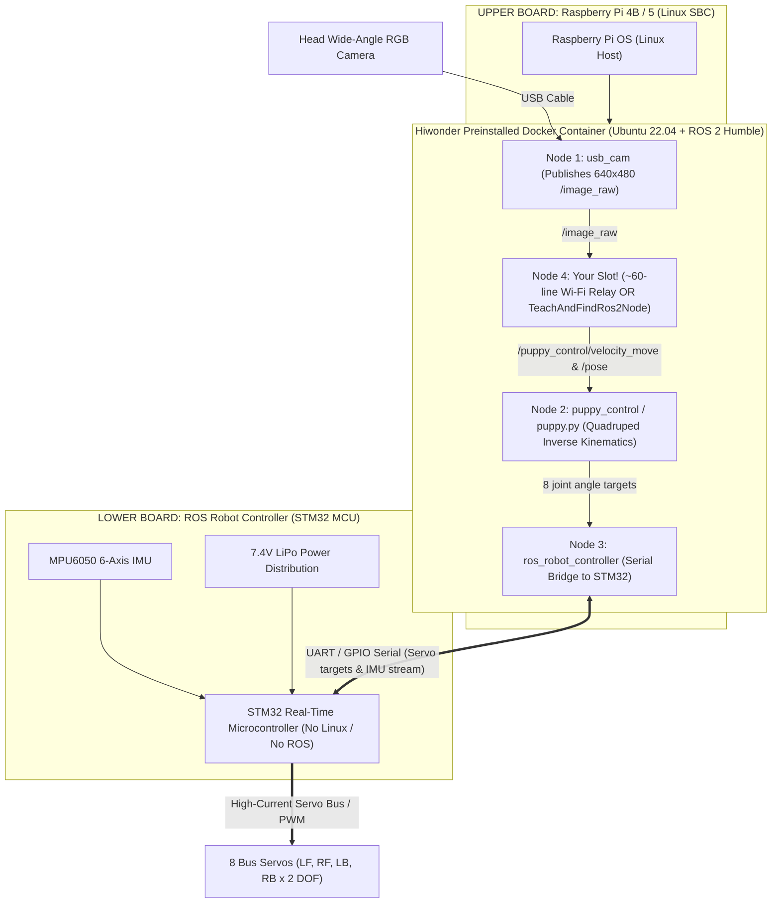
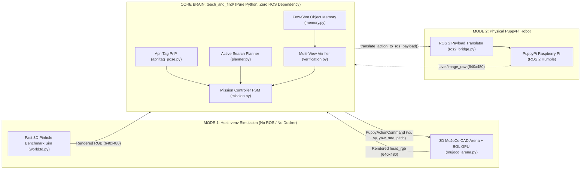
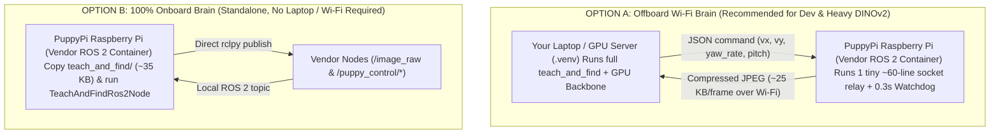
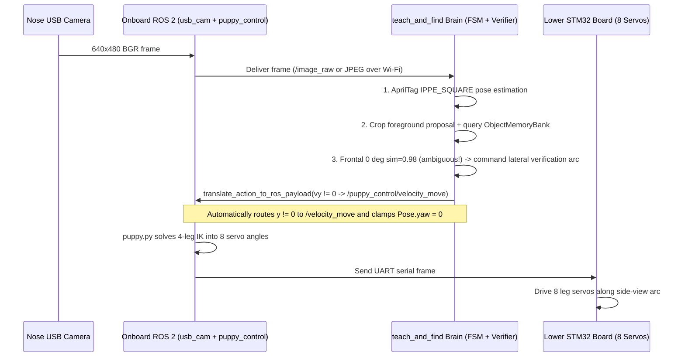

# 05. PuppyPi Hardware Stack, ROS 2 Role & Portable Sim-to-Real Guide

This guide visually explains **what runs inside the physical PuppyPi Standard boards**, **what role ROS 2 plays**, **where the MuJoCo 3D simulator sits**, and **how `teach_and_find` ports to the real robot with minimal friction**.

---

## 1. Inside the Physical PuppyPi Standard (Two Boards + Full Onboard ROS 2)

A physical Hiwonder PuppyPi Standard carries **two stacked circuit boards**. The upper **Raspberry Pi** runs the **entire Linux + ROS 2 Humble environment (multiple ROS 2 nodes simultaneously)**, while the lower **STM32 expansion board** handles real-time servo PWM and battery power:

Key takeaway: **Nodes 1, 2, and 3 are already preinstalled and auto-started by Hiwonder on boot.** You never rewrite camera drivers, inverse kinematics, or STM32 serial packets — your software simply plugs in as **Node 4**.

---

## 2. Clean Sim-to-Real Boundary ("Zero-ROS Core")

All intelligence in `teach_and_find/` is written in **pure Python (`numpy` + `opencv`) with zero hard dependency on `rclpy` or `mujoco`**. The boundary between the brain and the body consists of **one input (`frame_bgr`)** and **one output (`PuppyActionCommand`)**:

---

## 3. Two Portable Deployment Modes on Real Hardware

| Criterion | Option A — Offboard `.venv` + Thin Relay on Pi | Option B — 100% Onboard inside Pi ROS 2 Container |
| :--- | :--- | :--- |
| **Files copied to PuppyPi** | **1 script (~60 LoC)** | `teach_and_find/` package (~35 KB) |
| **Extra `pip` packages on Pi** | **Zero** (uses vendor `rclpy`, `cv2`, `socket`) | **Zero** for spatial encoder; `onnxruntime` for quantized DINOv2 |
| **Compute budget** | Full laptop/workstation GPU | Raspberry Pi 4B / 5 CPU |
| **Wi-Fi disconnect safety** | Onboard `0.3 s` watchdog stops all servos immediately | Independent of Wi-Fi |

---

## 4. End-to-End 150 ms Control Tick Sequence

