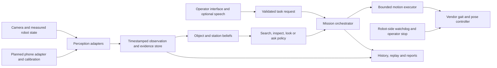

# PuppyPi shared system architecture

The five R&D tracks extend the existing `teach_and_find` package. Keep one set
of perception adapters, evidence records, mission contracts, and motion limits.
The table below describes target contracts; the implemented subset is called out
separately. Do not treat the complete table as an available API.

## Existing and proposed boundaries

Existing: `config.py`, perception interfaces, `ObjectMemoryBank`, planners,
`VerificationSession`, mission FSM, ROS 2 translation, TCP relay, and synthetic
evaluation. The local operator slice adds `storage.py` (SQLite migrations and PNG
evidence), `library.py` (persistent objects/assertions), `inspection.py` (checklists,
recorded-evidence rules and reports), and `cli.py`. It adapts persisted records
into the existing bank. Proposed: automatic mission-to-store observation capture,
typed task requests, route executor, question/answer state, automatic inspection
perception, and a live operator interface.

Keep ROS imports inside adapters and robot entry points. Model-specific tensors
and response formats must be converted into project-owned observations before
entering policy code. A detector produces candidates; a verifier produces an
instance decision; neither directly commands motion.

## Shared records

| Record | Required information | Rule |
| --- | --- | --- |
| Object identity | Stable ID, display name, reference image IDs, encoder signature, prototypes | Names can change without changing identity; reject incompatible embedding versions |
| Observation | ID, capture timestamp, station/pose estimate, source frame, object hypotheses, quality, visibility | Preserve capture time separately from receive/processing time |
| Camera/session, planned | Camera ID, clock mapping/error, calibration revision, orientation, resolution and pose validity | A changed phone pose or lens invalidates fixed calibration; never fuse by arrival time alone |
| Belief | Object/station hypotheses, supporting observation IDs, update time, freshness | Derived state can change; original evidence remains immutable |
| Task | ID, validated kind, target/rules, time/view/question budgets | Unknown or unsupported requests produce a typed error |
| Action | ID, skill, bounded arguments, expiry, execution status | Distinguish requested from achieved motion; reject stale commands |
| Finding | Predicate, pass/fail/unknown, evidence IDs, observation time | A missing or obscured observation produces unknown, not pass |
| Mission result | Outcome, stop reason, findings, interventions, evidence references | Task confirmation and successful return HOME are separate outcomes |

Persistence uses SQLite metadata and file-backed evidence crops under an
ignored data directory, with explicit schema versions and migrations. A vector
database is optional only when measured scale warrants it. Keep reference crops
and observation evidence outside application logs.

## Module ownership for implementation

- Extend `perception/` with pretrained proposal and encoder adapters. Keep the
  deterministic spatial encoder for offline tests and controlled baselines.
- Add durable observation storage and belief updates behind a small service
  boundary; preserve the current `ObjectMemoryBank` interface during migration.
- Implement route execution separately from station selection. The planner's
  chosen station is not evidence that the robot physically reached it.
- Extend mission orchestration with explicit clarification, inspection,
  cancellation, timeout, and inconclusive states. Do not fork four controllers.
- Put operator-facing flows and optional speech over the same task service.
  Human responses must identify the pending mission/question to reject late input.
- Generate reports from stored findings and image IDs. Natural language summaries
  must not silently introduce findings unsupported by those records.

## Reuse register

Reviewed on 2026-10-31. Availability means repository inspection, not successful
execution on PuppyPi. Pin a revision and record license/checkpoint provenance
when an integration is actually selected.

| Upstream | Reusable component | Integration boundary and limitation |
| --- | --- | --- |
| [YOLOE](https://github.com/THU-MIG/yoloe) | Pretrained text/visual-prompt proposals | Replace foreground proposals; instance identity still requires verification |
| [DINOv2](https://github.com/facebookresearch/dinov2) / [DINOv3](https://github.com/facebookresearch/dinov3) | Frozen visual descriptors | Compare on real low-resolution crops; backbone-specific preprocessing and model access must be explicit |
| [IEVE](https://github.com/XiaohanLei/IEVE) | Explore/verify switching and instance matching | Habitat dependencies stay out of the robot runtime |
| [ReMEmbR](https://github.com/NVIDIA-AI-IOT/remembr) | Temporal/spatial retrieval structure | Adapt to station-based memory; full vector database/VLM stack is optional |
| [DynaMem](https://dynamem.github.io/) | Dynamic-memory update concepts | RGB-D/Stretch implementation; use as related work or adapt selected components |
| [DovSG](https://github.com/BJHYZJ/DovSG) | Dynamic object/relation updates | Original 3D graph uses RGB-D; station relations are a scoped alternative |
| [KnowNo](https://github.com/google-research/google-research/tree/master/language_model_uncertainty) | Help requests and uncertainty calibration | Adapt candidate scoring and evaluate assumptions on robot data |
| [Explore until Confident](https://github.com/Stanford-ILIAD/explore-eqa) | Exploration, stopping, QA evaluation | Simulation/depth stack requires adaptation |
| [ViNT/NoMaD](https://github.com/robodhruv/visualnav-transformer) | Checkpoints and demonstrated-route navigation | Adapt velocity control, camera geometry, and low-viewpoint domain shift |
| [VLFM](https://github.com/rai-opensource/vlfm) | Semantic frontier selection | Depth-based occupancy map; not a direct RGB-only deployment |
| [RoboHop](https://github.com/oravus/RoboHop) | Topological representation paper | Linked repository contained only README; not an implementation dependency |
| [AprilTag](https://github.com/AprilRobotics/apriltag) / [OpenCV](https://docs.opencv.org/4.x/d9/d0c/group__calib3d.html) | External pose and camera calibration baseline | Reuse existing tag detection; measure phone/world/body transforms and invalidate stale calibration |
| [aiortc](https://github.com/aiortc/aiortc) | Browser-to-host video/data-channel transport | Optional phone adapter; timestamp mapping, secure capture and disconnect handling require integration |
| [Ego4D / Ego-Exo4D tools](https://github.com/facebookresearch/Ego4d) | Multi-camera dataset utilities and synchronization conventions | Human activity data; no direct robot policy transfer; dataset terms separate from code |

The [Phone Observer design](11-phone-observer-research.md) details these last
three entries, their source availability, geometry, and evaluation limits. The
current evidence schema needs a migration before it can represent camera sessions
and clock uncertainty; do not create a separate phone-only memory store.

## Physical execution prerequisites

Preserve the relay watchdog and motion clamps. Confirm velocity units and
firmware behavior on the actual kit. The existing lateral routing and zero pose
yaw are source-audit assumptions that need physical verification. Start with
short forward/turn/stop skills; add other motions only after characterization.

Use frame-age checks and monotonic command deadlines. A slow VLM request must
not keep an old movement alive. Reconnection should return to an idle state
until mission state is explicitly reconciled. Keep the relay on a trusted local
network; it is not an authenticated public robot API.

The initial navigation environment consists of validated clear routes. Neither
AprilTags nor a language model provide general obstacle avoidance. Autonomous
replanning around unknown obstacles is a separate navigation capability.

## Implementation sequence

1. Capture timestamped real camera observations and characterize movement.
2. Benchmark real-object proposals and instance descriptors offline.
3. Add persistent objects, sightings, and evidence retrieval.
4. Complete one operator-controlled search flow with recovery and stop.
5. Reuse persistence and route execution for checklist inspection and reports.
6. Add freshness-aware beliefs, calibrated abstention, and look-or-ask policy.
7. Add body-aware observation and optional speech/visual-route navigation.

Model names, endpoints, storage paths, thresholds, and motion defaults belong in
`Settings` and environment configuration. Keep checkpoint downloads, GPU use,
external model calls, and hardware actuation opt-in during development.
