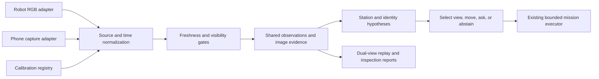

# Phone Observer: external vision for PuppyPi Standard

Status: **Planned**. User-confirmed constraints on 2026-10-31: PuppyPi Standard
and more than three months for development/research. This document adds a fifth
research track and a concrete integration plan; no phone stream, camera fusion,
or externally guided robot motion has been implemented in this repository yet.

## Product direction

Use one phone on a fixed stand as a third-person observer of the demo area. The
robot camera supplies close views of objects, while the phone supplies broader
coverage and an external view of the robot. This is an ego/exo camera pair: the
phrase third-person does not require three physical cameras.

The first demonstration should show an object moved while PuppyPi looks away.
The phone supplies a new station hypothesis with a timestamp and image. PuppyPi
visits that station using a validated route and verifies the exact object using
its own camera. If either view is stale or obscured, the system displays unknown
and requests another view rather than inventing a confirmed location.

The shared services also support a second scenario: the low robot view cannot
establish whether an expected item is on a table, but the elevated phone view can.
An inspection report shows which camera provided each finding. A phone view can
improve observability; it cannot guarantee exact-instance identity from tiny crops.

Start with a fixed rear camera, stable resolution/orientation, an operator host,
and printed calibration markers. Do not require a depth camera, LiDAR, phone
depth API, robot arm, or a large model running on the Pi. The vendor lists multiple
Pi/ROS and accessory configurations, so Standard alone does not identify the
installed board or firmware. Check the actual kit before deployment.
[Hiwonder product specifications](https://www.hiwonder.com/products/puppypi).

## Related work and reusable code

Reviewed 2026-10-31. Repository availability means source inspection, not that an
integration was run. No upstream code, weights, or datasets were downloaded into
this project during this review. Pin a commit and record terms before importing.

| Work | Established idea / available component | Proposed use and limitation |
| --- | --- | --- |
| [Bultmann et al., ICRA 2023](https://arxiv.org/abs/2303.03797), [full paper](https://arxiv.org/html/2303.03797) | External fixed RGB cameras estimate robot pose from learned robot keypoints and fuse observations across views | Closest robotics motivation. Original system uses multiple calibrated cameras, a robot-specific keypoint model, and a different platform; its measured accuracy is not transferable to one phone/PuppyPi. A usable official implementation was not verified in this review; treat as method reference. |
| [Ego-Exo4D](https://ego-exo4d-data.org/), [official tools](https://github.com/facebookresearch/Ego4d) | Synchronized, calibrated human egocentric and stationary exocentric video; download/visualization utilities are available | Borrow capture manifests, alignment, and paired-view evaluation practices. This is human activity data, not a pretrained PuppyPi navigation policy. Code is MIT; dataset access/terms are separate. |
| [AprilTag 3](https://github.com/AprilRobotics/apriltag), [license](https://github.com/AprilRobotics/apriltag/blob/master/LICENSE.md) | Public C/Python detector and marker pose estimation, BSD-2-Clause | A marker on a rigid robot body mount plus world-reference markers provides a practical external-pose baseline. Reuse existing OpenCV tag handling first; a second detector is optional. |
| [OpenCV calibration and pose](https://docs.opencv.org/4.x/d9/d0c/group__calib3d.html) | Camera intrinsics/distortion, PnP, homographies and coordinate transforms | Calibrate the phone and estimate camera/world/robot transforms. A floor homography only maps points on that plane; it does not localize elevated object pixels correctly. |
| [aiortc](https://github.com/aiortc/aiortc), [browser/server example](https://github.com/aiortc/aiortc/tree/main/examples/server), [example instructions](https://raw.githubusercontent.com/aiortc/aiortc/main/examples/server/README.rst) | Python WebRTC implementation with browser video and data-channel example, BSD-3-Clause | Optional phone-browser adapter on the host. Reuse the transport pattern; add session pairing, timestamps, bounded buffering, and disconnect handling. The example alone is not a calibrated or synchronized robotics camera. |

Browser capture requires permission and a suitable secure context. Plan trusted
HTTPS for a phone reaching the host over LAN and test both target browser and
background/screen-lock behavior. Do not assume desktop localhost examples work
unchanged on a remote phone. [Media Capture and Streams specification](https://www.w3.org/TR/mediacapture-streams/).

## Feature acceptance

| ID | Operator-visible capability | Required evidence before promotion |
| --- | --- | --- |
| F33 | Connect a phone and view both cameras | Live images carry source, capture time, frame age, and connection state; disconnect makes the view unavailable |
| F34 | See PuppyPi's external position on the station map | Calibrated pose with uncertainty/validity; measured reference positions; occluded marker or moved phone invalidates the estimate |
| F35 | Confirm an object or inspection condition across two views | Exact object/station agreement with both evidence sources; contradictions remain unresolved until re-observation |
| F36 | Request the most useful available view | Policy chooses robot observation, phone observation, feasible robot movement, or human clarification; logs expected and measured benefit/cost |
| F37 | Replay a synchronized ego/exo mission | Export paired timelines with source IDs, missing frames, clock uncertainty, calibration revisions, and evidence links |

Object relocation remains F12, and inspection export remains F25. These become
richer with a phone source; do not count the same behavior again as a new feature.
F34 is localization, not obstacle avoidance. Initially use its pose for display,
offline evaluation, and reacquisition proposals. Closed-loop motion requires
validated routes, frame-age checks, the existing watchdog, and stop-on-loss tests.

## Integration design

Extend the existing evidence service with an explicit database migration, not a
second memory store. The current v2 schema stores evidence mode/source but has no
camera ID, calibration ID, capture clock uncertainty, or frame-pair association.
Do not claim current `source=operator` records already support camera fusion.

Planned records: camera/session ID, sequence number, device capture timestamp,
host receive timestamp, mapped host monotonic capture time, offset uncertainty,
calibration revision, exposure/orientation/resolution, image hash, and measured
pose with validity. Preserve each source independently; a fused hypothesis links
observation IDs and its derivation. A network arrival timestamp is not capture
time. Pair within a measured time tolerance; reject or mark ambiguous when clock
uncertainty exceeds that tolerance. Never count adjacent correlated frames as
independent confirmations.

Calibrate phone intrinsics at the deployed lens, zoom, resolution, and orientation.
Use a rigid world board visible in the operating region for extrinsics and a
measured tag-to-body transform. Define `T_A_B` as mapping B coordinates into A;
then `T_world_body = T_world_phone * T_phone_tag * T_tag_body`. Validate units and
axes on measured test poses. A moved phone, changed lens/zoom, or changed crop
invalidates the fixed calibration until re-estimated. Pose estimation can be
ambiguous with a small/oblique planar tag; reject unstable solutions using
reprojection checks and measured temporal consistency instead of smoothing blindly.

For objects, begin with calibrated station regions and cross-view instance
descriptors. A phone hint proposes a station; a close robot view verifies identity.
Do not infer metric 3D object location by projecting arbitrary object pixels onto
the floor. Do not put identity tags on target objects in an appearance-recognition
experiment. Robot/world markers are allowed and must be disclosed to all baselines.

A handheld phone is a later extension. It requires per-frame camera pose and
clock mapping, potentially through platform-specific tracking, plus relocalization
and drift assessment. Fixed-camera calibration cannot be reused after movement.

## R5: when is an external view worth requesting?

**Question:** can a single external camera reduce wasted locomotion and wrong
confirmations under low viewpoints, occlusion, and stale object memory?

**Hypothesis:** selecting views using visibility, freshness, clock uncertainty,
and expected information gain achieves comparable instance/inspection accuracy
with less travel or fewer user questions than ego-only and always-fuse methods.
This is a proposed contribution to evaluate; adding WebRTC and AprilTags is an
engineering baseline, not a novelty claim.

Start with deterministic quality/freshness gates and measured action costs.
Then compare a cost-aware policy against those gates. Use one shared descriptor
and candidate list across variants so gains cannot be attributed to changing the
backbone. R1 supplies stale-memory cases; R2 supplies the clarification action;
R3 supplies inspection predicates; R4 supplies feasible robot observation actions.

| Variant | Sensor access / decision rule | Purpose |
| --- | --- | --- |
| Ego only | Robot camera, same memory/navigation | Existing-system baseline |
| Exo only | Phone observations; bounded executor unchanged | Measure how much the fixed view alone solves |
| Always fuse | Both views, latest-frame rule | Simple fusion baseline and failure analysis |
| Gated fusion | Both views, fixed freshness/quality thresholds | Strong engineering baseline |
| Selected view | Both views, cost-aware observation/clarification policy | Proposed method |
| Oracle selection | Offline labels identify the useful view | Diagnostic upper reference; never report as deployable |

Run both equal wall-time/action-budget and equal processed-frame-budget analyses.
Disclose unequal fields of view and camera counts. Split enrollment, policy tuning,
and evaluation by day/layout/physical object; all cameras from one episode stay
in the same split. Include moved/absent targets, look-alikes, robot-view occlusion,
phone-view occlusion, bad lighting, deliberate phone displacement, stream dropout,
and replayed clock skew/latency. Validate fault handling while stationary before
any physical moving trial.

Measure exact-instance success, false confirmation, missing/misplaced precision
and recall, unknown/coverage, time, measured travel, questions, bytes/frames sent,
and interventions. For localization, use independent measured poses or an
independent reference camera; never score the phone estimate against itself.
Log median/p95 stream age, timestamp uncertainty, pose error, and recovery time.
Report paired episode-level intervals, not confidence intervals over video frames.

## Suggested schedule for a horizon longer than three months

This is an adjustable 16-week allocation, not a confirmed deadline or staffing
assumption. Keep R1 + R5 as the principal experimental story; build the other
tracks as application capabilities before committing to five separate research claims.

| Window | Work | Exit evidence |
| --- | --- | --- |
| Weeks 1–2 | Verify Standard kit, camera, bounded motion/stop; exercise persistent library | One measured route and object enrollment; explicit firmware/calibration record |
| Weeks 3–5 | Phone capture, timestamps, calibration, pose display, paired recorder | F33/F34/F37 replay and stationary physical acceptance, including disconnect/moved phone |
| Weeks 6–8 | One operator flow for memory, find, checklist, evidence; cross-view station hints | Shared-store integration; exact-instance verification and contradiction handling |
| Weeks 9–12 | R1/R5 policies and held-out baselines; add look-or-ask if time permits | Paired comparisons, latency/occlusion ablations, failure logs |
| Weeks 13–16 | Physical repetitions, grading demo, report and reproducibility package | Full denominators, interventions, independent pose reference, reproducible artifacts |

Next concrete step: implement camera/session records and a prerecorded dual-view
adapter with controlled clock skew and camera movement tests. Follow with phone
capture; only then enable external-pose proposals for the motion executor.
