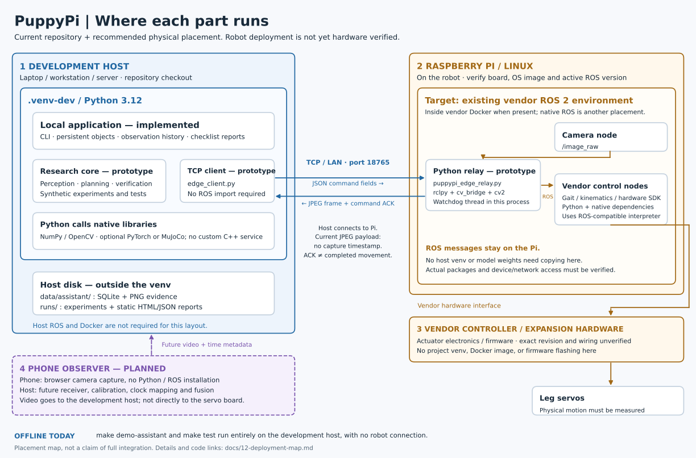
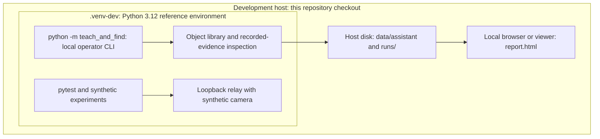
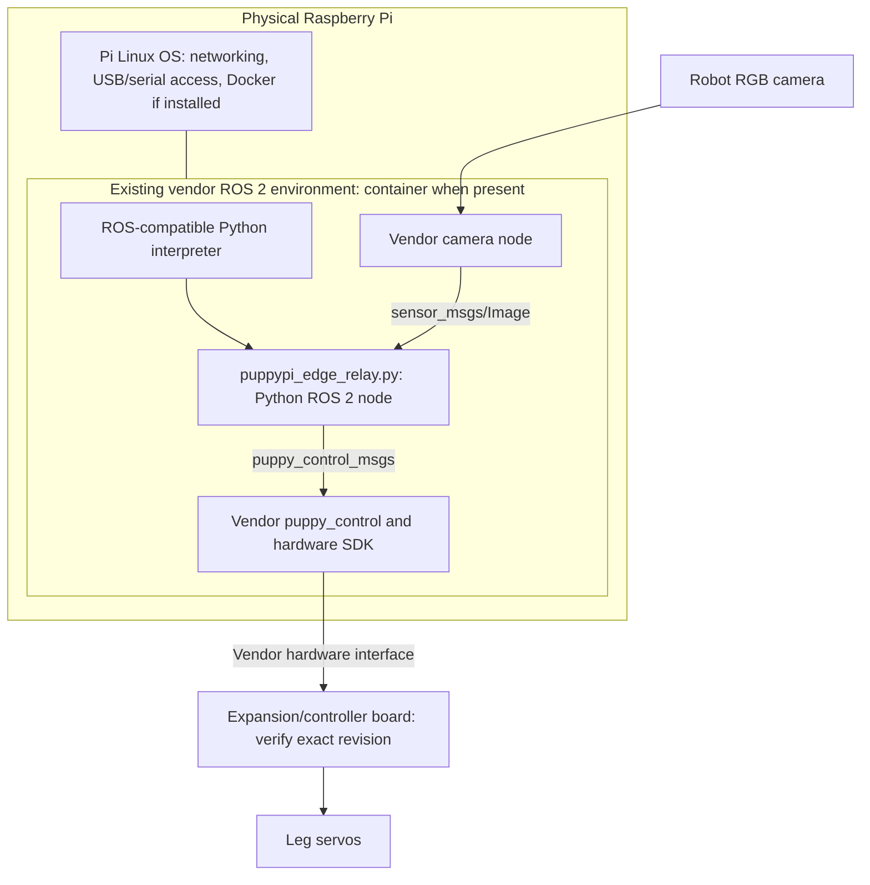
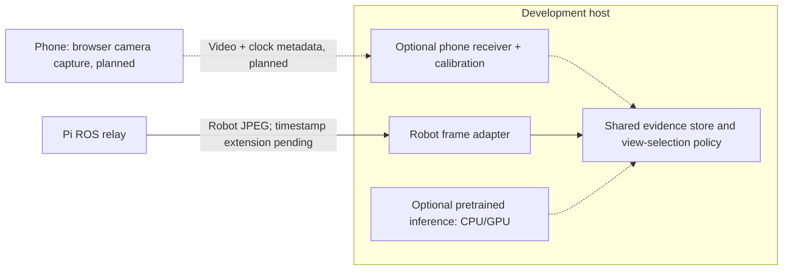

# Deployment map: host, Python, Docker, ROS, and the Pi

Reviewed against repository code on 2026-10-31. This is the current deployment
explanation; [02](02-deployment-and-hiwonder-driver-audit.md) and
[05](05-hardware-ros2-sim2real-guide.md) remain historical designs with assumptions
that are corrected below. No robot or phone was connected during this review.

**Recommended physical layout:** application/perception on the development host
in `.venv-dev`; camera/motion drivers and the Python relay in the Pi's existing
ROS environment; actuator control on the vendor hardware. A phone is a planned
additional camera source for the development host.

**What runs today:** the supported CLI, storage, reports, synthetic experiments,
and loopback tests run entirely on the development host. The relay and ROS 2
adapter exist, but a complete physical search/inspection application is pending.



[Open the scalable diagram](diagrams/deployment-map.svg) or
[the PNG version](diagrams/deployment-map.png). Boxes represent placement and
ownership, not separate mandatory services. Python modules may share one process.
The phone path is planned; the robot path is hardware unverified.

## 1. These terms describe different layers

| Term | What it means here | What it does not imply |
| --- | --- | --- |
| Development host | Laptop/workstation/server running this checkout | A Pi container is not running on this machine merely because the host controls the robot |
| Pi host OS | Linux running on the physical Raspberry Pi | This is a second use of “host”: it hosts the robot's containers, not the offboard application |
| Python / C++ | Languages and their runtimes/native libraries | A language does not determine which physical machine runs the code |
| Python venv | An interpreter/dependency environment, currently `.venv-dev/` | It is not a separate computer, Linux installation, or running service |
| Docker container | An isolated set of processes and userspace dependencies, sharing its Linux host kernel | It does not replace the physical Pi or automatically supply ROS/device access |
| ROS 2 | Libraries, messages, discovery and tools connecting robot processes (“nodes”) | Despite its name, ROS is not the Linux OS; nodes may use Python or C++ |
| Vendor controller/firmware | Hardware-specific actuator/sensor interface below the Pi software | This repo does not flash its firmware or deploy a Python venv onto it |

For example, one relay process can simultaneously be **Python code**, a **ROS 2
node**, run **inside a Docker container**, and execute **on the Raspberry Pi**.
These labels describe the same process at different layers.

## 2. What runs on the development host now



Run these in this repository on the development host:

```bash
make setup
make demo-assistant
.venv-dev/bin/python -m teach_and_find objects list
make check
make test
```

`make setup` uses `uv` and the lockfile to create/update `.venv-dev`. Make targets
select that environment without needing `source .../activate`. An existing
`.venv` is preserved. `python -m teach_and_find` without an explicit interpreter
requires the correct environment to be activated first.

The normal library uses `data/assistant/`; the demo deliberately creates its own
state inside a fresh `runs/assistant-demo/run-.../` directory. These are host-disk
data directories, outside the venv. The report is a static HTML file with local
images, not a web server or a running robot dashboard.

## 3. Recommended physical placement and exact code ownership

| Component | Machine and environment | Language / runtime | Repository entry point | Current status |
| --- | --- | --- | --- | --- |
| Operator CLI, enrollment, history | Development host, `.venv-dev` | Python | [cli.py](../teach_and_find/cli.py), [library.py](../teach_and_find/library.py) | Integrated local workflow |
| Persistent evidence and checklist reports | Development host, `.venv-dev`; data on host disk | Python + SQLite native library | [storage.py](../teach_and_find/storage.py), [inspection.py](../teach_and_find/inspection.py) | Integrated; assertions supplied by operator/fixture |
| Perception, matching, planner, verifier, mission state | Development host, `.venv-dev` | Python calling NumPy/OpenCV | [perception](../teach_and_find/perception), [planner.py](../teach_and_find/planner.py), [verification.py](../teach_and_find/verification.py), [mission.py](../teach_and_find/mission.py) | Prototype with synthetic evidence; physical orchestration incomplete |
| Robot TCP client | Development host, `.venv-dev` | Python sockets + OpenCV JPEG decoding | [edge_client.py](../teach_and_find/edge_client.py) | Loopback tested; library API, not a complete live mission command |
| ROS message field translation | Same process as the client | Python dataclasses; no ROS import required for translation | `translate_action_to_ros_payload` in [ros2_bridge.py](../teach_and_find/ros2_bridge.py) | Software tested |
| Camera/command TCP relay and timeout callback | Pi, existing ROS 2 environment, usually vendor container after verification | Python + `rclpy`, `cv_bridge`, `cv2`, NumPy, vendor messages | [puppypi_edge_relay.py](../scripts/puppypi_edge_relay.py) | Source exists; mock tests only |
| Camera publisher, gait/kinematics, hardware SDK | Pi, vendor ROS environment | Vendor Python/native binaries; actual package set depends on image | Vendor `puppy_control`, camera and hardware-controller packages | External dependencies; not bundled or verified on this kit |
| Servo signals and board-level control | Vendor expansion/controller hardware | Vendor electronics/firmware; exact revision unverified | No project firmware entry point | Preserve vendor implementation |
| Synthetic scenes and optional MuJoCo rendering | Development host, development/simulator environment | Python; optional native MuJoCo and graphics stack | [sim](../teach_and_find/sim), [render script](../scripts/render_3d_puppypi_sim.py) | Offline baseline/rendering, not physical gait validation |
| Optional pretrained model inference | Initially development host, explicitly configured Python/model environment | Optional PyTorch/native CPU or CUDA backend | [encoder.py](../teach_and_find/perception/encoder.py) | Adapter exists; torch/checkpoints are not installed by default |
| Phone capture | Phone browser or future native capture adapter | Browser media APIs / JavaScript, or native app | No implemented entry point | Planned |
| Phone receiver, calibration, fusion, dual-view UI | Development host, future optional adapter/runtime | Proposed Python aiortc/OpenCV plus browser UI | [Phone Observer plan](11-phone-observer-research.md) | Planned; no receiver/server dependency installed |

There is **no project-owned C/C++ source target, CMake build, ROS package manifest,
Dockerfile, or Compose stack** in this repository. `make build` builds the Python
wheel/source distribution; it does not compile robot firmware or build an image.
The CAD/Xacro files are source assets, not a complete ROS workspace.

OpenCV/NumPy and optional PyTorch/MuJoCo execute native code behind Python APIs.
Calling `cv2.aruco` does not mean a separate C++ service must be deployed. The
current tag estimator uses OpenCV, not a separately deployed AprilTag daemon.
A new C++ node is only a future option if profiling shows a concrete need.

## 4. The Pi stack and Docker boundary



Hiwonder's current guide describes a Docker-based ROS 1/ROS 2 switching workflow
and says ROS 1 is enabled by default in that workflow. Therefore neither
“Standard” nor “Pi 5” proves that this unit is currently running ROS 2.
Verify the installed image and active environment before choosing the adapter.
[Vendor Docker/ROS guide](https://docs.hiwonder.com/projects/PuppyPi/en/latest/docs/3.Remote_Tool_Installation_Connection.html).

For the offboard design, the Pi needs the relay script and its existing compatible
ROS dependencies. It does not need the complete research repository, model weights,
SQLite evidence library, host venv, or host GPU stack. The script's historical
“zero-dependency” description means it was intended to reuse vendor packages;
it still imports OpenCV/NumPy and, in live mode, ROS/vendor modules. Availability
on the actual image has not been checked.

Use the Python interpreter matching the Pi's installed ROS binaries. Do not copy
the host `.venv-dev` directory to the Pi or point the relay at the host's Python
3.12 environment: machine architecture and binary/Python versions can differ.
ROS's own packaging guidance requires the interpreter to match its binary build.
[Official ROS Python guidance](https://github.com/ros2/ros2_documentation/blob/humble/source/How-To-Guides/Using-Python-Packages.rst).

If ROS 2 is installed natively on a particular Pi image, the relay belongs in that
native ROS environment; the architecture does not require adding Docker just to
run the relay. If it is inside a container, the relay must share the relevant ROS
network/domain and see the required packages. The Pi must also expose the relay's
TCP port through its existing container network arrangement. Binding inside a
container does not by itself make that port reachable from the development host.

The lower-board STM32 model, IMU, servo wiring/protocol, and exact driver chain
shown in historical diagrams are not verified for this user's unit. The current
map deliberately labels the vendor controller boundary without promising those
electrical details. The project sends high-level commands into the existing driver
stack; it does not implement or flash controller firmware.

## 5. What crosses Wi-Fi, and what stays inside ROS

The **host initiates a TCP connection to the Pi relay**, which listens on the
configured port (default 18765). The host does not subscribe to ROS topics in this
mode. Python/ROS versions on the two computers need not match for this byte protocol.

```mermaid
sequenceDiagram
    participant H as Host Python client
    participant R as Pi Python relay
    participant C as Pi camera ROS node
    participant V as Pi vendor motion node
    C->>R: /image_raw (latest buffered image)
    H->>R: F (request a frame)
    R-->>H: 4-byte length + JPEG bytes
    Note over H: Decode and evaluate in host Python
    H->>R: C + 4-byte length + JSON fields
    R->>V: Velocity / Pose / optional Gait messages
    R-->>H: O (application callback returned)
    Note over H,V: ACK is not measured motion completion
    Note over R,V: Timeout handler publishes zero velocity; physical stop must be measured
```

| Link | Actual / proposed payload | Status |
| --- | --- | --- |
| Host to Pi, TCP 18765 by default | `F` frame request; `C` length-prefixed JSON command | Implemented, loopback tested |
| Pi to host, same connection | JPEG image or empty frame; one-byte command acknowledgement | Implemented, loopback tested |
| Camera to relay, inside Pi ROS | `sensor_msgs/Image`, default `/image_raw` | Live code exists; topic/environment unverified |
| Relay to vendor control, inside Pi ROS | `/puppy_control/velocity`, `/velocity_move`, `/pose`, optional `/gait` | Live code exists; movement unverified |
| Phone to development host | Proposed video plus camera/session/time metadata | Planned; no selected production endpoint or fixed port |
| CLI to browser/report viewer | Files on host disk | Implemented; no HTTP service required |

The current frame wire format contains **no capture timestamp, sequence number,
or camera identity**; `get_frame()` returns an array or `None`. It can return the
same buffered frame repeatedly. The durable observation API can store timestamps,
but the relay does not yet transport them. Timestamped evidence and frame-age
gates must be integrated before claiming fresh physical or synchronized ego/exo
perception.

The timeout watchdog runs in a **Python thread on the Pi relay process**, not in
the host model and not in independently verified board firmware. Its default
timeout is 0.30 seconds; the loopback test checks that a halt callback occurs.
This does not establish a 300 ms physical stopping time or protection if the relay
process/driver itself hangs. The host's command builder bounds commands, but the
current relay is not an authenticated, fully validated task gateway. These are
known physical-integration gaps, not completed safety capabilities.

## 6. Three deployment modes, with honest status

| Mode | Host requirements | Pi requirements | What is available |
| --- | --- | --- | --- |
| A. Offline development | Python `.venv-dev`; CPU baseline; optional simulation extras | None | Supported CLI/demo/tests today |
| B. Offboard application + Pi relay | Python `.venv-dev`; optional model backend; TCP reachability | Existing ROS 2 packages and compatible Python; relay; vendor drivers | Preferred integration direction; transport prototype exists; full live mission pending |
| C. Entire application onboard | Optional operator terminal | Project dependencies and compute inside a ROS-compatible environment | Experimental alternative, not a delivered standalone application |

`create_ros2_node()` in `ros2_bridge.py` is a **direct ROS 2 adapter alternative**
to the offboard TCP boundary. Its present timer only covers station selection and
tag alignment/recovery. It is not a complete autonomous search/verification/report
loop and is not a ready-made launch command. The module's field translator is
also reused by the TCP client without importing ROS at all.

The current live adapters use `rclpy` and ROS 2 messages. There is no `rospy`
ROS 1 relay implementation, `ros1_bridge` integration, or generic distribution
compatibility layer. A ROS 1 image requires an adapter implementation or an
explicitly verified vendor ROS 2 setup. No ROS installation/switch was performed
for this documentation task.

Host Docker/ROS is optional future packaging, not a prerequisite for mode B.
Keeping ROS local to the robot also avoids making the application depend on
cross-distribution ROS networking. Historical “Jazzy and Humble are always
wire-incompatible” claims are too broad; this design simply does not require that
interoperability. No universal compatibility claim is made here.

## 7. Where the phone and larger models fit later



In the first phone design, the phone captures video and the development host
processes it. The phone needs no project Python venv, Docker container, or ROS
installation. The Pi keeps the camera/control adapter; it does not need to absorb
the second video stream. A separate GPU inference service is a possible later
deployment, but the existing optional encoder loads a model inside Python; there
is no implemented model-serving container, API, or mandatory cloud endpoint.

## 8. Identify the actual Pi environment before deployment

These are **manual read-only inventory steps**, not commands run during this
review. Open an SSH/VNC terminal on the Pi Linux host first:

```bash
cat /proc/device-tree/model
cat /etc/os-release
uname -m
docker ps --format 'table {{.Names}}\t{{.Image}}\t{{.Ports}}'
```

If Docker is absent or the user lacks access, record that result; do not install
or reset the robot image merely to match the diagram. If the existing ROS stack
is containerized, enter the observed container using the vendor's access method.
For example, replace the placeholder with the name returned above:

```bash
PUPPYPI_CONTAINER='replace-with-observed-container-name'
docker exec -it "$PUPPYPI_CONTAINER" bash
```

Inside the existing ROS shell, inspect the environment without starting motion:

```bash
printenv ROS_VERSION ROS_DISTRO
python3 --version
command -v python3
```

Only if this is the intended ROS 2 environment:

```bash
ros2 node list
ros2 topic list
ros2 topic info /image_raw
python3 -c 'import rclpy, cv2, numpy, cv_bridge; from puppy_control_msgs.msg import Velocity, Pose, Gait; print("relay imports available")'
```

An empty ROS variable or missing CLI may mean the shell has not loaded the
existing environment; use the installed vendor workspace setup, whose location
must be observed rather than guessed. Inventory results should record board,
OS/architecture, container image, ROS/Python versions, camera topic, and package
availability. They do not verify movement, stop response, or camera calibration.

## 9. Corrections to the historical diagrams

| Earlier wording or drawing | Current interpretation |
| --- | --- |
| Everything shown as already connected | Host workflows are integrated; robot deployment and phone fusion are pending |
| `.venv` as the current development environment | Use `.venv-dev`; preserve the older environment |
| Model names and dashboard in host diagram | Default perception is the spatial encoder; pretrained adapters are opt-in and live dashboard is planned |
| Tiny “zero-dependency” relay works with ROS 1 and ROS 2 | Actual relay is Python with native/ROS dependencies and implements ROS 2 only |
| Workstation listens for the robot | Current client connects to the server on the Pi |
| Wi-Fi frames already carry usable capture time | Current JPEG protocol does not carry it |
| Watchdog immediately halts all servos in hardware | Python timeout calls a zero-velocity publisher; physical response remains unmeasured |
| Complete onboard FSM or closed-loop MuJoCo deployment | ROS timer is partial; synthetic rendering/animations do not validate full physical control |
| Exact STM32/IMU/wiring and automatic startup on every kit | Verify the actual controller revision and installed image; the map preserves vendor ownership |

Use this page for placement, [08](08-system-evolution.md) for shared software
contracts, [10](10-operator-workflows.md) for runnable local workflows, and
[11](11-phone-observer-research.md) for the future camera integration.
