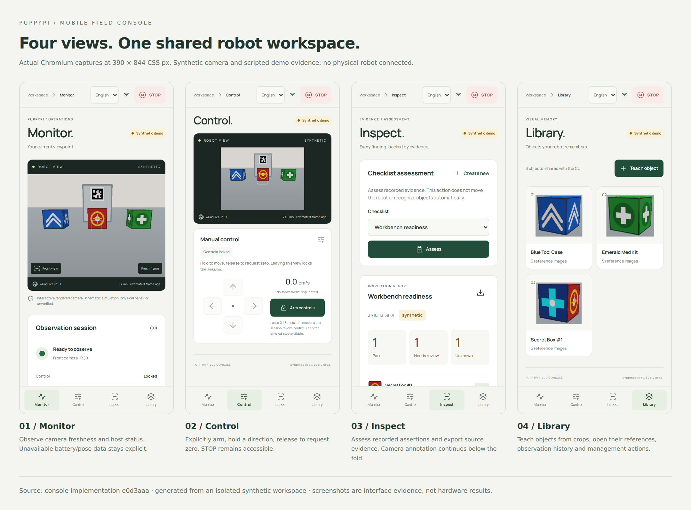
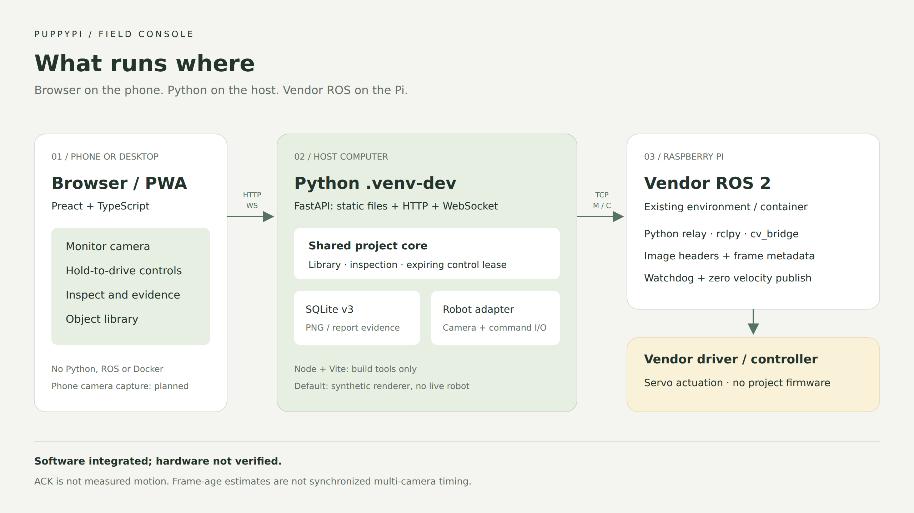
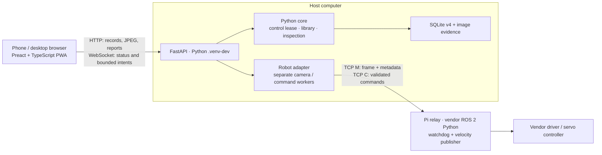
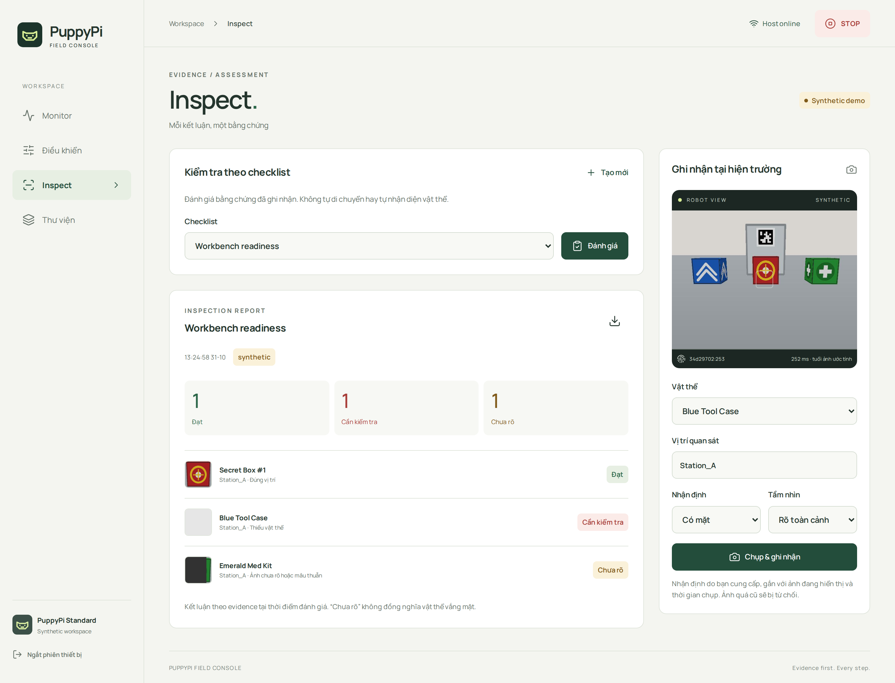
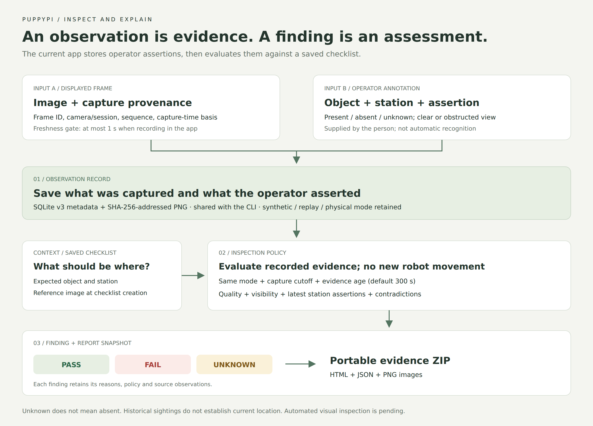
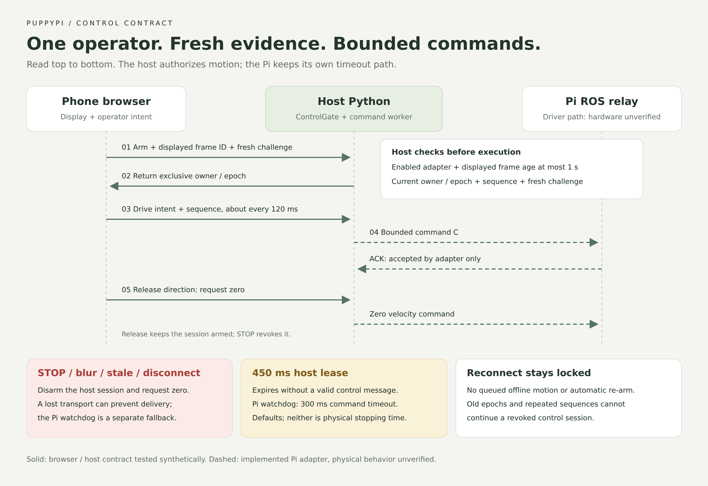

# Mobile field console

Start with the application screenshots, then follow the placement, evidence and
control figures. PNG figures render without Mermaid support; editable SVG sources
are linked alongside them.

## See the application



**Figure 1.** Actual app captures from Chromium at a 390 × 844 CSS-pixel phone
viewport. The camera and inspection fixtures are **synthetic**. This demonstrates
the implemented interface, not physical robot behavior or a native app install.

Open the [eight-screenshot walkthrough](14-mobile-console-gallery.md) for larger
phone views, the capture form, object history and desktop layouts. The
[standalone gallery](diagrams/mobile-ui-gallery.html) can also be opened locally
in a browser; it needs no app server. Each screenshot links to its full resolution.

## Stack and placement



**Figure 2.** The phone runs the browser UI; the host runs FastAPI, core Python
and storage in `.venv-dev`; the Pi runs the relay in its existing vendor ROS 2
environment after compatibility verification. Node builds the frontend on the
host. [Scalable SVG](diagrams/mobile-console.svg) · [PNG](diagrams/mobile-console.png).

<details>
<summary>Equivalent text diagram</summary>



</details>

The browser runs no Python, ROS, or C++. Node is a frontend build tool only.
FastAPI serves the compiled static files and API from one origin. The host core
does not import FastAPI. Docker is not required for this app; existing ROS Docker
workflows are separate. The Pi keeps its vendor ROS environment and driver.

Preact + Vite provides a compact client with direct control of the interface.
The HTTP/WebSocket contracts can also serve a future native client. This first
implementation uses one host process and one robot; do not start multiple Uvicorn
workers against the same robot.

The [mobile runtime proposal](23-mobile-runtime-decision.md) compares this PWA
with a Capacitor APK and a native Android client. It records hardware/background
tradeoffs and build/device acceptance gates. Android packaging remains proposed;
there is no built or device-validated APK in the repository.

## Run locally or on a phone

The interface defaults to **English**, including when the browser's preferred
language is Vietnamese. The language selector on the pairing screen and header
offers optional Vietnamese (`VI`); an explicit choice is remembered in this
browser. Switching languages disarms manual control. Dates follow the selected
locale; object names, evidence, API diagnostics and technical identifiers retain
their original values. English message keys live in application code, and
Vietnamese copy is isolated in `web/src/locales/vi.json`.

Prerequisites: Python 3.12, uv, Node 22.12+ (Node 24 tested).

```bash
make app-setup
make app-build
make app
```

Open `http://127.0.0.1:8080` and enter the pairing code printed in the host
terminal. The default adapter is synthetic and does not discover or connect to a
robot. The app shares `data/assistant/` with the CLI. To use an isolated demo
library and open it from a phone on the same trusted network:

```bash
make app APP_ARGS="--host 0.0.0.0 --data-dir data/mobile-demo"
```

On the phone, open `http://<host-lan-ip>:8080`, then pair. An empty synthetic
workspace offers **Load demo data**: it explicitly creates three taught objects
and scripted present/absent/uncertain evidence. The sample report has one pass,
one fail, and one unknown. It is independent of the current rendered scene and
does not claim automated recognition. The renderer responds to manual commands
using a bounded kinematic camera pose; it is not a physics or gait simulation.

HTTP on a trusted LAN supports the online console. Home-screen installation and
service workers require a secure context on phones: use HTTPS with a certificate
trusted by that phone, or terminate HTTPS at a same-origin local proxy. The
launcher accepts `--ssl-certfile /path/cert.pem --ssl-keyfile /path/key.pem`.
Do not commit certificates/private keys or expose the unauthenticated raw Pi TCP
relay to the internet. This workflow needs no cloud deployment. A self-signed
certificate warning is not the same as a trusted secure context.

Pairing uses a random host-start code, rate-limited attempts, an HttpOnly SameSite
cookie, and same-origin mutation/WebSocket checks. The optional
`PUPPYPI_OPERATOR_TOKEN` environment variable supplies a deployment-managed code;
keep it outside the repository. Sessions expire after eight hours or host restart.
There are no user roles or persistent accounts. All paired operators can stop;
only one WebSocket session can own motion at a time.

## Operator flows

| View | Implemented behavior | Evidence boundary |
| --- | --- | --- |
| Monitor | Camera frame, estimated age, connection status, recent events, reference thumbnails | Battery and measured pose remain unavailable; session events are bounded in-memory diagnostics |
| Control | Explicit arm, hold-to-drive, release-to-zero, always-visible stop, exclusive owner | Commands are bounded forward/back and yaw intents; ACK means accepted by adapter, not measured motion |
| Inspect | Capture the displayed fresh frame with a presence/absence/unknown assertion, create checklists, assess and download ZIP reports | Assertions and visibility come from the operator; assessment uses existing evidence, not autonomous patrol or image understanding |
| Library | Upload 1–8 cropped reference images, list, rename, archive, inspect history/images | Shared deterministic spatial encoder and SQLite store; reference replacement remains available in CLI |
| Monitor → Room memory | Recorded regions/timeline, three typed historical questions, saved answers/JSON export, frame suggestions and confirmed sightings | Human-reviewed assertions; local CPU appearance baseline; no measured room geometry or autonomous patrol |

The [application-first plan](19-application-delivery-plan.md) explains the new
room workflow, endpoint/service boundaries, regression evidence and the next
monitoring/perception/phone/patrol slices. Research is integrated as conservative
temporal semantics, evidence provenance and useful visual review; model candidates
are never silently promoted into facts.



**Screenshot detail.** Desktop Inspect puts the saved report beside the capture
form. The seeded fixture has one pass, one fail and one unknown. These are
scripted assertions, independent of the current synthetic camera view. Selecting
a value in the capture form does not change the report until an observation is
saved and a new assessment is run.



**Figure 3.** Follow the two inputs into a stored observation, then the checklist
policy into a report snapshot. This separates camera evidence, the operator's
assertion and the derived finding. [Scalable SVG](diagrams/mobile-evidence-flow.svg)
· [PNG](diagrams/mobile-evidence-flow.png).

Archives preserve old evidence. Reference uploads are limited to PNG/JPEG, 4 MiB
per image, 8 megapixels, and 6 MiB per request including multipart overhead.
Reports contain snapshots and portable HTML/JSON/PNG evidence. A historical
sighting is not a claim that an object remains at that location.

## Real robot adapter and control contract



**Figure 4.** Follow arm → hold → release down the lanes. Release requests zero
while keeping the lease; STOP revokes the session. The 450 ms host lease and
300 ms Pi watchdog are software defaults, not measured physical stopping times.
[Scalable SVG](diagrams/mobile-control-flow.svg) · [PNG](diagrams/mobile-control-flow.png).

Deploy the updated `scripts/puppypi_edge_relay.py` in the robot's **verified ROS 2
environment** first. The robot's actual firmware, topics, driver units and ROS
distribution have not been checked in this work. Select the endpoint explicitly:

```bash
# Monitor-only connection to a deliberately selected relay.
make app APP_ARGS="--host 0.0.0.0 --robot relay --relay-host <pi-ip> --data-dir data/physical"
```

Physical control additionally requires `--allow-motion`, followed by a fresh
displayed frame and explicit arm in the UI. Use that flag only during an
authorized supervised hardware trial after verifying movement units and the
robot-side stop path. Never mix demo and physical evaluation directories.

The UI emits bounded intents at approximately 120 ms intervals while armed.
The host requires a fresh server challenge, strictly increasing command sequence,
current owner/epoch, and displayed frame age at most one second. The lease expires
after 450 ms without a valid command. Release sends zero; stop, tab change,
blur/backgrounding, disconnect, stale evidence, invalid/replayed commands and
session expiry disarm. Reconnection never automatically arms. Frame and command
workers/sockets are separate, and an in-flight nonzero send is followed by zero
even if the stop arrived during the send. These are software deadlines, not a
measured physical stopping-time guarantee.

The Pi watchdog retains its 300 ms timeout and publishes zero on both velocity
topics. It is a Python thread, not an independently verified hardware stop. The
mobile app does not add obstacle avoidance. Only this host should write robot
commands; another legacy client can bypass the app's exclusive-operator gate.

### Frame protocol and provenance

- `F` remains the legacy JPEG request; `C` remains the command/ACK exchange.
- `M` returns a four-byte network-order metadata length, JSON, four-byte JPEG
  length, then JPEG. Metadata schema 2 includes camera ID, relay session ID,
  sequence, freshness flag and relay-local frame age.
- The ROS callback estimates source age from the image header and ROS clock,
  then adds monotonic buffering time. Validity assumes those ROS clocks share a
  time domain. Zero/future/invalid headers do not qualify as fresh frames.
- The host adds the entire transport round trip conservatively and derives a
  host-UTC capture estimate. `cross_device_clock_synchronized` remains false.
  This is insufficient for research claims about synchronized ego/exo fusion.
- The mock relay without timestamp metadata stays unverified for app motion.
  Use the built-in synthetic app adapter for the interactive offline demo.
- SQLite migration 3 adds provenance JSON; older observations keep `{}`.
  Stored observations retain adapter metadata and capture-time basis. Images
  and reports remain in the shared content-addressed evidence store.

## Development, verification, and remaining work

`make app-build` runs TypeScript checking and Vite. The generated assets are
ignored and included in the Python wheel when built before `make build`.
`npm --prefix web run dev` offers Vite development with `/api` HTTP/WebSocket
proxying to the host on port 8080. Production requires only Python plus the built
assets. The application JS is approximately 60 kB raw / 22 kB gzip in this build,
excluding CSS and locally bundled font files; this is not a device performance
benchmark. Third-party license texts ship as `THIRD_PARTY_NOTICES.txt`.

The service worker caches only the static shell and assets. Camera, evidence,
status, credentials, and commands are never cached or queued for offline use.
Network loss locks control; offline shell availability does not imply a usable
robot connection. Installation behavior varies by browser; real iOS/Android
home-screen installation remains to be tested.

```bash
make check
make test
make app-build
npm --prefix web exec -- playwright install chromium
make app-test
make build
```

Playwright owns a temporary evidence directory and a loopback-only server on
18766, then stops it. Screenshots are written to ignored `runs/mobile-preview/`.
Coverage includes upload, saved evidence, report download, hold/release, blur,
stop, reconnect, mobile layout and static-only cache. Python regressions cover
lease expiry/replay/exclusivity, stale frames, stop-during-send, monitor-only
transport, migration preservation, metadata and the existing research core.

Remaining: physical driver/latency/stop tests; real-device Safari/Chrome install
checks; automatic perception and search mission integration; phone third-person
capture/calibration/synchronization. F28 remains partial until search is wired.
The operator app is distinct from planned F33–F37 Phone Observer research.

## Interface design notes

The operator works with camera frames, stations, object references, evidence,
control leases, and inspection findings. The visual direction is a field notebook:
warm white paper, graphite camera surround, forest green controls, lime readiness,
amber uncertainty, and red stop. Manrope provides a compact but readable type
scale (12/14/16/20/28/40 px); spacing follows a 4 px grid and surfaces use quiet
borders. The camera dominates Monitor and Control; evidence dominates Inspect.

The signature is a frame provenance strip, repeated in the camera, mode badge,
capture action, observation history, and report. Avoid generic metric tiles,
invented battery charts, and decorative robot animations. Use a continuous
camera workspace, explicit unavailable telemetry, and actual rendered frames.
Native HTML controls and dialogs provide keyboard and focus behavior. Mobile
navigation stays at the bottom and the stop control remains visible at the top.

Sources: [Preact](https://preactjs.com/),
[FastAPI WebSockets](https://fastapi.tiangolo.com/advanced/websockets/),
[PWA installability](https://developer.mozilla.org/en-US/docs/Web/Progressive_web_apps/Guides/Making_PWAs_installable).
