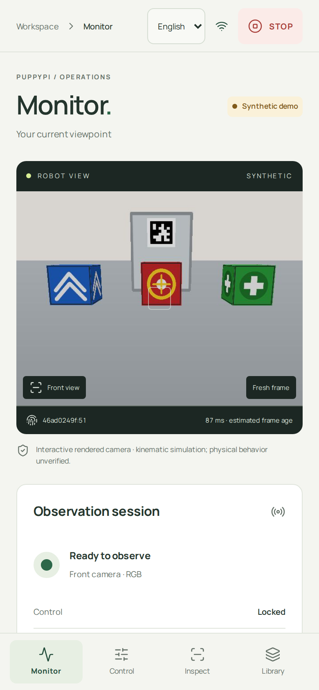
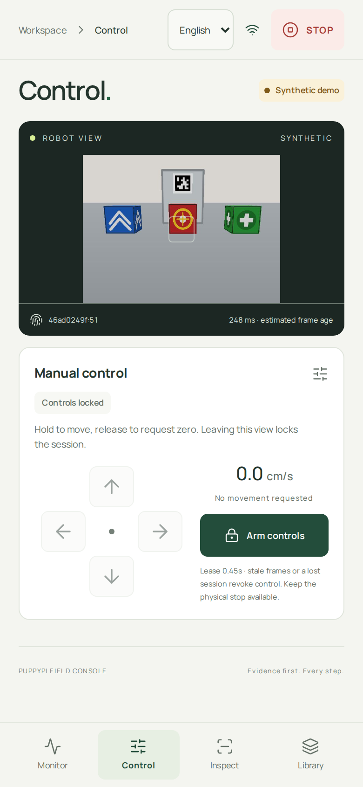
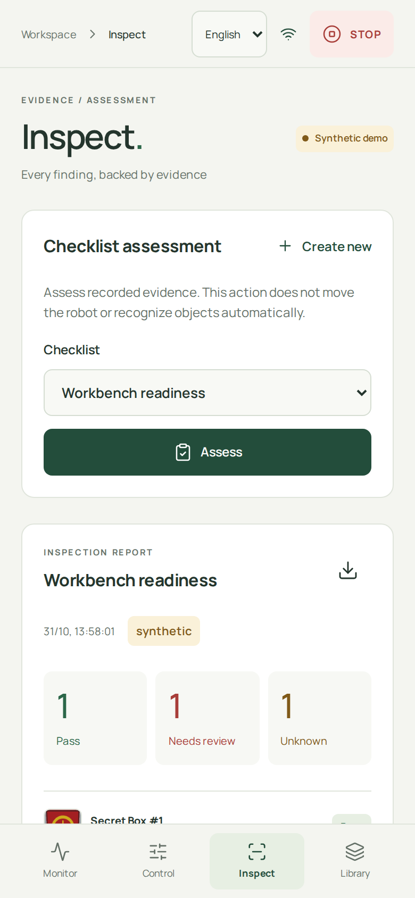
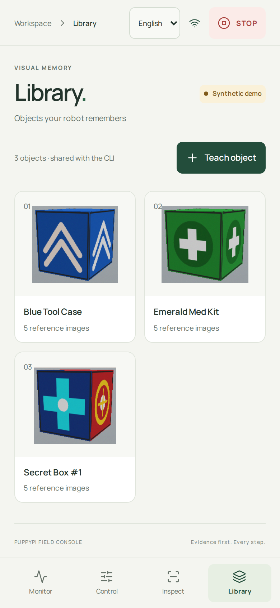
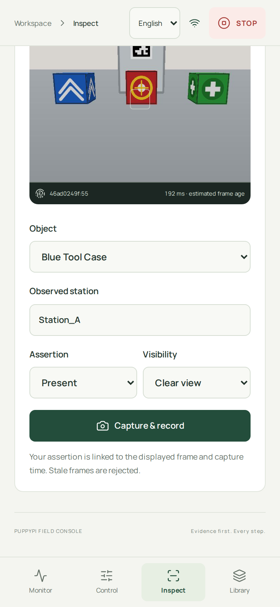
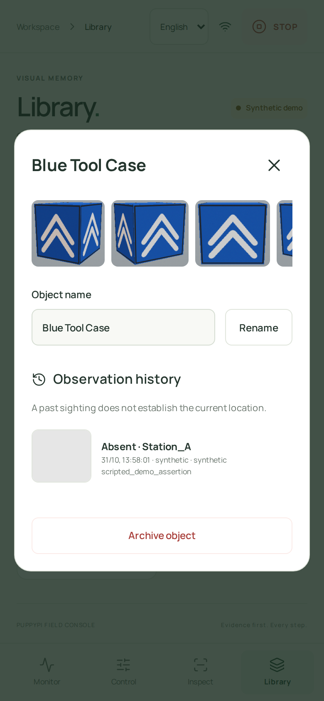
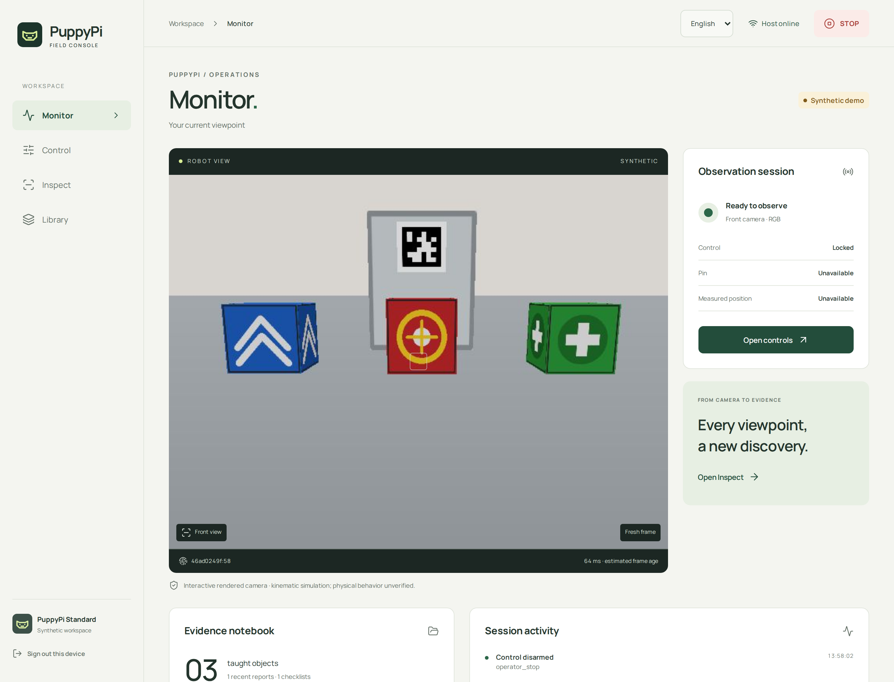
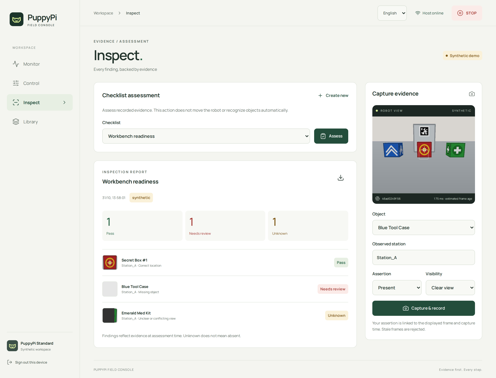

# Mobile console: screenshot walkthrough

These eight images are **actual application screenshots**, captured from the
implementation at `e0d3aaa` on 2026-10-31 using Chromium and an isolated synthetic
workspace. They are not UI mockups or physical robot evidence. The captures use
the default English interface; Vietnamese is available only through an explicit
language selection.

Phone viewport: **390 × 844 CSS px**, captured at 2× resolution. Desktop viewport:
**1440 × 1100 CSS px**, also at 2×. The images are ordinary viewport captures;
content below the fold is reached by scrolling. Click any image to inspect it.

[Architecture and run instructions](13-mobile-console.md) ·
[Four-screen overview](diagrams/mobile-ui-gallery.png) ·
[Local browser gallery](diagrams/mobile-ui-gallery.html).

## 1–2. Observe the robot, then open manual control

| Monitor | Control |
| --- | --- |
| [](screenshots/mobile-console/phone-monitor.png) | [](screenshots/mobile-console/phone-control.png) |

**Look for:** the synthetic-mode badge, frame identity and estimated age below
the camera, bottom navigation, and STOP in the header. On Control, the camera and
direction buttons fit in one viewport. The pictured session is locked; **Arm
controls** must be pressed before holding a direction. No physical movement was
performed to capture these screens.

## 3–4. Evaluate a checklist and manage taught objects

| Inspect | Library |
| --- | --- |
| [](screenshots/mobile-console/phone-inspect.png) | [](screenshots/mobile-console/phone-library.png) |

**Look for:** **Assess** to assess recorded evidence, the report download icon,
and the three distinct outcomes. The synthetic fixture intentionally yields one
pass, one fail and one unknown. This is not a recognition accuracy score.
Library shows the taught objects and reference counts; **Teach object** uploads
cropped reference images. Selecting an object opens its history and management
actions.

## 5–6. Record evidence and inspect its provenance

| Capture form, scrolled into view | Object history dialog |
| --- | --- |
| [](screenshots/mobile-console/phone-capture.png) | [](screenshots/mobile-console/phone-history.png) |

**Look for:** the object, station, assertion and visibility fields above **Capture
& record**. The operator supplies the assertion; the app associates it with a
fresh displayed frame. The form in this screenshot has not been submitted.
History retains the recorded time, mode, source and image. Its earlier scripted
absence assertion does not mean the currently displayed camera automatically
detected absence. Archive preserves historical evidence.

## 7. Monitor on a larger display

[](screenshots/mobile-console/desktop-monitor.png)

**Look for:** camera dominance, connection state, library shortcuts and the
session event log. Battery and measured position are explicitly unavailable.
These fields are not filled with fabricated telemetry.

## 8. Inspect on a larger display

[](screenshots/mobile-console/desktop-inspect.png)

**Look for:** the saved pass/fail/unknown report at left and the camera annotation
form at right. A report is a snapshot of stored assertions; it does not update
merely because the camera or form selection changes. The download icon exports
HTML, JSON and source PNG evidence together.

## Capture provenance and refreshing these images

All screenshots came from the same fresh temporary database seeded once through
**Load demo data**. No user library, private recording, live robot, or paid API
was accessed. The renderer and fixture observations are intentionally independent;
they are not paired ground-truth labels for an image-recognition evaluation.
The pairing screen and its code are not included in any image.

To refresh the gallery after an intentional UI change:

1. Build the current client with `make app-build` and record its Git revision.
2. Start the disposable loopback-only capture/test server:

   ```bash
   UV_PROJECT_ENVIRONMENT=.venv-dev uv run --locked --extra dev --extra app python scripts/mobile_browser_server.py
   ```

3. Open `http://127.0.0.1:18766` in Chromium and pair with the fixture code defined
   in [the server script](../scripts/mobile_browser_server.py). Seed the empty demo
   once. Never substitute a live relay or a user's evidence directory.
4. Set the viewport sizes above, wait for fonts and images to load, dismiss the
   seed notification, and capture the four main phone tabs at scroll position 0.
   Capture the first object's history dialog and the scrolled Inspect capture
   form separately. Do not edit the captured pixels or add invented UI states.
5. Capture Monitor and Inspect at the desktop viewport. Keep the report at the
   seeded one-pass/one-fail/one-unknown state for this documentation sequence.
6. Save the eight PNGs under `docs/screenshots/mobile-console/`. Render
   [the gallery HTML](diagrams/mobile-ui-gallery.html) at 1440 CSS px wide to update
   [the overview PNG](diagrams/mobile-ui-gallery.png). The three SVG diagrams in
   the [app guide](13-mobile-console.md) are editable sources; their PNG siblings
   are browser-rendered exports at 2× the SVG's declared size.
7. Stop the disposable server, update the source revision/date and captions,
   visually inspect the outputs, and run `make check`.

The existing `make app-test` suite also captures interaction-test screenshots
under ignored `runs/mobile-preview/`. Those are transient test output; this
gallery is the versioned documentation snapshot.
