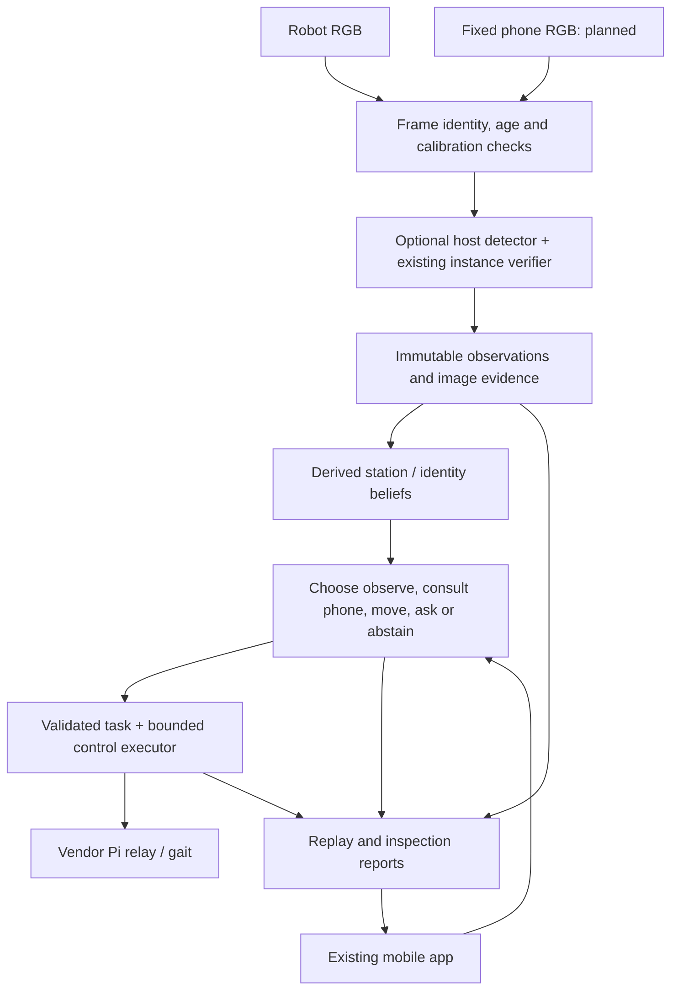

# Next features: research and implementation proposal

Reviewed 2026-10-31 against the current PuppyPi Standard repository and primary
project/paper sources. **This is a proposal; the capabilities below are not new
delivered features.** Source availability was checked, but upstream models and
integrations were not installed or benchmarked. Priorities and effort are project
judgment, not performance results. The user has more than three months; host
compute and the actual robot ROS/driver configuration remain unresolved.

## Recommendation

Build one coherent demonstration: **PuppyPi finds a moved object, consults a phone
overview when useful, verifies the exact object, and explains its decision with
replayable evidence.** Reuse the existing mobile console and shared core.

The current app already supports camera/manual control, object management,
operator assertions and recorded-evidence reports. The largest functional gap is
between those operator assertions and autonomous image interpretation. The main
scientific question is whether freshness-aware memory and selective external
views improve decisions at a matched budget, rather than simply adding a camera.

Use [the existing screenshots](14-mobile-console-gallery.md) as the product
baseline. Planned panels below must not be illustrated as delivered screenshots.

## Six extensions in dependency order

| Order | Operator-visible extension | Existing feature IDs | Demonstration | Acceptance evidence |
| --- | --- | --- | --- | --- |
| 1 | Mission timeline and evidence replay | F08; foundation for F32/F37 | Scrub from frame to candidate, decision, command and acknowledgement | Saved run opens after restart; shows missing frames and commanded versus measured state separately; replay cannot actuate |
| 2 | Automatic proposals from taught image references | F01/F03/F31; enables F21 | Teach a cropped object, then display candidate boxes from a new camera view | Held-out exact-instance tests include similar distractors and target absence; stale inference cannot publish a current confirmation |
| 3 | Memory Scout with belief repair | F11–F14/F19 | Move an object; an old sighting becomes uncertain and a new observation repairs the location belief | Same perception and scene sequences for last-seen, fixed expiry and proposed policy; count false location confirmations and travel |
| 4 | Phone Observer and external robot pose | F33/F34; later F35 | Pair a fixed phone, see ego/exo views and calibrated robot pose on a station map | Capture/session provenance, bounded clock uncertainty, calibration validity; marker loss or moved phone invalidates pose |
| 5 | Look-or-Ask candidate cards | F16–F19 | Two similar boxes: show both crops, ask a grounded question or choose another view | Compare never-ask, always-ask-on-ambiguity and cost-aware choice; incorrect answers/timeouts preserve uncertainty |
| 6 | Automatic evidence-backed inspection | F20–F25 | Missing or misplaced item produces a finding with reference/current images and reasons | Compare simple image/feature change and repeat-view verification under lighting, occlusion and perspective changes |

These extend the existing inventory. Replay, visualization panels and algorithm
variants are not counted as separate completed robot features. Automatic absence
requires sufficient coverage of the expected region; a missed detector proposal
alone is not evidence of absence.

## Reusable work and actual fit

### Visual prompting: YOLOE

[YOLOE, ICCV 2025](https://arxiv.org/abs/2503.07465) has an
[official implementation](https://github.com/THU-MIG/yoloe), linked checkpoints
and text/visual prompting examples. Its benchmark throughput is device-specific,
not a Raspberry Pi estimate. The repository lists AGPL-3.0; model/dependency terms
must also be recorded before reuse.

**Proposed adaptation:** run a checkpoint on the host as an optional proposal
adapter; convert outputs to the existing `CandidateProposal` record. Feed crops
to the current exact-instance matcher/verifier, keeping the deterministic spatial
baseline runnable. A category detection is only a candidate for a particular
taught object. Benchmark latency, proposal recall and target/decoy confusion
before selecting a model/device; training from scratch is unnecessary for this
first comparison. Avoid importing the upstream demo's pinned FastAPI stack into
the console environment unchanged.

### Temporal retrieval: ReMEmbR

[ReMEmbR paper](https://arxiv.org/abs/2409.13682) and
[official code](https://github.com/NVIDIA-AI-IOT/remembr) expose memory items with
captions, time and pose. Their setup includes VILA, Ollama and Milvus; the live
example targets Nova Carter.

**Proposed adaptation:** borrow time/location retrieval patterns and compare
against a simple station-memory policy. Keep SQLite and image provenance as the
authoritative project store. Add optional caption retrieval later. Upstream
retrieval does not supply a validated PuppyPi movement executor or prove that a
historical location is still correct.

### External camera: AprilTag/OpenCV plus aiortc

[AprilTag 3](https://github.com/AprilRobotics/apriltag) provides public detection
and pose-estimation code; pose requires camera intrinsics and known tag size.
The [official aiortc server example](https://github.com/aiortc/aiortc/tree/main/examples/server)
demonstrates browser video and data channels with Python. This is usable transport
reference code, not a synchronized robotics observation pipeline.

**Proposed adaptation:** fixed phone on a stand, world-reference board, rigid
robot marker and measured tag-to-body transform. Reuse current OpenCV calibration
and tag support first. Add phone session/frame metadata, capture-clock mapping,
calibration revision and bounded buffering at the adapter boundary. The phone
can start with a station hint; close robot views establish exact identity. A
floor homography does not locate arbitrary elevated object pixels correctly.
The fuller design remains [R5](11-phone-observer-research.md).

### Human clarification: KnowNo

[KnowNo, CoRL 2023](https://robot-help.github.io/) uses uncertainty alignment and
conformal prediction for help requests. Its linked
[code entry](https://github.com/google-research/google-research/tree/master/language_model_uncertainty)
has a retrievable [official README](https://raw.githubusercontent.com/google-research/google-research/master/language_model_uncertainty/README.md).
This review verified the entry point, not an executable reproduction.

**Proposed adaptation:** start with explicit candidate sets and image cards, then
calibrate the decision to ask using held-out episodes. Compare question cost with
another observation. Keep language requests behind validated task contracts;
outputs never become arbitrary motor commands. Do not claim formal coverage for
adaptive or shifted robot data without checking the method's assumptions.

### Replay tooling: Rerun and MCAP

[Rerun's public SDK/viewer](https://github.com/rerun-io/rerun) supports multimodal
timelines and sensor comparison. Its core repository lists Apache-2.0/MIT.
[MCAP](https://mcap.dev/) is an open container format for timestamped multimodal
channels.

**Proposed adaptation:** begin with versioned project events and selective image
evidence; optionally export to MCAP and use Rerun as a developer viewer. Keep the
small phone timeline in the existing Preact app. Neither logging format nor
viewer establishes clock synchronization. Avoid replacing the application with
a large generic dashboard before the missing perception/mission behaviors work.

### Inspiration requiring a larger adaptation

[RoboPocket, 2026](https://robo-pocket.github.io/) couples smartphone AR feedback
and remote inference with interactive policy improvement. Its described hardware
uses an iPhone Pro, custom gripper, lens mount and encoder. No official source
release was verified from the project page and author links during this review.
Borrow the interaction idea: display a proposed observation/action and let the
operator correct it. Do not schedule its manipulation pipeline as a PuppyPi
integration.

[NaVILA, RSS 2025](https://navila-bot.github.io/) offers
[public VLA code](https://github.com/AnjieCheng/NaVILA), an 8B checkpoint and a
separate low-level locomotion component. Its evaluation instructions use GPU and
a legacy Habitat setup. It is valuable related work for hierarchical navigation;
the supplied locomotion policy is not a verified PuppyPi Standard controller.
Retain vendor gait execution for the first physical system.

## Proposed shared architecture

Keep inference off the command worker. Every result must refer to its input
frame/model version and original capture time; completion time must not make an
old result appear fresh. Append schema migrations for new session/calibration,
run-event and belief records. Preserve CLI/app compatibility and old embeddings'
model identity. Map proposed actions to verified robot capabilities; record
achieved outcomes separately from requests/ACKs.

## One main research claim to test

**Question:** when should a robot use old memory, request an external view, move
for a better view, or ask a person?

**Hypothesis:** a policy using memory freshness, source visibility and measured
action cost reduces false confirmations and travel compared with last-seen and
always-fuse policies at comparable task completion. This is a proposed hypothesis,
not an established novel algorithm or a result.

Start with a small explicit action set and empirical action costs. Fit decision
thresholds/benefit estimates only on calibration episodes. First isolate R1 with
ego-only memory baselines; then hold that policy fixed to isolate the value of
R5 view selection. Only afterwards evaluate the joint policy.

| Comparison | Baselines / ablations | Primary measurements |
| --- | --- | --- |
| Appearance | Spatial baseline; optional model proposals; same verifier | Candidate recall, exact-instance precision/recall, absence false positives, p50/p95 latency |
| Memory | Last-seen; uniform expiry; freshness/quality-aware belief; active repair | False location confirmation, success, revisits, time and measured travel |
| Views | Ego only; exo only; always fuse; freshness gates; cost-aware choice | Success/error, unknown rate, processed frames, bandwidth, time and travel |
| Help | Never ask; fixed ambiguity threshold; cost-aware ask/view | Exact-target accuracy, questions, response time and unanswered/incorrect-answer handling |

Use paired scene sequences with moved, absent, similar, occluded and nuisance-only
changes. Add replayed delay/dropout and invalid calibration cases. Compare both
equal-time/action budgets and equal-processed-frame budgets: an extra camera is
an extra resource. Keep model versions/enrollment images constant, split by
layout/day/instance rather than adjacent video frames, and report uncertainty
intervals with missions/sequences as the sampling unit. A small pilot estimates
variance and experiment cost before deciding the final sample count. Record all
failures/interventions. External-pose accuracy needs independent reference
measurements, not the evaluated phone estimate itself.

## Suggested 16-week sequence

This is a dependency-based planning estimate, adjustable to team and hardware.

| Window | Deliverable | Exit decision |
| --- | --- | --- |
| Weeks 1–2 | Stationary hardware inventory/camera/stop checks; persistent run records and ego replay | Can timestamps, driver units and stop behavior support a supervised trial? |
| Weeks 3–4 | Host visual-prompt proposal adapter and exact-instance evaluation | Choose a backbone only after real-crop accuracy/latency results; retain offline baseline |
| Weeks 5–7 | Memory repair and one validated station route integrated into the app | Demonstrate moved-object recovery with counted failures; stay with recorded replay if motion prerequisites fail |
| Weeks 8–10 | Fixed-phone capture, calibration, dual-view inspection and pose display | Reject lost markers, old frames and moved-phone calibration; no blind fusion |
| Weeks 11–13 | Paired R1/R5 experiments and ablations | Estimate benefit over simpler gates at matched budgets |
| Weeks 14–16 | Failure analysis, evidence package and polished demo; optional candidate-grounded questions | Preserve the main study if extra features compete with evaluation time |

The first implementation slice should be **persistent run events + ego-only
replay**, while characterizing actual hardware. It makes every subsequent model
and policy change inspectable. The next perception slice should produce candidate
overlays and saved scored proposals on recorded real scenes before controlling a
walking robot. Full autonomous search remains dependent on motion validation.
