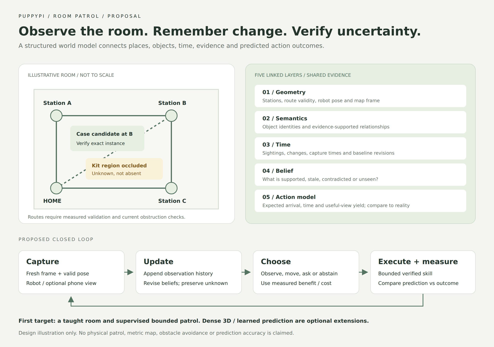
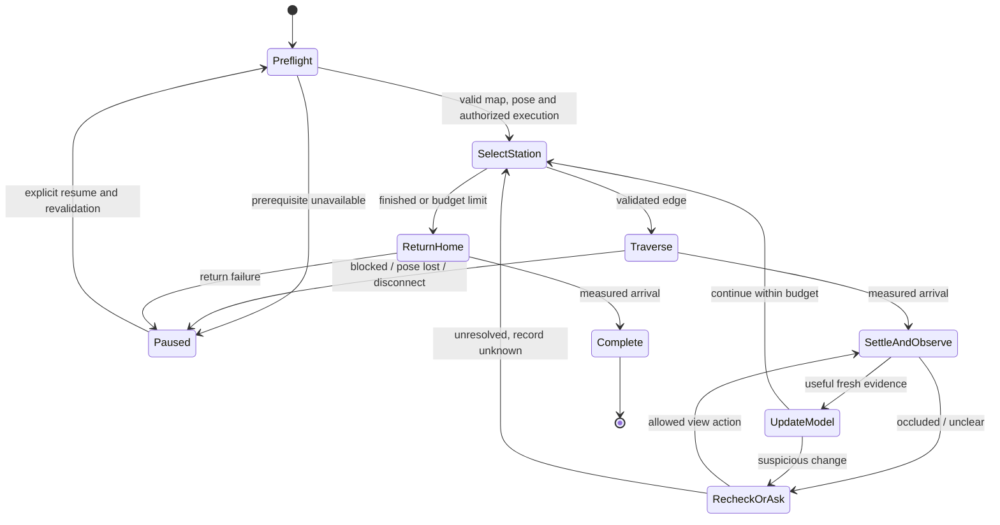

# Room Patrol: an evidence-grounded room world model

Proposal date: 2026-10-31. Platform: user-confirmed PuppyPi Standard, existing
English-first mobile console, offboard Python host, and optional fixed phone.
**Status: Planned.** No autonomous patrol, room reconstruction, new perception
model or physical capability was implemented or verified in this research task.
Upstream entry points were reviewed; code/checkpoints were not installed.

**Research update:** the [deeper prior-art audit](17-deep-research-active-room-inspection.md)
finds substantial overlap with 3D VSG, PBD-AG, SCOUT and active perception fault
diagnosis. Treat this document as the application architecture, not a novelty
claim. The follow-up proposes a narrower joint change/source-diagnosis experiment,
stronger baselines, explicit release checks and a conditional implementation plan.

## Proposed demonstration

Teach PuppyPi a small room with HOME and three inspection stations. Start a
bounded patrol from the app. At each station the robot stops, waits for a useful
image, checks expected objects, and updates a room model. Move the taught tool
case, obscure the first-aid kit and change the lighting. The robot reports the
move, retains uncertainty about the hidden kit, and avoids treating illumination
alone as a confirmed incident. It chooses a recheck, a phone view or operator
help within its remaining budget, then attempts a verified return to HOME.

The app explains **what changed, where, when, which observation supports it,
and what remains unknown**. Patrol completion and successful return are separate
measured outcomes. Battery is not used as a return criterion until real telemetry
exists; the initial mission has an explicit time/action budget.

**Figure 1.** Illustrative design, not a captured room, navigation result or
delivered screen. [Editable SVG](diagrams/room-patrol-world-model.svg).
The green route is an example of operator-verified connectivity, not inferred
free space. This figure does not establish obstacle avoidance.

## What it means to understand the room

Vision converts images into observations. A persistent room model links those
observations to places, identities, relationships and changes. Planning asks what
an action would reveal or achieve. A useful model must also expose uncertainty.

| Layer | What PuppyPi must represent | Concrete question | First implementation |
| --- | --- | --- | --- |
| Geometry and route topology | Stations, coordinate frame, traversable edges, localization validity, blocked/unknown routes | Where am I, and which route is currently usable? | Measured floor plan plus calibrated tags; individually tested edges |
| Semantics and identity | Persistent object IDs, classes/descriptions, station regions and supported relationships | Is this the taught case, and where was it observed? | Existing references and matcher plus optional detector; station-level graph |
| Time and change | Immutable sightings, visibility, timestamps, baseline revisions and change events | What changed since the previous patrol? | Append observations; derive events without overwriting history |
| Belief and observability | Supported/contradicted/stale/unknown claims, camera coverage and evidence links | Is the kit absent, or simply hidden? | Explicit visibility and freshness gates; avoid treating scores as probabilities |
| Action and observation prediction | Expected route outcome, duration, localization loss and useful-view yield | Is another view worth the time, and what should I see next? | Empirical transition/cost tables from measured actions; compare prediction with outcome |

One possible state is `W_t = (G_route, G_semantic, O_1:t, B_t, M_action)`.
`O` stores observations, `B` derives current beliefs, and `M_action` predicts
outcomes of the robot's validated actions. This is a structured, partly predictive
world model. A scene graph alone is only one component. It does not require a
large learned video generator to be useful.

Example: an observation records that the case was at Station_A at 10:00. At
10:05 a shelf blocks that region: the claim becomes unverified, not absent.
A clear close view at Station_B at 10:07 supports a new location. A move event
requires defensible identity association; similar boxes retain competing
hypotheses. Conflicting cameras do not become confirmation by majority vote.

The first relation is `observed_at_station`. Add `on_surface`, `inside` or
metric `near` only with enough geometric/visibility evidence or an explicitly
recorded operator annotation. An LLM's plausible room description is not a
measured relationship. Floor projections apply to the floor plane, not arbitrary
pixels on tables, walls or people.

## How visual understanding would work

1. **Bootstrap a room:** measure HOME/stations, name regions, save reference
   viewpoints and define expected objects. Record how each edge was validated.
   The existing example `TopologicalGraph` is a synthetic layout, not this room's
   measured map.
2. **Acquire evidence:** robot RGB and optional fixed-phone RGB retain camera,
   session, capture time/uncertainty, calibration and frame identity. Pose and
   image must share a verified transform/time relationship.
3. **Select useful views:** reject stale/blurred frames and wait for the robot
   to settle. A low camera may not see a tabletop; use another feasible pose or
   phone view and record the region that was actually visible.
4. **Perceive and associate:** detect candidate regions, extract features and
   match taught instances across views/time. Use the existing deterministic
   encoder as a baseline. Proposed YOLOE integration is described in
   [the reuse review](15-next-feature-research.md); category matching alone does
   not establish exact-instance identity.
5. **Update the model:** retain raw observations and derive object/station
   beliefs and events. Negative updates require adequate coverage, not just a
   missed bounding box. Store incompatible interpretations when unresolved.
6. **Query and act:** answer grounded questions using observation IDs and images;
   choose an allowed observation or mission skill. Grounded language planning
   cannot create arbitrary executable code or direct motor fields.

Recognition, geometry and timing are separately evaluated. A convincing point
cloud is not proof of localization accuracy, collision avoidance or object-state
understanding.

## Research to reuse, with input assumptions

Reviewed primary project documentation and source entry points on 2026-10-31.
Availability means inspectable source, not a successful reproduction. Pin a commit
and record code/model/data terms before importing an implementation.

| Work | Verified source and established idea | PuppyPi adaptation / gap |
| --- | --- | --- |
| ConceptGraphs, ICRA 2024 | [Paper](https://arxiv.org/abs/2309.16650), [official code](https://github.com/concept-graphs/concept-graphs). Builds open-vocabulary object graphs from posed RGB-D input. README points to `ali-dev` for an iPhone RGB-D workflow. | Borrow object association/graph querying. Ordinary phone-browser RGB does not supply that RGB-D/pose input. Select a branch and input adapter deliberately. |
| DovSG, RA-L 2025 | [Paper](https://arxiv.org/abs/2410.11989), [code](https://github.com/BJHYZJ/DovSG). Local updates to dynamic 3D scene graphs; documented setup includes a D455, mobile manipulator and GPU laptop. | Compare local versus whole-room belief updates. Use station-level relations first; its 3D/manipulation pipeline is not a Standard controller. |
| DynaMem | [Project/paper](https://dynamem.github.io/), [linked implementation](https://github.com/hello-robot/stretch_ai/blob/main/docs/dynamem.md). Updates a feature point-cloud memory with RGB-D observations on Stretch. | Borrow dynamic-memory evaluation and stale-object handling. Preserve existing evidence records and keep grasping out of scope. |
| VLFM, ICRA 2024 | [Paper](https://arxiv.org/abs/2312.03275), [code](https://github.com/rai-opensource/vlfm). Combines depth-derived occupancy/frontiers with language-grounded visual values. | Compare semantic next-view priorities over validated stations. Full frontier exploration needs geometric sensing and a navigation executor beyond today's core. |
| MASt3R-SLAM, CVPR 2025 | [Paper](https://arxiv.org/abs/2412.12392), [code](https://github.com/rmurai0610/MASt3R-SLAM). Supports RGB video/folders with optional calibration; documented installation uses CUDA and linked checkpoints. | Optional host-side reconstruction experiment. Measure scale, drift, tracking loss, resource use and cross-session alignment before using its map for motion. Model/checkpoint terms are separate. |
| Nav2 Collision Monitor | [Official configuration guide](https://docs.nav2.org/rolling/configuration_and_development/configuration_guide/core_servers/collision_monitor/configuring_collision_monitor_node/). Supports sensor inputs such as scans, point clouds and ranges; documentation explicitly distinguishes software response from certified safety. | Optional ROS integration after compatible sensors, transforms and command ownership exist. A room caption, tag detector or point cloud visualization is not a substitute for this input/control integration. |
| V-JEPA 2 | [Primary project description](https://ai.meta.com/research/vjepa/), [code/models](https://github.com/facebookresearch/vjepa2). Video representation/prediction and action-conditioned robot planning; described deployment uses an arm and robot-data training. | Optional later representation/prediction study. Requires PuppyPi-specific action alignment and evaluation; released arm planning is not a ready walking policy. |

These projects establish related work and reusable components. Combining them on
a smaller robot does not by itself establish a new research contribution.

## Three deployment levels

**A — Recommended first: Standard + host, with optional fixed phone.** Build a
station graph, reference regions and temporal object beliefs. Tags anchor measured
pose/scale; known-route motion is supervised and individually characterized.
Phone localization has explicit visibility/calibration bounds. Start with
recorded replay and stationary observation before any patrol execution. This is
bounded inspection of a taught room, not unrestricted exploration.

**B — Richer navigation: add verified geometric sensing.** Evaluate a suitable
RGB-D/stereo/depth or range sensor, robot payload, power, field of view and driver
support. Integrate odometry/pose, map frames and a local obstruction response.
Then test metric mapping and navigation in clutter. Low obstacles, table edges,
reflective surfaces and drop-offs need specific coverage; an elevated phone can
have blind spots and cannot replace onboard proximity coverage by assumption.

**C — Advanced research: dense or learned prediction.** Benchmark host-side
reconstruction and action-conditioned visual prediction on recorded runs. Keep
the bounded executor independent. Upgrade only when prediction helps a task on
held-out scenes, not merely because generated views look plausible.

If only RGB is available, learned monocular geometry can be an estimate to test;
it is not automatically trustworthy metric clearance. Use independent measured
distances/tags for scale checks. If localization, route visibility or stop behavior
cannot be validated, the useful deliverable remains stationary/replayed room
understanding and operator-guided inspection.

## Patrol mission and adaptive observation

Estimate station priority from overdue checks, importance of requested predicates,
uncertainty and expected useful visibility, minus measured travel/time cost.
Compare this transparent scoring baseline before a learned policy. Optional
actions are a close robot view, feasible pose change, phone consultation, asking
the operator, or abstaining. No model is allowed to treat an unknown edge as
traversable. Repeated frames are not independent verification trials.

Keep a versioned patrol checkpoint: mission/station, completed predicates, pending
questions and remaining budget. Resume revalidates pose, route and evidence.
Human teleoperation and autonomous patrol must have one command arbiter, with
explicit takeover revoking autonomy. The current manual lease alone does not
implement that mission arbitration. The Pi watchdog remains independent.

## App capabilities and other useful room applications

| Proposed English UI entry | What the operator gets | Prerequisite |
| --- | --- | --- |
| Room Map | Stations/routes, measured robot pose, blocked/unknown edges and coverage ages | Versioned room frame and localization |
| Patrol | Start/pause/cancel/resume, inspection progress, remaining budget and return outcome | Mission executor plus exclusive command arbitration |
| Changes | Moved/missing/uncertain findings with before/current evidence and verification state | Perception, association and temporal beliefs |
| Ask the Room | Questions such as “Where was the case last seen?” or “Which region was not checked?” | Grounded graph/evidence queries and explicit uncertainty |
| Mission Replay | Timeline of observations, beliefs, selected actions and achieved outcomes | Durable run events |

The same room model supports a **room diary**, workstation readiness checks,
lost-item search, an inspection view for hard-to-see regions, and guiding an
operator to a known station after routes are validated. Open/closed door or
container checks need a separately evaluated predicate; detecting a door class
does not infer its state. Schedule repeated short patrols only after one bounded
patrol works. Unattended security, person identification, manipulation and
automatic charging are outside this first proposal.

## Proposed integration with this repository

- Extend `StationNode`/`TopologicalGraph` with persisted room/edge metadata rather
  than replacing the planner. Never silently reinterpret its synthetic example
  coordinates as calibrated physical geometry.
- Add room frame/calibration, entity/relationship claims, change events, action
  outcomes and patrol checkpoints through explicit schema migrations. Relations
  link observation IDs and include valid time, source, status and model version.
- Reuse `CameraFrame`, `ObjectLibrary`, the verifier and `InspectionService`.
  Keep candidate perception and model inference outside the control worker.
- Add a bounded patrol task contract/executor and a single manual/autonomy
  arbiter above the robot adapter. Extend the existing FastAPI/Preact app with
  English-first room/patrol views; do not create another evidence database.
- Log prediction versus measured result, timing and pose validity. Existing ACKs
  are not odometry. Put host model dependencies in optional isolated environments;
  keep ROS/vendor runtime on the Pi and native library boundaries explicit.

## Main academic question and experiments

**Question:** can visibility- and freshness-aware room beliefs choose inspections
that detect meaningful changes earlier with fewer false alarms and less travel?

**Hypothesis:** explicit unknown states and targeted second observations outperform
a fixed patrol and a static semantic map at equal observation/time budgets. This
is a hypothesis, not a novelty or performance claim. R1 temporal memory, R3
inspection and R5 external-view selection remain the closest existing tracks.

| Experiment | Controlled comparison | Report |
| --- | --- | --- |
| World representation | Last-seen table; static station graph; temporal graph; temporal graph with visibility | Identity/relationship accuracy, stale claims, unsupported assertions and model update latency |
| Patrol selection | Fixed loop; least-recently-observed station; uncertainty score; proposed cost/visibility policy | Event detection delay, missed events, false alarms, measured travel/time, useful views and interventions |
| Verification | Single view; fixed two-view; targeted recheck; optional phone view | Change precision/recall, unknown rate and false confirmation at matched coverage |
| Action prediction | Constant edge cost; empirical transition/cost model; optional learned predictor | Arrival/duration prediction error, localization-loss prediction and downstream task utility |

Use a taught small room, then vary layout, day, object instance and nuisances.
Include actual moves/removals, similar instances, occlusion, lighting-only changes,
phone movement, tag loss and replayed network delay. Ground-truth event times and
object states are independently annotated, not derived from model detections.
Use the same perception versions/reference images and paired event sequences.
Split enrollment, calibration and evaluation; adjacent frames cannot cross splits.

Report both equal-time/action and equal-processed-frame budgets. Count false
alarms per patrol and per monitored time, event-detection delay, unobserved regions,
return failure and operator intervention. Report conditional precision together
with unknown/coverage so abstaining on everything cannot look successful. Use
patrol/room sequences as statistical units with interval estimates. Determine
sample size after a variance/runtime pilot, not from a fixed frame count.

## Delivery plan and acceptance gates

| Phase | Deliverable | Acceptance gate |
| --- | --- | --- |
| Weeks 1–2 | Actual-kit inventory, stationary camera/pose tests, measured stop/route characterization, recorded room sequence | Known units, timing, frame/pose validity and supervised stop path; otherwise continue offline |
| Weeks 3–4 | Versioned room/temporal graph and replayed room queries | A moved versus obscured object updates differently; every claim links source evidence |
| Weeks 5–6 | Automatic proposals and predicate evaluation on recorded real views | Exact-instance/distractor and nuisance tests beat or justify replacing the deterministic baseline |
| Weeks 7–9 | One bounded three-station patrol with takeover/pause/resume and return | End-to-end measured outcomes, budget enforcement and stop-on-loss; no claim from a scripted animation |
| Weeks 10–12 | Fixed-phone view and optional adaptive rechecks | Calibration loss invalidates pose; conflicting/stale views cannot confirm a change |
| Weeks 13–16 | Paired experiments, ablations, failures and reproducible demo package | Demonstrated benefit over simpler patrol policies with all interventions reported |

These are planning windows, conditional on team/compute and hardware progress.
Dense 3D mapping and a large learned video world model are optional later studies.
The next concrete software slice is **room-schema + event replay on a recorded
two-patrol sequence**, distinguishing a moved object from an occluded one. It
builds the model needed for patrol without assuming locomotion already works.
