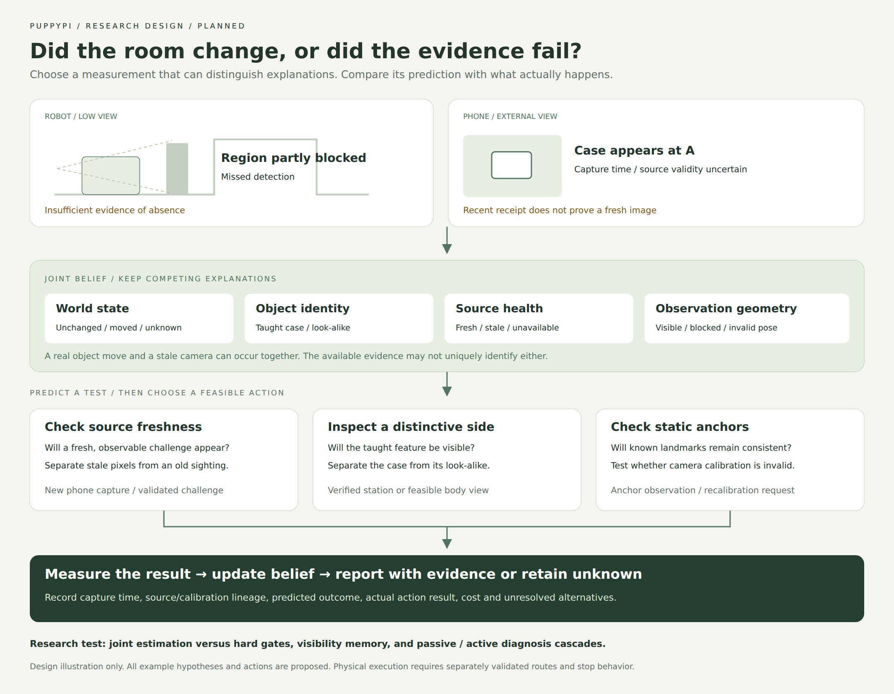

# Active room inspection: prior art, a sharper question, and an experiment

Review date: **2026-10-31**. Platform: PuppyPi Standard, host computer, and
optional fixed RGB phone camera. **Status: research proposal; no new robot
feature or experimental result.** This review revises the novelty framing of
[Room Patrol](16-room-patrol-world-model-proposal.md), which remains the system
design. It does not promote F33–F39 beyond their current implementation status.

## Decision

Yes, substantial parts of the proposed patrol already exist. A robot that patrols,
builds a scene graph, remembers moved objects, chooses informative views and
answers room questions would be a useful application, but that combination alone
is not a defensible algorithmic contribution.

Build the application around **active verification of room changes when both
the scene and the observation sources can be wrong**. Study a narrower question:

> At equal sensing and movement budgets, does jointly estimating object changes
> and camera reliability improve verified change reports over strong visibility,
> timestamp and calibration gates, or over diagnosing sensors first and then
> updating the room model?

This is a proposed empirical contribution, not a claim that joint estimation,
active diagnosis, Bayesian fusion or expected information gain is new. A second
literature audit and the experiments below must establish whether a narrower
method contribution survives. The useful deliverable can instead be a measured
low-cost system and an ego/exo benchmark with documented limitations.



**Figure 1.** Proposed experiment, not a screenshot or observed robot behavior.
[Editable SVG](diagrams/active-room-inspection.svg). Predictions are testable
observation outcomes; the figure contains no measured probabilities.

## What has already been done

Reading levels: **M/E** means the primary method and experiment sections were
examined; **P** means primary project/repository material or an abstract was
examined, with the narrower scope stated. Availability means inspected upstream
files or links, not a successful installation or reproduction. Preprints are
identified separately from conference publications.

| Work and review level | Existing capability and assumptions | Consequence for PuppyPi |
| --- | --- | --- |
| [Semantic Scene Difference Detection, 2023](https://arxiv.org/html/2309.16552) — M/E | Pretrained VQA answer differences at taught patrol viewpoints; physical Fetch experiments at three laboratory spots | Patrol plus semantic before/after comparison is established. A practical application baseline; original source release not verified |
| [3D VSG, ICRA 2023](https://arxiv.org/html/2209.07896) — M/E | Graph-based prediction of semantic scene variability, evaluated on 3RScan; change-aware visit ordering | Predicting likely changes to choose patrol stops is established. [Code](https://github.com/ethz-asl/3d_vsg) has training/inference paths; its input is an existing annotated graph |
| [Khronos, RSS 2024](https://arxiv.org/html/2402.13817) — primary formulation and repository | Dense spatiotemporal metric-semantic mapping, integrating short and long dynamics | Strong reference for persistent geometry. [ROS implementation](https://github.com/MIT-SPARK/Khronos) requires a richer mapping stack than the current station-based RGB system |
| [Clio, RA-L 2024](https://github.com/MIT-SPARK/Clio) — P, source/README | Task-dependent scene graph granularity using an information bottleneck | Task relevance is established. Offline graph clustering can be studied separately; Python-only setup does not provide the complete online perception stack |
| [Bayesian Fields, 2025](https://arxiv.org/html/2503.05949) — method/evaluation sections | Probabilistic semantic fusion and task-dependent objects in Gaussian scenes from posed RGB | Probabilistic multiview semantics is established. The linked [repository](https://github.com/MIT-SPARK/Bayesian-Fields) contained **only LICENSE** when inspected; implementation reuse is unavailable at this snapshot |
| [GraphEQA, CoRL 2025](https://arxiv.org/html/2412.14480) — P, primary approach/evaluation overview and source | Online 3D scene graph plus relevant images and hierarchical VLM exploration; simulated QA and physical examples | Room QA grounded in an actively built graph is established. [Source](https://github.com/SaumyaSaxena/graph_eqa) exists, with Hydra/Habitat and Stretch-specific setup |
| [Counterfactual perception FDI, 2025 preprint](https://arxiv.org/html/2509.18460) — M/E | Predicts diagnostic outcomes under fault hypotheses; chooses controls for fault detection/isolation | Active hypothesis discrimination is established. It is a required conceptual baseline; no author implementation release verified |
| [O-STaR, GRC 2026](https://www.hrl.uni-bonn.de/publications/2026/menon26grc) — P, institution abstract and poster | Furniture-anchored dynamic object beliefs, geometry-filtered priors and learned household relocation habits | Personalized temporal object search is established. Full implementation and source release were not verified |
| [SCOUT, 2026 workshop/preprint](https://arxiv.org/html/2606.06721) — M/E | Prior occupancy map and posed RGB-D; semantic uncertainty, predicted visibility and coverage guide viewpoints | Entropy-guided scene graph exploration is established. No source release verified in the inspected paper |
| [PBD-AG, 2026 preprint under review](https://arxiv.org/html/2608.10449v2) — M/E | Persistent baseline/delta graph, IDs, visibility-gated absence, audit events and active inspection; posed RGB-D and occupancy geometry | Particularly close to the earlier proposal. [Project](https://shuobao214.github.io/PBD-AG/) inspected; usable source release not verified |
| [OASIS-Map, 2026 under review](https://ori-drs.github.io/projects/oasis-map/) — P, project and release status | Cross-session object correspondence/change maps under partial views; RGB-D indoors and RGB/LiDAR outdoors | Persistent identity through revisits is established. Project explicitly says **Code Soon**; it is a comparison/reuse watchlist item |
| [Robot-WATCHDOG, CoRL 2026 project](https://cea-list.github.io/Robot-WATCHDOG/) — P, method/evaluation summary | Temporal object graphs and nominal demonstrations for manipulation failure detection | Predictive relational monitoring is established. Its manipulation setup is not a patrol controller; source release not verified |

The first six rows also clarify why a photorealistic room reconstruction would
improve presentation without establishing novelty. Dense geometry and calibrated
semantic evidence solve different problems. An appealing mesh can contain wrong
identities, stale objects and unobserved surfaces.

### Four comparisons that change the proposal

**3D VSG:** DeltaVSG learns position, state and instance variability; its planner
visits high-variability objects before falling back to coverage. Its active
evaluation assumes a previous map and a change measurement at each visited
object. This establishes scheduling precedent, but leaves our actual RGB
measurement reliability to be evaluated. Do not transfer its reported efficiency
gain to PuppyPi. See Sections V and V-E of the linked paper.

**PBD-AG:** Section 3 already covers persistence, visible misses and event
provenance. Its fine inspection uses a primary RGB-D view; alternate angles
support verification/retry rather than cross-view proposal fusion. Section 4
reports nine construction rollouts and three 300-frame dynamic sequences with
12 scheduled events; physical demonstrations are qualitative. Adapted memory
controls share observations and are explicitly not original end-to-end systems.
These controlled protocols are worth adopting. They do not establish robustness
to our asynchronous phone faults. This is a statement about the reported tests,
not proof that the authors' method cannot be extended.

**SCOUT:** its acquisition score combines visibility, view novelty and current
semantic uncertainty. Evaluation uses two Gazebo scenarios and three trials per
method/scenario, with a 50-observation cap for SCOUT. The challenging case retains
association and relation errors. Lower internal entropy is therefore insufficient
evidence of a correct room model. Our comparison must measure wrong confirmed
claims and coverage, not merely entropy reduction.

**Counterfactual FDI:** Han and colleagues explicitly model diagnostic test
distributions conditioned on fault and control hypotheses, and optimize active
controls using MCTS. Evaluation is simulated monocular asteroid navigation with
scene-motion, sensor-damage and visual-deprivation faults. Reusing active fault
diagnosis in a room is an application adaptation. A possible distinction is the
joint semantic-change/identity/async-source problem and its benchmark; adding a
room graph to their objective is not automatically a new algorithm.

## Candidate directions and selection

| Direction | Demo value | Closest overlap and practical constraint | Decision |
| --- | --- | --- | --- |
| Predict which objects change and patrol them first | Clear adaptive route | 3D VSG and O-STaR; needs longitudinal data, comparable navigation and perception | Include as a later scheduling baseline/extension |
| Dense 4D room replica with natural-language exploration | Visually striking | Khronos, Bayesian Fields and GraphEQA; richer pose/geometry/compute stack; some code unavailable | Optional host visualization, conditional on measured reconstruction quality |
| Joint room-change verification and observation-source diagnosis | Explains an actual failure, then selects a useful test | PBD-AG, SCOUT and active FDI; narrower joint experiment still unproven | **Main R1/R3/R5 investigation** |

The third direction offers an observable chain: conflicting evidence → competing
explanations → predicted measurement → bounded test → measured result → revised
report. It also provides a coherent reason to add the external phone camera.
The hardware constraint alone is not the contribution.

## Proposed method: jointly model the room and how it was observed

### State and evidence

Maintain a small joint belief over:

- **World state:** object/station placement, supported relations and possible
  change intervals.
- **Identity association:** several candidates when look-alikes remain plausible.
- **Observability:** whether the relevant region could actually be inspected.
- **Source state:** freshness, freeze/replay, clock-offset uncertainty, calibration
  validity and context-dependent perception reliability for each camera.
- **Action state:** feasible verified skills, measured duration and execution
  uncertainty; commanded pose is distinct from measured pose.

Changes and source faults can occur together. Do not use a single mutually
exclusive list in which “object moved” rules out “phone stale.” Use a factorized
state with a manageable joint hypothesis set and an explicit other/unknown case.
Start with enumeration/beam pruning over a few objects and stations, not an
unbounded whole-room particle system.

One design notation is:

```text
b_t = P(X_t, identity_t, visibility_t, source_health_t,
        clock_offset_t, calibration_t | accepted_evidence_1:t)
```

This is a specification, not an implemented probability model. Likelihoods need
controlled calibration data; current matcher similarities cannot be inserted as
calibrated probabilities. Begin with transparent rule-based hypotheses and keep
their scores labeled as scores until calibration is supported.

Store both capture-time intervals and receipt time. A delayed frame refers to its
capture interval, not the current room state. Use bounded historical recomputation
or smoothing for admissible delayed evidence. If time ordering is ambiguous,
retain an interval/unknown relationship. Transport sequence/ACK freshness does
not prove that sensor pixels are fresh. Equally, identical pixels in a static
room do not prove a frozen camera.

Group correlated evidence by capture/session/model lineage. Repeated crops from
one frame and two views processed by the same failing model are not independent
votes. Multiple camera views do not justify multiplying uncalibrated scores.
An RGB floor homography does not establish visibility or depth on a tabletop.
Without sufficient geometry or validated region visibility, a missed detection
retains unknown status. Test whether conservative RGB gates are adequate before
adding an optional geometric sensor.

### Prediction and action selection

Predict **observable tests** conditional on each surviving joint hypothesis:
which tag/landmark should remain consistent, whether a fresh frame should arrive,
whether a discriminative object side should be visible, and how an accepted
measurement would change a task answer. No generated image is evidence.

For a finite, feasible action set, a conventional decision formulation is:

```text
R(b) = minimum expected task loss over report / defer decisions

a* = argmin_a [ E_y R(update(b, a, y))
               + lambda_time * expected_duration(a)
               + lambda_travel * measured_route_cost(a)
               + lambda_compute * inference_cost(a)
               + lambda_help * operator_cost(a) ]
```

Include the no-action/defer alternative and remaining mission budget. Normalize
cost units, predeclare loss weights and report sensitivity. Expected risk
reduction is a standard decision principle; our research question concerns the
measurement/state model and whether the additional coupling earns its cost.

Allowed actions initially: request a new phone capture; inspect a known static
landmark; wait for a stable robot frame; acquire a discriminative close view at
an already verified station; ask a grounded question; report unknown. Movement
requires a validated route and current execution checks. A fixed phone provides
no new angle just because the planner requests one. Body pose actions are added
only after feasibility and camera motion have been measured.

### A concrete ambiguous case

| Explanation still possible | Useful discriminating observation | Insufficient evidence |
| --- | --- | --- |
| The taught case moved from A to B | Fresh exact-instance evidence at B, consistent time ordering, and a usable check at A when reporting absence there | A same-category box at B |
| The case remains at A behind an occluder | A reachable view exposing the taught region or a trustworthy independent view | Repeated detection misses from the blocked view |
| Two similar cases were confused | A side label/feature supported by enrollment references | High category confidence from two cameras |
| The phone is stale while a real move also happened | A fresh challenge-linked landmark observation plus renewed object evidence | Recent packet receipt or an unchanged JPEG hash alone |
| The fixed phone was moved | Geometric inconsistency across known static anchors, followed by recalibration or degraded operation | Automatically interpreting all displaced image regions as moved objects |
| Both cameras lack a discriminating view | Explicit unresolved result and a useful help request, if one exists | A plausible language-model explanation |

Freshness challenges must be observable, for example a bounded robot turn or a
temporary operator-presented visual nonce in the phone view. A challenge is only
attempted in a cleared, validated setup. It does not provide cryptographic sensor
attestation, and no response means unavailable evidence rather than proof of a
particular fault. Some hypotheses remain observationally indistinguishable.

## The application demo

Proposed app experience, in English by default. These screens do not exist yet;
the [current screenshot gallery](14-mobile-console-gallery.md) shows the delivered
console. Use a room/station diagram first; add a registered 3D view only after it
passes geometry checks.

1. **Room:** teach HOME and a few verified inspection stations, named regions,
   two similar cases and a simple placement rule. Show the observation age and
   coverage of each region.
2. **Patrol:** PuppyPi visits a bounded route and records useful views. Display
   actual progress and incomplete checks separately from route commands.
3. **Change:** move the taught case while the robot view is blocked. Keep the
   second case at its original station. Show candidate changes without an alarm.
4. **Conflict:** freeze the phone stream or introduce controlled delay, labeled
   as a fault-injection demo. Show the disagreement and evidence capture intervals.
5. **Investigate:** the app shows a short structured reason: “A fresh phone
   landmark check can resolve source freshness before this view is used.” Log the
   prediction and action cost before acquiring the measurement.
6. **Verify:** reacquire source validity, then inspect a discriminative feature.
   Report changed placement only if identity and temporal evidence support it.
7. **Repair:** move the phone. Show calibration invalidation and the affected
   claims becoming unknown; resume fusion after a validated recalibration.
8. **Ask the room:** “What changed since the last completed patrol?” and “What
   remains unchecked?” Answers cite actual frames and capture times. They do not
   infer a perpetrator or an unobserved cause.
9. **Replay:** scrub through world claims and source health, compare predicted
   tests with measured outcomes, and export evidence plus the final report.
10. **Take over:** demonstrate pause/manual takeover/explicit revalidated resume
    and a separately measured HOME outcome once physical execution is available.

For a strong live presentation, let the evaluator choose one intervention from a
bounded menu without revealing it to the policy. The experiment controller logs
ground truth separately; only observable evidence reaches the tested method.
Show at least one unresolved case. This tests behavior rather than a scripted
sequence of predetermined answers.

## Reuse and deployment boundary

| Component | Reuse decision | Where it would run |
| --- | --- | --- |
| Existing library, references, SQLite evidence, checklist reports, PWA | Extend shared records and views; preserve schema/model provenance | Python host `.venv-dev` and browser |
| Existing relay and expiring control contracts | Keep execution isolated from inference; camera metadata needs clock validation | Pi's verified vendor/ROS environment, still to be inventoried |
| Phone Observer | Implement fixed-camera capture, source lifecycle and calibration before policy research | Phone browser capture; host ingestion/time estimation |
| 3D VSG | Reproduce graph-based prediction in an isolated optional environment; compare with frequency/recency baselines | Host; Python 3.8-era requirements require compatibility work |
| PBD-AG/SCOUT/active FDI principles | Implement clearly named common-interface adaptations if code remains unavailable; preserve equations and input differences | Pure Python host policy core; optional heavier model adapters |
| Khronos | Optional richer-sensor study; do not make it a dependency of station patrol | Separate host ROS 2 stack; README tests Jazzy/Ubuntu 24.04 and warns ROS 2 support is incomplete |
| Clio | Optional offline task-specific graph study | Separate host environment; complete online stack has additional ROS/perception dependencies |
| GraphEQA | Study task/image retrieval and bounded planning contracts; clarify licensing before copying code | Separate Hydra/Habitat/robot environment; not an onboard Pi install |
| Bayesian Fields / OASIS-Map | Watch releases; no implementation dependency while source is unavailable | Optional reconstruction research only |

Khronos example semantic inputs include ground-truth/pre-recorded labels; its
optional learned segmentation has separate model/setup requirements. Do not
report results obtained with such labels as raw-RGB perception performance.
GraphEQA's repo root had no license file and GitHub metadata returned no detected
license; public visibility alone does not grant code reuse rights. Dependency,
checkpoint and dataset terms need their own checks before importing anything.

The following default-branch snapshots were obtained through GitHub's read-only
API during this review. Source inspection is not execution evidence:

| Repository | Inspected revision | Observed release detail |
| --- | --- | --- |
| `ethz-asl/3d_vsg` | `20dd48e2bc34e91acebd40a624d17c6d922d5649` | `src/`, `config/`, training/inference instructions; BSD-3-Clause metadata |
| `MIT-SPARK/Khronos` | `63faadde6ed92220e78fb2f6ca86dcc54bb5cf9e` | ROS stack and datasets documented; BSD-3-Clause metadata |
| `MIT-SPARK/Clio` | `f912b7c08fb0e029d80fd6b05eccee5009199ce4` | Full and offline-only setup documented; BSD-2-Clause metadata |
| `SaumyaSaxena/graph_eqa` | `d3fbbf14bdb05631a1633556d7d3056601374cd3` | `graph_eqa/`, Dockerfiles, configurations and scripts; licensing unresolved |
| `MIT-SPARK/Bayesian-Fields` | `f127344ef4eaa06f134757bca42986b74159cc6b` | Root contains LICENSE only; BSD-2-Clause metadata |

No upstream code, model weights or dataset was installed by this review. A
Dockerfile in an upstream project does not mean this repository deploys Docker.
Pi board/firmware, camera motion, host GPU and geometric sensors remain unknown.

## Experiments that could justify the research

### Three distinct protocols

**A. Shared-evidence replay:** every method receives identical captured frames,
metadata and perception versions. Test delayed/reordered data, identity swaps and
belief repair. This isolates estimation, not active policy or physical navigation.

**B. Controlled acquisition experiment:** repeat staged layouts/interventions
with the same allowed station/view actions. Acquire measurements chosen by each
policy. A branchable synthetic harness can exercise all actions but must be
labeled synthetic. A fixed recorded camera trajectory cannot fairly evaluate a
policy that asks for an unrecorded view.

**C. Supervised physical closed loop:** evaluate complete missions after camera,
route, watchdog and stop characterization. Log motion failures, localization
loss, Wi-Fi delays, operator interventions and uncompleted inspections. Do not
merge these results with synthetic or replay results.

### Required baselines

| Baseline | What it isolates |
| --- | --- |
| Fixed patrol + current-frame comparison | Minimal application reference |
| Last-seen memory; recency/frequency scheduling | Whether persistent or learned machinery is needed |
| Visibility-gated persistent memory, PBD-AG-inspired | Whether standard occlusion handling explains gains |
| Always fuse ego/exo | Whether extra images alone explain gains |
| Hard metadata/clock/calibration gates + visibility memory | Whether straightforward engineering solves source errors |
| SCOUT-inspired uncertainty/visibility acquisition | Whether generic semantic active perception is sufficient |
| Passive source diagnosis → room update | Whether separate stages are sufficient |
| Active FDI-inspired diagnosis → room update | Whether established active diagnosis is sufficient |
| Proposed joint state + task-risk acquisition | Whether coupling improves end-task decisions enough to pay its cost |
| Oracle source/visibility labels | Diagnostic upper reference only; never a deployable competitor |

Match detectors, embeddings, frame/action budgets and available sensor inputs.
Use both equal wall-clock and equal processed-evidence analyses. A station/RGB
adaptation must be named as such, with omitted components recorded; do not claim
to outperform a full RGB-D paper by comparing against a reduced reimplementation.
Where faithful original methods are feasible, run those separately in their
native input setting. Include a simple greedy action selector before MCTS; search
complexity must earn measurable utility.

### Data and split plan

[3RScan's official release](https://github.com/WaldJohannaU/3RScan) supports
revisited-room object identity/change experiments with RGB-D, poses and
correspondences. It does not supply this proposed continuous robot/phone patrol
and sensor-fault protocol. Keep reference/rescan groups in one split; follow
access terms and the [coordinate/unit FAQ](https://github.com/WaldJohannaU/3RScan/blob/master/FAQ.md).
The [Khronos datasets](https://github.com/MIT-SPARK/Khronos) can exercise dynamic
mapping components, with sensor and semantic-label assumptions recorded. Neither
dataset substitutes for the required PuppyPi observations.

Collect a small versioned **ego/exo room-inspection benchmark**. This is a proposed
dataset, not a released asset. Include unchanged rooms, actual moves, disappearances
from observable regions, occlusion-only episodes, look-alike exchanges, nuisance
lighting, and source faults both alone and combined with true changes. Test
missing/untrustworthy metadata as well as explicit delays; otherwise a timestamp
threshold will trivially solve the injected fault.

Use an independent reference recording and event log for placement, identity,
camera relocation and intervention times, including annotation disagreement.
Keep evaluator-only labels, fault schedules and held-out views outside policy
inputs. A tag visible to the tested model cannot secretly serve as an excluded
identity cue. Learn likelihoods/costs on training data; choose thresholds on a
separate calibration split; evaluate held-out rooms/days/object instances as the
claim requires. If only one room is available, claim same-room robustness rather
than unseen-room generalization.

### Metrics and statistical unit

- **Primary:** false confirmed change reports against decision coverage and
  time-to-verified-change, at matched mission budgets. Predeclare report matching
  by identity, region, event type and time interval; count false reports per
  unchanged opportunity and precision among issued reports separately.
- **Identity and memory:** association errors/ID switches, event recall, unresolved
  true changes and belief-repair delay. An always-unknown system has zero false
  reports but fails coverage and recall.
- **Diagnosis:** source-fault confusion matrix and delay; joint change-plus-fault
  performance; inability to distinguish hypotheses is an explicit outcome.
- **Prediction:** held-out test-outcome log loss/Brier score when probabilities
  are calibrated, reliability plots and risk/coverage under shift. Raw heuristic
  scores are evaluated as rankings, not calibrated probabilities.
- **Cost and execution:** end-to-end latency including remote calls, inference
  count, bytes, measured travel, action failures, interruptions and operator time.
  Do not substitute travel for energy without power measurements.

Pair scenes/interventions and counterbalance method order. Estimate uncertainty
over missions or room/day groups, not adjacent frames. A pilot estimates variance
and informs sample-size planning; an arbitrary number of images is not a power
analysis. Report all failures and separately analyze source-only, change-only,
combined and unidentifiable cases. Predeclare which result would reject the main
hypothesis and publish negative findings in the project report.

## Implementation sequence and decision gates

The user has more than three months; the following 16-week allocation is
conditional on hardware access and team capacity. It replaces a feature-count
race with visible application milestones and one coherent experiment.

| Period | Concrete slice | Exit criterion |
| --- | --- | --- |
| Weeks 1–2 | Camera/stop characterization; durable run ledger and deterministic ego replay | Evidence capture/receipt times and actions survive restart; stale/duplicate events cannot silently rewrite current claims |
| Weeks 3–4 | Taught room regions, automatic candidate perception, fixed patrol inspection view | Demonstrate unchanged/moved/occluded/look-alike outcomes on labeled replay; human annotations remain distinguishable |
| Weeks 5–6 | Fixed-phone ingest, time bounds, anchor checks and hard-gated fusion | Show delay, dropout and camera movement without accepting unsupported joint confirmation |
| Weeks 7–8 | Common-interface visibility memory and passive/active diagnosis baselines | Reproduce controlled behaviors; record adaptations, cost and calibration data; pilot the benchmark |
| Weeks 9–10 | Small joint hypothesis estimator and greedy task-risk acquisition | Beat or explain parity with the strongest cascade/gating baseline on a locked development set; measure added overhead |
| Weeks 11–12 | Evidence-linked Room/Investigate/Replay app views and bounded mission integration | Evaluator-selected intervention produces a measurement-dependent result; unidentifiable cases remain unresolved |
| Weeks 13–16 | Held-out repeated missions, ablations, figures, report and optional reconstruction | Report paired uncertainty, errors/interventions and cost; release only cleared selected artifacts |

**Go/no-go:** if gates and a cascade match joint estimation, keep the simpler
system and present that result. If a full prior-art implementation already solves
the same sensor/task conditions, reproduce it and narrow the claim. If there is
no trustworthy motion/visibility baseline, keep the acquisition experiment
stationary/operator-assisted and label it accordingly. Dense reconstruction,
learned video prediction and body-aware views are extensions after these gates.

The next reviewable code slice is a versioned run/evidence ledger with capture-time
intervals, source/session identity, calibration references and proposed-versus-
measured action records, plus two replay episodes exercising moved versus occluded
beliefs. It must use migrations and preserve the existing deterministic baseline.
Phone capture and physical patrol are subsequent integrations, not implied by
that ledger.

## Claim boundary

An appropriate provisional project title is **“Active Room Inspection with
Asynchronous Robot and Phone Evidence.”** A defensible eventual contribution
would need measured benefits, an explicit comparison with active diagnosis and
persistent-graph systems, and a reproducible protocol. This review identifies
overlap and a testable direction; it does not certify publication novelty or a
physical capability. The impressive demo should be the visible consequence of
verified inference and useful actions, with uncertainty exposed when necessary.
