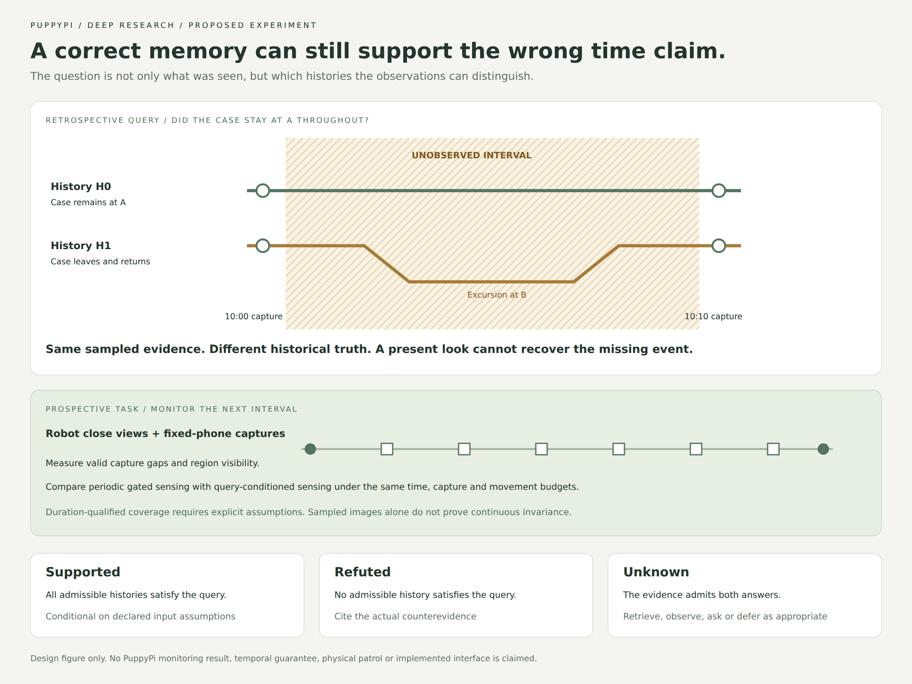

# PuppyPi room intelligence: temporal evidence, predictive models and active inspection

Research date: **2026-10-31**. Mode: **Deep**, using the eight-phase
[Deep Research skill](https://github.com/199-biotechnologies/claude-deep-research-skill/blob/f2f2c0fa4e7617ca84c86b63f4bb40f77a746933/SKILL.md).
Platform: user-confirmed PuppyPi Standard, host computer, optional fixed phone.
**Status: proposed research and application design; no new hardware capability.**

This report extends the [twelve-work audit](17-deep-research-active-room-inspection.md)
and revises its research priority. Read the current
[feature inventory](06-feature-roadmap.md) for actual delivery status. The
[source registry](research/2026-10-31-deep-room/sources.jsonl),
[evidence store](research/2026-10-31-deep-room/evidence.jsonl),
[claim ledger](research/2026-10-31-deep-room/claims.jsonl) and
[run manifest](research/2026-10-31-deep-room/run_manifest.json) make the review
inspectable. Numbered citations identify works, not independent confirmations
from different pages belonging to the same project.

## Executive Summary

The strongest project direction is a room assistant that can explain both what
it observed and what its observation history cannot establish. This review
finds direct precedents for long-term temporal question answering, choosing
between memory retrieval and physical exploration, uncertain memory refinement,
perception diagnosis, and predictive inspection. Those precedents substantially
narrow the earlier proposal's novelty claim. In particular, Mind Palace reports
a false desk-use conclusion caused by sparse patrol coverage, while AbstainEQA
already includes temporal information unavailability. [1] [4]

The recommended application is **PuppyPi Room Observatory**: taught stations,
object identity, an evidence timeline, change investigation, bounded patrol and
an optional external phone view. Its distinctive demonstration would let an
evaluator choose an intervention and a time-qualified question. The app would
show the observation gaps, select a useful measurement where possible, and
return a supported answer or a precise unresolved result. For future monitoring,
it would allocate robot and phone captures to reduce question-relevant gaps.

The proposed research question is whether task-conditioned acquisition improves
supported-answer coverage at a fixed false-claim rate and sensing budget over
periodic sampling with conservative temporal monitoring. This is a hypothesis,
not certified algorithmic novelty. Partial-trace temporal semantics, active
diagnosis and joint reliability estimation are established; they are foundations
and required baselines. [8] [9] [12] [26]

Learned world models and dense reconstruction remain optional host experiments.
Released manipulation models do not supply PuppyPi motor control, and some
strong RGB change methods have substantial offline computation costs. [5] [19]
The first implementation should therefore establish evidence provenance,
visibility-qualified temporal claims and replay, then add phone acquisition and
measured action-outcome prediction. A counterfactual-history benchmark, explicit
assumptions, independent ground truth and causal alarm timing can make the work
academically useful even if simple baselines win. No upstream model was installed,
paid API called, or robot actuated during this review.

## Introduction: question, scope and methodology

The practical question is broader than how to attach a language model to a robot:
what room understanding would make a small quadruped useful, visually compelling
and scientifically assessable? This report considers a user who wants both
demonstrable features and R&D, has more than three months, and already has a
Python evidence core and an English-first mobile console. Those are project
constraints, not externally measured research results. The application should
reuse that work rather than create a second isolated controller or demo database.

Three independent retrieval branches examined temporal memory/world models,
active diagnosis/asynchronous observation, and platform/inspection benchmarks.
A fourth pass examined foundational world models, reconstruction and temporal
monitoring. Primary method and evaluation sections were read for the closest
works; repository trees, selected implementation files and deployment notes were
checked where available. The registry records narrower reading scopes when only
an abstract or official implementation document was inspected. No source was
treated as reproduced merely because its repository exists.

The initial framing asked whether joint camera reliability and object-change
inference might provide a contribution. Retrieval exposed older diagnostic-graph,
robust-estimation and asynchronous-fusion precedents. A second discovery was more
actionable: a reported failure of temporal room understanding caused by incomplete
observation coverage. The outline was consequently refined toward temporal claim
support and prospective acquisition, with source diagnosis retained as a nuisance
state and baseline. That refinement is an interpretation of the evidence, not an
assertion that prior methods cannot be extended. [1] [8] [10] [12]

The review includes academic papers, manufacturer specifications and official
software documentation. Paper, project page, code and dataset belonging to one
work form one scientific independence cluster. Broad conclusions are checked
against multiple works; a paper-specific fact is explicitly single-source and
does not become externally replicated because three links repeat it. Numeric
source scores in the registry are the skill's uncalibrated triage heuristic.
They are not probabilities of truth, and they do not replace assessment of
experimental design, privileges or reproducibility.

Material assumptions remain open. Standard does not identify the user's exact
board, firmware, camera or installed software. Its current manufacturer packing
list must be distinguished from options shown across the product family. [15]
Host GPU availability, repeatable robot pose, external-camera timing and reliable
obstacle sensing are unverified. Accordingly, the proposal begins with taught
regions and supervised, measured station actions. Dense metric navigation,
continuous high-rate observation and a generic learned locomotion controller are
outside the initial claim.

The success criterion for this research phase is a decision-ready design with
counterevidence, testable predictions, known reuse constraints and a clear
falsifier. It is not a promise of publication. The report distinguishes observed
source facts from our proposed system, logical examples and experimental plans.
All quantities proposed for future measurement remain proposed, and all existing
physical results belong to their original platforms and experimental settings.

## Main Analysis

### Finding 1: temporal room understanding already exists; historical coverage is the harder boundary

[Mind Palace](https://arxiv.org/html/2507.12846v2) already combines episodic
scene-graph memory, temporal questions, exploration and value-of-information
retrieval stopping. Its evaluation includes simulated and real scenes. Most
relevant here, its limitations describe a desk-use conclusion that was wrong
because periodic visits missed activity between observations. This is a direct
motivation for studying evidence coverage rather than advertising long-term
memory itself as a new capability. [1]

[STAR](https://arxiv.org/html/2511.14004v3) similarly joins temporal retrieval
and spatial actions in one decision loop. Its source contains memory components,
but the inspected benchmark README remained forthcoming and licensing was not
detected. Its simulation execution also uses privileged object masks, including
in the reported realistic memory setting. Reuse therefore needs a clearly named
common-interface adaptation rather than a claim of equivalent raw-RGB robot
performance. [2]

[DynaMem](https://arxiv.org/html/2411.04999v2) supplies another useful memory
reference: registered RGB-D supports stale-geometry revision and grounded query
cross-checking. Its dynamic grounding benchmark isolates memory queries from
navigation, exploration and manipulation. [3] These distinctions matter because
an apparent improvement can result from better input geometry, privileged
detections or a narrower task. The PuppyPi comparison must separately identify
what information each method receives and what action is actually measured.

Abstention also has a close predecessor.
[AbstainEQA](https://arxiv.org/html/2512.04597) explicitly includes events
outside the observed timeframe as information unavailability. Its analysis of
prompting and text-only controls warns against apparent refusal performance that
depends on question wording rather than available visual evidence. [4] Our
inference is that a useful new test must hold wording constant while changing
observation history. A model should not earn credit merely for learning that
questions containing a particular word are often unanswerable.

[UQ-DAAAM](https://arxiv.org/html/2606.08277v1) refines uncertain semantic memory
using multiview caption consistency. Its guarantees depend on stated score
distribution assumptions; they concern uncertainty reduction rather than
calibrated answer correctness. Refinement selects recorded views, with the
reported pipeline doing this at shutdown, rather than demonstrating physical
next-view navigation. [7] Caption agreement and temporal completeness are
therefore different evaluation targets. A perfectly consistent description can
still be unsupported for an interval the camera never observed.

Consider a case observed on shelf A at 10:00 and 10:10. One possible history
leaves it there throughout. Another moves it to B at 10:03 and returns it at
10:07. The two recorded shelf images can be identical. “Where was it last
observed?” can have a supported answer. “Did it remain there for the whole ten
minutes?” cannot be established from those images alone. This is our logical
example, not a measured result from any paper. Adding an attractive room graph
does not introduce the missing observation.

That example changes the product requirement. An evidence timeline needs
unobserved intervals, source validity and the scope of a claim, not just a row
of successful sightings. Natural-language answers should distinguish a historical
witness, a present observation and a model-based forecast. A present look can
verify current placement; it cannot reconstruct an unrecorded excursion. A
stored phone recording or a human witness may provide new historical evidence,
but each must be identified as a separate source with its own reliability.

The resulting opportunity is deliberately narrower than “robots should know
when they do not know.” The question is whether physically measured visibility,
timing and identity constraints can improve which temporal claims a system
supports, and whether prospective robot/phone acquisition can improve that
support efficiently. A deterministic coverage checker is the strongest initial
competitor, not an inconvenience to be omitted. If it matches a richer method,
the appropriate outcome is a simpler implementation and a useful negative
result. Further algorithmic novelty would require an advance beyond these
existing memory, abstention and uncertainty frameworks.

### Finding 2: a useful world model needs a declared prediction target and a deployment budget

For this project, use three separate terms. A **historical room model** stores
supported identities, places and observations over time. A **predictive
observation model** estimates what a permitted sensing action might reveal.
A **learned environment simulator** predicts future latent states or images from
actions. These are proposed architectural categories, not a claim that the
literature uses one universal taxonomy. They prevent a scene graph, a renderer
and a learned dynamics model from being evaluated as if they were interchangeable.

The foundational [World Models](https://worldmodels.github.io/) work demonstrates
learned recurrent representations and controller training through imagined
environment dynamics. [23] [DayDreamer](https://arxiv.org/abs/2206.14176) extends
world-model learning to physical robots, including a quadruped; its released
implementation has robot-specific actor/learner configurations. [24] These are
important precedents, but their existence does not establish compatible PuppyPi
proprioception, actuator interfaces or online-learning conditions. Replacing the
current motion boundary would be a separate hardware/control project.

[V-JEPA 2-AC](https://arxiv.org/html/2506.09985) makes the action-domain problem
concrete. Its studied controls are end-effector commands for Franka manipulation,
and its specified planning comparison reports 16 seconds per action on an
RTX 4090. [5] That timing belongs to its reported configuration, not every use
of its encoder. The implication for PuppyPi is to evaluate optional frozen
features or a small observation predictor offboard, while preserving existing
bounded motor skills. The released action head must not be interpreted as
quadruped velocity or servo commands.

[WorldMem](https://arxiv.org/html/2504.12369v3) addresses long-term consistency of
generated scenes with pose/time-indexed memory, evaluated through generation
metrics in Minecraft and posed real imagery. [6] This is a different objective
from proving that an enrolled physical case remained at a station. An imagined
view may help visualization or supply a candidate prediction; it is not captured
evidence. The app must preserve that distinction even when the predicted image
looks convincing. A synthetic room replay likewise cannot be presented as a
recording of an actual patrol.

Reconstruction offers a useful visual extension.
[VGGT](https://github.com/facebookresearch/vggt) predicts cameras, depth and
point/track geometry, with examples for COLMAP export and optional bundle
adjustment. Its release distinguishes original and commercial checkpoint terms.
[25] The proposed use is a host-generated room visualization registered against
measured anchors. Before attaching metric claims to it, measure scale, pose and
reconstruction error on held-out landmarks. A reconstructed surface is not by
itself a certified traversable region, an object identity or a visibility proof.

[SceneDiff](https://arxiv.org/html/2512.16908v2) is especially relevant as a
training-free RGB spatial-change baseline. Its inspected implementation uses
geometry, segmentation and pretrained features; the paper reports an average
159.4 seconds per sequence pair on an NVIDIA A40. [19] This supports an offline
deep-audit role, not a promise of live per-frame processing on the Pi. Its paper,
website and current evaluation revision also differ in reported headline gains
and matching protocol. Freeze the revision and metric definition before making
comparisons; a downloaded repository name is not a reproducibility specification.

A direct predictive-inspection precedent also exists:
[World Model Failure Classification and Anomaly Detection](https://arxiv.org/html/2602.16182).
It studies a fixed robot pose with PTZ control and offboard inference, using
290 short inspection videos. [17] That is strong motivation for a separate
temporal-monitor comparison. It does not establish autonomous room traversal,
raw sensing robustness or event coverage between sampled patrol stops. A
successful gauge-monitor demonstration should not be transferred wholesale to
free-moving object inspection.

Our proposed architecture consequently uses two rates. Cheap, bounded perception
and source checks support live operation; selected episodes enter a queued host
audit whose completion time is visible. An audit result refers to the evidence
it processed, even if the robot has since moved. It can request a fresh check
before a current-state report. These are design choices to be measured, not
performance claims. The cost model includes upload, queueing, model inference
and re-acquisition, rather than timing only one network forward pass.

For the first predictive experiment, forecast the outcome of a small set of
verified observation skills: whether a region will be exposed, an instance
feature discriminative, a tag usable and a capture fresh. Record the prediction
before execution and score the measured result afterward. Compare a lookup table,
a geometric/rule baseline and a small learned head using the same frozen visual
features. Do not begin by training a large video generator. If predictions fail
to improve task decisions after their cost is counted, the room assistant should
remain a structured evidence system with transparent sensing policies.

### Finding 3: joint reliability estimation and active diagnosis are foundations, not the remaining novelty

The previous proposal emphasized jointly considering a changed room and faulty
camera evidence. That is a sensible state-estimation design, but the general
pattern has older precedents.
[Switchable Constraints](https://nikosuenderhauf.github.io/assets/papers/IROS12-switchableConstraints.pdf)
jointly optimizes geometric state and factor inclusion using latent switches.
[12] [PerceptionMonitoring](https://arxiv.org/html/2205.10906) models diagnostic
relations, failure states and diagnosability; released source includes a
Python/C++ toolchain with incomplete usage documentation. [8] Robust weighting
and diagnostic graphs therefore belong in the baseline ladder.

[Han et al.](https://arxiv.org/html/2509.18460) go further by predicting
control-conditioned diagnostic outcomes and selecting controls through MCTS for
fault isolation. Their evaluation is simulated monocular asteroid navigation.
[9] [Gao et al.](https://arxiv.org/html/2111.03751) compensate delayed object
locations before collaborative fusion, assuming correspondences, extrinsics and
delay estimates in an RGB-D setting. [10] These establish active diagnosis and
asynchronous object estimation without proving that either transfers unchanged
to an RGB quadruped and phone. An adaptation must preserve that distinction.

Timing is also an inference problem with observability conditions.
[Qin and Shen](https://arxiv.org/html/1808.00692) jointly estimate temporal offset
with visual-inertial state and explicitly use sufficiently excited motion in
their calibration experiments. [11] A static room and static external camera
do not automatically offer such excitation. Likewise,
[single-frame deep view synchronization](https://arxiv.org/html/2007.03891)
studies content alignment for unsynchronized multiview tasks with geometric
assumptions; it is not sensor-freshness attestation. [14] Clock, image content and
packet sequence are related evidence, not interchangeable guarantees.

Even a predict-test-update inspection loop is established.
[Sehr et al.](https://arxiv.org/html/2005.00167) use process uncertainty to guide
robot sensing, while their hardware-in-loop experiment substitutes simulated
process measurements for captured thermal imagery. [13] This is a useful warning
about evidence labels: physical motion plus simulated perception is a mixed
experiment, not a complete physical vision validation. PuppyPi reports should
separate replay, synthetic observations, selected-view acquisition and actual
closed-loop execution with equally explicit boundaries.

The sharper design target is **answer identifiability**. Suppose the phone may be
stale, but every plausible current-world hypothesis agrees that a newly observed
case at B is the taught instance. A task asking for current location may already
be answerable without proving the phone's exact failure mode. Conversely, a task
asking whether the case ever left A remains unresolved even if camera health
is now completely known. Resolving all fault entropy can waste effort that has
no effect on the requested answer. This is our interpretation and proposed
policy objective, not an established new result.

A useful state representation therefore preserves combinations. An object can
move while the phone freezes; a camera can move while two look-alikes exchange
positions. A single categorical label such as change-or-fault excludes valid
worlds. Source hypotheses should influence which observations are admissible and
how uncertain they are, while world hypotheses describe placement and identity.
The system need not diagnose an unseen fault with certainty before reporting a
well-supported fact from an independent valid source.

There is an important impossibility boundary. If a static live camera and a
frozen image produce exactly the same accessible observations, pixel equality
does not identify which is present. A new packet timestamp only identifies
receipt unless its relation to capture is established. A validated visual
challenge, preserved historical recording or independently observed landmark
motion can add information. If no feasible test separates answer-changing
hypotheses, further repeated inference cannot turn disagreement into knowledge.
The correct outcome remains unresolved, possibly with a grounded help request.

The experiment should first test deterministic age/session/calibration gates,
visibility-qualified negatives and robust residual weighting. Next compare
passive and active diagnosis cascades against task-conditioned acquisition using
the same observations and permitted actions. A larger joint estimator is justified
only if its end-task benefit survives those controls. MCTS is optional after a
greedy selector; algorithmic complexity is a cost and an experimental variable,
not evidence of research depth by itself.

### Finding 4: temporal claims need explicit semantics before an intelligent acquisition policy can be evaluated

**Figure 1.** Proposed counterfactual-history test, not collected data or a
delivered app screen. The phone row describes a future monitoring experiment,
not recovery of missing past observations.
[Editable SVG](diagrams/temporal-evidence-gap.svg).

The proposed method starts with a bounded query contract. Parse a request into
an enrolled identity, a named region, a time horizon, a predicate and a temporal
operator. Preserve distinctions such as last observed, present now, observed at
every check, continuously present, or an excursion lasting at least a declared
duration. Unsupported requests require clarification. The language model may
propose this typed query, but it does not decide whether the evidence satisfies
it and does not issue movement commands. This is a design proposal.

Temporal monitoring itself is established.
[Robust Online Monitoring of STL](https://people.eecs.berkeley.edu/~sseshia/pubdir/rv15.pdf)
defines satisfaction intervals for partial signals and states an interpolation
assumption for reconstructing sampled signals. [26]
[RTAMT](https://github.com/nickovic/rtamt) provides online/offline monitoring
interfaces, including a bounded-future online fragment and optional C++ backend.
[27] The research must not rename three-way monitoring as a new logic. The room
specific problem is constructing defensible input signals from uncertain
identity, geometry, source validity and capture time, then measuring whether
selecting observations improves useful decisions.

Our proposed semantics uses a set of histories compatible with the accepted
evidence and declared assumptions. Let an evidence record retain capture-time
bounds, receipt time, source/session, model/preprocessor version, region,
identity candidates, calibration reference and observed visibility. Let
`H(E, A)` denote histories consistent with evidence `E` under assumptions `A`.
For a typed query `q`, return Supported if every admissible history satisfies it,
Refuted if none does, and Unknown otherwise. If `H` is empty, report inconsistent
evidence and investigate admission/assumptions; do not accept every query through
vacuous truth. This is a specification for a small prototype, not implemented code.

This set-valued view is deliberately separate from a probability distribution.
It can establish an assumption-dependent support relation without inventing
probabilities. A probabilistic forecast additionally needs a transition and
measurement model fitted and calibrated on appropriate held-out episodes.
“Likely remained at A under this learned model” is a forecast, not equivalent to
“observed continuously at A.” The app should make that distinction understandable
without requiring the operator to inspect equations.

**Elementary indistinguishability argument.** Take any finite set of valid robot
capture times with a nonempty gap. Construct history H0 with the object at A
throughout and history H1 with an excursion-and-return entirely inside that gap.
Allow unrestricted object transitions and make all recorded views otherwise
identical. Any method receiving only those observations gets the same input in
both histories, although their continuous-presence and ever-left answers differ.
It cannot always issue a correct definite answer for both. This is a simple
logical limitation, not a novel theorem or an empirical failure rate.

The argument also explains why a retrospective query is not always an acquisition
task. A fresh look may resolve present location or identify which stored crop
belongs to the case. It cannot reveal a vanished past excursion without an
additional witness or recording. The action selector must distinguish recoverable
stored evidence, current-state ambiguity, irrecoverable past ambiguity and a
future monitoring request. Otherwise it can spend a large movement budget on a
question no future view can answer. Human help counts as a source with response
time, provenance and possible error; it is not a hidden ground-truth oracle.

A narrower duration contract permits a useful conditional statement. Suppose
every excursion lasts at least `delta`, source validity and object labels are
correct at captures, the relevant region is observable, and valid captures span
the requested horizon including its endpoints. If every actual adjacent gap is
strictly shorter than `delta`, an excursion within that horizon cannot occur and
return entirely unwitnessed: it would have to fit inside a shorter gap. Boundary
crossings are witnessed at the endpoints. This elementary sampling argument is
an explicit operating assumption, not a general guarantee that a camera detects
all real events.

With uncertain capture times, use the largest admissible adjacent gap and a
certified observed span. A nominal timestamp near the query boundary does not
establish that the boundary itself was observed. Occlusion, uncertain identity,
source failure, exposure blur or wrong labels invalidate the proposition's
premises. Camera frame rate alone cannot certify continuous coverage, and
intervals between accepted frames cannot silently become observations through
constant interpolation. The initial benchmark should sweep event duration
against capture gaps and report where this contract actually holds.

An implementable first version can maintain disjoint support, contradiction and
unknown intervals for each enrolled object/region predicate, together with the
assumption used to bridge any interval. It should preserve negative evidence only
where the object could genuinely have been seen. A detector miss from a low or
blocked view does not prove absence on a tabletop. If geometry is insufficient,
operator-specified region visibility may support a labeled experimental mode,
but that mode must remain distinct from automatic inference. Exact-instance
identity is evaluated separately from class recognition.

For prospective monitoring, define a finite set of feasible captures, station
inspections and help requests. Our proposed objective minimizes future task loss
plus measured sensing, travel, compute and operator costs. A deterministic policy
may minimize the largest query-relevant blind gap; a stochastic policy may use
an explicitly estimated event model to minimize expected loss. Neither objective
follows from a set of admissible histories alone. Include a no-action/defer option,
remaining budget and action failures rather than assuming each command creates
a useful observation.

Adaptivity needs a reason to help. In a homogeneous single-region setting with
equal costs and no useful event prior, evenly spaced valid observations are a
strong baseline for controlling the maximum gap. The study should include that
setting and expect little advantage. More informative conditions have multiple
query regions, complementary ego/exo visibility, changing occlusion, variable
transmission/inspection cost or measured event context. The policy must exploit
observable differences rather than private intervention schedules. If benefit
exists only when supplied true hidden visibility or event timing, it does not
support the deployable research claim.

The more ambitious model predicts the probability that a permitted action
produces an admissible, answer-changing observation. Its targets are identity
discrimination, region visibility, timing validity and execution success, not
beautiful imagined pixels. Train it on measured action outcomes, calibrate it
separately and compare against empirical frequency tables. A useful ablation
keeps all state and perception fixed while replacing query-conditioned utility
with generic entropy or coverage utility. That tests the proposed decision
mechanism instead of confusing a new detector, extra camera and new planner.

### Finding 5: the benchmark must expose impossible answers and causal evaluation errors

The proposed benchmark has two complementary goals: evaluate supported temporal
answers and evaluate how acquisition improves future observability. It must not
reward a method for confidently guessing a hidden event from a biased question.
The central unit is a mission with a query, admissible evidence, permitted
actions, an intervention history and a separately protected reference record.
Frames from one mission are correlated observations, not independent trials.
All counts and splits below describe a proposed protocol, not collected data.

Start with paired histories. Use identical enrolled objects, room layout and
question wording, and make the robot's sampled observations match as closely as
possible. In one history an object stays at A; in the other it leaves and returns
between visits. A retrospective arm supplies no additional historical witness.
A prospective arm begins the monitoring request before the intervention and
permits budgeted phone captures or station checks. The pairing separates
evidence sufficiency from language shortcuts and tests whether the policy buys
new information instead of inventing it. The strict indistinguishability replay
arm must use byte-identical model-visible frames and relevant metadata for the
paired histories. Approximately matched physical trials test robustness rather
than the literal impossibility argument.

Cross that design with no-change, persistent move, excursion-return and
look-alike exchange conditions. Vary view obstruction, capture gaps, phone delay,
camera relocation and known/unknown timing. Include true changes together with
source faults and episodes in which neither camera can resolve identity. Keep
source-fault labels out of the method's inputs unless a baseline is explicitly
given oracle information for diagnosis. Easy faults with trustworthy timestamps
belong in the benchmark, but cannot be the only cases: a timestamp threshold
would otherwise solve the advertised challenge.

There are three evaluation modes. Shared-evidence replay fixes all observations
and perception outputs, isolating memory, admission and query semantics.
Controlled acquisition lets each policy request real supported actions against
repeated staged conditions, measuring the observations it actually obtains.
Supervised physical missions add localization, movement, network and intervention
failures. A fixed recorded trajectory cannot fairly evaluate a request for an
unrecorded view. Synthetic branching can test policy logic, but its result must
remain separately labeled rather than mixed into a physical success rate.

The strongest baseline is a partial-trace monitor with periodic acquisition and
conservative source/visibility gates. Compare it with the same monitor using
generic coverage/entropy acquisition, then query-conditioned acquisition using
the identical state estimator. Add a current-state graph, a retrieval/VLM QA
adaptation, and prompted abstention as application comparisons. Diagnosis-first
cascades and robust weighting test whether the source model adds anything.
Optional learned observation forecasting must face a measured lookup-table
baseline. An oracle schedule or hidden visibility labels are diagnostic upper
references only, never deployable competitors.

The primary result should be supported-answer precision against decision
coverage at matched mission time and sensing budgets. Include event recall,
unresolved true changes, false definite answers on indistinguishable pairs,
capture-gap distributions and latency from event onset to the **first causal
report**. Universal-claim errors and sampled-check answers require separate
scoring. A system returning Unknown everywhere avoids false assertions but fails
coverage and recall; a system answering everything can have misleading average
accuracy if easy unchanged episodes dominate. Report the complete tradeoff.

Maintain two separate evaluation labels: hidden scene truth and evidence-relative
support under the declared query contract. A lucky claim that the case stayed
at A in the unchanged history is still unsupported if the accessible evidence
also admits the excursion history. Both members of that retrospective pair
warrant Unknown for the universal question. Score factual correctness and
evidential support separately. For the bounded task set, adjudicate support from
accessible evidence, documented assumptions and counterhistories; record reviewer
disagreement. Do not label a claim supported merely because the protected
reference recording happens to make it true.

There is a concrete reproduction hazard in the inspected
[inspection timing script](https://github.com/autoinspection-classification/GaugeFailClassification/blob/e4cbd6ce584049a5fd98c6c808ba66617824c93d/scripts/evaluation/compare_detection_timing.py):
the default chooses a detected spike nearest the ground-truth label, while first
detection is an option. This is not proof of the setting used for the paper's
numbers. [17] For PuppyPi, predeclare causal first-report timing, early false
alarms, event-matching windows and repeated-alarm handling. Ground truth may score
outputs afterward; it may not select the most favorable deployed alarm.

Physical reference design also needs care.
[LILocBench](https://www.ipb.uni-bonn.de/html/projects/localization_benchmark/)
reserves an upward camera for AprilTag ground truth rather than estimator input.
[20] [AutoInspect](https://arxiv.org/html/2404.12785) reports missions, completed
inspection actions and interventions over an extended physical deployment. [16]
Adopt those accounting principles without transferring their sensors, platforms
or success rates. For this project, record actual robot pose independently where
possible and count every failed acquisition, operator correction and incomplete
return. Reference markers cannot secretly leak identity or pose labels to a
method supposedly evaluated without them.

Group train/calibration/test by room, day, object instance or intervention family
as the eventual claim requires. Preserve reference/rescan associations and reject
near-duplicate frame leakage. Fit event likelihoods and action costs only on the
training split; choose thresholds on calibration; freeze them before held-out
evaluation. A pilot estimates variability and informs sample-size planning.
Confidence intervals should resample missions or room/day clusters, not adjacent
video frames. If only one room is available, state same-room robustness rather
than unseen-room generalization.

Finally, test whether the claimed acquisition effect survives cost accounting.
Report equal wall-clock, equal accepted-capture and equal inference-budget
comparisons, with actual bytes, queued-audit time, travel and operator response
time. Larger sensing opportunity is an application advantage but not evidence
that an algorithm uses the same opportunity better. A convincing negative result
would show that periodic gated captures match a complex policy under realistic
conditions; that result should change the final implementation rather than be
hidden behind a weak fixed-patrol comparison.

### Finding 6: the impressive application is an observable investigation, supported by modest hardware first

The application proposal is **PuppyPi Room Observatory**. Its visible center is
a room map linked to time: places, enrolled objects, observed changes, camera
coverage and unresolved questions. The name describes an intended product flow,
not a delivered feature. It extends the existing field console and shared
evidence store. The current application still uses operator assertions and a
synthetic default robot; autonomous room perception, phone ingestion and physical
patrol require their own integrations and acceptance evidence.

The manufacturer specification supports a conservative starting point. The
[Standard packing list](https://wiki.hiwonder.com/projects/PuppyPi/en/latest/docs/1.Quick_Start_Guide.html)
is narrower than the product family's combined options: ranging/voice equipment
appears in higher kits. Board configuration must be physically inventoried. [15]
Begin with RGB, host computation, taught regions and measured routes. A phone
can add an external observation, but cannot make a low camera see every table
or provide general collision avoidance. The mission must stop or defer when its
validated observation or movement conditions fail.

External localization has prior art with substantial assumptions.
[Bultmann et al.](https://arxiv.org/html/2303.03797) use calibrated external
cameras with robot-specific pose estimation and an already sensor-equipped
mobile platform. [18] For the initial PuppyPi experiment, use rigid fiducials and
independent reference poses before a learned external pose estimator.
[AprilTag](https://github.com/AprilRobotics/apriltag) requires camera calibration
and correctly measured tag geometry. [21] Tags can support pose checks; they are
not object-instance recognition or obstacle sensing.

Phone transport can build on the
[aiortc browser/server example](https://github.com/aiortc/aiortc/tree/main/examples/server),
which provides reusable webcam media exchange. [22] The project still needs
source/session identity, capture-time bounds, bounded buffering, calibration
lifecycle and reconnect handling. Browser permission and transport arrival do
not establish pixel freshness. A phone used as the operator display is also not
automatically a simultaneous observer; device placement, power, capture support
and actual browser behavior need a separately measured setup.

On the host, keep the pure Python evidence, temporal monitor and task policy
independent of ROS, UI and model transport. Optional perception/reconstruction
adapters convert their outputs into project-owned records, with explicit model
and preprocessor identity. Heavy GPU stacks should use separate optional
environments or services with versioned input/output contracts. A failed deep
audit must not stall the watchdog or prolong motion. The Pi retains the existing
vendor gait/control boundary; physical gait and stop behavior require independent
validation on the actual kit. Neither a VLM answer nor a generated video supplies
motor instructions.

The first new durable records would describe a query, admitted observations,
source/calibration revisions, predicate support and proposed/measured action
outcomes. Their names are design choices, and persistence requires an explicit
schema migration. Preserve the original image evidence and revisions rather
than overwriting an old location when a new belief arrives. Delayed evidence
can revise a historical claim through a bounded recomputation with an audit
trail; it cannot silently move the receipt timestamp into the capture slot.

The demo begins with enrollment and a few named room regions. The evaluator
selects a case and asks a retrospective question about the last interval. A
timeline shows accepted robot views and gaps. If the case briefly moved and
returned in an unobserved gap, the correct explanation identifies that missing
evidence instead of inventing a movement story. The evaluator can reveal the
reference recording afterward. This demonstration is valuable only if the model
never received that recording or its labels before answering.

Next the evaluator starts a prospective monitoring task. The app previews which
regions are currently observable and how a phone capture or robot station visit
could improve the evidence. The policy selects an allowed action, logs its
expected outcome and cost, and displays the actual result after acquisition.
An enrolled case and its similar decoy require a close discriminative view.
Moving the phone invalidates its geometry until checked; a source fault can
coexist with a real move. These are proposed behaviors to implement and test,
not a script of predetermined final answers.

The user experience should expose meaningful outcomes without presenting the
operator with internal model machinery. A Room view shows locations and evidence
age. A Timeline distinguishes observations, unobserved spans and forecasted
coverage. Investigate shows a concise reason for the next permitted measurement.
An answer links to its supporting frames and states whether it concerns current
placement, observed checks or a duration-qualified monitoring task. Replay shows
what was predicted, executed and measured; export includes source provenance.
These views provide feature breadth while sharing one evidence model.

If host reconstruction succeeds, add an optional registered 3D view alongside
the measured station map. If deep spatial audits are useful but slow, show them
as queued reports with their original capture interval. If no feasible action
can resolve a query, offer a grounded help request or retain Unknown. Pause,
manual takeover, explicit revalidated resume and the measured HOME outcome
remain separate execution requirements. A visually compelling demo should make
those boundaries visible through actual behavior, rather than hiding unresolved
perception or motion behind a polished animation.

## Synthesis & Insights: a sharper research proposal

The recommended provisional title is **Coverage-Aware Temporal Room Inspection
with Active Ego–Exo Observation**. It names an investigation rather than declaring
a new foundation model. The broad architecture combines established memory,
monitoring and active-perception ideas. The possible contribution is a measured
method or benchmark that ties temporal claims to the observations capable of
supporting them, with prospective acquisition under real visibility and cost.
Publication novelty remains unresolved and would require a focused review of
the final method, not just this application direction.

Three hypotheses separate the possible benefits. H1 concerns integrity:
visibility/time/source-qualified temporal semantics reduces false definite
answers on incomplete histories compared with latest-state or prompted QA
systems. H2 concerns acquisition: query-conditioned robot/phone sensing yields
more supported answers than periodic gated sensing under the same budget when
visibility and costs are heterogeneous. H3 concerns prediction: a small learned
action-outcome model improves that tradeoff beyond empirical tables. Each can
fail independently. H1 may succeed while H2 shows periodic observation is enough,
and H3 may add cost without useful improvement.

Do not call all three contributions delivered by one successful demonstration.
The first experiment should isolate H1 in shared replay. The second begins the
query prospectively and isolates H2 with identical perception. The third keeps
the acquisition objective fixed and substitutes learned predictions for tables.
Optional dense reconstruction and expensive spatial audits are application or
representation studies with separate measurements. This structure makes it
possible to retain useful features while rejecting a research hypothesis.

The question's temporal operator changes what actions have value. A current
location query can benefit from a new close view. A past event query benefits
from searching preserved recordings or witnesses. A continuous-interval query
may require assumptions the system cannot justify. A future duration-qualified
monitoring task can benefit from controlling observation gaps. Therefore, a
policy that always selects the view with greatest generic uncertainty reduction
can optimize the wrong problem. This is the proposed mechanism to test, not a
measured advantage over the cited systems.

The phone's role is similarly conditional. It may provide long observation
duration at a fixed pose, while the robot supplies close identity evidence or
access to another region. It may also be occluded, stale, geometrically invalid
or aimed at the wrong region. Treat its contribution as a measured change in
query-relevant observability, with bandwidth and processing costs. “Two cameras”
is an equipment count; “fewer unsupported temporal answers at equal cost” is a
research outcome. If a fixed phone alone solves the monitoring task, report
that result and avoid attributing the gain to quadruped planning.

The highest-value reusable output could be the benchmark even if no elaborate
policy wins. A useful release would contain selected cleared clips, immutable
run manifests, identical-wording query pairs, protected reference labels,
explicit timing/visibility uncertainty and baseline adapters. It would include
unanswerable episodes and intervention counts instead of filtering them away.
That output can support future work on memory admission, temporal inference,
active sensing and observation forecasting without requiring a particular model
provider or robot controller.

The minimum claimed advance must be stated after the results. A system paper
could contribute a carefully characterized low-cost deployment and open protocol.
A benchmark paper would need evidence that its tasks reveal reproducible gaps
not explained by lexical cues or privileged inputs. An algorithm paper would
need a precise mechanism and strong matched ablations. Hardware affordability,
framework count, a scene graph plus chatbot, or the use of a recent pretrained
model are not sufficient arguments for algorithmic novelty. This report is
intended to prevent those claims from entering the final project narrative.

## Counterevidence Register

| Attractive claim | Counterevidence or strongest alternative | Required response |
| --- | --- | --- |
| Temporal memory and active room QA are new | Mind Palace and STAR already couple memory and action [1] [2] | Reuse/adapt and compare; narrow the question |
| Abstention for missing past evidence is new | AbstainEQA includes temporal unavailability [4] | Evaluate observation-dependent behavior with fixed wording |
| Joint source reliability is new | Diagnostic graphs, robust switches and active FDI [8] [9] [12] | Include gates, robust weighting and diagnostic cascades |
| A predictive video proves room understanding | Generation, manipulation and inspection have different tasks [5] [6] [17] | Score physical task decisions and preserve imagined/captured provenance |
| Temporal intervals guarantee continuous truth | Partial-signal monitoring requires explicit signal assumptions [26] | State admissible histories and measure input validity |
| Adaptive sensing must beat periodic capture | Homogeneous costs/visibility may offer no adaptive advantage | Include a null setting and retain the simpler policy if matched |
| The camera setup is lightweight because the robot is small | Reconstruction/audit models have independent host costs [19] [25] | Measure end-to-end time and label queued work |

## Claims-Evidence Table

The machine-readable ledger links atomic facts and synthesis statements to stable
source/evidence IDs. This table records the main conclusions and their status;
it does not count project pages as independent experimental replication.

| Conclusion | Independent work clusters | Status |
| --- | --- | --- |
| Generic memory, temporal QA and semantic refinement have close predecessors | 1, 2, 3, 4, 7 | Supported scope assessment; no claim that their methods are identical |
| Generic joint reliability, async fusion and active diagnosis are established | 8, 9, 10, 11, 12, 14 | Supported; sensor/task assumptions differ |
| Learned dynamics, visual simulation and inspection models are not interchangeable deployment claims | 5, 6, 17, 23, 24 | Supported comparison plus project-specific inference |
| The proposed temporal/acquisition mechanism is novel | None establishes this negative universal | **Unverified; not asserted** |
| Query-conditioned sensing improves the proposed benchmark | No PuppyPi experiment yet | **Hypothesis H2** |
| The actual Standard kit supports autonomous patrol | No physical acceptance evidence yet | **Unverified; prerequisite** |

## Limitations & Caveats

This is a targeted deep review, not an exhaustive systematic review with a claim
of literature completeness. Searches were refined after counterevidence emerged;
the final evidence set therefore emphasizes close mechanisms and deployability
rather than a balanced census of every semantic mapping paper. Some sources are
preprints. Reading depth and source-release checks vary and are recorded in the
registry. A paper-specific finding is not an independent replication, and a
repository snapshot does not establish successful installation or performance.

The benchmark and policies are unimplemented. No physical timing, visibility,
motion or prediction accuracy is reported for PuppyPi. The proposed admissible
history set is only as defensible as its inputs and assumptions. Incorrect
perception or aggressive pruning can discard the true history and invalidate
apparent support. A conservative model can produce too many unknowns. The study
must expose both failure modes through precision/coverage and reference audits,
rather than presenting conservatism as free correctness.

There may be closer work on active temporal monitoring, camera-network scheduling
or evidence-aware EQA than the retrieved set. The final algorithm would need a
follow-up review against its exact formulation. No first-of-its-kind claim is
made here. Existing software licenses, checkpoint access and dataset conditions
can change; revisions and terms must be checked again at integration time.
The manufacturer's current configuration is an assumption until reconciled with
the actual kit. Host compute and real phone behavior remain unresolved.

Automated report checks can verify structure, links and lexical evidence overlap.
They cannot prove a source entails a scientific claim or that a causal inference
is valid. The review therefore includes manual primary-section inspection and
independent critique. Any network verification warning must remain visible in
the validation record, even when the same source was accessible through the web
retrieval tool. A successful validator exit is not a substitute for that audit.

## Recommendations

Implement one coherent evidence pipeline before expanding the feature inventory.
The first slice is a versioned run ledger, source lifecycle and replay that keeps
capture bounds separate from receipt time. Add typed temporal queries and a
conservative interval/check monitor with explicit unknowns. Demonstrate the two
indistinguishable historical cases on replay. This is a reviewable software
milestone that requires neither GPU models nor physical locomotion and provides
a meaningful failure scenario from the start.

In parallel with software, inventory the board, vendor environment, camera,
movement primitives and stop behavior. Establish stationary live capture before
supervised station routes. Add fixed-phone capture only after measuring timing,
calibration validity and source loss. Automatic visibility and exact-instance
matching require labeled real observations; operator annotations should remain
an explicit mode, not silently stand in for perception performance. Do not make
reconstruction or a learned controller a prerequisite for the core app.

Use the first development episodes to compare periodic gated sensing and a
query-conditioned greedy policy. Add heterogeneous regions and measured costs,
then lock the benchmark protocol and held-out splits. An optional small learned
observation predictor is justified only after empirical tables are competitive.
Queued SceneDiff-style audits and a registered 3D viewer can add application
value in a separate host experiment, with latency and provenance visible.

For a conditional sixteen-week schedule, allocate the first four weeks to
hardware characterization, the ledger, perception labels and temporal replay;
the next four to phone capture and strong fixed/active baselines; the next four
to measured acquisition and the evaluator-driven app flow; and the final four
to held-out trials, critique, figures and reporting. This is a capacity estimate,
not a promise. If route validation fails, keep the study stationary or operator
assisted. If a simple monitor matches the complex policy, ship the simple monitor
and report why adaptivity did not help.

The final presentation should distinguish delivered features, integration
evidence, hardware verification and research hypotheses. Its strongest story is
a question whose answer changes when the available evidence changes, with the
robot demonstrably choosing a useful measurement. A feature checklist can show
application breadth, but the scientific conclusion must come from matched
comparisons and honest failures, including unresolved cases.

## Methodology Appendix

The invoked skill was retrieved at revision
`f2f2c0fa4e7617ca84c86b63f4bb40f77a746933`, after checking the local skill
catalog and discovering no installed Deep Research package. Its methodology,
report-assembly, HTML and quality references were read. It was used as a
retrieved workflow with reviewed validation scripts, not as a claim to have
invoked a hosted Deep Research service. Source discovery used the available
web tool because the skill's preferred search CLI was absent. Three parallel
agents returned structured evidence; the root agent integrated, critiqued and
refined it.

Scope and plan covered eight angles: temporal memory, long-term EQA, abstention,
predictive world models, active diagnosis, asynchronous camera evidence, physical
inspection/platform constraints and evaluation methods. Retrieval preserved
short quotations and locators plus bounded paraphrases in an append-only evidence
file. Canonical work identifiers merge arXiv HTML/abstract/version URLs into one
work cluster while retaining the inspected version in its URL. Related code and
project pages do not become extra independent scientific support.

Triangulation tested the broad memory, diagnosis and world-model claims across
multiple works. Specific reported numbers remain single-source and are linked
to their experimental setting. The critique used practitioner, skeptical reviewer
and implementation-engineer perspectives. It rejected generic novelty claims,
identified the periodic-monitor baseline, and separated retrospective inference
from prospective acquisition. The counterfactual-history example and elementary
sampling argument are our logical analysis; their utility and assumptions still
require empirical validation.

Each major section was written progressively from the persisted evidence.
Atomic factual claims and synthesis/recommendation records are separately typed.
The skill's report, citation, claim-support and HTML validators are run alongside
repository document checks. Their results and manual-review qualifications are
recorded in the validation artifact. Numeric heuristic overlap/credibility
scores are not treated as calibrated probabilities. No whole paper, complete
camera stream, downloaded weights or credentials are committed with this report.

The repository is the canonical documentation destination, following its existing
format and English language rules. A readable HTML/PDF bundle is also prepared
under the skill's Documents destination. Packaging includes a proposed design
figure, not a screenshot of unimplemented features. Existing synthetic app
screenshots remain separately labeled in the current gallery. The manifest lists
artifacts and adaptations, and the handoff records the next concrete code slice
without changing feature delivery status.

The stopping rule is evidence adequacy and completed critique for this scoped
decision. More search results would not establish novelty by accumulation.
Remaining uncertainty is actionable: reproduce the closest feasible baselines,
measure the actual observation process, then decide whether any proposed coupling
earns additional implementation complexity. That process can support a strong
application and a credible R&D report even if the most elaborate method is
rejected.

## Bibliography

[1] Ginting, Muhammad Fadhil et al. (2025). "Enter the Mind Palace: Reasoning and Planning for Long-term Active Embodied Question Answering". CoRL 2025, confirmed by official project and repository citation. [Primary source](https://arxiv.org/html/2507.12846v2). Retrieved 2026-10-31.

[2] Chen, Taijing et al. (2025). "Searching in Space and Time: Unified Memory-Action Loops for Open-World Object Retrieval". arXiv preprint; conference acceptance not independently established. [Primary source](https://arxiv.org/html/2511.14004v3). Retrieved 2026-10-31.

[3] Liu, Peiqi et al. (2025). "DynaMem: Online Dynamic Spatio-Semantic Memory for Open World Mobile Manipulation". ICRA 2025, DOI 10.1109/ICRA55743.2025.11127619. [Primary source](https://arxiv.org/html/2411.04999v2). Retrieved 2026-10-31.

[4] Wu, Tao et al. (2026). "When Robots Should Say I Don't Know: Benchmarking Abstention in Embodied Question Answering". CVPR 2026; official project labels Highlight. [Primary source](https://openaccess.thecvf.com/content/CVPR2026/papers/Wu_When_Robots_Should_Say_I_Dont_Know_Benchmarking_Abstention_in_CVPR_2026_paper.pdf). Retrieved 2026-10-31.

[5] Assran, Mido et al. (2025). "V-JEPA 2: Self-Supervised Video Models Enable Understanding, Prediction and Planning". Primary technical paper and Meta project; acceptance status not audited. [Primary source](https://arxiv.org/html/2506.09985). Retrieved 2026-10-31.

[6] Xiao, Zeqi et al. (2025). "WorldMem: Long-term Consistent World Simulation with Memory". NeurIPS 2025, confirmed by official proceedings and repository. [Primary source](https://arxiv.org/html/2504.12369v3). Retrieved 2026-10-31.

[7] Zhang, Harry et al. (2026). "Remember with Confidence: Uncertainty Quantification for Spatio-temporal Memory with Probabilistic Guarantees". arXiv preprint; acceptance not established. [Primary source](https://arxiv.org/html/2606.08277v1). Retrieved 2026-10-31.

[8] Pasquale Antonante et al. (2023). "Monitoring of Perception Systems: Deterministic, Probabilistic, and Learning-based Fault Detection and Identification". Artificial Intelligence 325, 103998; arXiv first submitted 2022. [Primary source](https://arxiv.org/html/2205.10906). Retrieved 2026-10-31.

[9] Haeyoon Han et al. (2025). "A Counterfactual Reasoning Framework for Fault Diagnosis in Robot Perception Systems". arXiv:2509.18460v1; venue acceptance not independently verified. [Primary source](https://arxiv.org/html/2509.18460). Retrieved 2026-10-31.

[10] Peng Gao et al. (2022). "Asynchronous Collaborative Localization by Integrating Spatiotemporal Graph Learning with Model-Based Estimation". ICRA 2022; arXiv:2111.03751v1 (2021), author institutional publication list confirms venue. [Primary source](https://arxiv.org/html/2111.03751). Retrieved 2026-10-31.

[11] Tong Qin and Shaojie Shen (2018). "Online Temporal Calibration for Monocular Visual-Inertial Systems". IROS 2018. [Primary source](https://arxiv.org/html/1808.00692). Retrieved 2026-10-31.

[12] Niko Sünderhauf and Peter Protzel (2012). "Switchable Constraints for Robust Pose Graph SLAM". IROS 2012. [Primary source](https://nikosuenderhauf.github.io/assets/papers/IROS12-switchableConstraints.pdf). Retrieved 2026-10-31.

[13] Martin A. Sehr et al. (2020). "Information-Collection in Robotic Process Monitoring: An Active Perception Approach". arXiv:2005.00167v1; venue not independently verified. [Primary source](https://arxiv.org/html/2005.00167). Retrieved 2026-10-31.

[14] Qi Zhang and Antoni B. Chan (2023). "Single-Frame based Deep View Synchronization for Unsynchronized Multi-Camera Surveillance". IEEE TNNLS 34(12), 10653–10667; 2020 preprint, v3 May 2022; institutional publication list confirms 2023 issue. [Primary source](https://arxiv.org/html/2007.03891). Retrieved 2026-10-31.

[15] Hiwonder (n.d.). "PuppyPi Quick Start Guide: packing lists". Manufacturer documentation, current version inspected 2026-10-31. [Primary source](https://wiki.hiwonder.com/projects/PuppyPi/en/latest/docs/1.Quick_Start_Guide.html). Retrieved 2026-10-31.

[16] Staniaszek, Michal et al. (2024). "AutoInspect: Towards Long-Term Autonomous Industrial Inspection". 2024 paper, arXiv v3. [Primary source](https://arxiv.org/html/2404.12785). Retrieved 2026-10-31.

[17] Ho, Michelle et al. (2026). "World Model Failure Classification and Anomaly Detection for Autonomous Inspection". 2026-02-18 preprint v1. [Primary source](https://arxiv.org/html/2602.16182). Retrieved 2026-10-31.

[18] Bultmann, Simon et al. (2023). "External Camera-based Mobile Robot Pose Estimation for Collaborative Perception with Smart Edge Sensors". 2023 paper; ICRA-era work. [Primary source](https://arxiv.org/html/2303.03797). Retrieved 2026-10-31.

[19] Wu, Yuqun et al. (2026). "SceneDiff: A Benchmark and Method for Multiview Object Change Detection". 2026-03-31 v2; official project/repo label ECCV 2026. [Primary source](https://arxiv.org/html/2512.16908v2). Retrieved 2026-10-31.

[20] LILocBench project, University of Bonn (2025). "LILocBench: Long-Term Indoor Localization Benchmark". IROS 2025 benchmark. [Primary source](https://www.ipb.uni-bonn.de/html/projects/localization_benchmark/). Retrieved 2026-10-31.

[21] AprilRobotics (n.d.). "AprilTag 3 official implementation". Current repository inspected 2026-10-31. [Primary source](https://github.com/AprilRobotics/apriltag). Retrieved 2026-10-31.

[22] aiortc maintainers (n.d.). "aiortc browser audio/video/data-channel server example". Current repository inspected 2026-10-31. [Primary source](https://github.com/aiortc/aiortc/tree/main/examples/server). Retrieved 2026-10-31.

[23] David Ha and Jürgen Schmidhuber (2018). "World Models". Interactive research article; related NeurIPS 2018 paper. [Primary source](https://worldmodels.github.io/). Retrieved 2026-10-31.

[24] Philipp Wu et al. (2022). "DayDreamer: World Models for Physical Robot Learning". CoRL 2022, as cited in official repository. [Primary source](https://arxiv.org/abs/2206.14176). Retrieved 2026-10-31.

[25] Jianyuan Wang et al. (2025). "VGGT: Visual Geometry Grounded Transformer". CVPR 2025. [Primary source](https://arxiv.org/abs/2503.11651). Retrieved 2026-10-31.

[26] Jyotirmoy V. Deshmukh et al. (2015). "Robust Online Monitoring of Signal Temporal Logic". Runtime Verification 2015. [Primary source](https://people.eecs.berkeley.edu/~sseshia/pubdir/rv15.pdf). Retrieved 2026-10-31.

[27] RTAMT maintainers (n.d.). "RTAMT: Specification-based real-time monitoring library". Official repository, inspected 2026-10-31. [Primary source](https://github.com/nickovic/rtamt). Retrieved 2026-10-31.
