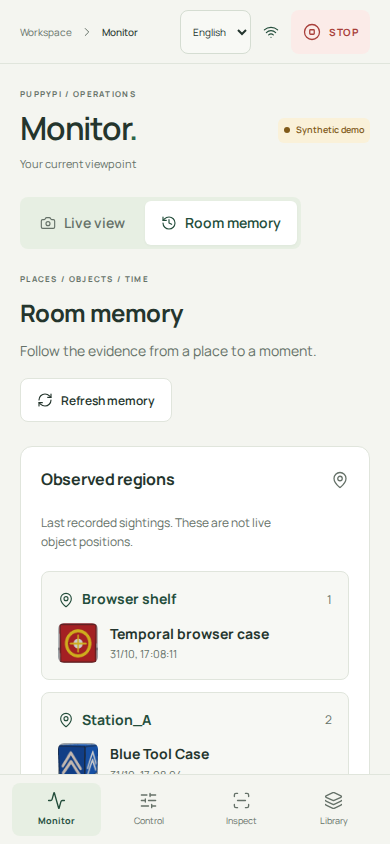
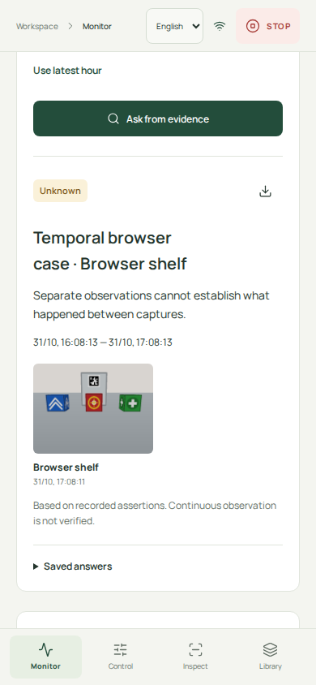

# Applying room-intelligence research to the operator app

Date: 2026-10-31. Priority: usable application workflows, followed by measured
automation. The [deep review](18-deep-research-room-intelligence.md) informs the
contracts and baselines; it is not a requirement to install every reviewed model.

## Available now: Monitor → Room memory

The console now connects four concrete workflows to the existing library and
evidence store. They run with the synthetic camera by default and do not actuate
a robot. Real-camera/physical performance remains unverified.

| Workflow | What the operator can do | Implemented boundary |
| --- | --- | --- |
| Room memory | Browse observed regions and each object's last recorded sighting; filter the timeline by region | Regions come from recorded station labels, not a metric reconstruction; last seen is historical |
| Evidence timeline | Open original images with capture time, assertion, author/mode and explicit gaps | Recorded observations persist; this is not a replay of a complete motion/action run |
| Ask Room | Ask where an object was last seen, whether it was seen within a range, or whether it stayed throughout a range; reopen saved answers and download JSON | Three typed questions, not unrestricted natural-language reasoning; answers concern recorded assertions |
| Analyze a viewpoint | Generate foreground crops, rank enrolled objects, inspect the frozen source and explicitly confirm a sighting at a named region | Existing CPU appearance baseline; scores are not probabilities; suggestions alone never update object memory |

| Phone overview | Evidence-linked temporal answer |
| --- | --- |
|  |  |

These are actual Chromium captures of the implemented app with synthetic fixtures,
not concept renders or hardware results. Open the
[desktop capture](screenshots/room-memory/desktop-room.png) for the candidate
review and timeline, or the [capture manifest](screenshots/room-memory/capture-manifest.json)
for source hashes and viewport sizes.

Use the existing **Library** to enroll reference crops. In **Monitor**, select
**Room memory**, then **Analyze current view**. Enter the observed region, review
the candidate and select **Confirm sighting**. The saved operator assertion then
appears in the region list, timeline, library history and existing inspections.
**Ask Room** links its verdict to those images and persists the answer snapshot.
The original **Live view**, **Control**, **Inspect** and **Library** flows remain
available. UI defaults to English with optional dedicated Vietnamese translations.

An empty proposal list never records absence. A confirmed sighting records the
frozen analysis capture time, even if the live camera has advanced. Confirming
the same candidate twice is idempotent; conflicting confirmations are rejected.
The observation and its confirmation binding commit atomically. The operator
must provide the region and identity confirmation; the machine has not measured
those facts automatically.

The temporal policy implements the useful boundary from the research. One valid
recorded witness can support an existential question. A valid recorded negative
or a sighting elsewhere can contradict continuous presence. A few positive
samples never establish continuous presence. Low visibility, conflicts, missing
capture-time bounds and unobserved spans retain Unknown. Physical relay timestamps
currently lack the required interval contract, so range witnesses remain
conservative; historical last-seen lookup is still available. No calibration or
continuous-monitoring guarantee is claimed.

## Concrete application sequence

| Slice | User-visible delivery | Acceptance gate | Status |
| --- | --- | --- | --- |
| A Memory and visual review | Region browser, timeline, three grounded questions, saved/exportable answers, frame suggestions and confirmed sightings | Browser completes analyze → confirm → last seen → interval Unknown; saved answer survives reload; empty/stale/conflicting inputs handled | **Integrated locally**, synthetic/loopback evidence |
| B Monitoring tasks | Start a stationary monitoring task for an enrolled object/region; show capture progress, missed checks and final evidence report | Durable task restart becomes interrupted; periodic baseline records actual captures; source loss does not silently mark an item absent | Planned |
| C Automatic inspection | Host model proposes objects and supported visible states; validated recognition/visibility admission produces verifier records | Real labeled crops and target/decoy scenes; unknown/occluded negatives preserved; model/preprocessor versions recorded | Planned; A currently offers foreground suggestions and human review |
| D Phone Observer | Pair a fixed phone capture session; inspect both sources, source age and calibration state | Measure clock bounds, disconnects, camera relocation and same-instance association; observer session cannot acquire motion | Planned |
| E Bounded patrol | Start a taught station route; pause, take over, resume after revalidation and inspect the final report | Hardware camera, movement units, localization, stop and route conditions measured; action success distinct from command ACK | Planned |
| F Selective acquisition | Task proposes another camera, useful station view or grounded question; compare periodic and task-conditioned choices | Same perception/actions/budgets; score supported-answer coverage, false assertions, cost and interventions | Planned research extension |

This order yields an application at every stage. A can be used for local visual
review immediately. B can first monitor a stationary viewpoint without claiming
navigation. C replaces human annotation only where actual perception acceptance
passes. D adds measured observational value. E is gated by physical execution.
F earns adoption only if it improves the supported task outcome over the simple
baseline. Dense 3D, learned video prediction and body-pose selection are optional
extensions after these workflows, not initial dependencies.

## Where the research enters the product

| Research lesson | Product decision | Evidence to collect |
| --- | --- | --- |
| Persistent memory needs source evidence | Shared observations, immutable saved answers, source-linked crops and images | Restart and historical-answer preservation |
| Temporal answers depend on observation coverage | Typed temporal questions, explicit Unknown, visible gaps, no interpolation between samples | Same sampled history cannot certify continuous presence; valid counterexample changes the verdict |
| Caption/matcher agreement is not exact-instance certainty | Ranked candidates require explicit confirmation; no probability badges | Target/decoy crops, confusing views and rejected candidates |
| Diagnosis and source quality affect usable evidence | Fresh-frame analysis, mode isolation, capture-bound checks and retained provenance | Stale/replayed sources, missing time bounds and conflicting records |
| Acquisition should buy useful evidence | Later monitoring/phone/patrol tasks share the same query and report model | Periodic gated baseline versus task-conditioned acquisition |

These are adaptations of the reviewed ideas and existing project components,
not reproductions of the complete Mind Palace, DynaMem or active-diagnosis stacks.
The source audit and limitations remain in documents 15–18. Optional learned
backbones remain configured through Settings/environment and are not downloaded
by default tests or installed merely to add a feature name.

## Implementation map

| Layer | Current implementation |
| --- | --- |
| Core room semantics | [room.py](../teach_and_find/room.py): mode-separated projection, evidence selection, bounded questions and saved answers |
| Visual review | [scene.py](../teach_and_find/scene.py): existing foreground proposals/encoder/matcher, immutable analysis snapshot, atomic operator confirmation |
| Storage | [storage.py](../teach_and_find/storage.py): append-only migration to SQLite v4 adds query/analysis/confirmation tables and indexes; existing images and observations preserved |
| Host transport | [mobile/api.py](../teach_and_find/mobile/api.py): authenticated same-origin room/analysis routes; existing control channel unchanged |
| Browser | [RoomConsole.tsx](../web/src/RoomConsole.tsx), [roomTypes.ts](../web/src/roomTypes.ts): Monitor subview, region filtering, query form, image review and JSON download |
| Verification | [test_room.py](../tests/test_room.py), [test_mobile.py](../tests/test_mobile.py), [console.spec.ts](../web/tests/console.spec.ts) |

The core imports no FastAPI, ROS or UI framework. Host Python does the image
analysis and persistence; the browser presents results. The Pi gains no new
service or movement primitive from slice A. No Docker or custom C++ layer is
introduced. Operational read limits and candidate counts live in
`Settings.room`; perception thresholds reuse existing Settings.

The new routes are `GET /api/room`, `POST /api/room/queries`,
`POST /api/room/analyses`, `GET /api/room/analyses/{id}` and
`POST /api/room/analyses/{id}/confirm`. Mutation routes require pairing and
same-origin checks; responses remain uncached. New scene analysis requires a
fresh displayed frame. Confirmation operates on the persisted frozen source and
records a historical operator assertion; it never arms or sends motion.

## Interface direction

The operator is reviewing a room from a phone or laptop before deciding what to
inspect next. The interface should feel like the existing field notebook:
Manrope, warm paper, forest actions, green recorded support, amber unknowns and
muted metadata. Domain vocabulary is region, sighting, capture, witness, gap,
candidate and confirmation. The signature is an evidence spine connecting each
answer and historical region card back to an actual image.

Preserve the four primary destinations. Room memory is a Monitor subview rather
than another permanent navigation item. Region cards have no invented coordinates;
the query answer carries its image/time; analysis separates live and frozen
views; candidate cards state that scores are not probabilities; the timeline
exposes gaps. These replace a decorative map, generic metric grid and unsupported
confidence gauge. Existing semantic tokens, 4 px spacing rhythm, native controls
and subtle borders carry the design; the app does not introduce a new component
framework.

## Demo and evidence

Start the usual app with `make app-build` and `make app`. Pair, load synthetic
demo data and open Monitor → Room memory. For an exact synthetic matching demo,
enroll a crop of the displayed object in Library, analyze the view, confirm it at
a named region and ask its last recorded location. Ask whether it stayed there
throughout a time range: the finite sightings must retain Unknown. Inspect the
source image and export the answer. This demonstrates a real application flow
on synthetic images, not physical recognition or patrol.

Automated regression coverage includes absent proposals, occlusion, simultaneous
conflicts, physical time uncertainty, invalid ranges, mode separation, saved
answers, stale-frame rejection, concurrent duplicate confirmations and storage
failure rollback. Browser coverage includes frozen-frame confirmation, queries,
download, reload persistence and phone overflow checks, alongside the existing
control/offline tests. Next deployment work remains stationary real-camera and
stop characterization, followed by monitoring task capture and a labeled
automatic-perception evaluation.
