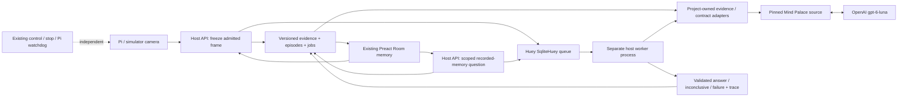

# Mind Palace application integration: research audit and fix proposal

Implementation follow-up: the user accepted this design. See the
[application implementation and evidence](22-mind-palace-app.md). The original
proposal and its Planned labels below are preserved as the pre-implementation
contract, not the current delivery status. Broader research/hardware gates remain open.

Date: 2026-11-01. Project revision audited: `647d722`.
Status: **Proposed design; application integration NOT IMPLEMENTED.**
The [critical incident](review/2026-10-31-fatal-critical-lethal-capability-integrity.md)
remains OPEN / FAIL. No delivery score or feature status is promoted by this plan.

## Decision and boundaries

Integrate the actual Mind Palace implementation behind the existing Room memory
app, first as **recorded-memory question answering**. Reuse its episodic selection,
room/view retrieval, visual checking and working-memory reasoning. Preserve the
user-selected `gpt-6-luna` profile and existing evidence/control boundaries.
Do not describe this first slice as the complete active LA-EQA method, automatic
3D scene reconstruction, tracking or a learned predictive world model.

The distinction follows the [paper's task and method](https://arxiv.org/html/2507.12846v2):
its memory is organized over observation trajectories, with pose/image inputs,
episodic scene structure, retrieval and an active exploration branch. The
[official implementation](https://github.com/mind-palace-laeqa/benchmark) is pinned
to `b59be261f9508c3a355a8afa0d495eeba0417d68` (MIT code license).
The existing [execution evidence](20-room-memory-upstream-validation.md) supports
one-image component execution, including eight actual Luna calls. It does not
establish useful multi-episode retrieval, general recognition or app integration.

This document proposes the necessary adaptations before implementation; it does
not silently revise the scope or claim that its patches already exist.

## Findings that change the implementation plan

Four behaviors were reproduced against the pinned source using **offline injected
responses**. They test malformed-input contracts, not model accuracy. No paid API,
GPU or robot was used in the new probes.

| ID | Actual upstream behavior | Required application correction |
| --- | --- | --- |
| MP01 | `MindPalaceExploration.vlm_image_analysis` converts the answer string to characters; injected invalid value `not found` returns `found=True` because it contains `t` | Validate the exact `True`/`False` enum before upstream interpretation; invalid output must fail, never become a detection |
| MP02 | `EQAReasoning.check_ready_to_answer` accepts a substring; injected `not yes` returns `ready=True` | Validate the exact `yes`/`no` enum before interpreting readiness |
| MP03 | `PlaceExploration.plan` replaces an empty direct selection with unvisited viewpoints; the probe selected `[0, 1]` after an empty result | Use direct retrieval with validated IDs; empty/invalid selection must not trigger substitute selection |
| MP04 | `WorldModel.move_robot('now', 99, [42])` uses numeric-ID proximity for missing nodes, then reports endpoint `42` even though that node is absent, with distance `0.0` in the fixture | Never use benchmark movement simulation as a PuppyPi executor; reject unknown IDs and prohibit this method in the recorded-memory worker |

These findings do not assert that the paper's reported experiments used malformed
model outputs. They show that the public reference code's assumptions are not
sufficient application-boundary validation for this project's acceptance rules.

Further source/architecture findings:

- `LoadingHabitatSceneGraph.load_room_nodes` contains dataset-specific room/ID
  assignments. It is not a generic room-discovery function for arbitrary PuppyPi
  camera images. Build an explicitly documented evidence-to-graph adapter instead
  of copying benchmark labels or claiming automatic area clustering.
- The existing replay supplies nominal zero coordinates and one room/view. Those
  coordinates must not become application measurements. A formatting-only probe
  accepted unknown poses as `None`, but that does not establish end-to-end
  reasoning or navigation compatibility with missing geometry.
- The viewpoint prompt assumes nearby numeric IDs imply nearby locations. New
  UUIDs or capture sequence numbers do not meet this assumption. The proposed
  recorded-memory profile must remove that assumption explicitly, or supply a
  verified spatial ordering. Do not silently treat timestamps as geometry.
- `BeliefManager` and `WorldModel` do not replace versioned durable application
  storage. Each question needs fresh working state over an immutable input snapshot.
- API JSON-object mode alone does not validate enums, selected IDs, image
  availability or citations. A readiness response also does not establish temporal
  coverage, object-instance identity or the truth of all generated statements.
- The reference scene archive remains unavailable under the observed Google Drive
  download quota. Custom replay acceptance and full benchmark reproduction must
  remain separate; do not manufacture a benchmark pass.

## Concrete architecture



Keep the existing Preact/FastAPI/SQLite stack. Propose **Huey 3.5.3 with
SqliteHuey** for the job transport, using a queue database separate from the
application evidence database. Its [official API](https://huey.readthedocs.io/en/latest/api.html)
documents SQLite storage and task retry configuration; its
[consumer documentation](https://huey.readthedocs.io/en/latest/consumer.html)
describes the separate consumer process. This avoids adding a Redis service for
the initial single-host deployment. It is a proposed integration, not a new
application dependency already installed by this change.

A real framework-only probe installed Huey 3.5.3 into an isolated environment,
queued two tasks before starting a consumer, received a result from another PID,
observed the expected task error with one attempt, and stopped the consumer.
That verifies the narrow queue/process/result mechanism. It does not establish
exactly-once API billing, application restart recovery or running-task cancellation.

| Runtime | Responsibility |
| --- | --- |
| Phone/browser | Existing UI, capture/question submission, job state, inspected images and validated citations; no API key |
| Host app environment | FastAPI, pairing/same-origin checks, immutable capture admission, evidence/job transactions and queue submission |
| Separate host worker environment | Pinned upstream plus project adapters; actual Luna calls; no robot command client |
| OpenAI service | Selected model inference; no local GPU hosting for this profile |
| PuppyPi environment | Existing camera/relay and independent stop/watchdog; no new model or learned gait service |

Use a stable configured worker checkout/environment when deploying, not an
implicit import from ignored experiment files. Record the upstream revision,
adapter version, prompt/schema versions and actual returned model on every run.
Production workers read exported credentials; they must not dynamically source
an interactive shell for each job. The existing `--from-bashrc` research option
is an explicit experiment convenience, not the proposed service authentication path.

## Data contract and upstream reuse

Append a migration after SQLite v4; do not alter shipped migrations. Proposed
records are captures, episodes, episode-view mappings, derived descriptions,
jobs, questions, run steps and citations. Exact table names remain implementation
details; the contracts are mandatory:

- Capture: image digest, frame/camera/session IDs, captured/received times,
  uncertainty bounds, mode, registered region/viewpoint source and optional pose
  with its calibration/frame/source. Freeze the image before queueing inference.
- Episode: explicit capture-session or declared time-window identity, immutable
  capture membership and mode. Never invent the photo's capture time or use a
  user label containing `now` as an upstream execution-mode selector.
- Derived description: actual model output, capture ID, model and preprocessing/
  prompt/schema revisions, request/result status and image provenance. It is a
  model hypothesis, not an operator assertion or enrolled exact-instance identity.
- Question/run: requested scope, immutable eligible capture snapshot, budgets,
  selected episode/region/view IDs, validated outputs, inspected image IDs,
  citations, stage timings, actual model/usage and terminal state.
- Working belief: construct a new upstream `BeliefManager` for each question.
  Do not reuse another question's mutable history or mix physical/synthetic modes.

| Existing upstream component | Proposed use / explicit adaptation |
| --- | --- |
| `PlaceNode`, `RoomNode`, `SceneGraph` | Build from registered regions and actual capture records; semantic descriptions come from Luna, not injected object labels; missing geometry remains unknown |
| `EQAReasoning.object_identification` | Use the actual method; validate its structured result |
| `EpisodicExploration.episodic_reasoning_v2` | Use the actual selection; accept only available recorded episode IDs in this initial profile; active-acquisition plans are unsupported, not silently rewritten |
| `RoomExploration` and direct place retrieval | Use upstream selection over admitted records; validate membership/duplicates/exhaustion; explicitly revise the numeric-closeness prompt assumption for unposed recorded views |
| `WorldModel.explore` | Retrieve only snapshot-approved existing image paths; precheck image integrity and require the complete selected set to be loaded |
| `vlm_image_analysis`, `check_ready_to_answer`, `answer_the_question` | Retain the upstream calls, with exact response contracts checked before lossy boolean interpretation; no presence/absence or readiness inferred from malformed strings |
| `BeliefManager.update_history` | Feed valid observations into query-local history; persist an independent source-linked trace in project-owned records |
| Benchmark room loaders and `move_robot` | Excluded from product execution; they do not supply generic room mapping or physical actuation |

Extend the existing explicit Luna transport with **stage-specific schemas** rather
than guessing the expected stage from prompt keywords. Preserve upstream enum
spellings at the boundary so valid outputs still execute the upstream method.
Reject malformed enums, wrong model, unknown IDs, missing images or incomplete
output. Proposed citation extension: label images with capture IDs, ask the final
stage for citation IDs, validate them against the inspected set, and persist them
before the upstream final method discards extra fields. Merely linking every
retrieved image must be labeled "images inspected", not proof of every claim.

The explicit prompt/contract/input-loader changes are proposed adapter revisions,
not a claim that stock Mind Palace accepts arbitrary app inputs unchanged. Retain
diffs and contract tests for every adaptation. No research algorithm is replaced
by handcrafted answer logic.

## User flow, proposed API and job semantics

Preserve Monitor, Control, Inspect and Library navigation. In Room memory add
**Capture memory**, **Ask memory**, a job panel and answer cards with timestamps,
inspected images, validated citations and the actual source/model record.
Progress labels reflect executed stages, never an invented percentage.

Proposed authenticated, same-origin API; none of these routes exists yet:

| Route | Contract |
| --- | --- |
| `POST /api/memory/captures` | Fresh displayed frame, registered region/view reference and idempotency key; freeze source and enqueue capture-description job |
| `POST /api/memory/questions` | Recorded-memory scope, question, selected episodes and budget; snapshot admitted inputs and return job ID with HTTP 202 |
| `GET /api/memory/jobs/{id}` | Actual queued/running stage or terminal result, authorized evidence links and error code |
| `POST /api/memory/jobs/{id}/cancel` | Cancel queued work or request cooperative cancellation of active work; never claim that an already-sent paid request was undone |

Use the existing paired-session boundary. Store no evidence API response or
pending mutation in offline caches. Technical failures terminate as `failed`;
a valid run lacking sufficient evidence or reaching its declared retrieval budget
ends `inconclusive`. Unknown or unsupported capability is not a synthetic success.

The queue transports a job ID, not arbitrary code, file paths or credentials.
The worker atomically claims the job in application storage. Configure retries
to zero at both Huey and SDK layers. Poll cancellation and budget before each
model call. Once a job is cancelled, late completions cannot overwrite its state.
Use request timeouts plus a worker-level deadline; do not assume a threaded task
timeout kills an in-flight request. Worker restart reconciliation marks lost
running jobs interrupted and does not automatically reissue billable calls.
Exactly-once external API execution is not guaranteed across a crash.

Registered region metadata is a declared input, not automatic localization.
No synthetic zero pose is inserted for missing physical geometry. The recorded-
only adaptation needs multi-view validation with unknown poses; if an operation
needs geometry, reject it until measured input is available. Active exploration,
route following and paper VoI/MDP claims stay gated on that later executor/evaluation.
Captions cannot automatically become `ObjectLibrary` assertions of exact-instance
presence or absence. Sparse frames also cannot certify continuous room state.

## Implementation slices and acceptance gates

All slices below are **Planned**. They are coherent code/review boundaries,
not a commitment to generate a particular number of commits.

| Slice | Concrete changes | Required observable gate |
| --- | --- | --- |
| A Contracts and upstream adapter | Move reusable transport out of the experiment script into an optional adapter, record source revision, add exact per-stage validation and proposed prompt corrections; configure model/paths/budgets in Settings | MP01/MP02 invalid values fail before interpretation; MP03 cannot select substitutes; MP04 is unreachable from the adapter; unavailable upstream/model fails without alternate provider |
| B Durable capture and worker | Append migration, freeze images/provenance, create explicit episodes, add Huey task adapter and separate worker environment | Enqueue via real queue and consume in another process; restart preserves captures; worker loss marks interrupted; duplicate submission does not create a second inference job |
| C App workflow | Add the proposed API and English-default controls/status/evidence presentation using existing components | Actual app capture becomes an episode; a question invokes upstream/Luna and shows persisted source-linked output after reload; control/stop remains independent during inference |
| D Multi-episode evaluation | Evaluate diverse episode/view candidates, missing/occluded evidence, invalid outputs, cancellation and source loss; compare against declared baselines | At least three episodes and two registered regions with more than one plausible view; fixed labeled task set/splits and budgets; report failures, citations, tokens and latency, not only a success screenshot |

Proposed files: extend `config.py`, `storage.py`, `mobile/api.py` and
`web/src/RoomConsole.tsx`; add a small pure record/job service, an optional
`mind_palace_adapter.py` and a separate worker/queue adapter. Keep SDK/Huey/upstream
imports outside the pure record/inspection core. Reuse evidence image storage.
Do not add Redis, Docker, ROS or GPU requirements to default tests.

The decisive end-to-end gate is **app capture → actual Luna description → durable
episodes → actual upstream retrieval/reasoning → validated answer and source images
in the app**, with restart and failure cases. Offline API fixtures test contracts
only; a live opt-in run must exercise that entire product path before claiming
research integration. The current one-photo success cannot close this gate.

## Evidence, reproduction and verification

- [Offline contract results](research/2026-11-01-mind-palace-fix-audit/contract-probes.json)
- [Real Huey framework probe](research/2026-11-01-mind-palace-fix-audit/queue-probe.json)
- [Source/artifact manifest](research/2026-11-01-mind-palace-fix-audit/manifest.json)
- [Contract probe source](research/2026-11-01-mind-palace-fix-audit/contract_probes.py)
- [Queue probe source](research/2026-11-01-mind-palace-fix-audit/queue_probe.py), [task definitions](research/2026-11-01-mind-palace-fix-audit/queue_tasks.py)

Copy the probe files into ignored `runs/mind-palace-fix-review-2026-11-01/`
before running them from the repository root. The contract probe uses the pinned
upstream environment already documented in document 20. The queue probe uses an
isolated environment containing only Huey 3.5.3 and standard-library components:

```bash
mkdir -p runs/mind-palace-fix-review-2026-11-01
cp docs/research/2026-11-01-mind-palace-fix-audit/*.py runs/mind-palace-fix-review-2026-11-01/
CUDA_VISIBLE_DEVICES=-1 MPLBACKEND=Agg runs/room-upstream-audit/.venv-mind-palace/bin/python runs/mind-palace-fix-review-2026-11-01/contract_probes.py
UV_PROJECT_ENVIRONMENT=.venv-dev uv venv --python 3.12 runs/mind-palace-fix-review-2026-11-01/.venv-queue
UV_PROJECT_ENVIRONMENT=.venv-dev uv pip install --python runs/mind-palace-fix-review-2026-11-01/.venv-queue/bin/python huey==3.5.3
runs/mind-palace-fix-review-2026-11-01/.venv-queue/bin/python runs/mind-palace-fix-review-2026-11-01/queue_probe.py
```

Do not recreate existing environments unnecessarily. The queue probe stops its
own consumer in `finally`; its marker tasks never call a model or robot. These
research artifacts do not add dependencies or change production behavior.
Validation and unresolved constraints are recorded in the
[2026-11-01 handoff](handoffs/2026-11-01-handoff.md).
