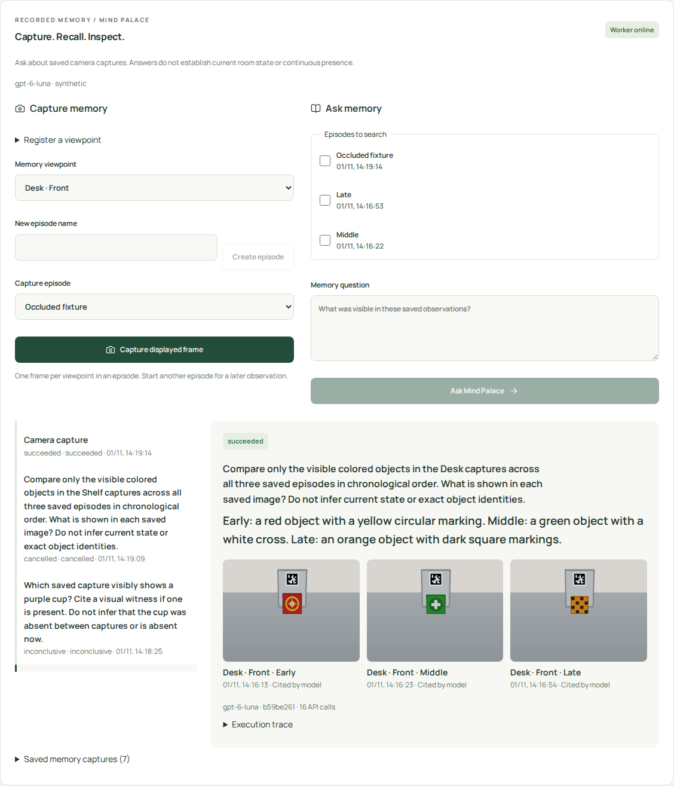
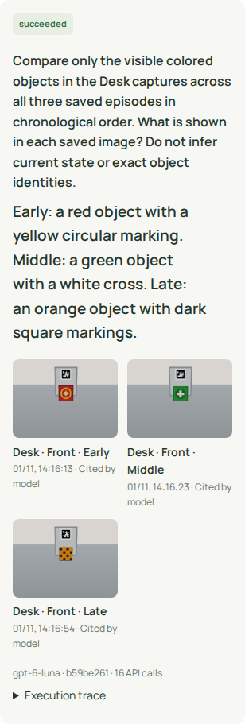
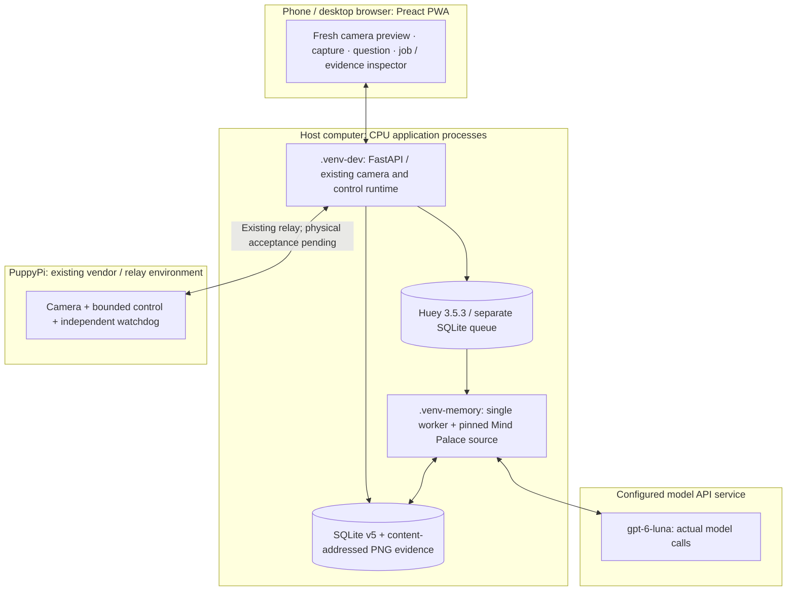

# Recorded-memory questions in the PuppyPi app

Implementation date: 2026-11-01. This implements the recorded-memory application
profile accepted in [document 21](21-mind-palace-integration-fix-proposal.md).
The broader [critical review](review/2026-10-31-fatal-critical-lethal-capability-integrity.md)
remains **OPEN / FAIL**. This page distinguishes software integration from
algorithm quality and physical verification; it does not change the user's score.

## What the app executes

Open **Monitor → Room memory**. Register a named region/viewpoint, create an
episode, and capture the displayed fresh frame. The host freezes that frame and
returns a durable job. A separate worker calls the selected model to describe
visible contents. Select completed episodes, enter a natural-language question,
and ask Mind Palace. Its actual upstream methods select episodes, rank regions,
retrieve viewpoints, inspect their images, assess readiness and produce an answer.
The result includes saved source images, capture times, validated citation IDs,
actual model/revision/call counts and expandable model outputs.

The default UI remains English. Vietnamese is an explicit locale selection.
Existing operator assertions and the handcrafted appearance baseline are under a
separate, initially closed comparison section. They never provide answers to this
model-backed workflow. A missing worker, source, image or model does not invoke them.





## Where each component runs



| Runtime | Installed / executed here | GPU, ROS or Docker requirement |
| --- | --- | --- |
| Browser / phone | Existing Preact/TypeScript UI; no model key | None |
| Host `.venv-dev` | `app` extra: FastAPI, camera/control runtime, durable records and queue producer | None for this profile |
| Host `.venv-memory` | `memory` extra: OpenAI SDK, Huey, Pillow plus normal core dependencies; pinned source components | No local GPU; no ROS or Docker |
| Configured API service | Requested and returned model ID `gpt-6-luna` | Provider-managed compute/weights; no local checkpoint |
| PuppyPi | Existing camera/relay/watchdog, when explicitly selected | This change adds no Pi-side model or gait controller |

The acceptance server substitutes an explicitly synthetic loopback camera for
the last row. It never discovers or connects to a robot. More machine/ROS/native
library detail remains in the [deployment map](12-deployment-map.md).

## Setup and operation

From the repository root, prepare environments and static UI once:

```bash
make setup
make hooks
make app-setup
make app-build
make memory-setup
```

`memory-setup` creates `.venv-memory/`, fetches the MIT-licensed upstream source
under ignored `.upstream/mind-palace/`, and checks revision
`b59be261f9508c3a355a8afa0d495eeba0417d68`. An existing different/dirty checkout
fails instead of being overwritten. Selected source modules run directly from
that checkout; this profile does not install the full Habitat/Torch benchmark.
`.venv/` is preserved. Direct `uv` commands must explicitly select their environment.

In the **worker terminal**, use the credentials already exported by your shell:

```bash
export TEACH_FIND_DATA_DIR="$PWD/data/memory-app"
export PUPPYPI_MEMORY_MODEL=gpt-6-luna
make memory-worker
```

`OPENAI_API_KEY` is required there. The SDK also honors its configured endpoint.
The worker does not source an interactive shell at runtime or send keys to the
browser. Do not put credentials in commands, Git files, screenshots or reports.

In a **second terminal**, select the same store and enable the host UI/API profile:

```bash
export TEACH_FIND_DATA_DIR="$PWD/data/memory-app"
export PUPPYPI_MEMORY_ENABLED=1
export PUPPYPI_MEMORY_MODEL=gpt-6-luna
make app
```

Pair using the code printed by the app. The existing default is a synthetic
robot. See the [app guide](13-mobile-console.md) before explicitly selecting a
physical relay. Stop the app and worker with Ctrl-C in their own terminals.
One worker owns each store; a second worker is rejected by a process lock.

Deployment defaults live in `MemorySettings` in `teach_and_find/config.py`.
`PUPPYPI_MIND_PALACE_PATH` selects a different pinned checkout. Default limits
are 24 snapshot captures, 8 inspected viewpoints, 24 calls per job, 1,024 output
tokens per call, 60 seconds per request and a 300-second cooperative job deadline.
The overview shows a bounded 30-entry history window; older records remain stored.
The immutable submitted profile preserves model, source and limits across a
later configuration change. These are limits, not promised latency or accuracy.

## Research reuse and explicit adapters

Primary references: the [Mind Palace paper](https://arxiv.org/html/2507.12846v2)
and [author implementation](https://github.com/mind-palace-laeqa/benchmark/tree/b59be261f9508c3a355a8afa0d495eeba0417d68).
The existing [component replay](20-room-memory-upstream-validation.md) precedes
this app integration. Product entry points are `MindPalaceAdapter.describe` and
`MindPalaceAdapter.question`; the separate worker invokes them through real
[Huey SQLite tasks](https://huey.readthedocs.io/en/latest/api.html#SqliteHuey).

| Upstream module / method actually invoked | Product use / boundary |
| --- | --- |
| `mind_palace_generation.PlaceNode`, `RoomNode`, `SceneGraph` | Evidence-to-graph adapter with model descriptions; operator-registered region metadata; unknown coordinates remain `None` |
| `EQAReasoning.object_identification` | Actual target extraction |
| `EpisodicExploration.episodic_reasoning_v2` | Actual selection over recorded episode IDs; other acquisition strategies fail as unsupported |
| `RoomExploration.value_based_room_selection` | Actual region ranking; output IDs and parallel arrays checked; scores are uncalibrated |
| `PlaceExploration.direct_query_place_retrieval` | Actual viewpoint retrieval; empty/unknown/duplicate selections fail, without `plan`'s substitute selection |
| `WorldModel.explore` | Reads approved image paths; it is a retrieval wrapper, not a learned predictive world model |
| `MindPalaceExploration.vlm_image_analysis` | Actual local visual-target check; exact `True`/`False` validated before upstream conversion |
| `BeliefManager.update_history` | Query-local positive, clear witnesses only; a negative check is not an absence assertion |
| `EQAReasoning.check_ready_to_answer`, `answer_the_question` | Actual reasoning over inspected evidence, strict readiness enum and source-linked final output |

The vendor checkout is unchanged. Project transport binds to upstream interfaces
and supplies explicit stage schemas. It replaces the numeric-closeness prompt
sentence because capture IDs have no measured spatial ordering, supplies episode
metadata, clarifies local visual checking versus global readiness, and extends
readiness/final image input to labeled inspected captures. Final citation IDs
must belong to that inspected set. Registered episode names accompany images;
they are labels, not model observations. The historical one-photo replay script
is preserved; the new supported worker uses the stricter production transport.

A development run initially returned `inconclusive`: each single-image check
judged whether it could answer the entire multi-episode question. Its trace is
retained. The explicit local-check prompt corrects this stage ambiguity; it does
not insert detections or change the model's returned decision. The final global
readiness check still decides whether the collected evidence is sufficient.

## Persistence, failures and control

SQLite migration v5 appends region/view, episode/capture, model-description,
job/step and worker-heartbeat tables. Shipped v1–v4 migrations are untouched.
Each image is frozen before enqueue and checked by SHA-256 before inference.
Provenance preserves camera/session fields, capture/receive times, available clock
uncertainty, evidence mode and optional measured pose. Missing uncertainty or pose
remains unknown. Synthetic test times identify replay ingest time, not the capture
time of a physical room. This profile makes no multi-camera synchronization claim.

Questions snapshot **all completed captures in the selected episodes**. A pending
or failed description blocks submission; it is not silently dropped. Over-budget
snapshots fail without truncation. Each question creates a fresh upstream belief.
Model descriptions and results remain distinct from operator assertions and
exact-instance enrollment. No model output becomes a motor command.

API routes are paired-session/same-origin protected and uncached:
`GET /api/memory`; `POST /api/memory/views`, `/episodes`, `/captures`, `/questions`;
`GET /api/memory/jobs/{id}`; `POST /api/memory/jobs/{id}/cancel`.
Captures/questions return HTTP 202. Reusing a request key with the same request
returns the original job; different input conflicts. Capture retries are checked
before freshness, so a legitimate retry does not create a second billable job.

The SQLite outbox republishes undispatched queued IDs. Atomic claims suppress
duplicate execution. SDK and task retries are zero. Cancellation is cooperative;
a sent request may still cost money, and a late response cannot overwrite the
cancelled state. A restarted worker marks lost running jobs `interrupted` and
never automatically reissues their calls. Exactly-once external billing is not
guaranteed across a crash. A stalled worker becomes visibly unavailable after its
heartbeat expires; queued captures do not receive fabricated answers.

Missing source/key/image, invalid model output, wrong model, provider failure or
unsupported active acquisition yields explicit failure. Valid insufficient
witnesses or exhausted retrieval budgets yield `inconclusive`. Inspected images
remain reviewable for inconclusive results. A vision description is not proof of
current presence, absence during unobserved intervals, continuous coverage,
tracked identity, navigation or predictive world modeling.

Inference runs in another process without a robot command client. Existing app
control/stop and Pi watchdog paths remain separate. Default tests use synthetic
frames/loopback commands; no physical acceptance is claimed.

## Reproducible acceptance and remaining research gates

The opt-in runner creates its own new synthetic store, starts its own loopback
app and real worker, captures through Chromium, executes actual model jobs and a
paired direct-all-images baseline, writes evidence, and stops its child processes.
It requires built frontend, `.venv-dev` with the app extra, `.venv-memory`, pinned
source and Chromium. It refuses to attach to an occupied acceptance port.

```bash
# Run only when paid model calls are intended and OPENAI_API_KEY is exported.
UV_PROJECT_ENVIRONMENT=.venv-dev uv run --locked --extra dev --extra app python scripts/research_memory_app.py \
  --allow-paid-api --directory runs/my-new-memory-acceptance
```

The [fixed task set](research/2026-11-01-mind-palace-app/tasks.json) is a small
post-development synthetic regression set. Labels are used only for evaluation,
never passed to the model or stored as model descriptions. Both compared paths
use the same model, PNG captures and shared descriptions. Direct-all-images is
an explicit baseline, never a runtime fallback. Report actual calls/tokens/latency
and failures; this six-image case cannot establish a retrieval advantage.

See the [execution report](research/2026-11-01-mind-palace-app/report.md) and
[manifest](research/2026-11-01-mind-palace-app/manifest.json) for observed outcomes,
startup failures, cancellation, source loss, occlusion and reproduction artifacts.
Software checks do not establish recognition quality. A held-out real-room dataset,
identity/visibility annotations, larger paired evaluation, active acquisition and
hardware validation remain open. The full original benchmark remains blocked by
the previously observed scene-download quota; this replay does not replace it.
