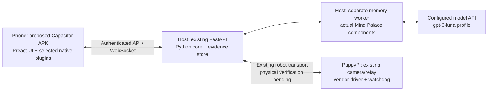

# Mobile runtime: PWA, Capacitor APK and native Android

Date: 2026-11-01. Status: **Proposal; Android packaging is not implemented.**
This records the mobile-runtime discussion. It does not authorize a framework
migration or promote an unimplemented feature. The existing
[critical review](review/2026-10-31-fatal-critical-lethal-capability-integrity.md)
remains OPEN for its outstanding capabilities.

## Current application and proposed direction

The current [Field Console](13-mobile-console.md) is a Preact/TypeScript PWA
served by the host's FastAPI application. The repository has a web manifest and
service worker, but no Capacitor dependency, Android project, Gradle configuration,
built APK or demonstrated installation on a physical Android phone.
Browser screenshots and tests establish web behavior only.

The proposed direction is to retain the Preact interface and add a Capacitor
Android container when an installable APK is required. Add native modules for
specific device capabilities only when their requirements and measured behavior
justify them. This is a recommendation, not an implemented or device-validated
architecture. No Flutter or Kotlin UI rewrite is selected by this document.

[Capacitor](https://capacitorjs.com/docs) provides a native application container
for web interfaces and plugin access to platform APIs. Its
[Android workflow](https://capacitorjs.com/docs/android) adds an Android project
that can be managed with Android Studio. Packaging the web client does not
package the Python backend, Mind Palace worker or robot-side ROS environment.

## Runtime comparison

| Concern | Current PWA | Proposed Capacitor APK | Native Android client |
| --- | --- | --- | --- |
| Interface | Browser-rendered Preact UI | Reuses Preact inside an Android WebView | Platform UI implementation |
| Installation | Browser / home-screen installation, subject to browser requirements | Android package; build and signing configuration required | Android package; build and signing configuration required |
| Hardware access | Browser-exposed APIs and permissions | Web APIs plus installed or custom native plugins | Direct platform API integration |
| Monitor, memory, timeline and reports | Existing implemented web workflows | Reuse is expected; Android behavior must be tested | Requires implementing equivalent client workflows |
| Continuous phone camera, IMU and capture timing | Must establish browser/device behavior; not implemented here | May require native streaming/sensor modules; not supplied merely by packaging | Can use platform capture/sensor APIs; integration and measurement still required |
| Background behavior | Cannot assume the page or JavaScript remains active | WebView and plugin lifecycle require explicit handling | Still subject to Android background-execution restrictions |
| Video/control latency | Must measure end to end | APK packaging does not itself establish a latency improvement | Native implementation does not itself establish a latency improvement |
| Model inference on the phone | Not implemented | Needs an explicitly integrated inference runtime if selected | Needs an explicitly integrated inference runtime if selected |

These are architectural tradeoffs, not measured performance rankings. There is
no PWA-versus-Capacitor-versus-native device benchmark in this repository.
Interface quality depends on implementation; a modern visual design does not
require a native UI rewrite.

## Consequences for PuppyPi features

For camera monitoring, saved-image inspection, Room memory questions and reports,
retaining the web interface is a reasonable starting point because those flows
already exist. The main uncertainty is actual phone behavior: stream decoding,
network latency, rendering, touch input and application lifecycle.

Phone Observer is a stronger reason to consider native modules. Continuous
camera acquisition, source timestamps, IMU data and calibration must be designed
and evaluated as an input pipeline. A photo-picker/camera plugin does not by
itself establish continuous video capture, sensor synchronization or multi-camera
fusion. Phone Observer features F33–F37 remain Planned in the
[feature inventory](06-feature-roadmap.md); no such module is delivered here.

For background work, choose an Android-supported execution mechanism appropriate
to the task. Do not assume that a WebSocket, page timer or worker will run forever
when the screen locks. Native apps also have platform restrictions; see the
[Android background-task guidance](https://developer.android.com/develop/background-work/background-tasks).
Capacitor's [Background Runner](https://capacitorjs.com/docs/apis/background-runner)
is a separate API with platform constraints, not evidence that continuous robot
control or camera streaming works in the background.

Existing manual-control stop/lease behavior must be preserved across Android
pause, screen lock, focus loss, process termination and reconnect. App lifecycle
callbacks are one signal; independent host/robot stop mechanisms remain necessary.
No physical stopping-time guarantee follows from the current browser tests or
from choosing a native client.

## Proposed deployment boundary

Only the phone container/plugins are proposed additions. The current
[recorded-memory profile](22-mind-palace-app.md) keeps its Python worker on the
host and model inference behind the configured API. It requires no local GPU
for that profile. APK packaging does not move inference onto the phone or Pi.
Credentials for model inference must remain outside the APK/browser.

A packaged client also changes the web-origin boundary. The current web client
uses same-origin API paths, paired-session cookies and WebSocket authentication.
An Android implementation must explicitly design host selection and transport/
session behavior, including cross-origin handling where applicable. Do not
assume that copying web assets into a container preserves authentication.
Do not broadly disable origin checks or certificate validation to make it work.

## Implementation acceptance before claiming APK support

1. Pin the selected Capacitor/Android toolchain and record the actual build
   command, SDK requirements and debug/release signing procedure.
2. Build an APK from the repository and install it on a documented physical
   Android device. Record OS and WebView versions. Emulator evidence is separate.
3. Exercise host selection, pairing, authenticated HTTP/WebSocket requests,
   camera display, capture, saved evidence, downloads and reconnect.
4. Compare video age and control response using the same phone, host, scene,
   network and server configuration. Agree on performance targets before the
   experiment; do not invent thresholds or claim a speedup from packaging alone.
5. Test background/foreground transitions, screen lock, app termination,
   disconnection and reconnection using disposable synthetic/loopback transports
   first. Verify disarming, bounded command expiry and no offline motion queue.
6. Verify that API keys, camera/evidence responses and control commands are not
   bundled, cached or retained for offline replay. Preserve English default and
   explicitly selected Vietnamese localization.
7. If native camera/sensor modules are selected, record the actual implementation,
   capture clocks and uncertainty, camera/session identity and calibration
   revision; measure dropped frames, latency and battery/thermal behavior.
8. Publish build, device and feature-specific results separately. A successful
   APK build is not proof of hardware control, Phone Observer, synchronization,
   tracking or model quality.

No Android build, installation, performance or hardware test was performed for
this documentation change. Runtime code and dependencies are unchanged.
