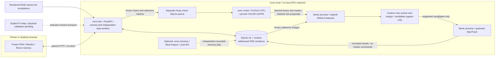

# Executable YOLOE + DINOv2 visual inspection

This implements the YOLOE proposal adapter selected in [the feature research](15-next-feature-research.md).
The supported opt-in profile now requires both complementary models. It does not replace recorded-memory QA, verified exact identity, navigation,
RL locomotion or a learned predictive world model. The critical incident remains open.

## Method and input contract

- Actual author implementation: [THU-MIG/YOLOE](https://github.com/THU-MIG/yoloe),
  revision `40cd606cabdbe2b566d6f14a6b162c89206e9a1b`, AGPL-3.0.
- Checkpoint: author-linked `jameslahm/yoloe`, Hugging Face revision
  `b584da188a198a2e6aa0e013d3fef6d55b212603`, `yoloe-v8s-seg.pt`, SHA256
  `ac2b90ed23011495a3e86d89caeb3432a15129cac8d849ba121293c8fc1e0536`.
  The pinned model card declares `agpl-3.0`; CPU dependency versions are
  separately locked in [the worker requirements](../requirements/vision-cpu.txt).
- Invoke original `YOLOEVPSegPredictor`, `get_visual_pe`, `set_classes` and
  `YOLOE.predict`. No handcrafted proposal generator or stored appearance
  embedding participates. Enrollment names and cropped reference images are
  human inputs, not automatic recognition results.
- Project-owned input binding: for each enrolled object, place its reference
  crops in 320-pixel gray tiles, each crop fitted within 200 pixels. Pass the
  actual pasted bounding boxes with one shared class index to upstream SAVPE.
  Upstream `LoadVisualPrompt` merges same-class prompt masks. Concatenate the
  resulting per-class visual embeddings and use upstream `set_classes`.
  This preprocessing is custom; it is not a new learned algorithm or training.
- Convert model boxes into the existing `CandidateProposal` record and persist
  its clipped image crop alongside the unmodified floating-point model box and
  mask polygon. Clipping/rounding is image-coordinate binding, not a detector.
  Do not let the legacy appearance matcher confirm these candidates implicitly.
- Use original model preprocessing/NMS/mask decoding at input size 640 and
  score threshold 0.20. Scores are uncalibrated model outputs. Return all
  retained detections, including false positives and conflicting class labels.
- Required comparison backbone: [Meta DINOv2](https://github.com/facebookresearch/dinov2),
  revision `7764ea0f912e53c92e82eb78a2a1631e92725fc8`, original `dinov2_vits14`
  and `make_classification_eval_transform`, Apache-2.0 for this model/code profile.
  The official 88,283,115-byte checkpoint has observed SHA256
  `b938bf1bc15cd2ec0feacfe3a1bb553fe8ea9ca46a7e1d8d00217f29aef60cd9`.
  This is an observed download digest, not an author-published checksum.
- Compute genuine 384-dimensional normalized descriptors for reference images
  and model-generated crops. **Project-owned decision policy:** maximum cosine
  over views per class, minimum score 0.80, minimum top-class margin 0.05, and
  agreement with the original YOLOE prompt class. These hand-selected development
  thresholds are not calibrated probabilities or an upstream identity classifier.
  A single reference class has an unknown margin, not an invented competitor score.
- Preserve every raw proposal, including rejected ones and all per-reference
  cosines/reasons. A policy pass means **reference-supported candidate**, never
  confirmed exact identity or present/current location. The app shows original
  crop and closest reference side by side. Similar visible objects can still pass.
- Feed only reference-supported model boxes/scores into the actual upstream
  `BYTETracker` in the pinned YOLOE source. Its returned indices are explicitly
  mapped back to the original unfiltered proposals. The implementation uses
  Kalman filtering and data association; it is not a neural tracker/world model.
  IDs are temporary associations within one recorded window, not verified identity
  or cross-job re-identification. Capture times remain attached; ByteTrack assumes
  regular cadence. This is the Ultralytics implementation distributed inside YOLOE,
  not a claim of importing the separate [original ByteTrack repository](https://github.com/FoundationVision/ByteTrack).
  See the [ByteTrack paper](https://arxiv.org/abs/2110.06864),
  [DINOv2 paper](https://arxiv.org/abs/2304.07193) and
  [YOLOE paper](https://arxiv.org/abs/2503.07465) for the underlying methods.
- Only one camera/session per window. Preserve capture clock, calibration,
  source and frame IDs. Never send simulator object IDs, locations or scene
  labels to the inference adapter. They may be used only by a separate evaluator.
- Dedicated CPU worker, durable jobs and explicit source/checkpoint/dependency
  failure. No baseline, alternative checkpoint, authored detection or manual
  confirmation is selected when inference fails. Cancellation prevents late
  publication; model execution never commands the robot.

## Initial exploratory evidence (not application acceptance)

CPU execution on renderer images exposed a failed whole-crop visual prompt
(background boxes around score 0.07). Adding declared gray reference context
produced a correctly localized target at score 0.60. A three-class, 12-frame
probe ran actual SAVPE, segmentation and ByteTrack but also detected the wall
AprilTag as an object, missed some targets and fragmented one track. These
observations do not establish reliable exact-instance recognition. Keep these
failures in the subsequent application evaluation rather than correcting model
outputs with simulator truth.

## Where each part runs



No Docker, ROS installation or new project C++ service is required by this
profile. PyTorch's CPU wheels supply their own compiled kernels. Inference is
offboard; nothing in this change installs a vision model on the Pi. The browser
renders results and never executes the model or queues motion offline. The
separate Mind Palace worker and its paid API calls are not used by this vision
acceptance experiment.

## Setup and application workflow

From a repository checkout, use Python 3.12. The tested vision worker is Linux
x86-64 with CPU PyTorch 2.6.0; this is not a Pi latency or deployment result.

```bash
make setup
make app-setup
make app-build
make vision-setup
```

`vision-setup` requires Git, curl and uv; it fetches both pinned sources/checkpoints and creates `.venv-vision`; it does
not run inference. It preserves `.venv`, `.venv-dev` and `.venv-memory`. A mismatched
existing checkout/checkpoint fails rather than overwriting it. Only the visual
prompt inference subset is installed; text prompting and upstream training are
not supported by this selected environment. Dependencies are locked separately
because the author package uses `opencv-python`, while the host uses the headless
wheel; these are never installed into the same environment by this workflow.

Start the worker in one terminal and the app in another, from the same repository
and with the same `TEACH_FIND_DATA_DIR` if overriding the default:

```bash
make vision-worker
```

```bash
PUPPYPI_VISION_ENABLED=1 make app
```

Pair the browser. Enroll cropped reference images in **Library**, then open
**Monitor → Room memory → See the model's evidence**. Explicitly select reference
objects and press **Analyze camera window**. The current displayed frame must
be fresh; the host freezes up to 12 preceding frames from the same identified
camera/session. Selected library images, names and model configuration are
snapshotted. Legacy CV2 embeddings are not read, converted or reinterpreted.

The app shows raw detections, decoded mask polygons, temporary track associations,
original timestamps, a frame scrubber, source/checkpoint provenance and an
uncached JSON record. **Executed / quality unverified** means inference completed,
not that the objects were recognized correctly. Empty detections do not establish
absence. There is no automatic sighting/region assertion, motor command or
identity confirmation from this profile.

Jobs can queue while the worker is offline. Cancellation wins over late result
publication; a forward pass already executing finishes before the next cancellation
check. The job budget is checked between model calls, not a hard preemption of
a native kernel. Worker restart marks its running jobs interrupted rather than
retrying them. Memory and vision use separate queue files, worker locks,
heartbeats, job filtering and restart reconciliation over the shared durable job
protocol. Existing memory queue names are preserved for compatibility.

Authenticated, same-origin, uncached routes: `GET /api/vision`,
`POST /api/vision/jobs`, `GET /api/vision/jobs/{id}` and
`POST /api/vision/jobs/{id}/cancel`. Durable schema v6 only adds the vision
heartbeat; existing job/evidence tables and images are reused and preserved.

## Reproducible genuine executions

Run the disposable rendered-camera experiment after preparing Chromium:

```bash
PYTHONPATH=. CUDA_VISIBLE_DEVICES=-1 MPLBACKEND=Agg .venv-dev/bin/python \
  scripts/research_vision_app.py --directory runs/my-new-vision-run
```

This owns/stops a synthetic camera server and actual CPU model worker, enrolls
three objects through the Library UI, submits jobs through the browser, evaluates
nine rendered conditions, captures desktop/phone screenshots and runs eight real
artifact/profile/cache failure jobs. Its directory must be new. The renderer's scene IDs, expected
boxes and labels stay in evaluator files; the model only receives pixel images
and enrolled visual prompts. Images depict authored box meshes/textures, not a
physics controller or a real room. Camera timestamps describe replay ingestion.

The unmodified author example uses a different v8-L checkpoint. After explicitly
downloading its author-linked weights, verify/run it separately:

```bash
PYTHONPATH=. CUDA_VISIBLE_DEVICES=-1 .venv-vision/bin/python \
  scripts/research_yoloe_example.py \
  --checkpoint data/models/yoloe/yoloe-v8l-seg.pt \
  --directory runs/my-new-upstream-example
```

The runner verifies SHA256
`14e9c146f7f7efa0bfea8c5f82952c9f95fb1f9c3bf0f18b3727b76624f9d746`,
then invokes the author's exact `predict_visual_prompt.py` on its bus/zidane
assets. This is separate from v8-S application quality. Tests never invoke either
experiment, download weights, require a GPU or call a paid API.

See the [actual app execution report](research/2026-11-01-yoloe-app/report.md).
The user accepted the [DINOv2 comparison stage](25-visual-identity-fix-proposal.md).
The [combined execution report](research/2026-11-01-dual-vision-app/report.md)
records both models in the actual app; the earlier raw-YOLOE report is historical.

## Versioned dual-model execution

Every new job snapshots `profile_version=2`, both source revisions/checkpoint
hashes and the custom decision thresholds. Workers reject historical queued
profiles that omit the version or specify a different version; old records are
not silently upgraded to another algorithm. Old completed jobs remain readable
and the app states that DINOv2 did not execute in those saved profiles.

Both source/checkpoint checks happen before inference. The original DINOv2 Hub
loader is invoked with a verified local weight path and the actual author model;
its same-named local cache is also digest-checked before/after loading so a stale
cache cannot substitute another checkpoint. The worker records actual executed
DINOv2 transform/forward calls as well as YOLOE/SAVPE and ByteTrack calls. Missing
DINOv2 source, weights, dependencies or a corrupt cache fails the whole job with
no YOLOE-only result. Comparison/association does not command the robot or write
a human/verified sighting into memory.

The nine-scene evaluation retains the previously inspected development conditions
and adds new angle, lighting, unknown distractors and deliberately identical-visible-
front conditions after freezing the hand-selected policy. This is a limited
synthetic condition split, not a held-out real-room benchmark. Both false accepts
and rejection-induced recall loss must remain visible; do not tune the thresholds
on those inspected outputs or claim reliable exact identity from a policy pass.
