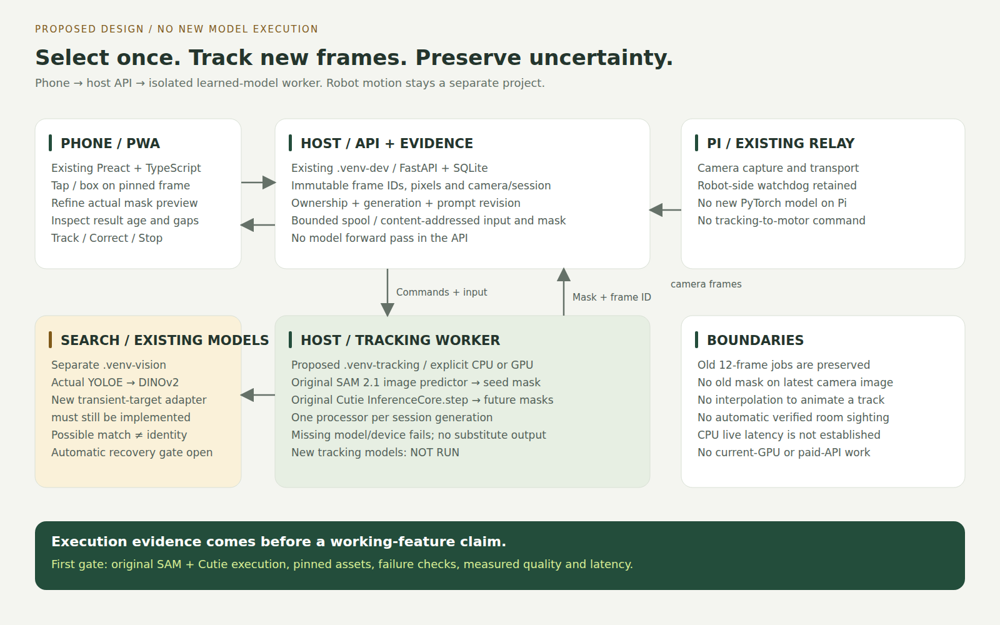
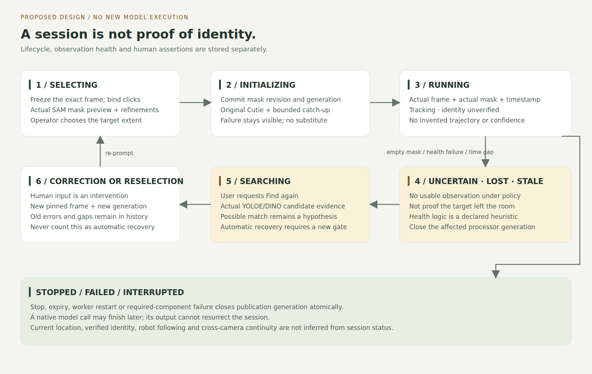
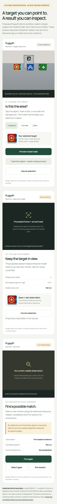

# Interactive target tracking: research plan and application design

Date: 2026-11-02. Status: **Proposed; not implemented or quality validated.**
The user requested a rigorous implementation plan for selecting an object in the
camera and actively detecting/tracking it. This document proposes a new explicit
profile; it does not revise the accepted recorded YOLOE/DINOv2/ByteTrack profile,
its failed exact-identity gate, or the OPEN critical review.

Start with the [source-backed research review](research/2026-11-02-interactive-tracking/report.md),
[repository audit](research/2026-11-02-interactive-tracking/repository-audit.json)
and [checkpoint metadata](research/2026-11-02-interactive-tracking/checkpoint-metadata.json).
Ten repositories were inspected. **New-model inference: NOT RUN. App integration:
NOT IMPLEMENTED.** All figures below are labeled design artifacts.

Subsequent execution on 2026-11-02: [actual component report](research/2026-11-02-tracking-execution/report.md)
now demonstrates original SAM 2.1 + Cutie on CPU, with an explicit CUDA trial
failing from insufficient free VRAM. The initial source-audit statements above
describe that earlier research stage. App integration remains unimplemented;
the 5 FPS live gate and G1–G4 are not passed. The original proposal hash belongs
to the planning snapshot at commit `a6432ee`, not this later addendum.

Subsequent app integration: [actual full app report](research/2026-11-02-stream-app/report.md)
now records genuine selection/preview and future-frame Cutie sessions through the
browser, two 5 Hz overload failures and a separate 3 Hz diagnostic. The earlier
"unimplemented" statements above are historical planning/component snapshots.
The complete design remains the execution contract: Find-again, automatic recovery,
full evidence export and remaining G1–G4 quality/device coverage are unfinished.
The [operating guide](27-live-tracking-app.md) describes only the delivered subset;
the 5 FPS / five-minute gate is unchanged and FAIL, not superseded by 3 Hz.

## 1. Product outcome and exact scope

The operator opens Monitor, selects a visible target with a tap or box, sees a
model-produced mask preview, refines it if necessary and presses **Track this
object**. New incoming images produce mask/box observations for that selected
target. The operator can stop, correct the selection, inspect evidence, and request
**Find again** after losing usable tracking.

| Capability | Proposed delivered behavior | Separate acceptance obligation |
| --- | --- | --- |
| Select | Foreground/background clicks or a box on an immutable camera image | Original SAM 2.1 inference must produce the mask; a filled rectangle cannot substitute |
| Track | Original Cutie propagates the approved mask through future frames | Persistent session, measured throughput/latency, segmentation quality and drift evaluation |
| Correct | Re-prompt a fresh pinned image; create a new tracking generation | Human correction is recorded; no retroactive correction of old predictions |
| Find again | Search new images with actual YOLOE/DINOv2 and expose all candidate evidence | Candidate search is not automatic exact-instance recovery |
| Recover automatically | Continue the same target after disappearance without operator rescue | A separately evaluated quality gate; remains FAIL/unreleased until it passes |
| Save evidence | Timeline of model observations, gaps, prompts and state transitions | No automatic conversion to verified physical-object sightings or current room state |

“Active” in this profile means that the user starts target-conditioned inference
on incoming images. **Robot turning, walking, following and autonomous room search
are a subsequent control project.** A tracking request carries no motor command.
V1 requires stationary/disarmed operation, matching the current vision-job guard.
Moving-camera replay is an evaluation condition, not authorization for robot motion.

One active target and one camera/session are supported in the proposed first
release. Multiple viewers may inspect it; only its owning operator may change it.
Cross-camera identity transfer and continuous world memory are outside this gate.

## 2. Current code and the concrete gaps

At project revision `409e156`, [VisionConsole](../web/src/VisionConsole.tsx) selects
enrolled objects and submits `/api/vision/jobs`; its SVG detections have no target
selection handler. [VisionService](../teach_and_find/vision_service.py) freezes
references and at most 12 past frames. [OperatorRuntime](../teach_and_find/mobile/runtime.py)
keeps 12 camera frames by default, and its camera/control loops are independent.
[CameraFrame](../teach_and_find/camera.py) already supplies IDs, clocks, freshness
and provenance. [EvidenceStore](../teach_and_find/storage.py) is schema version 6
with content-addressed BGR PNGs. The Preact PWA/FastAPI application is retained.

Required additions are an immutable selection anchor, true mask initializer,
per-session temporal model state, a bounded future-frame feed, explicit lifecycle,
live-result presentation and recovery evaluation. Repeatedly submitting 12-frame
jobs would reset memory and IDs; it does not meet the streaming contract.

## 3. Method decision and what is actually reused

Proposed profile: `sam21_tiny_cutie_base_v1`.

| Role | Required implementation | Project-owned part |
| --- | --- | --- |
| Point/box-to-mask | Original [SAM 2.1 image predictor](https://github.com/facebookresearch/sam2/blob/2b90b9f5ceec907a1c18123530e92e794ad901a4/sam2/sam2_image_predictor.py), tiny weights | Prompt coordinate binding, preview revisions and serialization |
| Temporal mask propagation | Original [Cutie InferenceCore](https://github.com/hkchengrex/Cutie/blob/ec5cdd4cf16f75c73ad785a2f96fb97dbad4125a/cutie/inference/inference_core.py), base-mega weights | Model loading/device configuration, frame scheduling, session lifecycle |
| Re-detection candidates | Existing pinned YOLOE author SAVPE | Explicit temporary target reference binding and bounded search request |
| Candidate/reference comparison | Existing original DINOv2 ViT-S/14 | Custom comparison/ranking/abstention policy; evaluated separately |
| Tracking health | No learned absence classifier is claimed | Explicit custom monitor of empty masks, image/time gaps and optional calibrated-on-development diagnostics |

SAM 2 source revision: `2b90b9f5ceec907a1c18123530e92e794ad901a4`.
Cutie source revision: `ec5cdd4cf16f75c73ad785a2f96fb97dbad4125a`.
Licenses and checkpoint sizes/revisions are in the audit. Neither model has run
in this project in this research turn. No training from scratch is proposed.

SAM 3.1, EdgeTAM, RITM/Cutie, DAM4SAM and SAM2Long were considered rather than
assumed absent. The [review](research/2026-11-02-interactive-tracking/report.md)
explains device/access, streaming-interface, licensing and integration differences.
They are explicit experiment arms, never automatic alternate backends.

ByteTrack remains in the recorded inspection profile. The new profile does not
feed Cutie outputs through a second identity allocator: a selected-target session
has its own UUID and generation. This is a deliberate proposed architecture,
not a claim that ByteTrack already performs arbitrary click-to-track.

## 4. Deployment and data flow

[SVG architecture](research/2026-11-02-interactive-tracking/architecture.svg);
[three-page design figure PDF](research/2026-11-02-interactive-tracking/design-figures.pdf).

| Location | Runtime | Responsibilities |
| --- | --- | --- |
| Phone/browser | Existing Preact/TypeScript PWA | Display, point/box input, mask previews, state/evidence inspection; no required local model |
| Host API | Existing `.venv-dev/`, Python/FastAPI | Auth, immutable frames, schema validation, command ownership, bounded spool and persistence |
| Host tracking worker | Proposed isolated `.venv-tracking/`, Python/PyTorch plus original upstream source | SAM image initialization and one persistent Cutie processor per active generation |
| Host vision worker | Existing `.venv-vision/`, Python/PyTorch CPU | Explicit YOLOE/DINOv2 candidate-search jobs; separate from the tracking worker |
| Host memory worker | Existing `.venv-memory/` | Existing opt-in recorded QA; no per-frame language-model calls in the tracking loop |
| Pi | Existing camera/relay and robot watchdog | Capture/transport; no new PyTorch deployment or physical actuation for this feature |
| ROS/Docker | Existing optional deployment boundaries | No ROS/Docker requirement for the host tracking profile |

Use a configured CPU device for the first feasibility experiment. A separate
explicit GPU deployment profile may later target live latency on a provisioned
host. Do not use the currently occupied GPUs. CPU-to-GPU migration or vice versa
must be an explicit configuration choice, with its own evidence; no silent
device/backend substitution. No current evidence proves either profile meets
the live release target. An unavailable required model/device exposes failure.

The API never imports the models or waits for a forward pass. Keep motion stop
and camera acquisition independent of worker latency, model failure and disk I/O.

## 5. Selection and exact pixel binding

1. A loaded camera image has a recorded frame ID. A tap begins selection and
   freezes that exact image; a subsequent frame cannot change the target under
   the pointer. The API pins the referenced frame only if it is available, fresh
   at pin time, and belongs to the current camera/session.
2. Return an anchor token, immutable source PNG/hash, natural width/height,
   camera/session, capture-clock metadata, display transform and expiry. Show
   this PNG for prompting, replacing the lossy live JPEG. Model inference and
   clicks then refer to the same saved pixels. Retain the initial JPEG frame ID
   as provenance; do not claim its bytes equal the lossless PNG.
3. Transform pointer positions through the inverse displayed-image transform.
   Respect letterboxing, rotation, mirroring, zoom and device pixel ratio.
   Reject clicks in padding, NaNs, invalid boxes and points outside image bounds.
   Do not crop a convenient center region when the prompt is invalid.
4. Submit foreground/background points or an XYXY box in source-image pixels.
   The API creates a prompt revision. SAM 2 uses `set_image(rgb_uint8)` and
   `predict(point_coords, point_labels, box, ...)`. RGB conversion occurs once
   at the adapter boundary; the store remains BGR. Record the transform/config.
5. Return actual masks and upstream predicted mask-quality scores. For ambiguous
   prompts, expose alternative masks and allow additional points. The operator
   approves a specific mask/revision; that selects the target extent, not its
   physical identity. Store the actor and all corrections as human input.
6. Start commits that exact approved mask/hash and camera anchor. An expired
   anchor, unavailable intervening frames or excessive catch-up delay requires
   a fresh selection; do not initialize on a different image silently.

An existing YOLOE box may suggest the initial box when clicked, but SAM 2 still
executes in this profile. If it cannot produce a usable mask, initialization
fails. The box or a manually filled mask never substitutes for required inference.

At the model boundary, SAM consumes HWC uint8 RGB. Cutie consumes CHW float RGB
in [0,1] and an HW integer seed mask with background 0 / target 1, using its
original normalization internally. Do not normalize twice. Preserve the released
base checkpoint's model configuration rather than changing the architecture for
one target. CPU inference is eval/inference-mode FP32; any mixed-precision GPU
profile is configured and evaluated separately. Reject empty or wrong-sized seeds.

## 6. Streaming and bounded resource policy

The session starts feeding future frames when its anchor is pinned, rather than
after a long mask-selection interaction. A separate bounded tracking spool extends
the short motion-frame buffer; it must not enlarge the motion freshness window.

- The camera loop offers frames nonblockingly to a two-entry producer queue.
  A dedicated spool writer encodes/saves images and short SQLite transactions
  outside the runtime lock. Explicitly record dropped capture sequences.
- The worker consumes the ordered, bounded spool by camera/session and sequence.
  It calls original Cutie `step` once per consumed frame. It never manufactures
  intermediate masks or treats repeated images as new captures.
- Initial prompt approval allows ordered catch-up only through retained frames
  within the configured gap/latency budget. If catch-up cannot keep up, mark the
  session delayed/failed and retain evidence. Do not pretend a historical result
  is current or jump the target to the latest image.
- Keep one owning worker and one processor per generation. SAM predictor features
  and Cutie memory must not leak between cameras, operators or sessions. Rebuild
  `InferenceCore` for corrections/reseeding rather than relying on `clear_memory`.
- Every published mask references the exact processed source image. The UI pairs
  them atomically and displays result age. It never overlays an old mask on the
  latest camera image or extrapolates motion for animation.
- Persist processed source images, binary masks, commands and events for bounded
  sessions. Unconsumed frame spool entries may be pruned after expiry; processed
  evidence remains until explicit retention expiry/export. Enforce duration,
  bytes and free-disk budgets; storage errors stop the capability visibly.

Proposed starting operational budgets, **not measured performance**: one target,
640×480 capture, at most 5 offered frames/s, two pending producer frames, 60
retained anchor/catch-up frames, 10-second selection expiry, 300-second session,
512 MiB session evidence cap and 250 ms UI status polling. All belong in future
`TrackingSettings`/environment configuration, not UI magic constants. Frame-gap
and health-quality thresholds must be frozen after development evaluation, before
held-out tests. Never widen them after inspecting failures to create a pass.

The 10-second anchor limit is also constrained by actual spool coverage and the
catch-up budget. An unexpired token alone does not prove that tracking can start.
Inference deadline checks between native calls cannot hard-preempt a kernel;
Stop prevents publication immediately and frees model state once the call returns.

## 7. State, health, identity and recovery

[SVG lifecycle](research/2026-11-02-interactive-tracking/lifecycle.svg).

Track two separate fields: lifecycle (`selecting`, `initializing`, `running`,
`searching`, `stopped`, `failed`, `interrupted`) and observation state
(`tracked_unverified`, `uncertain`, `lost`, `stale`, `candidate_match`). Do not
encode verified physical identity in the lifecycle enum.

| Event | Behavior and visible state |
| --- | --- |
| Model mask returned within budgets | Show `Tracking · identity unverified`, paired image and actual capture time |
| Empty output | Show `Uncertain` immediately, with no current mask; retain original Cutie processing only for the bounded short-gap grace period, then mark `Lost` and close the generation if no usable output returns |
| Rejected custom health diagnostics | Show the exact policy reason and close the processor generation; diagnostics are custom rules, not a learned identity verifier |
| Camera gap, changed session, clock reset or wrong calibration/orientation | Show `Stale` or end the generation; do not bridge the gap with an invented trajectory |
| User corrects mask | New anchor and generation; preserve prior mistakes and record a human intervention |
| User presses Find again | Enter bounded candidate search on genuinely new frames with the frozen seed/reference set |
| Candidate resembles target | Show `Possible match`; never call a raw similarity a verified identity |
| Explicit stop/expiry | Atomically close generation; no late model result can return it to running |
| Model/checkpoint/device/worker failure | `Failed` with a stable error code; no CV2, canned mask, alternate checkpoint or manual-assertion substitute |

“Lost” means there is no usable target observation under the stated processing
policy. It does **not** prove absence from the room or identify why the object
disappeared. Cutie softmax and mask geometry do not provide calibrated target
presence; a confident wrong mask can escape a health monitor. Include such failures
in the report. The monitor is a **proposed custom heuristic**, declared here before
implementation; it cannot fulfill a learned absence-detection or identity claim.

Cutie may update memory inside a suspicious `step` before the app sees its result.
The proposed design terminates that generation on declared health failure. During
a short empty-mask grace period, original Cutie memory updates continue; that
limitation is recorded rather than described as frozen or trusted memory. Proposed
initial policy: an empty mask immediately becomes `uncertain`; at 0.6 seconds
since the last usable capture it becomes `lost` and closes the generation. A
capture gap over 0.6 seconds or result age over 1 second makes the live display
stale. Evaluate and freeze these declared custom operational rules on development
episodes; do not call them a trained absence model. This design does not claim
unsupported rollback or perfect protection against memory contamination.

### Recovery stages and the automatic-recovery gate

Re-detection uses actual upstream YOLOE visual prompts from the selected target
crop and explicitly chosen library references. Reuse DINOv2 to record comparison
features/scores. This requires a new transient `TargetReferenceSet` adapter:
the current vision API accepts enrolled library IDs only. Record the original
frame, crop/mask provenance and user selection; do not pass simulator identity,
GT boxes or legacy CV2 embeddings. Freeze this new reference binding before its
first quality experiment; it is not an already integrated feature.

Keep seeds and user-approved examples immutable. Search proposals or predicted
masks must not self-enroll as authoritative references. Preserve rejected/raw
proposals and per-reference scores, including detector/descriptor disagreement.

There are two independently labeled recovery paths:

- **Operator-assisted reselection:** a user chooses a candidate/new target mask;
  create a new generation and record human linkage. Useful application behavior,
  but not successful automatic recovery and not a fallback that passes its gate.
- **Automatic recovery experiment:** freeze a declared candidate-selection policy
  on development data, then evaluate without user rescue. Tentative associations
  remain model hypotheses. Promote the automatic feature only if its precision,
  coverage, ambiguity and failure gates below pass. Until then report FAIL /
  experimental, including any trial that required reselection.

The existing 0.80/0.05 DINO rule already fails held-development cases. It is not
assumed to solve the new recovery problem. SAM 2/Cutie does not fix this by itself.
Identical visible instances with broken temporal continuity must remain ambiguous;
the system cannot recover hidden identity from nonexistent visual evidence.
Changing verification models or adopting DAM4SAM/SAM2Long requires an explicit
new method revision and actual upstream execution, not a renamed custom script.

## 8. Proposed API and records

These routes and types are **design only; they do not exist yet**. Reuse existing
pairing/same-origin/no-store conventions and operator sessions. Validate strict
Pydantic request schemas with extra fields forbidden, bounded arrays/coordinates
and stable error codes. Idempotency keys bind the complete request payload.

| Route | Contract |
| --- | --- |
| `GET /api/tracking` | Enabled profile, actual required-model preflight/worker status, capabilities and active-session summary |
| `POST /api/tracking/anchors` | Bind a displayed fresh `frame_id`; persist immutable PNG and bounded feed; return expiry/geometry/token |
| `POST /api/tracking/sessions` | Anchor token, prompt, request key; create owned selecting session and actual SAM preview revision |
| `GET /api/tracking/sessions/{id}?after_event=N` | Snapshot plus bounded cursor-based new events/observations; separate history from current status |
| `POST /api/tracking/sessions/{id}/prompts` | New point/box revision on a pinned anchor, with expected generation/revision |
| `POST /api/tracking/sessions/{id}/start` | Commit the exact preview revision/mask; initialize original Cutie and ordered catch-up |
| `POST /api/tracking/sessions/{id}/search` | Bounded genuine re-detection job; does not assert continuity or actuate motors |
| `POST /api/tracking/sessions/{id}/stop` | Idempotently end session and close publication generation |
| `GET /api/tracking/sessions/{id}/export` | Versioned provenance/results archive within retention; no weights/credentials |

Prefer existing HTTP polling for V1 results. Keep the current motion WebSocket
dedicated to controls; no new inference transport on its heartbeat. No Kafka,
Redis, new frontend framework or phone-native runtime is required.

Proposed project-owned records:

- `TrackingAnchor`: frame/image IDs, natural dimensions, source-to-display
  transform revision, camera/session, capture time/clock uncertainty, calibration
  revision, owner, expiry and retained sequence range.
- `TrackingPrompt`: actor, timestamp, anchor, ordered positive/negative points
  and/or box, revision, human-input provenance; optional user-entered target name.
- `TrackingPreview`: prompt revision, model/config/weights provenance, masks,
  raw mask-quality scores, low-resolution refinement artifact and execution timing.
- `TrackingSession`: UUID, mode, owner, lifecycle, profile/config digest, generation,
  camera/session, seed/mask hashes, optional library link with human assertion
  provenance, deadlines, counters and terminal error.
- `TrackingObservation`: session/generation/sequence, processed frame/image hash,
  actual binary mask/hash and derived box/centroid, model diagnostics, observation
  state/reason, capture/receipt/inference/publication clocks and dropped-frame count.
- `TrackingEvent`: monotonic session event index, actor, command/result,
  generation/revision, time, source evidence and discard reason for late results.

Do not place masks in the three-channel image store by pretending they are RGB
camera inputs. Add a bounded binary-mask artifact format with explicit width,
height, dtype, encoding and content digest; serve only authorized evidence IDs.
Decoded masks must match source dimensions and permitted labels. Polygon contours
are display derivatives; original raster masks are the evaluation/export truth.

Append migration 7 **only if schema 6 is still current when implemented**:
tracking sessions/prompts/events/observations/worker and bounded frame-spool rows,
with uniqueness on `(session_id, generation, sequence)` and command request keys.
Use foreign keys and transactional generation checks. Keep model provenance
versioned; never reinterpret persisted model memory or embeddings after upgrade.

There is no durable serialization of live Cutie tensors in V1. Worker restart
marks sessions `interrupted`; models may load again but tracking requires a new
anchor. Durable evidence is not a persistent trained world model.

## 9. Concurrency and failure handling

Use the existing job machinery for bounded preview/search work where it fits.
Keep long-lived Cutie state in a dedicated owning tracking worker, not one task
per frame spread across workers. Coordinate through short SQLite transactions
and the existing evidence store; run heartbeat/model loading outside DB locks.
Check upstream Hydra initialization and global state during adapter setup.

Each command carries owner, generation, expected revision and request key. Worker
publication uses a transaction conditioned on the still-active generation. Stop,
correction, expiry and camera restart invalidate in-flight outputs immediately.
Record finished-but-discarded inference separately; it cannot update current UI
or restart motion. Competing tabs receive a visible ownership conflict.

Missing/bad input or unavailable dependencies expose codes such as
`TRACKING_DISABLED`, `TRACKING_MODEL_UNAVAILABLE`, `TRACKING_WORKER_UNAVAILABLE`,
`ANCHOR_EXPIRED`, `PROMPT_INVALID`, `CAMERA_SESSION_CHANGED`,
`TRACKING_CATCHUP_EXCEEDED`, `TRACKING_CAPACITY`, `TRACKING_STORAGE_LIMIT` and
`TRACKING_INTERRUPTED`. No false success result is synthesized. Worker-offline
selection/start fails promptly rather than queuing an inevitably expired anchor.
Preview/start commands return an asynchronous operation status with actual pending
revisions; the API never blocks on SAM/Cutie inference. An owning operator lease
expires after a configured disconnect interval; worker restart or lease expiry
never resumes tracking automatically. Budget SQLite lock waits so frame-spool
writes cannot make the Stop acknowledgement exceed its target; test this under
load rather than inferring it from separated threads.

V1 tracking and motion arming are mutually exclusive. The host rejects arming
while a stationary tracking session owns the camera, and rejects starting it while
armed. Tests use synthetic devices only. Later concurrent manual driving or visual
servoing requires a separate reviewed contract and watchdog/latency evidence.

## 10. Phone interaction and visual design

[Design board](research/2026-11-02-interactive-tracking/interaction-design.html)
and [desktop preview](research/2026-11-02-interactive-tracking/desktop-design.png).
These are static authored proposals, not screenshots of a delivered app feature.
The illustrated selection rectangle is human input, not an inferred model mask.

The human is an operator beside the robot, selecting a small target with one
thumb and needing to distinguish target selection from model certainty. The
camera dominates; a compact target tray sits below it. Advanced model/source
details stay in an expandable evidence panel. Reuse current Manrope typography,
forest/lime palette, warm surfaces, native controls and current responsive layout.

Domain: camera sightline, selected target, mask boundary, lost contact, observation
age, correction anchor and evidence trail. Natural color world: camera charcoal,
paper white, robot neutral gray, forest controls, lime selection and amber uncertain
status. Signature interaction: the target tray always pairs the **operator's seed**
with the **last actual processed observation**, each with time/provenance.
Avoid equal dashboard cards, confidence gauges implying probabilities and a
generic green “AI recognized” toast.

| Screen/state | Primary action and required information |
| --- | --- |
| Live monitor | `Select target`; fresh camera, source/mode, no invented detections |
| Frozen selection | `Add point`, `Exclude area`, `Draw box`, Undo/Reset; explicit frozen capture time |
| Model preview | Actual proposed mask(s), optional refinements, `Track this object`; loading/error and stale-anchor states |
| Tracking | Actual paired processed image/mask, age, identity-unverified label, `Correct`, `Stop tracking` |
| Uncertain/Lost | Last evidence labeled historical; reason and `Find again`; no lingering live box |
| Search result | Actual candidates/reference pairs, `Possible match`; correction/reselection is explicitly human intervention |
| Failure | Concrete missing-model/device/input reason; retry after repair, without a baseline result |

Touch targets at least 44 CSS px; keep Stop reachable above the fold. Support
keyboard-accessible coordinate/box input and candidate lists as alternatives to
canvas tapping. Use an actual button for each selectable proposal, focus return,
screen-reader state announcements and Escape to cancel selection. Status uses
text and shape as well as color. Decorative motion never interpolates a target.
Default English; optional Vietnamese stays in existing dedicated locale resources.

## 11. Integration slices and executable acceptance gates

Estimates below are planning ranges in engineering days, **not delivery promises**.
Failures can extend them. Finish each gate before promoting the next feature.

| Slice | Work / likely files | Required evidence | Estimate |
| --- | --- | --- | --- |
| G0: real components | Separate optional environment/lock; artifact preflight; original SAM image and Cutie sequential examples; CPU/device loader audit | Original upstream call/output and source/checkpoint hashes on explicit inputs; no-model/device failure; measured startup, mask sizes and per-frame times | 2–4 |
| G1: select and preview | `TrackingSettings`; strict schemas/service; new SAM adapter; anchor storage; `TargetSelector.tsx` composed with existing Camera | Tap/box/negative-point input reaches real SAM; mask visible on its exact PNG; invalid/expired input fails; desktop/phone captures | 2–3 |
| G2: persistent track | New Cutie adapter and `tracking_worker.py`; bounded frame feed; migration and session API | Future frames, one processor/generation, preserved sequence; Stop/correction/restart/ownership tests; actual app output and lag report | 3–5 |
| G3: loss and search | Disclosed health policy; transient YOLOE/DINO reference set; candidate search UI | Genuine search inference and raw failures; lost/gap/alias episodes; manual recovery counted separately; automatic gate still enforced | 3–5 |
| G4: quality and release | Official evaluators, frozen split/config, long replays, annotated real-camera episodes, exports | Predeclared metrics and all failure cases; no quality promotion from tests/screenshots | 5–10 |

Future files should follow existing adapter boundaries rather than reorganizing
the core: `teach_and_find/tracking.py` for records/lifecycle,
`tracking_service.py`, `tracking_worker.py`, and
`perception/sam2_adapter.py` / `perception/cutie_adapter.py` under the existing
perception package, plus focused API/UI/tests. Verify paths when implementation
starts; these are not files claimed to exist. Preserve `.venv/`, `.venv-dev/`,
`.venv-memory/` and `.venv-vision/`. Proposed `make tracking-setup` /
`make tracking-worker` targets are not implemented yet.

Coherent future commit slices: `build(deps)` for pinned optional setup,
`feat(perception)` for executed original adapters,
`feat(core)` for tested session/feed/storage,
`feat(ui)` for wired target selection/live evidence,
`test(eval)` for measured acceptance and failure reports. Do not commit weights,
full streams, secrets or unused model adapters as delivered features.

## 12. Evaluation design and proposed release thresholds

### Questions and comparisons

H1: does target-conditioned mask propagation improve tracking coverage at the
same camera/capture budget compared with repeated detection/association?
H2: how much error originates in point/box initialization versus propagation?
H3: does candidate search recover discriminative targets without switching to
similar instances, and when must the system abstain?

Compare paired episodes with: existing YOLOE/DINOv2/ByteTrack; SAM 2 initialization
+ Cutie; an explicitly labeled evaluator-GT-mask + original Cutie propagation
arm; and the original RITM/Cutie interactive workflow where its dependencies can
run. A SAM 2 video predictor is a bounded-replay comparator, not a live API claim.
GPU-only DAM4SAM/SAM 3.1 comparisons are optional separately provisioned work;
do not replace required current arms with their published numbers.

Hold camera sequences, resolution, temporal sampling, targets and intervention
budgets constant. Report initialization compute separately and charge periodic
YOLOE/DINO search cost. Record original masks/frames and all required-model failures.

### Inputs, splits and annotation

The old 9-condition/108-file set is development only. Build new project-owned
rendered sequences: 12 distinct episodes for development and 24 independently
seeded held-out episodes, 30–60 seconds each. Include translation/rotation, small
targets, blur, camera movement, lighting, partial/full occlusion, exit/re-entry,
similar distractors, unregistered objects, identical-visible instances, capture
gaps and prolonged negatives. Split by scene/trajectory/object-instance seed,
not adjacent frames. Static duplicates count once for diversity reporting.

Render evaluation masks from a separate truth pass; isolate them from worker
inputs and UI assistance. Record human prompts before viewing future truth.
An automated point/box derived from GT is an explicitly **oracle-initialized**
research arm, never the user-selection or app-acceptance arm. Reuse the actual
project renderer; moving-camera physics claims require a real physics executor.

After software/synthetic gates, evaluate 12 new real-camera development episodes
and 24 held-out real-camera episodes, covering several target instances,
backgrounds and at least two recording sessions. These counts are proposed;
report actual availability and bootstrap uncertainty by episode, not frame.
Sparse human annotations cannot establish dense-frame metrics. If dense masks
are unavailable, report metrics only on declared annotated timestamps plus full
absence/identity intervals. No physical validation is claimed before those runs.

An optional public DAVIS/LVOS subset must have verified downloads, specific split
and dataset/video terms first. Record pretrained-data overlap; do not call a
public validation score proof of novel-domain generalization. Official DAVIS
J/F code is source-inspected; its model execution and dataset are not ready yet.

### Measures and gates

All numbers below are **proposed product acceptance thresholds, not results or
paper-derived guarantees**. Freeze the protocol/profile before held-out evaluation.
If a gate fails, retain FAIL and propose a method change explicitly.

| Gate | Measure / proposed threshold |
| --- | --- |
| Software integrity | Zero substituted outputs; required dependency/checkpoint/device failure, stale anchor, wrong session, Stop and restart cases pass |
| Selection | Median at most 3 foreground/background clicks or one box plus 2 corrections; at least 90% of defined visible-target trials reach initial mask IoU ≥0.70 within budget; failed selections count |
| Propagation | Official J&F ≥0.70 on the declared held-out ordinary visible-target set, excluding seed frame; visible-frame IoU ≥0.50 coverage ≥85%; failures remain in denominator |
| Distractor handling | Report switches per episode and wrong-target duration; zero automatic identity confirmation for indistinguishable-instance tests |
| Lost indication | Within 1 second of defined unusable/absent intervals on the live profile; absent-frame nonempty-mask false tracking ≤5%; report missed drift even if the UI still says Tracking |
| Automatic recovery | On at least 24 independent held-out recoverable events: association precision ≥95%, recall ≥80%, median delay ≤3 s; zero auto-resume in indistinguishable/gap-identity tests; human rescue counts as automatic failure |
| Live responsiveness | At 640×480 offered at 5 Hz: sustained ≥5 processed frames/s, P95 capture-to-display age ≤1 s over 5 minutes; report cold start, capture/queue/inference/publish/render separately |
| Stop and ownership | API closes publication generation immediately; Stop acknowledgement P95 ≤300 ms under model load, with zero post-stop current observations or motor commands |
| Resources | Bounded RAM/VRAM/disk/queue and no growth beyond configured budgets over 5 minutes; exhausted capacity produces visible failure |

Apply software gates regardless of hardware. CPU that executes but misses live
latency can pass component/replay evidence and must fail the **live** gate; it
cannot be advertised as live-ready. A later explicitly provisioned GPU run can
be evaluated against the same frozen quality protocol. Do not lower throughput
or omit search time to make the current machine pass.

Report selection success, J/F, coverage, false tracking while absent, switches,
time-to-loss, recovery precision/recall/delay, operator corrections, failed jobs,
latency quantiles and resource use separately. Define a switch against physical
instance GT; Cutie object IDs alone do not measure identity correctness. Use
original long-term evaluation tools if claiming official long-term scores.

Default tests remain offline and use explicitly labeled transport/model doubles
only for orchestration failure tests. Their pass establishes software behavior,
never real-model quality. Optional model acceptance must run actual pinned source
and checkpoints through the supported app path. Run `make check`, `make test`,
`make build`, and for UI implementation `make app-build` / `make app-test`, with
desktop/phone screenshots from the disposable test server.

## 13. Figures and evidence required for implementation completion

Deliver actual screenshots and downloadable evidence, not only a bibliography or
an attractive storyboard. Each run binds input frames, model revisions/weights,
preprocessing, prompts/revisions, output masks, state events, failures, timings,
evaluation split and source hashes.

Required figures: deployed runtime map; actual selection/refinement screenshots;
time-ordered masks across all test conditions; drift/alias/absence failures;
initialization-versus-propagation comparison; paired coverage/J&F/interventions;
recovery precision/recall with manual rescues exposed; capture-to-display latency
breakdown and queue/memory traces. Include full frame galleries and PNG/SVG/PDF
exports. Distinguish authored design figures from inference evidence prominently.

## 14. First concrete implementation step

Execute G0 before a Track button is promoted: prepare the isolated CPU inference
environment, provision and hash SAM 2.1 tiny/Cutie/base constructor assets, run
the original component entry points on a declared sequence and compare those
outputs with the proposed adapters. Fail on missing weights, incompatible input
or unsupported device, retaining the actual error. Measure frame latency and
record whether the live target is feasible on that host. Then implement the
immutable selection/preview slice against those working components.
