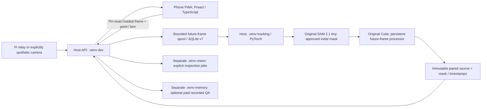

# Interactive target-tracking app: implemented subset and operation

Date: 2026-11-02. The selection/preview/future-frame path is integrated as an
optional app profile. **The complete F40 feature is unfinished and its 5 FPS live
gate FAILS on the measured CPU host.** Read the [full app execution report](research/2026-11-02-stream-app/report.md),
[accepted design](26-interactive-target-tracking.md) and OPEN critical review.

The subsequent user-authorized [v2 scheduling revision](28-live-stream-scheduling.md)
is now the supported live policy. [Its actual run](research/2026-11-02-tracking-freshness/report.md)
processes 292 observations over two minutes without FIFO lag growth, at about
2.41 mask callbacks/s. Latest-frame replacement fixes the observed overload
scheduling defect; it does not pass the unchanged 5 FPS/five-minute gate or
validate identity accuracy. Historic v1 failures above remain valid evidence.

## Placement



No phone model download, native build, Docker or ROS is required for this host
profile. The physical Pi relay and its ROS environment remain independently
unverified. The phone displays and prompts; it does not run PyTorch or become a
third-person camera through this feature. Model workers stay separate from the
camera/control loops. Tracking is stationary/disarmed and never commands motion.

## Provisioning and launch

```bash
make setup
make app-setup
make app-build
make tracking-setup
export PUPPYPI_TRACKING_ENABLED=1
export TEACH_FIND_DATA_DIR=data/operator-app
# Terminal 1: actual required models; CPU is explicit, no alternate backend
make tracking-worker
# Terminal 2: same Settings/environment/data path
make app APP_ARGS="--data-dir data/operator-app --host 127.0.0.1"
```

Setup pins both source revisions, four artifact hashes and the observed tracking
environment in `requirements/tracking.txt`. It reuses the common verified
checkout/download helpers and disables optional SAM CUDA extensions. This is the
CUDA-capable Torch build actually exercised on CPU, not a claim that a GPU is
required. `make tracking-setup` was exercised against the existing verified G0
sources/weights with `PUPPYPI_TRACKING_SOURCES=runs/interactive-tracking-research-2026-11-02`;
a clean new-machine download/install has not been tested. `.venv/` is preserved.

For access from a real phone, explicitly bind the host to its intended interface
and use the displayed pairing code from a reachable address. This experiment
bound only to loopback; phone/Wi-Fi/HTTPS behavior is not established by its
screenshots. Selecting a real relay requires an explicit `--robot relay
--relay-host ...`; this guide does not actuate or discover one automatically.
Existing motion authorization and robot-side watchdog requirements still apply.

Vision and Mind Palace remain optional, separate workers (`make vision-worker`,
`make memory-worker`) with their own setup. Enable their profiles explicitly on
both app and workers. Export `OPENAI_API_KEY` only in the paid worker environment.
To bound all paid attempts across jobs/restarts, configure the worker with
`PUPPYPI_MEMORY_BUDGET_FILE` and a positive `PUPPYPI_MEMORY_GLOBAL_CALL_BUDGET`.
A reused ledger's limit cannot be silently changed. Paid APIs are never part of
`make test` or `make app-test`.

## Operator interaction

1. In **Monitor**, disarm controls, wait for a fresh camera frame and an online
   tracking worker, then choose **Select target**. The exact loaded frame is
   pinned for ten seconds; it does not move under the pointer.
2. Add a foreground point, exclude a region with a negative point, or draw a box.
   Keyboard box coordinates are also available. Coordinates use the inverse SVG
   transform into the saved image raster; out-of-bounds prompts fail.
3. Choose **Preview model mask**. Original SAM produces alternatives; review the
   actual masks and choose the desired extent. Highest predicted quality does not
   guarantee an entire object or correct identity.
4. Choose **Track this object**. Original Cutie processes future source frames
   with its persistent state. The panel pairs each mask only with that exact
   processed source. Stale results are explicitly historical/delayed.
5. Use **Stop tracking** to invalidate the generation. Late model output cannot
   resurrect the session. A new explicit selection creates a new session; it is
   not automatic recovery of the same physical object.

The UI defaults to English; this new panel currently falls back to English when
its strings are absent from the optional Vietnamese resource. Custom lifecycle,
empty-mask and time-gap rules are disclosed as heuristics. A real model worker
must be ready; missing/corrupt sources/weights fail without replacement masks.
A model-mask score is not an object-identity probability.

## Implemented boundaries and unfinished work

Migration 7 persists owners (hashed session IDs), prompt revisions, generations,
source frames, observations, execution events and worker heartbeat. Migration 8
adds explicit bootstrap/live inbox state, persistent sequence
allocation and replacement/skipping metrics. The camera producer uses a capacity-one
latest-value mailbox and independent writer. Bootstrap uses bounded retained
history; live inference has one replaceable pending frame, with unchanged temporal
gap/freshness and count/time/byte limits. Source/preview/output bytes count toward the session
budget. Source PNG files are retained as evidence; frame-row retention is bounded
and does not silently delete images referenced by observations.

Only one target/camera/session runs at once. Owner changes, camera-session
changes, model failure, expiry and excessive lag stop the affected capability.
Readiness/configuration is not per-run inference evidence. API records preserve
actual upstream provenance, source/mask hashes, timestamps and failure codes.

The promised **Find again**, exact automatic re-identification, in-place correction
generations, complete session timeline/export and full held-out quality suite
remain unfinished. Existing enrolled-object YOLOE inspection still works as its
separate profile; it is not a substitute for transient-target recovery. Do not
mark G1–G4 or the critical incident complete from this integration subset.
