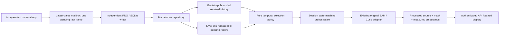

# Live tracking scheduling revision: freshness, ownership and overload

Date: 2026-11-02. User authorized correction after the FIFO overload failure at
`74be1ff`. Status: implemented; [actual 120-second app execution](research/2026-11-02-tracking-freshness/report.md)
records bounded live pending work and stable source age. Full 5 FPS gate remains FAIL.
This explicitly revises section 6 of the earlier [tracking design](26-interactive-target-tracking.md).
It preserves the approved models, mask/anchor binding, temporal gap/freshness
budgets, failure semantics and 5 FPS/five-minute acceptance gate.

## Failure and decision

The old camera-to-writer queue had capacity two and dropped incoming frames when
full. The writer fed a 60-frame ordered inference spool. Cutie consumed the oldest
unprocessed frame, turning live monitoring into delayed replay when consumption
was slower than production. A ten-second cutoff detected failure but could not
provide continuous low-latency tracking. Original [failed evidence](research/2026-11-02-stream-app/report.md)
is preserved. Hardware speed and segmentation accuracy are separate questions.

Revision: **latest-value admission at each live handoff**, one model call in
flight, one replaceable pending inference frame, explicit bounded initialization
and independent processed-evidence retention. A slower consumer reduces sampled
FPS instead of accumulating arbitrarily old work. Temporal discontinuity or a
single inference exceeding the unchanged freshness budget remains a visible
failure; a finite queue cannot guarantee model speed or quality.

[GStreamer queue](https://gstreamer.freedesktop.org/documentation/coreelements/queue.html)
documents bounded queues and dropping old buffers as a standard streaming policy.
This project uses its own small standard-library mailbox and SQLite adapter;
**it does not integrate GStreamer**. Original pinned Cutie's
[BURST reader](https://github.com/hkchengrex/Cutie/blob/ec5cdd4cf16f75c73ad785a2f96fb97dbad4125a/cutie/inference/data/burst_video_reader.py)
supports dataset frame subsampling. That source fact does not validate arbitrary
live skipping or guarantee accuracy; actual Cutie inference and paired sampling
checks are still required.

## Responsibilities and patterns

- **Mailbox / producer-consumer:** replace the pending raw frame under a lock;
  never block capture on model/PNG/storage latency. Close wakes the consumer.
- **Repository:** `FrameInbox` owns frame sequence allocation, bounded bootstrap
  retention, live replacement/claim, and scheduling counters in migration 8.
  Persisted sequence allocation never resets when the pending slot is consumed.
- **Pure scheduling policy:** select timestamped evidence according to phase;
  no model, file, clock or UI dependencies. Original `TrackingModels` remains the
  model adapter; scheduling is explicitly custom application logic.
- **State machine / orchestrator:** `TrackingRunner` handles preview, seed,
  bootstrap, live, failure and generation-guarded publication in separate methods.
  Stop invalidates publication immediately; native inference may finish later.
- **Evidence store:** processed images/masks and their timestamps remain durable.
  Historical evidence is not queried as a live work queue. Source files retained
  for audit count toward the existing byte budget; no automatic deletion of
  images shared with other features.

## Temporal contract

1. Pin the exact displayed fresh source and run SAM there. Seed Cutie with that
   approved original mask on that same raster. Never initialize it on a new image.
2. During preview/bootstrap, retain at most the configured 60 source records plus
   the anchor. Bootstrap chooses the newest *retained* frame reachable within the
   unchanged positive capture gap of 0.6 seconds from the last processed frame.
   This is explicit temporal subsampling, not fabricated intermediate motion.
3. Bootstrap ends only after consuming the head available at claim time and
   producing evidence within the existing one-second freshness budget. The
   existing ten-second initialization budget remains; missing history fails.
4. Live publication replaces the sole unclaimed pending record. The worker
   atomically claims the newest record and frees that slot before inference.
   Every chosen capture remains monotonic, same camera/session and within the
   unchanged 0.6-second gap. An excessive gap fails; do not process an older
   historical frame to conceal a discontinuity.
5. Live input already older than one second is rejected before inference. A
   result beyond that deadline is retained as historical evidence with a visible
   failure, not displayed as current. No frame extrapolation or automatic model
   reset/re-identification.
6. Schema/profile v1 histories remain interpretable as v1; existing active work
   is interrupted at worker restart. Profile v2 never silently upgrades an old
   session. Current model/source configuration is still frozen per session.

The one-pending-frame invariant applies to the **model inbox**. Capture-to-writer
also has one pending frame and one write may be in progress. These separate
constant-size stages must not be described as one total system-wide buffered
image. The bootstrap ring is a distinct, time-bounded initialization workload.

## Required measurements

- Offline deterministic overload test: many offers per consumer take; pending
  count never exceeds one in live mode; latest wins and replacements are counted.
- Temporal policy tests: bootstrap reaches newer evidence without exceeding gaps;
  live never selects stale oldest work; gap/clock discontinuity fails.
- Races: late preview/inference after stop cannot publish; new frames arriving
  during inference replace pending work, not the in-flight immutable snapshot.
- Actual upstream CPU model run through the hosted app, at requested 5 Hz for
  a sustained duration beyond the original ten-second failure. Report early/late
  source age, pending depth, skipped/replaced counts, latency and quality limits.
- Paired original-Cutie replay on identical rendered input/initial mask with
  ordered versus selected inputs. Report mask agreement as agreement, not
  ground-truth accuracy; retain raw evidence and failures.
- Keep the 5 FPS / five-minute gate independently FAIL unless its exact
  throughput and latency criteria pass. No extra paid calls are needed for
  scheduling tests; the existing benchmark ledger remains 8/15.
