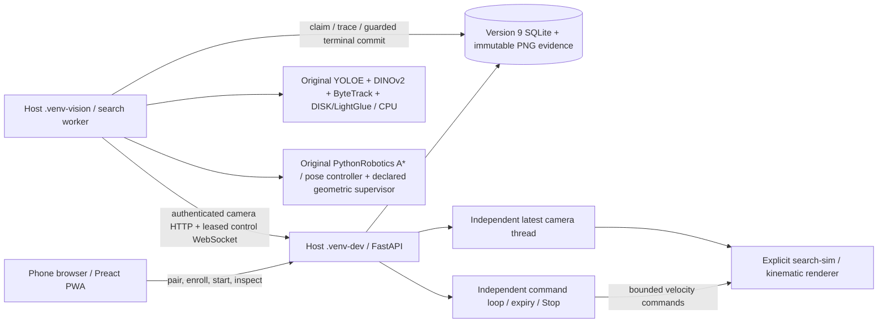

# End-to-end Teach, Search, Verify and Remember delivery contract

Date: 2026-11-02. User requested completion of the missing station-search,
multi-view verification and automatic recorded-sighting feature after the
[critical reporting recurrence](review/2026-11-02-academic-claim-inflation.md).
Status: implementation in progress; no completion or quality claim.

## Explicit user amendment: search v2 / vision v3

On 2026-11-02 the user accepted the concrete role revision after reviewing an
actual case: YOLOE proposes regions; DINOv2 selects gallery identity; original
DISK/LightGlue supplies geometric multi-view evidence. The user also requested
a detailed illustrated case report. This supersedes the class-agreement gate
**only for new search payload v2 / vision profile v3**. Similarity ≥0.80, margin
≥0.05, mandatory original models and quality/failure gates remain. Original
vision profile v2, legacy jobs and their failures are preserved unchanged.
The original contract and development progression below are retained as history;
the authorization is not a retrospective quality pass.

## Required outcome and explicit method

From the app, register reference images, start a target search, observe actual
bounded robot motion through configured inspection stations, acquire distinct
views, execute genuine learned matching, inspect match/rejection evidence, and
query the resulting recorded observation timeline. This delivery is evaluated in
the existing **kinematic rendered simulator**, not physical locomotion or an
unknown-room exploration/world-model claim. The simulator must integrate bounded
velocity commands; setting the camera to an oracle inspection pose is forbidden.

Keep existing YOLOE SAVPE → original DINOv2 → Ultralytics ByteTrack as mandatory
candidate inference. Their accepted custom similarity/margin policy is unchanged.
Add actual pretrained **DISK + LightGlue** source/checkpoints for local feature
correspondence across reference/query views. Use released **PythonRobotics A***
and its **PathFinderController** for known-map planning/control. These are classical
geometric algorithms, not learned navigation or a PuppyPi RL gait. Use real
OpenCV AprilTag detection/PnP and calibrated ground-plane camera geometry for
visual localization; renderer pose/target identity is not a controller/model input.

This chooses actual upstream implementations for previously missing components;
it does not relabel the legacy heuristic as those implementations or claim full
IEVE reproduction. IEVE's released agent couples Habitat/Mask-RCNN/LightGlue and
contains a zero-match exception substitute, which is not reused. Here LightGlue
is used directly from its separately licensed author implementation. Model errors
fail the search with no alternate matching backend.

## Reuse and ownership

| Role | Real upstream | Project-owned responsibility |
| --- | --- | --- |
| Proposals / descriptors / temporary tracks | Existing pinned YOLOE / DINOv2 / ByteTrack | Existing adapters, frozen references and raw evidence |
| Local features and learned correspondence | LightGlue `5a650c444718caffc2669dc0094cde908f42dd73`, DISK via Kornia 0.8.2 | Verified local checkpoint loading, project records and explicit geometric readout |
| Grid route | PythonRobotics `8c392897c7f41a6e4d9aab9cb2e9737a7a6fa031` `AStarPlanner.planning` | Calibrated map adapter, footprint and endpoint validation |
| Velocity controller | Same PythonRobotics `PathFinderController.calc_control_command` | Units, velocity bounds, fresh pose/command lease and stop |
| Camera pose | OpenCV AprilTag corner detection/PnP; constrained geometry optimization | Registered landmark/camera calibration and pose-quality rejection |
| Memory | Existing versioned EvidenceStore | Durable search/view/model-sighting records and links to exact captures |

Primary sources: [LightGlue paper](https://arxiv.org/abs/2306.13643),
[author repository](https://github.com/cvg/LightGlue),
[DISK release](https://github.com/cvlab-epfl/disk),
[PythonRobotics paper](https://arxiv.org/abs/1808.10703),
[author implementation](https://github.com/AtsushiSakai/PythonRobotics),
[OpenCV marker geometry](https://docs.opencv.org/4.x/d5/dae/tutorial_aruco_detection.html).
LightGlue/DISK are Apache-2.0; PythonRobotics is MIT. No upstream source is copied
without retained attribution; pinned optional source checkouts remain separate.

## Configuration versus inference

A registered calibration/map supplies known station tag IDs, measured landmark
corners, inspection regions, reachable inspection poses, obstacles, camera
intrinsics/extrinsics and units. These are explicit operator/fixture inputs,
not learned room understanding. Test fixtures author the room and object placement,
but only pixels/calibration/reference images reach inference. Query object identity,
location and success labels stay in the evaluator. Station association requires
observed fiducial evidence; unknown pose/region remains unknown.

Reference-image registration does not train a model. Existing legacy descriptors
may remain for explicit comparison, but search uses the actual stored images and
required upstream models, never those descriptors as an inference substitute.
Legacy user assertions remain separately labeled historical data.

## Flow and failure semantics

One durable search at a time, one motion owner, separate host camera/watchdog and
CPU model worker. Reuse the existing authenticated bounded control channel. Motion
intents are set to zero before inference; a worker/model/network stall cannot
sustain motion. Global Stop cancels the search and invalidates ownership. No
automatic resume after manual takeover, stale pose, disconnect or restart.

The final transport refinement makes each navigation segment its own lease.
At a reached view, the worker requests a planned disarm, waits for a zero command
accepted by the device adapter, requires a capture timestamp after that
acknowledgement, then closes the control connection before heavy inference.
This acknowledgement establishes simulator/adapter command acceptance, not a
physical robot's measured stopping distance. A new segment must validate the
same running task and runtime motion-generation token, fresh camera/session and
calibration. Stop, unexpected expiry, invalid command, camera/command loss or host
restart revokes that token. Planned segment completion does not revoke it.
There is no automatic rearm after a fault. See the [execution report](research/2026-11-02-complete-search/report.md).

The worker plans from observed pose to reachable configured inspection goals,
executes and checks convergence, then saves the exact capture and inferred pose.
Only actual model-proposed candidates may be verified. All proposals, descriptors,
local correspondences, rejection reasons and failed views remain inspectable.
Required sources, weights, models, pose or inputs missing → explicit FAIL.

The multi-view evidence policy is custom and must be frozen before held-out
assessment. It uses measured local correspondences, geometric consistency,
reference coverage and genuinely distinct camera poses; no invented probability,
weighted legacy confidence accumulator, canned success or manually confirmed
identity substitutes for it. Not-found/exhausted is not proof of observed absence.
Indistinguishable evidence must remain inconclusive. Do not persist a verified
model sighting until the verification acceptance gate actually passes.

## Completion gates

1. Real upstream example and project examples execute; record revisions, licenses,
   checkpoints, preprocessing, invocation counts and raw results independently.
2. App enrollment → start search → executed continuous motion → multiple model
   views → verdict → persisted evidence/timeline runs without editing run state.
3. No renderer pose, target labels, query truth boxes or oracle pose-setting enters
   navigation/perception. Compare visual pose/trajectory to evaluator truth only
   after execution. Record collisions, invalid localization and interventions.
4. Freeze calibration/readout before held-out positives, wrong/look-alike targets,
   absent targets and insufficient/hidden distinguishing views. Report precision,
   recall, false confirmations, inconclusive results and all failures. Do not tune
   thresholds on those held-out scenes or count execution as quality acceptance.
5. Cancel/Stop, stale camera/pose, missing/corrupt model and worker restart cannot
   commit success or keep movement alive; default tests remain offline/no hardware.
6. Phone/desktop UI, screenshots and source/match/trajectory figures reflect actual
   execution and actual provenance; no authored identity displayed as inference.
7. All required software checks pass, original failed evidence remains, and
   unrun physical/real-room acceptance is stated explicitly. A partial pipeline
   or another proposal does not complete this user request.

## Development findings (not acceptance)

The first simulator run stopped on unavailable AprilTag pose before any view was
inferred. The second reached one view but lost tag coverage during a turn. These
runs remain under `runs/search-development-2026-11-02/`. Calibration v3 adds
observed tag coverage and nearer inspection goals; this is supplied fixture/map
calibration, not learned scene recovery. Original PythonRobotics point control
uses configured gains `(0.8, 2.0, 0.0)`. A project-owned geometric heading supervisor
rotates before translation near the original controller's forward/reverse switching
boundary, and aligns terminal yaw. These are explicit classical control rules,
not learned control or an unmodified full navigation stack.

A subsequent app run enrolled images through Chromium and reached two inferred
views, then its original combined receive/capture/send loop used an expired
challenge. The revised transport continuously drains status into one slot,
separates camera HTTP and control sending, and expires movement intents. It never
rearms after lease loss. Preserve the failed run `runs/search-app-dev3-2026-11-02/`.

That run also exposed a method problem: the detector boxed the target but assigned
the competing prompt class; DINOv2 selected the target (cosine 0.890, margin 0.185).
Reversing the prompt bank produced the same semantic result, so the observed issue
is not fixed by reversing class indices. Genuine DISK/LightGlue on the boxed target
produced 92–138 geometric inliers across the two captures, whereas background-tag
crops failed the configured support policy. These are development diagnostics,
not a held-out quality result or permission to remove the class-agreement gate.

A user clarification was requested on the concrete revision: use YOLOE as region
proposal, DINOv2 as gallery identity readout, and DISK/LightGlue for geometric
multi-view verification, preserving all mandatory models and failure behavior.
The user then explicitly accepted that revision, as recorded above. The original
class-agreement path remains in vision profile v2; new searches use profile v3.

## Process architecture and execution instructions



This evaluated profile runs on the host. It uses neither ROS/Docker nor the Pi;
there is no physical search profile yet. Python orchestrates the actual pretrained
PyTorch components and the original geometric planner/controller. The phone hosts
the UI only. Network camera/status each have one latest slot; the sender and intent
expiry operate independently of camera HTTP and heavy inference. Capture timestamps,
camera/session identity and the supplied calibration ID remain attached to evidence.

Prepare `make vision-setup`, `make search-setup`, `make app-build`. In the host and
worker shells, set the same data directory/pairing token and explicit enablement:

```bash
export TEACH_FIND_DATA_DIR=data/search-sim
export PUPPYPI_OPERATOR_TOKEN='<choose-a-private-pairing-token>'
export PUPPYPI_SEARCH_ENABLED=1
export PUPPYPI_VISION_ENABLED=1
export PUPPYPI_SEARCH_HOST=http://127.0.0.1:8080
make app APP_ARGS='--robot search-sim --host 0.0.0.0'
# Separate terminal, same environment:
make search-worker
```

Open the host URL from the phone, pair, enroll multiple cropped reference images
in Library, open Monitor → Station search, select a target and start. Inspect
actual captures, descriptor decisions, learned correspondences, failures and JSON
export. Stop cancels the durable search and invalidates movement ownership.
Manual arming is rejected while a queued/running search owns the workflow. A
worker restart interrupts queued/running searches rather than resuming them.

**The identity acceptance gate is currently FAIL.** The host's default
`SearchSettings.quality_qualified=False` blocks verified automatic-memory writes,
even if an experimental readout returns confirmation. Do not enable it merely to
make a demo pass. It requires frozen, recorded positive/negative/ambiguity quality
acceptance first. A completed motion/model job is not a completed target-finding
feature. The user-authorized revised role assignment applies to search v2 / vision v3;
legacy vision v2 keeps its original class-agreement semantics.

The frozen 13-case batch subsequently **failed**: six control-transport failures
and one false confirmation of an unknown same-front/different-side object.
The [illustrated case](review/2026-11-02-yoloe-identity-gate-case.md) records both
the recovered proposal and the remaining identity defect. The user approved
research on an additional verification stage, not an unspecified new app
algorithm. See the [research and design plan](30-appearance-contradiction-research-plan.md).
The publication gate remains closed; the required complete feature is not delivered.

The opt-in reproducer owns disposable server/worker/browser processes and stops
them in `finally`; it never actuates a physical kit or calls a paid API:

```bash
PYTHONPATH=. .venv-dev/bin/python scripts/research_search_app.py \
  --output runs/my-search-case --scenario target
```

The target-case acceptance requires a confirmed target **and** a persisted model
sighting; an inconclusive target search exits nonzero. Negative fixtures require
no false confirmation. Use `--expect-error CODE` for an explicit missing-component
experiment; that passing failure test does not establish a successful search.
`source-manifest.json` fingerprints the source used by new experiments. Earlier
manifests' `api_calls: 0` meant paid model API calls, not local app HTTP calls;
new manifests use the unambiguous `paid_api_calls` field. Earlier execution-only
scripts exited zero after recording an inconclusive/failed run; that was not a
quality pass. The current reproducer separates execution from case acceptance.
