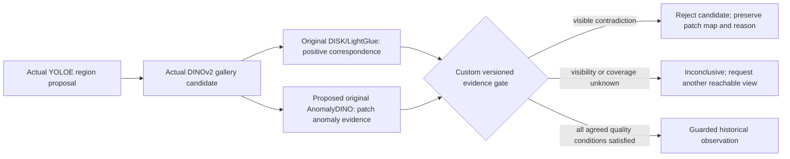
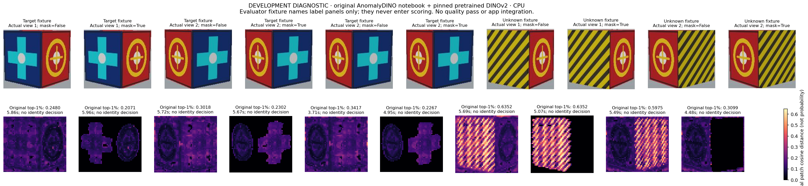

# Appearance contradiction verification: research and proposed gate

Date: 2026-11-02. **Research approved; replacement method not yet approved or
integrated. Current complete-feature status remains FAIL.** The user explicitly
requested research/design/plan or rewinding an unsound approach, rather than
forcing a result. The [illustrated counterexample](review/2026-11-02-yoloe-identity-gate-case.md)
is a permanent regression, not a fresh held-out example for later tuning.

## What the failure actually requires

The previous policy asks whether some learned features match. The counterexample
requires asking whether a visible object region contradicts every supplied target
reference. A matching front cannot excuse visibly different sides. Conversely,
an unseen side, occlusion, background or unfamiliar lighting must not be invented
as either agreement or contradiction. No finite gallery establishes arbitrary
physical identity; observationally identical objects must remain ambiguous.



This diagram is a proposal, not an executed app path. No extra anomaly model has
been silently added to search. Model names remain required; a failure cannot
fall back to LPIPS, CV2, operator assertions or the legacy matcher.

## Candidate sources, actual inspection and evidence

| Candidate | Verified source and intended role | Actual local status | Decision |
| --- | --- | --- | --- |
| AnomalyDINO, WACV 2025 | [Paper](https://openaccess.thecvf.com/content/WACV2025/papers/Damm_AnomalyDINO_Boosting_Patch-Based_Few-Shot_Anomaly_Detection_with_DINOv2_WACV_2025_paper.pdf), [author repository](https://github.com/dammsi/AnomalyDINO), revision `b9d1c2648e3a5247437d4d953d907a8f3d994457`, Apache-2.0 | Original notebook scoring function executed verbatim on five actual app crops, two masking configurations, pinned pretrained DINOv2, isolated CPU environment | Feasible diagnostic component; app verification/quality acceptance still pending |
| LPIPS, CVPR 2018 | [Author project/paper](https://richzhang.github.io/PerceptualSimilarity/), [repository](https://github.com/richzhang/PerceptualSimilarity), revision `082bb24f84c091ea94de2867d34c4544f68e0963`, BSD-2-Clause | Original SqueezeNet LPIPS ran on CPU on released example and five actual app candidate crops | Diagnostic comparator; not selected as a drop-in identity gate |
| PatchCore, CVPR 2022 | [Author repository](https://github.com/amazon-science/patchcore-inspection) | README inspected via primary source; not cloned/executed here | Established patch-memory alternative; no integration claim |

AnomalyDINO's industrial anomaly benchmarks are evidence about that paper's task,
not evidence that PuppyPi can reject novel objects under arbitrary camera motion.
Using it for object-instance contradiction is a proposed application requiring
its own evaluation. A high anomaly score is not an identity probability.

### AnomalyDINO code-path audit

The actual reuse target is `src/backbones.py:DINOv2Wrapper.prepare_image`,
`extract_features`, `compute_background_mask`, and
`src/detection.py:run_anomaly_detection`: original reference-patch memory,
normalization, FAISS nearest-neighbor distances and anomaly-map readout.
The original path uses per-patch tokens, unlike the app's global descriptor.
No new tracking/world model or model training is proposed.

Important source constraints found before promising deployment:

- The README's `--faiss_on_cpu` controls the FAISS index. The CLI still constructs
  the backbone on `'cuda'`, and `run_anomaly_detection` unconditionally calls
  `torch.cuda.synchronize()` for timing. That flag alone does **not** make the
  released end-to-end CLI CPU-ready. The separate original notebook scoring
  function does support an explicitly CPU model and CPU FAISS; that is the
  actual executed entry point below, not a claim that the CLI was repaired.
- `requirements.txt` pins NumPy 1.26 and warns about NumPy 2; the current vision
  worker has NumPy 2.5.4. The diagnostic therefore uses a separate `.venv-anomaly/`
  with NumPy 1.26.4; the app vision environment was preserved.
- Default PCA foreground masking includes centering assumptions and custom
  thresholds in the author code. Crops, partial occlusion and multi-face objects
  must be tested; foreground masks cannot be taken from renderer truth.
- Local pretrained DINOv2 must retain pinned source/weights. Adapting only source
  loading/device/timing needs an explicit recorded patch; original feature and
  anomaly computations must execute. Do not rewrite patch nearest neighbors in
  a short project script and call that author-repository reuse.
- The original benchmark datasets were not downloaded or evaluated in this task.
  MVTec-AD and VisA licenses/splits must be recorded before their use.

### Actual original AnomalyDINO notebook execution

`scripts/research_anomaly_contradiction.py` extracts **the exact original
`score_single_image` code cell** from the pinned notebook and invokes it without
rewriting its patch-memory, normalization, FAISS search, mask or top-1% scoring.
It uses original `DINOv2Wrapper` and verified original DINOv2 ViT-S/14 weights.
Only the original `torch.hub` source/weight request is redirected to the exact
pinned local implementation/checkpoint. The hook is restored after construction.
No model-output mock, test substitute or anomaly threshold is used.

Explicit configuration: CPU, two Torch/FAISS threads, smaller edge 672 as in
the notebook, three target references, rotation disabled, original CPU FAISS,
and two **independent diagnostic** runs with masking false/true. Neither is a
fallback. The recorded function SHA and environment are in the
[actual probe summary](research/2026-11-02-complete-search/anomalydino-probe.json).

| Actual candidate | Original top-1% patch distance, no masking | With original PCA masking |
| --- | --- | --- |
| Target, view 1 | 0.2480 | 0.2071 |
| Target, view 2, proposal A | 0.3018 | 0.2302 |
| Target, view 2, overlapping proposal B | 0.3417 | 0.2267 |
| Unknown different-side object, view 1 | 0.6352 | 0.6352 |
| Unknown different-side object, view 2 | 0.5975 | 0.3099 |



The unmasked maps localize high distances on the different sides. **In the last
masked panel, original PCA masking removes the distinguishing side**, so the
score falls sharply. This is a concrete application/assumption failure, not proof
the paper or source is defective. A background-removal heuristic must not discard
contradicting evidence merely because that region differs from the reference.

Measured wall times are 3.71–5.96 seconds per diagnostic call on CPU, including
recomputing all reference features each time as the original notebook function
does. No optimized/cached application latency is claimed. These are ten calls
on five development crops, not ten independent scenes or a held-out benchmark.
No new identity decision, threshold, app integration or sighting is produced.

Reproduce after creating the separate optional environment:

```bash
uv venv .venv-anomaly --python .venv-vision/bin/python
uv pip install --python .venv-anomaly/bin/python torch==2.6.0 torchvision==0.21.0 \
  --index-url https://download.pytorch.org/whl/cpu
uv pip install --python .venv-anomaly/bin/python \
  numpy==1.26.4 opencv-python==4.11.0.86 scipy==1.15.3 scikit-learn==1.7.2 \
  faiss-cpu==1.12.0 matplotlib==3.10.1 pandas==2.2.3 tifffile==2025.6.11 \
  tqdm==4.67.1 PyYAML==6.0.2
PYTHONPATH=. .venv-anomaly/bin/python scripts/research_anomaly_contradiction.py \
  --source runs/completion-research-2026-11-02/AnomalyDINO \
  --runs runs/search-segment-fixed-2026-11-02 \
    runs/search-qualification-v2-2026-11-02/unknown-hidden-808 \
  --output runs/anomalydino-contradiction-new-run
```

The selected next design must retain visible contradictory regions, explicitly
handle background/occlusion and abstain when evidence coverage is insufficient.
Original PCA masking cannot be accepted for that role based on these results.
Adding another mask model or a custom contradiction rule requires a concrete
reviewed revision; it is not silently part of the current app method.

### Actual LPIPS diagnostic

`scripts/research_identity_contradiction.py` invokes original
`lpips.LPIPS(net='squeeze', spatial=True).forward` with released ImageNet trunk
and LPIPS v0.1 weights. The original example produces a `1×1×64×64` map, mean
`0.71102309`, on CPU. Actual app crop/reference inputs use declared custom
RGB resize 256 and the original `im2tensor` normalization; they are unaligned.

| Development input | Minimum mean LPIPS over three supplied target references |
| --- | --- |
| True target, view 1 | 0.4240 |
| True target, view 2, two overlapping proposals | 0.4211 / 0.4234 |
| Unknown same-front/different-side object, view 1 | 0.5182 |
| Unknown same-front/different-side object, view 2 | 0.4974 |

These five selected candidates show a diagnostic signal, **not a calibrated
separator, accuracy measurement or accepted verification algorithm**. The true
target scores up to 0.5781 against a different view; viewpoint alone changes the
metric. A threshold fitted between these rows would reuse known test failures
as development data. The experiment writes no app verdicts or memory records.

Reproduce with no GPU, paid API or robot:

```bash
PYTHONPATH=. .venv-vision/bin/python scripts/research_identity_contradiction.py \
  --source runs/completion-research-2026-11-02/PerceptualSimilarity \
  --runs runs/search-segment-fixed-2026-11-02 \
    runs/search-qualification-v2-2026-11-02/unknown-hidden-808 \
  --output runs/lpips-contradiction-new-run
```

Actual results and weight hashes are in
`runs/lpips-contradiction-development-2026-11-02/results.json`.

## Proposed plan and acceptance before app integration

1. **Feasibility first.** Run an original AnomalyDINO example and its genuine
   source on saved app crops in an isolated CPU environment. Record any device
   compatibility patch separately. Missing components or execution errors mean
   FAIL, with no alternative backend. No unsupported CPU-performance promise.
2. **Fix the evidence contract.** Define foreground/visibility provenance,
   per-object patch-memory version, image/model preprocessing, anomaly-map and
   abstention outputs, persistence limits and cancellation. Distinguish original
   upstream computation from the project-owned contradiction/readout rule.
3. **Development split.** Retain the known counterexample as development data.
   Test multi-face appearance, partial visibility, scale, illumination, crop
   errors and true-target viewpoint changes. Decide whether this method is
   suitable before selecting thresholds. Rewind/reject the candidate if not.
4. **Review concrete design.** Present actual maps, raw measurements, CPU cost,
   method limits, proposed custom decision rules and required changes to the
   user. Research approval is not approval to ship a specific algorithm.
5. **Freeze fresh qualification.** Use unseen object appearances and seeds;
   paired positive/negative scenes, fixed reference/motion budgets, no truth
   inputs to inference, no post-freeze tuning. Report false confirmation,
   missed targets, inconclusive cases, inference errors, timings and interventions.
6. **Integrate only the agreed method.** Add an explicit new profile version;
   preserve historical failures. Publication requires positive correspondence,
   contradiction/visibility rules and the frozen quality gate. Required model
   failure remains terminal; Stop remains independent of inference.
7. **Full app acceptance.** Enrollment → measured simulator motion → genuine
   views/inference → accepted verdict → persisted model sighting → Library after
   reload → Room timeline/last-seen query, plus Stop/disconnect/restart/missing
   model and sustained-load checks. Real-room/Pi acceptance remains separate.

Until those gates pass, the supported app exposes experimental search evidence
and explicit failures. Automatic verified memory stays blocked. The broader
critical incident and the user's delivery rating remain unchanged.
