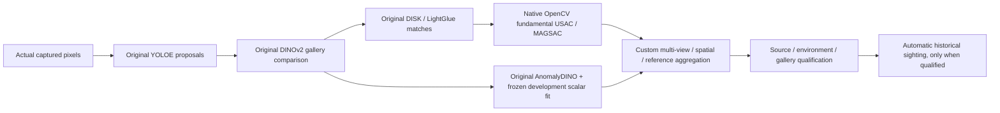

# Search v4: native geometry repair and unchanged identity acceptance

Date: 2026-11-02. The user's renewed instruction to fix the integration follows
review of the concrete fundamental-matrix proposal. It authorizes that repair;
it does not authorize changing identity thresholds or declaring a quality pass.

## Responsibility and actual reuse

The failing homography support rule was project-owned integration code in
`LocalCorrespondence.compare`. LightGlue's original implementation outputs
learned local correspondences; it is not a complete instance-identity system.
The app incorrectly applied a single planar transform to a multi-face 3D box.
The camera scheduling bug was also project code. Neither reproduced failure
establishes a defect in the author repositories or insufficient GPU hardware.

The new adapter calls the installed native OpenCV `findFundamentalMat` using
`UsacParams`. It does not implement a fundamental-matrix solver or MAGSAC in
Python. Original DISK and LightGlue models/weights/forward calls are retained.
Actual source was cloned and read before the repair:

- LightGlue: `5a650c444718caffc2669dc0094cde908f42dd73`, Apache-2.0;
  `.upstream/LightGlue`, original `demo.ipynb`/README and extractor/matcher.
- OpenCV 5.0.0 reference source:
  `runs/identity-fix-2026-11-02/opencv`,
  `40738fb16ceddb5fb3fea747585f7ce6abb0605b`, Apache-2.0;
  `modules/geometry/src/fundam.cpp:913` invokes native USAC fundamental estimation;
  `modules/geometry/src/usac/ransac_solvers.cpp:1176` defines the MAGSAC preset.
  Execution uses the installed framework wheel, not a claimed local C++ build.
- The inspected glue-factory relative-pose estimator needs reference camera
  models. They are unavailable for arbitrary enrolled crops; it is not integrated
  and no reference intrinsics are invented to invoke it.

[Official LightGlue](https://github.com/cvg/LightGlue) and
[OpenCV geometry API](https://docs.opencv.org/5.0/main_modules/d_projection.html)
are the primary public sources. The [illustrated diagnosis](review/2026-11-02-multiplane-geometry-case.md)
retains the original failed app captures and comparison.

## Fixed method and contracts

Native robust estimation: confidence 0.995, error 3 pixels, 2000 iterations,
nonparallel, random seed 0, MAGSAC score, sigma local optimization with sample
size 50 and ten iterations. Settings live in `SearchSettings`. Minimum support
remains eight inliers, ratio 0.60, coverage 0.12; distinct views, 0.20-m baseline,
all gallery-reference support and spatial/unique-region gates are unchanged.
Original AnomalyDINO, its weights/preprocessing and frozen scalar fit are
unchanged and mandatory. No homography retry, threshold relaxation, alternate
model, operator assertion or renderer identity may substitute.

New search payload/profile **v4**, vision profile v3. Historical v2/v3 records
retain their original method labels; the worker rejects them for new execution.
Every match exports actual matrix type, estimator configuration, matrix, raw
point pairs, inlier mask and support/rejection. Ordinary UI polling omits large
arrays. App copy discloses fundamental geometry, fitted appearance and custom
aggregation; none is an identity probability or a reproduced end-to-end paper.

## Acceptance and evidence plan

1. Re-extract and match the original failed reference/query crops using actual
   original DISK/LightGlue, then execute the native estimator. Preserve earlier
   failures. Authored nonplanar projection tests check the model assumption;
   insufficient/collinear pairs and historical evidence must not confirm.
2. Exercise fresh app navigation/model capture on the known positive regression.
3. Before evaluating, freeze 13 fresh scene/appearance variants with the same
   positive/negative/unknown/ambiguity/duplicate/one-view requirements and limits.
   Zero false confirmations and all mandatory positives must pass. Any failure
   keeps complete acceptance FAIL. Known failed examples remain regressions.
4. Required source/environment/fit/cache failures and Stop retain explicit failure
   without motion continuation. All work is CPU, synthetic render and loopback;
   no GPU, paid API or physical robot is required or claimed.
5. Enable publication only by explicit configuration with a real, matching,
   all-case-pass certificate. The flag cannot bypass certificate/source/gallery
   validation. Test actual sighting persistence, Library reload and Room history
   on an evaluated reference set; qualification does not cover arbitrary new
   galleries or real rooms. Keep default publication disabled.

Current status: the evaluated simulator subset passes the repeated 13-case
acceptance and actual qualified publication/reload/Library/Room history flow.
Real-room and physical quality remain unverified; the critical incident is OPEN.

The first 13-case v4 run subsequently passes 12/13 and fails on an OpenCV native
empty-model assertion while fitting a gallery-unresolved background region.
Keep that failure. The correction respects the existing descriptor gate before
geometry, preserves that specific native no-model error as unsupported evidence
without another solver, and wraps raw diagnostics on phones. It does not change
identity criteria, model weights or the appearance fit. All 13 frozen cases are
repeated after this correction; see the [actual report](research/2026-11-02-geometry-fix/report.md).
The repeat passes 13/13 without retuning. An additional known-unknown app run
executes the original appearance veto despite positive native geometric support.
Keep both the first failed batch and final scoped pass; never infer arbitrary
gallery or physical identity quality from them.
