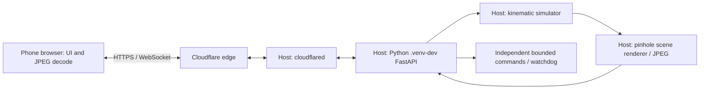

# Phone access and remote-only latency

Date: 2026-11-02. Status: integrated and measured through a public tunnel with
host-local Chromium touch emulation. Physical phone, ROS and robot are untested.

## Run it

From this repository on the prepared host:

```bash
make phone
```

This installs the locked host dependencies in `.venv-dev/`, builds the web app,
starts the simulator host and Cloudflare Quick Tunnel, and prints an HTTPS URL
and a pairing code. Open that URL on the phone, enter the code, rotate to landscape,
open **Control**, select **Arm controls**, and hold a direction. Release to stop;
the persistent **STOP** button disarms control. Existing authentication, command
leases, browser liveness checks and host watchdog remain enabled.

Keep the terminal running; Ctrl+C stops its owned services. For a detached session:

```bash
make phone PHONE_ARGS=--background
make phone-status
make phone-stop
```

The prepared host has Python 3.12, uv, Node 24, npm and cloudflared 2026.10.1.
The script checks these tools; on another host install missing Python/uv/Node
first (Node 22.12+). If cloudflared is absent, setup can download the official
Linux amd64/arm64 release and verify its published SHA256. That download path
was inspected but was not needed on this host. No sudo, Docker, ROS, GPU,
OpenAI key, phone build or APK is needed for this remote-only profile.
The phone needs a browser and internet access. First dependency installation
needs internet; subsequent starts reuse dependencies when the lockfile matches.

The URL changes on restart. Quick Tunnel is temporary and ends with its process;
it does not require a Cloudflare account or domain. See the
[official Quick Tunnel guide](https://developers.cloudflare.com/tunnel/get-started/quick-tunnels/).
Control uses a WebSocket, which Cloudflare
[supports](https://developers.cloudflare.com/network/websockets/).
Pairing remains mandatory; the launcher does not publish credentials in Git.
Logs, the private pairing-code file and source snapshots are under ignored
`runs/phone/<session>/`; `runs/phone/active.json` locates the current session.
The gallery/history persist in ignored `data/phone-console/` across restarts.

## What actually runs



All simulation and rendering run on the host CPU. The browser presents the images
and sends operator input. This profile has **no ROS hop**, no MuJoCo dynamics,
no learned locomotion and no real robot. The scene is explicitly authored
Python/OpenCV geometry, labeled as such in the app. Its renderer is an input
source, not an AI perception result. Measurements cannot be transferred to
`host → ROS → physics/robot → camera` without separately implementing and
instrumenting those stages.

Default mode turns off search, vision, tracking and paid memory workers; it starts
only the app and tunnel, supervised by the launcher. Loading a model environment
is unnecessary for monitor/control. The image reader keeps one request in flight
and one replaceable newest pending frame. Metadata does not cancel every active
image transfer. The displayed blob URL stays alive until its replacement decodes.
The frame identifier and host-age label describe that displayed image. The label
is a host estimate, not a measured one-way internet delay.

Optional local research workers have a separate command:

```bash
make phone-stop
make phone-ai PHONE_ARGS=--background
```

This requires the existing genuine model environments, upstream source,
checkpoints, evaluated gallery and matching search qualification. If these are
missing, startup fails; remote-only is not substituted. `make phone-ai-setup`
prepares the upstream search/tracking stacks and may download large dependencies
and checkpoints; it does not itself qualify an arbitrary gallery or real room.
The existing qualified gallery is local to this host. Neither mode starts the
paid Mind Palace worker. The remote-only benchmark below makes no claim about
AI throughput under concurrent load. See [the search contract](32-native-geometry-repair.md)
and [tracking guide](27-live-tracking-app.md) for those independent constraints.

## Measured results, AI off

Run `make phone-benchmark` after stopping an interactive phone session. It starts
its own real tunnel, drives Chromium using touch input for 60 seconds, saves
results, and stops that session. Install its optional browser once with
`npm --prefix web exec -- playwright install chromium` if unavailable.
Default tests never start a tunnel or call a model/API.

The [execution report](research/2026-11-02-phone-tunnel/report.md) records 24
actual UI input pulses, actual host command integration and matched rendered
frame IDs. Chromium ran on this host at 844×390 through public Cloudflare HTTPS;
it was not a physical phone on Wi-Fi/4G/5G.

| Measurement | Median / delivered rate | P95 |
| --- | ---: | ---: |
| Host capture/render rate | 5.00 FPS | — |
| Unique images painted in browser | 3.92 FPS | — |
| Touch input → simulator command applied | 19 ms | 21 ms |
| Touch input → changed-pose image painted | 665 ms | 779 ms |
| Captured image → browser paint callback | 515 ms | 623 ms |
| HTTPS timing-request round trip | 56 ms | 188 ms |

No command or visual response was missing in these 24 trials. P95 of 779 ms means
95% of measured input-to-image delays were at or below approximately that value;
it is not an accuracy score. Browser paint uses the existing decode/two-animation-
frame callback, not a physical display sensor. Same-host clocks permit subtraction;
a phone measurement needs clock synchronization/error bounds or an external
glass-to-glass method.

The configured capture period is 200 ms (5 Hz). Network transfer, rendering,
decoding and one-in-flight scheduling reduce delivered FPS. This is not a CPU
hardware maximum and has no relation to model recognition accuracy. The four
15-second windows have median displayed ages 509, 529, 520 and 494 ms; no growing
backlog was observed during this one-minute run. This does not certify indefinite
operation or another phone/network. The final interactive session lets the user
check actual phone responsiveness; its full path has not yet been measured.

Validation: 151 Python tests, 10 disposable-server Chromium tests, frontend and
Python package builds, and `make check`. The browser regression delays JPEG
responses by 350 ms while metadata continues at 200 ms, checking that images
still advance and controls can arm after decode. No paid API, GPU, ROS or physical
actuation was used. The broader capability-integrity incident remains open.
