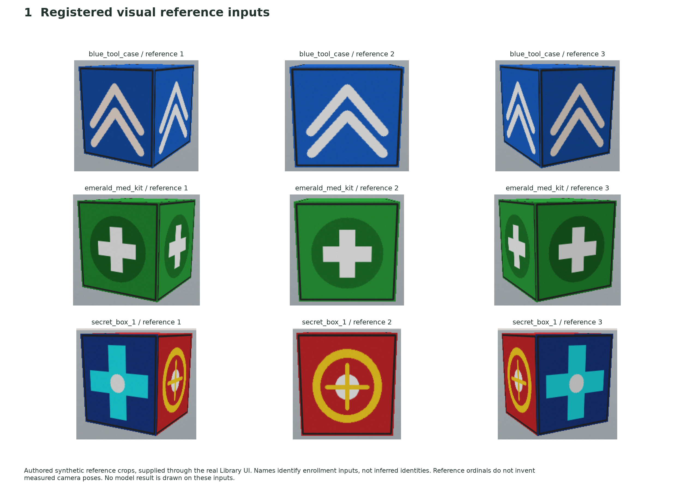
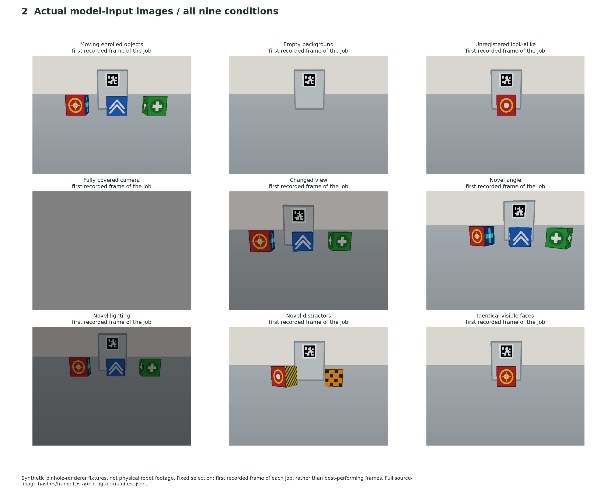
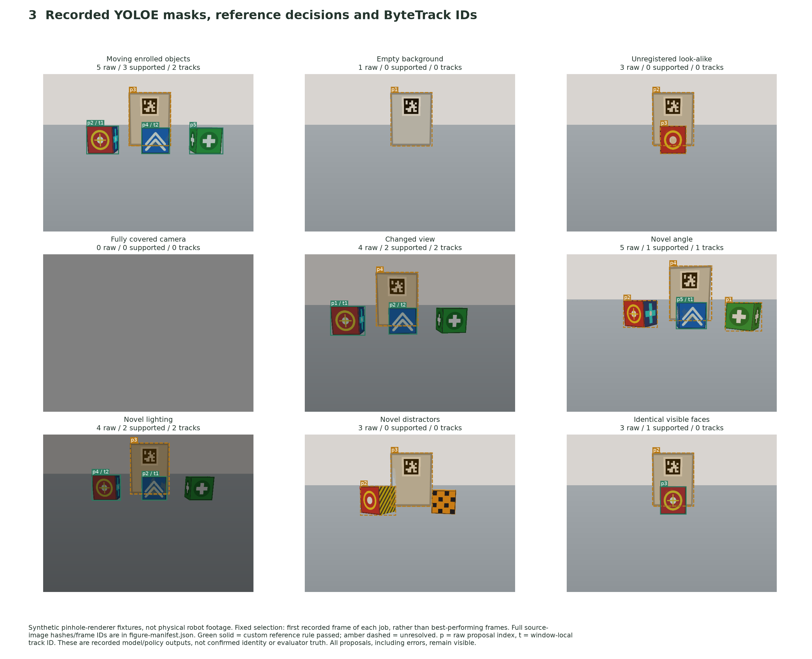
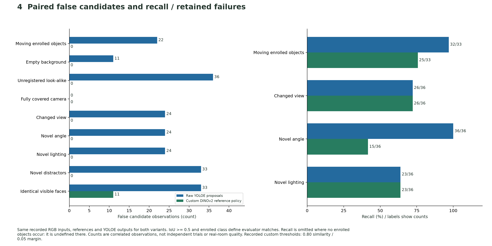
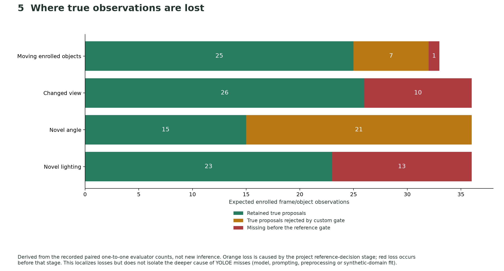
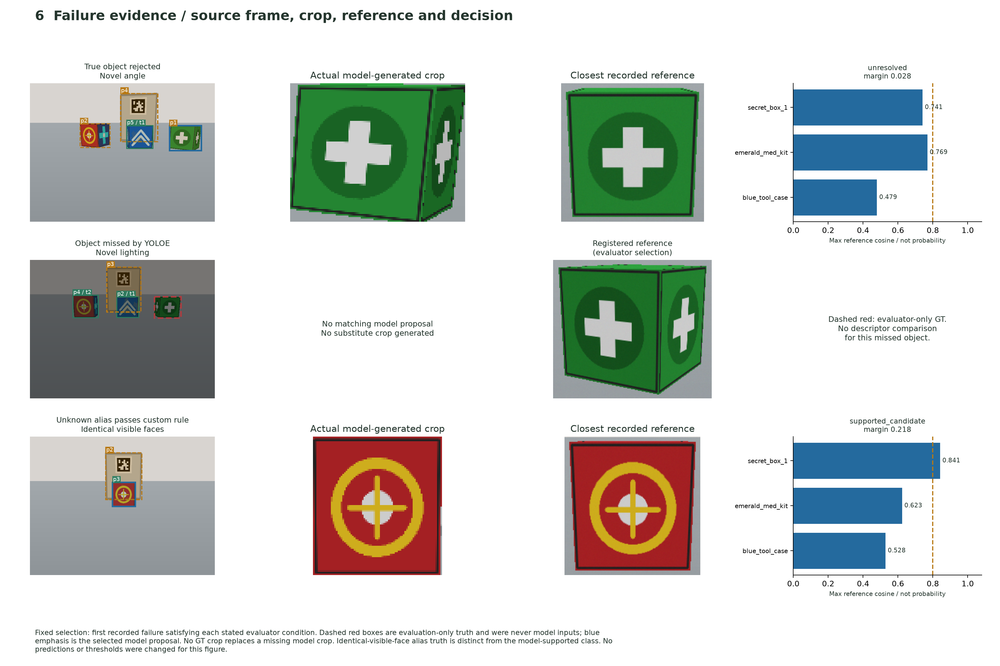
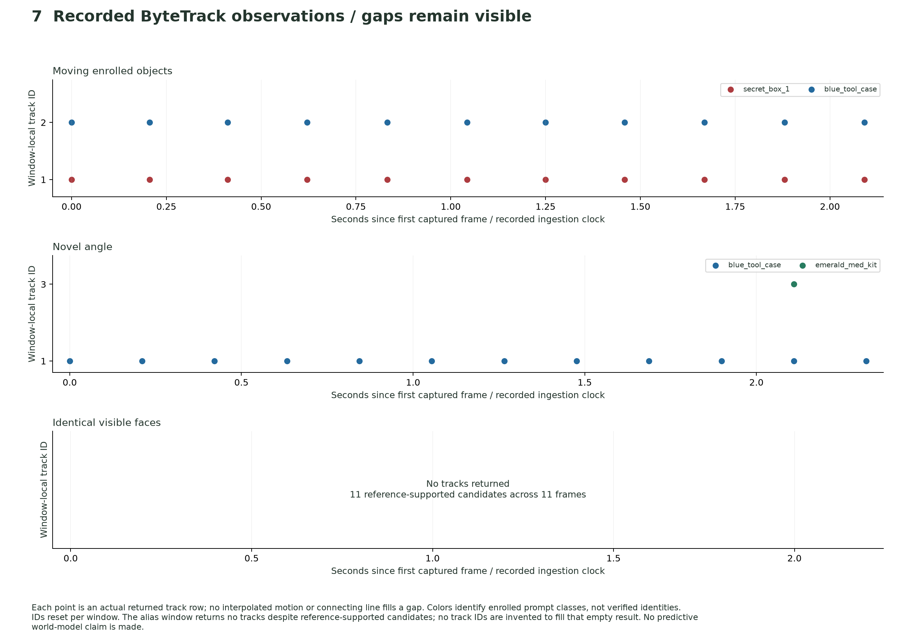

# Visual evidence atlas

Visualization update: 2026-11-02. All figures derive from the frozen combined-model
application run described in [the execution report](../report.md). They add no new
model inference or performance result. Exact-identity acceptance remains FAIL /
unverified, with raw errors retained.

[Open the 16-page figure PDF](figures.pdf).
PNG previews and SVG exports are available below; the nine individual scene
panels are included in the PDF after the source/model contact sheets.

## Scope and completeness

- **108 rendered source files** across nine conditions, with **53 distinct file
  contents** because several fixtures are static/repeated. These are authored
  pinhole-renderer inputs, not a physics controller, physical robot or real room.
- **103 captured frames processed by the actual models**. Capture windows can
  contain 11 or 12 frames; this is not 103 independent scenes/trials.
- **16 summary figures**: seven reference/overview/metric/diagnostic/timeline
  figures plus nine individual scene outputs. Each has PNG and SVG versions.
- An additional complete offline gallery contains **all 103 model-output overlays**,
  their source-image links, raw outputs, frame/capture IDs and hashes. A portable
  ZIP includes all 108 source files and content-addressed images. Full streams and
  this archive stay under ignored `runs/`, rather than being committed.

The [figure manifest](figure-manifest.json) records selection, source/output
hashes and PDF page count. The [archive manifest](archive-manifest.json) records
ZIP size/hash; [artifact validation](figure-validation.json) records archive CRC,
page/frame counts and gallery-link checks. Local complete outputs from this generation are located at:

```text
runs/vision-report-export-2026-11-02/complete/visuals/index.html
runs/vision-report-export-2026-11-02/complete-evidence.zip
```

The gallery/archive is a rendering of recorded model outputs. It neither queries
a model nor discovers a live robot. After extracting the ZIP, open
`visuals/index.html`; `recording/` retains the original reproducible inputs/data.
Model weights, databases, credentials and services are excluded.

## 1. Registered reference inputs



[SVG](01-enrolled-references.svg). Reference names are enrollment inputs, not
machine-inferred identity. Ordinals do not invent measured camera poses.

## 2. All nine source conditions



[SVG](02-nine-source-scenes.svg). Selection is the first recorded frame of each
job, not a best-performing frame. Scene/identity truth is evaluator metadata and
was not supplied to the inference models.

## 3. Actual recorded masks, proposals and associations



[SVG](03-nine-model-outputs.svg). Green solid means the custom reference policy
passed; amber dashed means unresolved. Neither implies verified identity. `p`
identifies the raw proposal; `t` is a temporary track ID only when actually returned.

Individual full-scene panels:

| Condition | PNG | SVG |
| --- | --- | --- |
| Moving enrolled objects | [PNG](scene-moving.png) | [SVG](scene-moving.svg) |
| Empty background | [PNG](scene-empty.png) | [SVG](scene-empty.svg) |
| Unregistered look-alike | [PNG](scene-decoy.png) | [SVG](scene-decoy.svg) |
| Fully covered camera | [PNG](scene-occluded.png) | [SVG](scene-occluded.svg) |
| Changed view | [PNG](scene-changed_view.png) | [SVG](scene-changed_view.svg) |
| Novel angle | [PNG](scene-novel_angle.png) | [SVG](scene-novel_angle.svg) |
| Novel lighting | [PNG](scene-novel_lighting.png) | [SVG](scene-novel_lighting.svg) |
| Novel distractors | [PNG](scene-novel_distractors.png) | [SVG](scene-novel_distractors.svg) |
| Identical visible faces | [PNG](scene-indistinguishable_front.png) | [SVG](scene-indistinguishable_front.svg) |

## 4. False candidates and recall



[SVG](04-paired-errors-and-recall.svg). Recall is undefined when no enrolled target
is present; those conditions are omitted from the recall panel instead of being
reported as zero or perfect recall. Counts remain correlated frame/object observations.

## 5. Stage-by-stage true-observation losses



[SVG](05-stage-loss-attribution.svg). Orange identifies true proposals lost in the
custom decision stage. Red identifies losses before that stage; it does not by
itself identify the deeper detector/prompt/preprocessing cause.

## 6. Actual failure evidence and reference comparisons



[SVG](06-failure-case-evidence.svg). Each row uses the first recorded failure
meeting the declared category. Red dashed boxes are **evaluator-only** truth,
never predictions. Missing model crops remain missing; no evaluator crop replaces
them. Scores and thresholds come from recorded outputs/configuration.

## 7. Recorded track observations and empty results



[SVG](07-recorded-track-timeline.svg). Points are actual returned track rows. No
interpolation fills gaps. The alias window has supported candidates but no returned
tracks; the empty result is explicitly shown. Prompt-class colors do not establish
identity and IDs are local to each window.

## Reproduce and verify

From the repository root with the existing raw acceptance directory:

```bash
PYTHONPATH=. MPLBACKEND=Agg .venv-dev/bin/python scripts/render_vision_report.py \
  --directory runs/dual-vision-app-2026-11-01-final \
  --committed-compact docs/research/2026-11-01-dual-vision-app/compact-runs.json \
  --output runs/my-new-visual-report
```

The output directory must be new. The renderer verifies the raw-output and metric
hashes against the committed evidence, verifies PNG hashes, and checks every
captured image against its mapped original rendered source. It creates the figure
PDF, PNG/SVG figures, full frame gallery and ZIP. It changes no model, threshold,
prediction, acceptance criterion or product UI. No GPU or paid API is needed.
