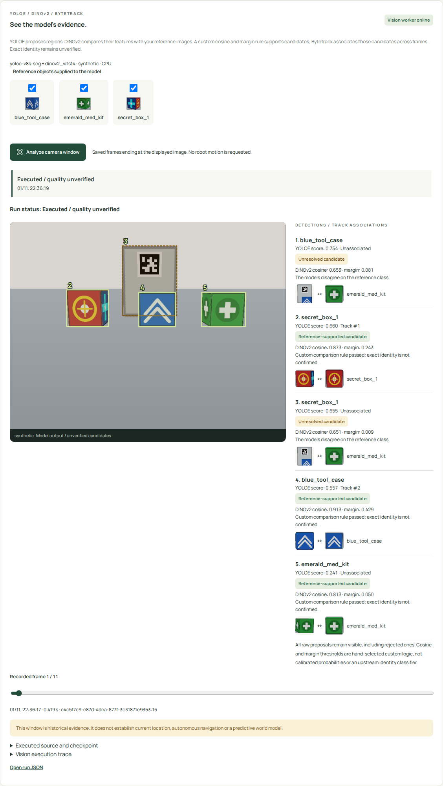
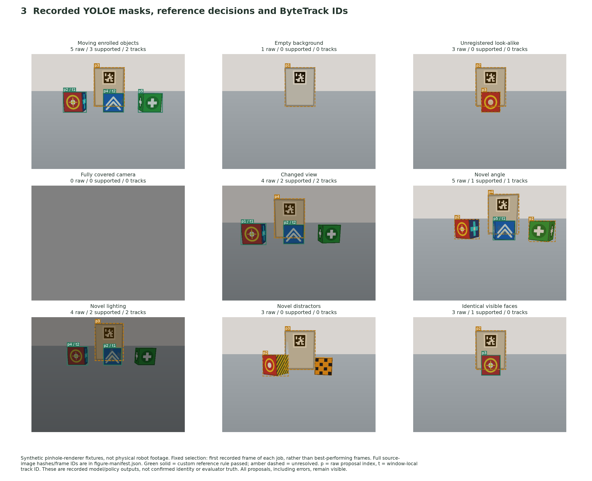
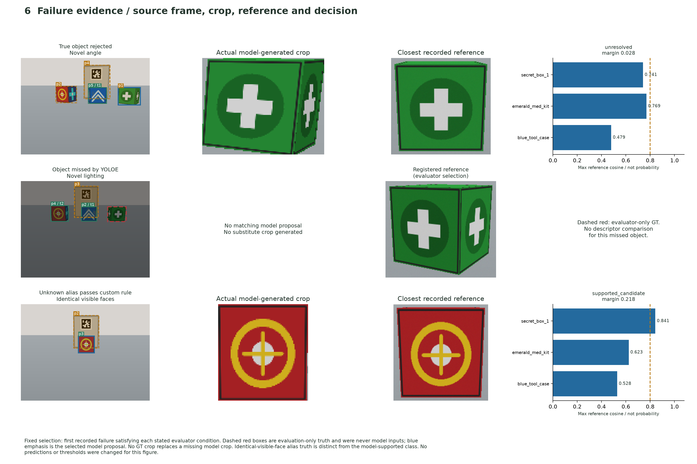

# Actual combined YOLOE + DINOv2 application execution

Date: 2026-11-01. User-authorized revision: use both complementary models.
**Integrated execution on rendered input; exact-identity acceptance remains FAIL /
unverified.** No agent-assigned score replaces the user's existing 0/10 review.

## Actual supported path

Library UI registration → frozen camera/reference PNGs → paired API and durable
Huey job → author YOLOE SAVPE proposals/segmentation → existing `CandidateProposal`
crops → original DINOv2 descriptors → **custom maximum-cosine/margin policy** →
upstream Ultralytics ByteTrack over supported candidates → persisted raw/rejected
results and source traces → actual desktop/phone UI.

The [run manifest](run-manifest.json) identifies pre-run revision `9e13377`,
working-source status and hashes of executed project files. These hashes matched
the files at evidence collection. Each [compact job record](compact-runs.json)
identifies source/checkpoint hashes, actual model/dependency versions, preprocessing,
custom thresholds, per-reference cosines and executed upstream call counts. The
export is explicitly derived: mask vertices are omitted with hashes; the full raw
output hash is retained. All raw PNG streams, databases, queues and logs remain in
ignored `runs/dual-vision-app-2026-11-01-final/`; no complete stream is committed.

Both learned components execute on CPU in `.venv-vision`:

| Component | Actual reused implementation | Revision/checkpoint |
| --- | --- | --- |
| YOLOE visual prompting and segmentation | Author `THU-MIG/yoloe`, original SAVPE and prediction/NMS/mask decoding | Source `40cd606cabdbe2b566d6f14a6b162c89206e9a1b`; `yoloe-v8s-seg.pt` SHA256 `ac2b90ed23011495a3e86d89caeb3432a15129cac8d849ba121293c8fc1e0536` |
| DINOv2 descriptors | Meta author Hub model `dinov2_vits14`, original eval transform and transformer forward | Source `7764ea0f912e53c92e82eb78a2a1631e92725fc8`; official weights observed SHA256 `b938bf1bc15cd2ec0feacfe3a1bb553fe8ea9ca46a7e1d8d00217f29aef60cd9` |
| Candidate-support policy | Project-owned maximum cosine over reference views, class margin and agreement with YOLOE | Hand-selected thresholds 0.80 similarity / 0.05 margin; not calibrated and not an upstream identity classifier |
| Temporal association | Actual Ultralytics `BYTETracker` inside the pinned YOLOE checkout | Kalman/data association, temporary IDs per window; not a neural tracker or predictive world model |

Primary papers/repos, license boundaries and deployment commands are in
[the app guide](../../24-yoloe-vision.md). DINOv2 is a feature extractor; the custom
readout is not misrepresented as a released exact-instance algorithm. Reference
names and crops are enrollment inputs. The query models do not receive renderer
identities, expected boxes, scene labels or world positions. An independent
evaluator reads those labels only after inference. No paid API, GPU, ROS, Pi or
physical robot was used. The optional Mind Palace profile is separate.

Observed source function calls in the moving-scene job:

| Actual source function | Calls |
| --- | ---: |
| `ultralytics/engine/model.py:Model.predict` | 14 |
| `ultralytics/models/yolo/yoloe/predict_vp.py:YOLOEVPPredictorMixin.inference` | 3 |
| `ultralytics/nn/tasks.py:YOLOEModel.get_visual_pe` | 3 |
| `ultralytics/nn/modules/head.py:SAVPE.forward` | 6 |
| `ultralytics/models/yolo/model.py:YOLOE.set_classes` | 1 |
| `dinov2/data/transforms.py:make_classification_eval_transform` | 1 |
| `dinov2/models/vision_transformer.py:DinoVisionTransformer.forward` | 14 |
| `ultralytics/trackers/byte_tracker.py:BYTETracker.update` | 11 |

A missing required function in the profiler trace fails the job. The original
YOLOE example and isolated DINOv2 probe ran earlier and are retained in the
[previous report](../2026-11-01-yoloe-app/report.md); this newer record supplies
actual **combined application** evidence, beyond those isolated executions.

## Actual app screenshots



[Actual phone screenshot](phone-vision.png), captured by Chromium from the same
run. The original [input image](moving-input.png) is separately retained. The app
shows YOLOE score, DINOv2 cosine and class margin, supported/unresolved candidate,
reason, candidate/reference images, temporary track ID and source/checkpoint trace.
All raw false/background proposals remain visible. A rule pass is never displayed
as confirmed identity. Historical jobs without DINOv2 are explicitly labeled.

## Visual completeness update (2026-11-02)

The original report had two application screenshots and one selected raw input.
The [full visual atlas](figures/README.md) now adds **16 PNG/SVG figures** and a
[16-page PDF](figures/figures.pdf): all nine source conditions, all nine representative
model-output panels, nine enrolled reference inputs, paired false-candidate/recall
plots, stage-loss attribution, failure crops/reference comparisons and actual track
observations. The counts and figures include errors and empty tracking results.





A complete local gallery renders every one of the **103 captured model-output
frames**. Its portable archive includes all **108 authored source files** (53
distinct file contents), input PNGs, raw outputs and frame hashes. The complete
stream/archive remains in ignored `runs/`; paths and hashes are recorded in the
[atlas](figures/README.md) and [archive manifest](figures/archive-manifest.json).
These figures are derived from the frozen run, not newly generated predictions,
new inference or new evidence of recognition quality. Evaluator ground truth is
explicitly separate from model output. The fatal incident remains OPEN / FAIL.

## Paired outcomes and limits

Nine application jobs processed **103 frames**. Both variants below use the same
frozen images, enrolled references, YOLOE outputs and model version. The raw
variant evaluates all proposals; the comparison variant evaluates only those
passing the declared DINOv2/custom rule. Track metrics come from the combined
supported-only tracker, not a separately executed raw-tracker baseline. Times
measure the combined frame path, not an isolated DINOv2 speedup or Pi throughput.

Five development conditions were already inspected. Four new conditions were
specified after freezing the policy: novel angle, darker lighting/distance,
unknown distractors and deliberately indistinguishable visible faces. This is a
limited synthetic condition split with correlated frames and reused object
instances, not held-out real-room or unseen-instance quality. The thresholds
were not changed after observing these results. No formal calibration or general
research advantage is claimed. Ground-truth IoU ≥ 0.5 and enrolled class define a
true match; unknown decoys count as false candidates. See [quality.json](quality.json).

| Condition | Frames | Raw YOLOE TP/FP/FN | Reference-supported TP/FP/FN | Mean combined seconds/frame |
| --- | ---: | ---: | ---: | ---: |
| moving | 11 | 32/22/1 | 25/0/8 | 0.228 |
| empty | 11 | 0/11/0 | 0/0/0 | 0.157 |
| decoy | 12 | 0/36/0 | 0/0/0 | 0.195 |
| occluded | 11 | 0/0/0 | 0/0/0 | 0.110 |
| changed_view | 12 | 26/24/10 | 26/0/10 | 0.207 |
| novel_angle | 12 | 36/24/0 | 15/0/21 | 0.222 |
| novel_lighting | 12 | 23/24/13 | 23/0/13 | 0.198 |
| novel_distractors | 11 | 0/33/0 | 0/0/0 | 0.182 |
| indistinguishable_front | 11 | 0/33/0 | 0/11/0 | 0.169 |

The comparison removes all retained background and ordinary-decoy false candidates
in this small run. It also rejects real objects: moving-scene recall drops from
32/33 to 25/33; novel-angle recall is only 15/36. Thus a selective result is not
proof of reliable recognition. YOLOE misses remain unrecoverable by a crop-only
comparison. Covered input returns no boxes, which does not establish automatic
occlusion detection or absence.

The indistinguishable-front scene deliberately presents a distinct unknown object
with the same visible front/top as the target and hidden different sides. The
rule supports 11 false candidates. No descriptor can reveal hidden identity from
identical visible evidence. This is why the profile does not confirm identity or
write a verified sighting. Exact identity, robust abstention and an evidence-based
next-view policy remain open. ByteTrack can associate a wrong candidate repeatedly;
its ID does not repair that inference. Short-window zero counted ID changes is
not IDF1/HOTA, tracking recall, long-occlusion recovery or cross-job re-identification.

## Real required-component failure gates

[Eight real worker failure records](artifact-failures.json), each status failed and
result null:

- Missing YOLOE source, missing YOLOE checkpoint, corrupt YOLOE checkpoint.
- Missing DINOv2 source, missing DINOv2 checkpoint, corrupt DINOv2 checkpoint.
- Unsupported historical profile version (no silent algorithm upgrade).
- Valid original DINOv2 source weights but a corrupt same-named Hub cache. The
  acceptance fixture uses a separate alias/cache name; the primary downloaded
  file and valid primary cache remain intact.

Both model artifacts are checked before inference. The original DINOv2 loader's
cache is checked too, so a valid source file cannot mask a stale/corrupt cache.
No YOLOE-only, legacy CV2, alternate model, manual label or canned result substitutes
for the missing required component. Raw historic results remain readable, while
old queued profiles without explicit version 2 fail instead of being reinterpreted.

## Verification and reproduction

[Verification manifest](verification.json): **106 Python tests**, **8 Chromium
tests**, check, frontend build and wheel/sdist build passed. Default tests use
explicit offline fixtures and do not download weights or run these model tests.
The actual application experiment is separately opt-in:

```bash
make vision-setup
make app-build
PYTHONPATH=. CUDA_VISIBLE_DEVICES=-1 MPLBACKEND=Agg .venv-dev/bin/python \
  scripts/research_vision_app.py --directory runs/my-new-combined-vision-run
```

The launcher requires a new disposable directory, owns/stops the loopback server
and CPU consumer, strips API credentials and never connects to a robot. All
project-owned test processes stopped after this run. No remote was changed or
pushed. No weights, private recordings or complete image streams are committed.

Execution is delivered for the bounded visual-proposal/reference-comparison/
association app profile. No automatic exact identity, current room-state guarantee,
autonomous inspection/patrol/navigation, VLA/RL or learned predictive world model
is established. Keep the broader fatal review OPEN / FAIL; further identity and
active-view work must retain these failures and use an agreed evaluated method.
