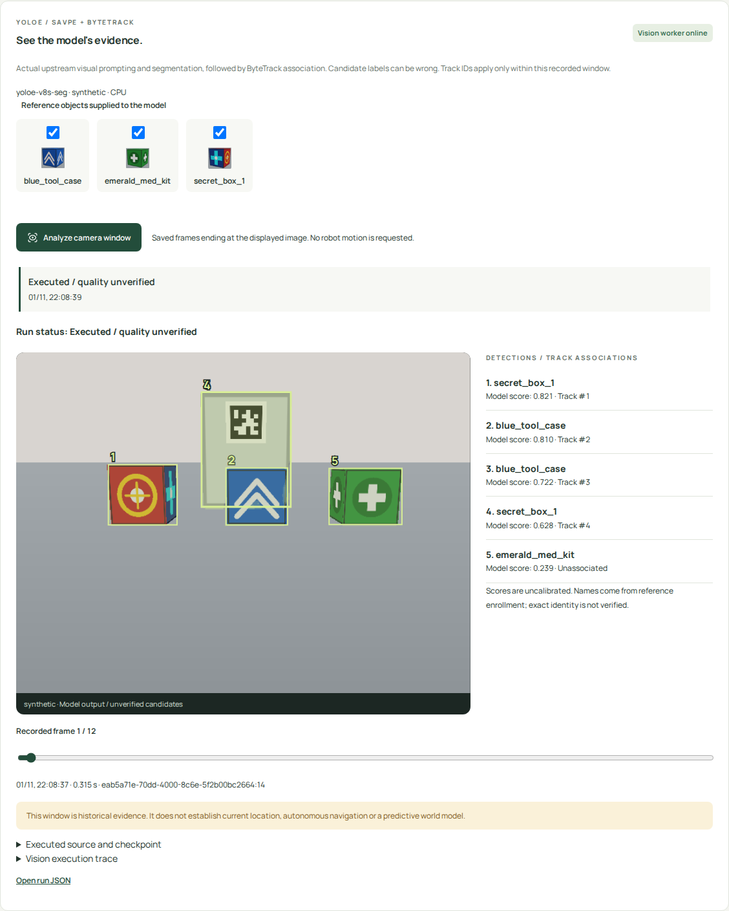

# Actual YOLOE / ByteTrack application execution

Date: 2026-11-01. Starting revision: `a37fb57` plus the explicitly hashed working
source in [the run manifest](run-manifest.json). Scope: actual pretrained vision
inference on **synthetic rendered RGB input**, through the operator application.
**Execution integration passes; exact-identity quality remains FAIL / unverified.**
The broader fatal incident and the user's 0/10 assessment remain OPEN and unchanged.

## What really executed

Library UI enrollment → paired app camera-window request → immutable SQLite job
and PNG snapshots → separate actual Huey consumer → pinned author YOLOE SAVPE,
segmentation/NMS → core `CandidateProposal` crop binding → original Ultralytics
ByteTrack implementation → persisted result → actual desktop/phone browser view.

The application used `yoloe-v8s-seg.pt` with CPU PyTorch 2.6.0, source revision
`40cd606cabdbe2b566d6f14a6b162c89206e9a1b`, checkpoint digest
`ac2b90ed23011495a3e86d89caeb3432a15129cac8d849ba121293c8fc1e0536`.
The profile, repository/model terms, source boundaries and launch commands are
in [the app guide](../../24-yoloe-vision.md). No local GPU, paid API, ROS process,
Pi or physical robot was used. This run did not execute Mind Palace; its earlier
paid runs are separate evidence.

The [compact per-run output](compact-runs.json) preserves every box, model score,
reference binding, crop hash, temporary association and execution trace. It omits
mask vertices, records their hashes and the full raw-output file hash, and clearly
identifies itself as a derived export. Complete raw JSON, all captured images,
SQLite/queue files and logs remain under ignored
`runs/vision-app-2026-11-01-final-crops/`; no complete image stream is committed.
The selected source image is [here](moving-input.png).

A Python call profiler observed actual upstream methods, not just imports or
configured entry names. In the 12-frame moving-object job it recorded:

| Actual source function | Calls |
| --- | ---: |
| `Model.predict` | 15 |
| `YOLOEVPPredictorMixin.inference` | 3 |
| `YOLOEModel.get_visual_pe` | 3 |
| `SAVPE.forward` | 6 |
| `YOLOE.set_classes` | 1 |
| `BYTETracker.update` | 12 |

Three reference sets account for the extra prediction calls. The job fails if
any required source function is absent from the observed trace. Labels are
explicit enrollment inputs; the query model never receives expected scene labels,
object locations, evaluator boxes or simulator identity truth.

The separate, unmodified author `predict_visual_prompt.py` example also executed
with its own v8-L weights and bus/zidane assets. Its [manifest](upstream-example.json)
records actual final boxes and a different checkpoint digest. This is source-
example execution, not the application's v8-S quality result. The first exploratory
whole-crop prompt failed localization; its original files remain under ignored
`runs/yoloe-execution/`. Declared context padding/contact-sheet preparation was
then fixed before the application profile was exercised.

## Actual screenshots

[Actual phone screenshot](phone-vision.png). These are Chromium captures, not
mockups. Visible duplicate/background boxes are deliberately retained. The UI
states **Executed / quality unverified** and distinguishes unverified candidate
names, model scores and temporary track IDs from identity or task success.

## Measured development-scene quality

Five application jobs processed **58 frames**. Each window contains 11–12 frames
because the displayed image can precede the newest buffered frame. These are tiny,
reused development fixtures, not held-out generalization or a research comparison.
The renderer supplies authored meshes/textures and scripted input motion, not a
physics simulator or a learned controller. Reference crops were prepared using
the existing custom OpenCV foreground selector; this is disclosed fixture input
preparation, not YOLOE proposal evidence. Missing reference foreground now raises
an error rather than substituting a center crop.

The separate evaluator joins source frame IDs to renderer-only truth and greedily
matches by descending model score, same enrolled class and IoU ≥ 0.5. The model
threshold is 0.20. Unknown decoys count as false positives when labeled as an
enrolled class. It never edits model boxes, labels, scores or tracks. See the
[raw quality summary](quality.json).

| Condition | Frames | TP | FP | FN | Precision | Recall | Mean model + tracking time/frame |
| --- | ---: | ---: | ---: | ---: | ---: | ---: | ---: |
| Three moving enrolled objects | 12 | 35 | 24 | 1 | 59.3% | 97.2% | 0.127 s |
| Empty room background | 12 | 0 | 12 | 0 | 0% | undefined | 0.103 s |
| Unenrolled look-alike only | 11 | 0 | 33 | 0 | 0% | undefined | 0.127 s |
| Entire camera covered | 11 | 0 | 0 | 0 | undefined | undefined | 0.117 s |
| Changed view and darker lighting | 12 | 26 | 24 | 10 | 52.0% | 72.2% | 0.119 s |

The wall marker/backboard is repeatedly mistaken for reference objects, sometimes
under conflicting classes. The decoy is also a false candidate. No exact-instance
rejection or automatic absence gate passes. In covered input the model returned
no boxes; that is not a claim of detecting occlusion or establishing absence.
Green objects are missed in the changed-view condition. Whole-job model time
ranges approximately 2.05–5.06 seconds including reference encoding and model load;
these are host measurements, not Pi performance or guaranteed throughput.

ByteTrack maintained IDs between correctly matched observations in these short
windows (zero counted ID changes). This excludes unmatched intervals and does not
establish tracking recall, long-occlusion recovery, re-identification or IDF1/HOTA.
False detections also receive track IDs. No predictive world model, room geometry,
route execution, VLA or RL locomotion is supplied by this result.

## Real failure behavior and software verification

Three additional jobs passed through the real queue/worker with explicitly bad
profile snapshots. [Their persisted outputs](artifact-failures.json) are
`VISION_SOURCE_MISSING`, `VISION_CHECKPOINT_MISSING` and
`VISION_CHECKPOINT_MISMATCH`, each status **failed**, result **null**, with its
required profile and error trace. No baseline, alternate checkpoint or canned
result was invoked. The synthetic browser suite separately checks queue-without-
worker, cancellation, reload, auth, no-store, localization and phone width.

Two early browser harness attempts failed before submitting inference (navigation
and waiting for reference choices). A third harness attempt incorrectly sampled
the previous job while a new request was still pending; the independent frame-ID
truth join rejected it. Its output was not used as quality evidence. The corrected
harness waits for the exact POST response ID and polls that job. All earlier run
directories remain preserved. The reported final run uses that corrected harness.

Default verification: **103 Python tests**, **8 Chromium tests**, `make check`,
`make app-build` and wheel/sdist build passed. Offline tests and contract fixtures
are not the model execution evidence; the optional actual model runs above are.
No task-owned server or model consumer is left running. No remote was configured
or pushed; environments, model weights and raw streams are ignored.

## Next proposed identity step, not delivered

The actual [DINOv2 probe](dinov2-probe.json) executed the pinned author model and
its preprocessing on CPU for 13 crops. It produces 384-dimensional descriptors.
Its maximum-reference cosine is explicitly custom comparison logic; no rejection
threshold, probability, identity verdict or quality guarantee was produced. It
neither changes the app's predictions nor participates in this vision profile.

The [concrete follow-up proposal](../../25-visual-identity-fix-proposal.md) adds
DINOv2 reference comparison with explicit custom readout and separate calibration/
evaluation gates. The user subsequently accepted using both complementary models; that next stage is not part of this recorded run.
Keep F03 and automatic inspection/current room-state claims unpromoted; the fatal
review remains OPEN / FAIL. Do not use execution success or these screenshots to
assert that the original full application/research requirements have been met.

## Subsequent accepted implementation

This report preserves the raw-YOLOE profile's executed code and failures. The
user later accepted using both complementary models, and the
[new combined application report](../2026-11-01-dual-vision-app/report.md) records
genuine DINOv2 inference in the supported worker. That later integration does
not change these historical outputs, ratings or exact-identity failures.
