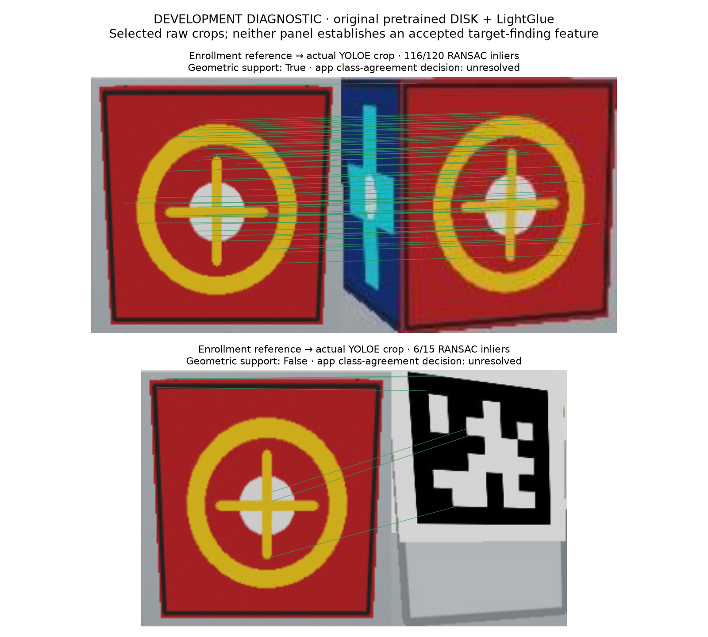
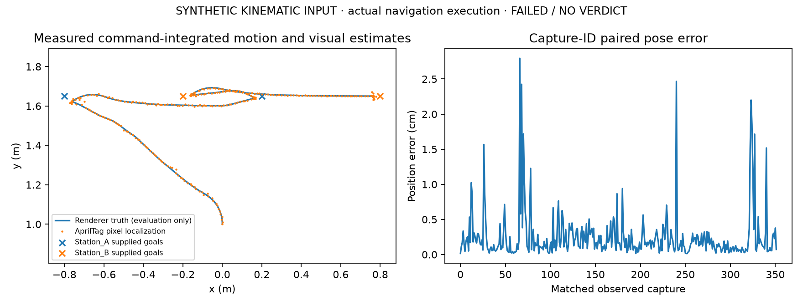
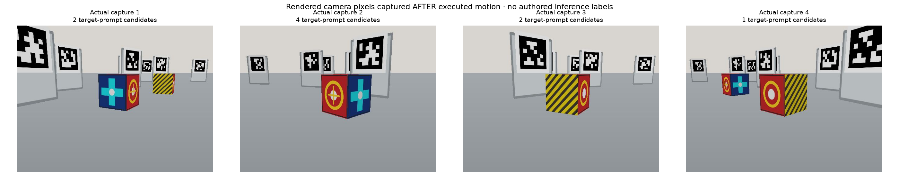
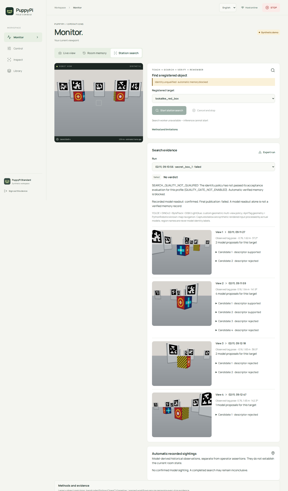
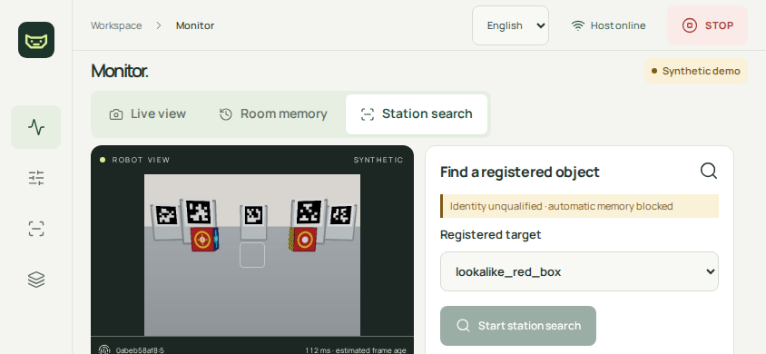
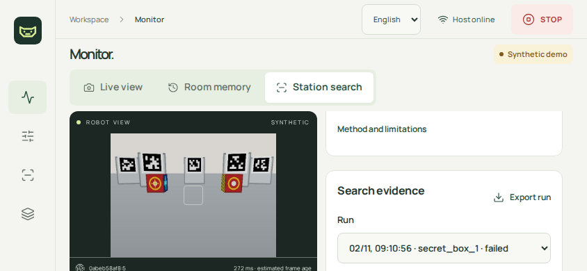
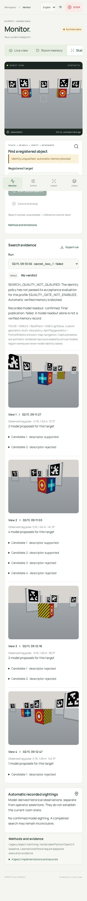

# Calibrated station-search completion attempt

Date: 2026-11-02 JST. **Requested complete feature: FAIL / not delivered.**
The mandatory critical review remains OPEN; the user's 0/10 delivery rating is
unchanged. Genuine navigation/model execution now exists, but target identity
acceptance and verified automatic observation memory remain unsatisfied. This
report does not promote component execution into completion.

## Concrete implementation and ownership

The [delivery contract](../../29-complete-teach-search-memory.md) describes the
new opt-in app flow. Library stores supplied cropped reference images. FastAPI
creates an immutable, versioned search snapshot; a separate `.venv-vision` worker
reads actual camera pixels, localizes from detected AprilTag corners, plans and
executes bounded body-velocity commands, stops at each configured inspection view,
and runs original pretrained inference. SQLite version 9 stores searches, events,
views and a separate model-sighting table. Human assertions remain distinct.

The old CV2 appearance descriptors are not consumed by search. The supported path
uses actual YOLOE, DINOv2, ByteTrack, DISK/LightGlue and PythonRobotics. It does not
reuse the full IEVE agent or claim a learned world model, SLAM, VLA, learned gait,
unknown-room exploration, physical locomotion or hardware verification.

| Component | Actual source/version | Evidence |
| --- | --- | --- |
| YOLOE SAVPE | THU-MIG/yoloe `40cd606cabdbe2b566d6f14a6b162c89206e9a1b` | Original model/predictor/SAVPE calls, real visual prompts and detections |
| DINOv2 ViT-S/14 | facebookresearch/dinov2 `7764ea0f912e53c92e82eb78a2a1631e92725fc8` | Original preprocessing/backbone calls and raw gallery cosines |
| ByteTrack | Same pinned YOLOE Ultralytics source | Original `BYTETracker.update`; tracks are local to the stationary inference window |
| DISK + LightGlue | cvg/LightGlue `5a650c444718caffc2669dc0094cde908f42dd73`, Kornia 0.8.2 | Original extract/match forward methods; verified local pretrained weights |
| Grid planning and pose control | PythonRobotics `8c392897c7f41a6e4d9aab9cb2e9737a7a6fa031` | Original `AStarPlanner.planning` and `PathFinderController.calc_control_command` |
| Localization | OpenCV AprilTag/PnP + SciPy constrained reprojection | Actual detected pixels, supplied landmark geometry, known camera height/pitch |
| Multi-view readout | Project-owned declared geometric policy | RANSAC inliers/coverage, view baseline, spatial association and gallery-reference coverage; uncalibrated |

Primary sources: [LightGlue paper](https://arxiv.org/abs/2306.13643),
[author code](https://github.com/cvg/LightGlue),
[DISK author release](https://github.com/cvlab-epfl/disk),
[PythonRobotics paper](https://arxiv.org/abs/1808.10703),
[author code](https://github.com/AtsushiSakai/PythonRobotics).
LightGlue/DISK are Apache-2.0; PythonRobotics is MIT; the YOLOE source is AGPL-3.0.
See the existing vision profile for its source/checkpoint licensing details.

The LightGlue adapter changes **checkpoint transport only**: original constructors
request their original weights and receive the exact hash-verified local files.
Unknown URLs fail; no network or matching substitute is used. Every learned
LightGlue parameter is checked against the released remapped state dictionary.
The extractor and matcher algorithms/forward methods remain upstream. Models are
initialized serially in this isolated worker; the transport hook is restored even
on failure. This is not a model-output mock.

| Released checkpoint | Observed SHA-256 |
| --- | --- |
| DISK `depth-save.pth` | `9c2ee4ded238892dfa51569941372601e35e4a74aa6f84ea80053d2ab1c07abe` |
| `disk_lightglue_v0-1_arxiv.pth` | `b5b21d47ea24f2c5e501aec9c91b9716e4c8c3429a4dc1e615c133c4c9378335` |

These hashes are observed official-download digests, not claimed author-published
checksums. The existing YOLOE/DINOv2 required artifacts remain unchanged.

## Original examples versus application execution

The original `lightglue.utils.match_pair` ran on the released Sacre-Coeur pair,
original DISK 2048 keypoints/default resize 1024 and original LightGlue on CPU:
451 correspondences, 13.280 seconds. This is upstream component execution, not a
PuppyPi quality result. The application profile explicitly uses 512 keypoints and
resize 256, with custom geometric readout.

Original PythonRobotics `a_star.main()` executed, and its original
`move_to_pose(0,0,0,1,1,1.57)` executed 84 controller calls; the last logged position
was approximately `(1.000024, 0.999083)`. The adapter preserves original planning
and translation-control methods but adds declared geometric heading supervision,
footprint checks, normalized command bounds, freshness and Stop handling. It does
not claim an unmodified full robot navigation stack.

## Prototype input-boundary correction

An audit of the first development payloads found that `SearchSettings` included
an authored `sim_scenario` configuration value. Although navigation/inference did
not branch on that value, it should not have reached the worker and prevents
claiming those payloads were a clean evaluator/inference boundary. Preserve the
original records; they are development evidence, not leakage-free quality proof.

Revised v2 separates renderer-only `SearchSimSettings` from the serialized search
profile. The evaluator also removes scenario/seed environment variables from the
worker process. Only the host renderer/evaluator receives placement/presence
conditions; the worker receives calibration, images, supplied references and
operational budgets. New payload/source audits and fresh unseen-case evaluation
must establish this boundary. No true pose or oracle camera setting is added.

## Observed application progression and failures

All inputs are explicitly **synthetic pinhole-rendered scenes and kinematic motion**.
Reference images are authored enrollment inputs. Configured landmarks, map and
goals are supplied calibration; object placement, target identity and true pose
stay in the renderer/evaluator. The worker gets pixels/calibration/references,
never oracle viewpoints or true pose. Truth/capture IDs are compared only after
execution; no physical kit, GPU or paid model API is used.

- First development attempt stopped on tag loss before any inferred view.
- Calibration v2 reached one inferred view, then stopped on tag coverage loss.
- Chromium enrollment/start in `search-app-dev3-2026-11-02` reached two inferred
  views, then the old combined receive/capture/send loop used an expired challenge.
- The corrected transport drains status into one slot and uses separate camera
  and control threads. It has no FIFO of motion intents and never rearms after
  a lost lease. An offline delayed-camera test checks challenge freshness and
  expiry of a stalled nonzero producer to zero.
- `search-app-dev4-2026-11-02` still failed on visual-pose loss after motion
  chattered near the point controller's forward/reverse boundary. A later run
  was deliberately cancelled after diagnosing position/yaw threshold chatter;
  that is recorded as an intervention, not autonomous success.
- Explicit geometric rotation supervision and a latched positional goal corrected
  those execution issues. The final identity rule remains unchanged.

Development run `search-app-dev6-2026-11-02`, job
`585ef0f5-ccb8-4f9a-8e5c-84dea0d3fcb7`, completed all four actual inspection views
in 83.198 seconds with no operator intervention. Its result was **inconclusive**,
with no automatic sighting. Original A* planning executed four times and the pose
controller 151 times. Actual per-view source traces record 12 `Model.predict`,
16 `SAVPE.forward`, 12 DINOv2 backbone, four ByteTrack update calls in total;
DISK forward executed 12 times and LightGlue forward 27 times.

Capture-ID paired position error against evaluator-only renderer truth had median
0.00694 m, P95 0.02477 m and maximum 0.06901 m. The known-map kinematic footprint
counter reported no collisions; this is not physics or a physical collision test.
Earlier traces with an unimplemented collision counter do not establish zero
collisions. Their derived reports explicitly mark that metric unavailable.

## Identity diagnosis and explicit user revision

In two actual development captures, YOLOE boxed the target but assigned the
competing enrolled prompt class. DINOv2 selected the target instead (one example
cosine 0.89038, margin 0.18536). Reversing the gallery order reproduced the same
semantic assignments, which rules out that simple indexing/order explanation for
this observation. This does not prove all repository/adaptation code correct or
establish broad model quality.

A separate genuine DISK/LightGlue diagnostic over **all raw crops**, including
those rejected by the supported agreement rule, produced 92–138 geometric inliers
on the boxed target across two views; background-tag crops failed the configured
geometric support rule. The diagnostic is not silently routed into the app's
identity verdict or automatic-memory path.

A concrete revision has been presented to the user: retain YOLOE as region
proposal, use DINOv2 for gallery identity and original DISK/LightGlue for geometric
multi-view verification. The user explicitly accepted this revision on 2026-11-02 and requested the
illustrated case report. New search payload v2 uses vision profile v3; original
vision v2 and its recorded class-agreement failures remain unchanged. This is an
authorized design amendment, not a silent fallback after inference failed. The new identity quality gate is
not qualified; `SearchSettings.quality_qualified=False` prevents publishing a
verified automatic sighting even if an experimental readout is positive.

## Acceptance status

| Gate | Current evidence |
| --- | --- |
| Actual upstream components and pretrained inference | Executed |
| App enrollment → bounded simulator motion → four model views → saved readout | Executed; positive and inconclusive readouts exist, quality not qualified |
| Correct target confirmation → verified automatic memory → user-visible history | **FAIL / not established** |
| Frozen held-out positive/negative/look-alike/hidden-distinction evaluation | **FAIL**: 13 cases, six control failures and one false confirmation |
| Missing required model | App fails explicitly before movement; no alternate backend |
| Stop/cancellation | Exercised; cancelled status and disarmed zero command; no sighting |
| Physical navigation / real-room identity / Pi | Not run |

The feature cannot be reported complete. The next steps under the accepted role revision are a frozen versioned readout, held-out positive,
look-alike, absent and observationally ambiguous cases, and successful guarded
model-sighting publication/history through the app. Passing software tests or
adding this report does not close that gap.

## Frozen qualification-v2: actual FAIL, preserved

The [frozen protocol](protocol-v2.json) declared 13 cases before execution with
unchanged cosine 0.80/margin 0.05 and geometric policy. Three disposable app/
worker pairs ran concurrently. [Actual per-case outcomes](qualification-v2-failures.json)
record six control-transport failures, two correct positive readouts, four correct
inconclusive readouts and **one false confirmation**. Automatic sightings: zero.
Do not compute a favorable accuracy by dropping the six execution failures.

The unknown-object failure is illustrated in the [case review](../../review/2026-11-02-yoloe-identity-gate-case.md).
It passed DINOv2 with cosines 0.8073/0.8198 and obtained real LightGlue matches on
its shared front, despite visibly different sides. The policy confused shared
surface agreement with complete identity. The closed qualification gate caused
`SEARCH_QUALITY_NOT_QUALIFIED`; it prevented memory publication, not the erroneous
readout. There is no qualification certificate and no threshold was retuned.

The v2 post-repair audit under ignored `runs/` also reports source-signature
mismatches because the implementation subsequently changed. Those mismatches
must not be misrepresented as the original failures: original app outputs show
the six actual transport errors and the actual false-positive case above.

## Control design correction and measured regression

The initial transport kept a motion lease alive through model import/inference.
Heavy same-process work could stall its Python heartbeat threads. The system
stopped safely, but failed the task. Raising lease/freshness limits was rejected.

The revised state boundary is explicit:

```mermaid
stateDiagram-v2
    [*] --> ValidateTask
    ValidateTask --> Navigate: current task epoch + fresh same-session pixels
    Navigate --> Disarm: observed goal reached
    Disarm --> Capture: adapter accepted zero command
    Capture --> Infer: image captured after acknowledgement; transport closed
    Infer --> ValidateTask: next planned goal only
    Infer --> Readout: view budget complete
    Navigate --> Failed: stale pose / lost lease / disconnect
    Disarm --> Failed: missing stop acknowledgement
    ValidateTask --> Cancelled: Stop / cancelled task / revoked epoch
    Infer --> Cancelled: durable cancellation
    Failed --> [*]
    Cancelled --> [*]
    Readout --> [*]
```

The runtime token is frozen at task creation and checked atomically when arming.
Global Stop, host restart and unexpected control/camera failure invalidate it;
planned acknowledged disarm preserves it. New connections cannot impersonate a
missing/terminal search. Camera/session and calibration must remain consistent.
SciPy localization imports occur before acquiring motion authority. The control
loop explicitly sends zero even when arm/disarm happen before its first tick.
No drive can be sent after the worker starts the disarm transition.

The final same-code three-case regression repeated prior cases under three
concurrent independent app/worker processes, without modifying their state:

| Case / known seed | Actual views | Readout / final state | Duration from queued to terminal | Pose error P95 | Known-map collision events |
| --- | --- | --- | --- | --- | --- |
| Target / 101 | 4 | Confirmed A / publication FAIL, gate closed | 115.57 s | 0.00802 m | 0 |
| Absent target / 606 | 4 | Inconclusive / completed | 115.47 s | 0.01061 m | 0 |
| Unknown different-side object / 808, single gallery | 4 | Inconclusive, one supported candidate / completed | 113.83 s | 0.00926 m | 0 |

Each reached four acknowledged stationary-inference boundaries without lease
loss. These repeated seeds are **regression data**, not a new held-out quality
qualification. Slightly different observed viewpoints/timings changed the
unknown-object verdict. The earlier false confirmation remains a real failure;
the later inconclusive result does not establish its repair.

Evidence directories: `runs/search-segment-regression-{target-101,absent-606,unknown-808}-2026-11-02/`.
Their raw source manifests, immutable captures, per-view model calls and separate
renderer evaluation truth remain available. Truth is joined by capture ID only
after the worker finishes. Kinematic motion is command-integrated; no physical
PuppyPi, unknown-room obstacle avoidance or learned gait is established.

## App screenshots, safety checks and remaining limits

The landscape workspace keeps camera, target selection, visible qualification
warning and global Stop together. The evidence column scrolls independently;
portrait remains usable. Full JSON export retains raw correspondence arrays,
while routine polling transfers bounded summaries and compact view details.
The app shows experimental model readout separately from final publication.

These history screenshots reopen the actual target-regression evidence store in
a new disposable simulator host with no model worker. They preserve the actual
failed search and its captures; the adjacent live camera belongs to that new
host/session. They do not depict a successful automatic sighting. No operator
assertion or artificial certificate was inserted to exercise a success screen.

Final genuine app fault runs explicitly failed on missing YOLOE, DINOv2 and
DISK/LightGlue weights, with no movement/inference substitute or sighting:
`VISION_CHECKPOINT_MISSING`, `DINOV2_CHECKPOINT_MISSING`, and
`SEARCH_CHECKPOINT_MISSING`. One DINO harness invocation expected the wrong error
name; it failed its assertion, preserved the correct app error, and was rerun
with the corrected expectation in a new directory.

The actual Stop run cancelled a moving task, left the gate disarmed and command
zero, and wrote no sighting. Browser click to observed host disarm was 49 ms in
one sample, **not** physical stopping latency or a percentile bound. Default
regressions cover late publication after cancellation/restart, missing worker,
stale task IDs, immutable references, bounded polling, disarm acknowledgement,
intent expiry and no rearm after Stop. Physical and optional GPU tests were not
run. Genuine worker restart under active motion has not been repeated in this
final harness; do not call that a new hardware/restart demonstration.

Software verification: `make check`, **133 Python tests**, frontend build,
**10 Chromium tests**, and wheel/source-distribution build passed. Screenshots
were visually inspected. No paid API, GPU or live robot was used, and disposable
app/worker/server processes were stopped. The research scripts are opt-in;
default tests download no models and actuate no hardware.

## Next approved research, not an undisclosed backend change

The user approved investigation/design of a visible-appearance contradiction
stage and explicitly reaffirmed preserving failures, revising/reviewing the plan
or rewinding an unsound approach. The [source-backed research plan](../../30-appearance-contradiction-research-plan.md)
compares original LPIPS diagnostics and actual original AnomalyDINO notebook
inference, including the PCA masking failure and source/API/device/dependency
constraints. These remain offline development diagnostics, not app backends.
A specific new supported method
still requires review. Current full-feature acceptance remains **FAIL** and
automatic verified memory remains blocked.
