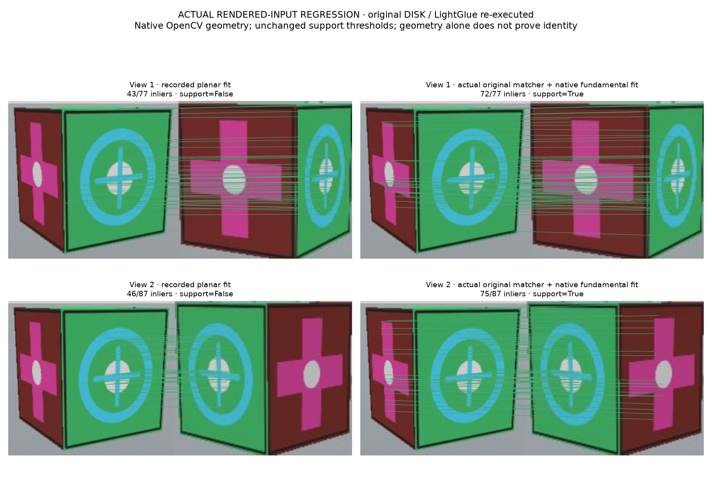
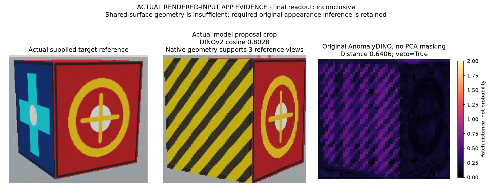
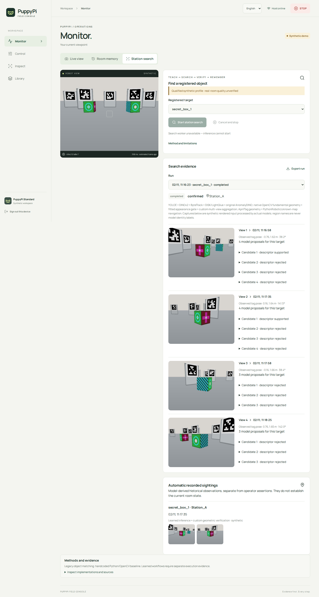
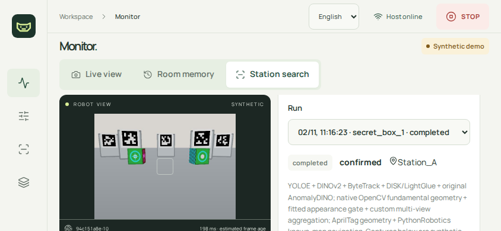
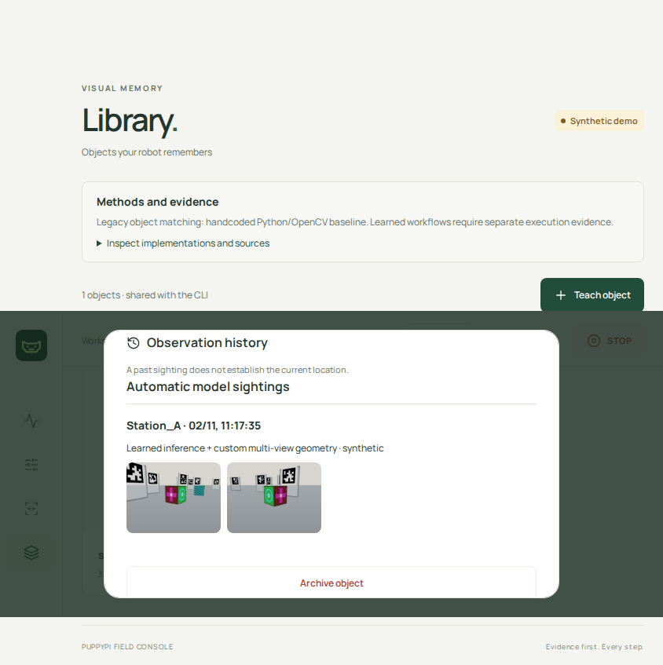

# Native 3D geometry correction: execution evidence

Date: 2026-11-02. **PASS for the evaluated simulator profile and actual automatic-history flow. Real-room and hardware quality remain unverified.**
This report follows the user's instruction to repair the reproduced integration
error. The critical incident remains OPEN, user rating 0/10 unchanged.

## Why the previous code failed

The project added one homography after actual original DISK/LightGlue matching.
A homography is a planar support model; the enrolled object is a 3D box with
multiple visible faces. The original matcher returned useful pairs, but the
project-selected geometric gate discarded enough pairs to fail required
reference support. This is a project integration/design error, not demonstrated
upstream repository corruption or insufficient GPU memory.

Original LightGlue produces feature correspondences, not final object identity.
Cloning and invoking it does not validate a newly invented downstream decision.
The missing assumption test was nonplanar correspondence support. The separate
camera-cadence failure was also project scheduling code, corrected previously.
Historical failed evaluations remain preserved in the
[previous report](../2026-11-02-identity-fix/report.md).

## Actual repair, original implementation boundaries

[Search-v4 contract](../../32-native-geometry-repair.md): original DISK/LightGlue
points → **native OpenCV `findFundamentalMat` / `UsacParams` MAGSAC** → unchanged
support thresholds and mandatory original AnomalyDINO appearance evidence →
custom multi-view/reference/spatial aggregation. Python connects original
implementations; it does not implement a new epipolar solver or MAGSAC.
The final aggregation remains explicitly project-owned, not a reproduced
end-to-end identity paper or calibrated probability.

The native configuration follows inspected OpenCV source: confidence 0.995,
3-pixel error, 2000 iterations, seed 0, nonparallel, MAGSAC score, sigma local
optimization, sample size 50 and ten iterations. Eight inliers, ratio 0.60,
coverage 0.12, all-reference coverage, two distinct views, baseline 0.20 m and
spatial ambiguity gates are unchanged. AnomalyDINO and the frozen five-sample
scalar development fit are unchanged. No planar retry, threshold relaxation,
manual identity, authored model score or model fallback is allowed.

The [source/material record](materials.json) identifies cloned original source,
revisions, actual file hashes, documentation access and reuse. LightGlue source
is `5a650c444718caffc2669dc0094cde908f42dd73`; inspected OpenCV source is
`40738fb16ceddb5fb3fea747585f7ce6abb0605b`. Execution uses the installed OpenCV
5.0.0 native framework wheel, not a local build of that reference checkout.
Reference-camera intrinsics remain unknown; no invented calibration is used.

Search v4 rejects historical planar match evidence. Old v2/v3 records keep their
original labels. Actual app/API/export records disclose matrix type, parameters,
raw learned points, matrix, inlier mask and support/rejection. Qualified memory
requires an explicit flag **and** a real matching all-case-pass certificate;
the flag cannot bypass source, environment, profile or gallery checks.
Default publication remains disabled.

## Actual regression results

Original DISK/LightGlue extraction and matching were rerun on the preserved
failed app crops. The new supported adapter calls the native framework:

| Recorded input | Prior planar support | Re-executed original matcher + native fundamental support |
| --- | --- | --- |
| View 1, reference 1 | 43/77, unsupported | 72/77, supported |
| View 2, reference 1 | 46/87, unsupported | 75/87, supported |

[Execution provenance and summary](original-matcher-summary.json) bind the full
local record by hash. This is actual model execution on recorded simulator input,
not fresh navigation or proof of arbitrary physical identity.



The full-app known regression `hidden`, seed 20202 / appearance 90001, also runs
four newly observed views and returns confirmed. Publication remains blocked in
that development run. It cannot qualify fresh cases by itself.

The first development attempt fails because an edit put a dictionary item next
to an unexpanded comprehension, causing `SyntaxError` in the package-provenance
record. This was a new project coding error, caught by tests/runtime, corrected
before freezing evaluation. Its log/store remain at
`runs/geometry-fix-2026-11-02/development-hidden/`; the successful retry is a
separate directory. No failed record was overwritten or relabeled.

## Frozen full app evaluation

[Protocol v4](protocol-v4.json) was frozen before evaluating 13 new scene and
appearance variants: four mandatory positives plus negatives, unknown shared-front
objects, duplicate instances, ambiguous enrollment and insufficient views.
Source/profile signature:
`a290599c2dd3d7a5bf6e5c0ef1252f1cbc487d5e8c1613e8d69c66bfe8d1e25e`.
Inputs are authored **kinematic pinhole renderer scenes processed by actual
learned models on CPU**. Renderer truth is evaluator-only, never an identity,
location or success input to the worker. Three disposable apps run concurrently.
No inference settings, thresholds or criteria may change after results appear.

The first full batch is **12/13, FAIL**; preserve its
[audit](qualification-v4-failed.json). The empty-room run fails before a completed
view because native OpenCV asserts `!model.empty()` on eight actual matched
points. Its long raw error also overflows the portrait page, so the browser
harness aborts before writing its final JSON. The SQLite failure record, points,
screenshots and source snapshot remain; the missing export is not invented.

The diagnostic reruns actual original YOLOE/DINOv2/DISK/LightGlue on that saved
capture. All four detector regions are gallery-unresolved; one eight-pair set
reproduces the native assertion. The points are finite, unique and not collinear;
no unverified mathematical cause or upstream patch is claimed. Source inspection
locates the native empty-model assertion in `usac/estimator.cpp:418`.

Correction: preserve unresolved detector/descriptor observations, but do not run
local geometry downstream of a failed gallery gate. The original identity
predicate already excluded those candidates, so no acceptance threshold is
changed. A specifically identified native empty-model assertion becomes explicit
unsupported pair evidence with raw error, null matrix and no fitted inliers;
there is no alternate solver. Other native/dependency failures remain terminal.
An actual eight-pair regression fails before and passes after this correction.
The native library itself is not patched or represented as successfully fitting
that pair. Long error text now wraps on phones, verified with a browser failure
fixture and the actual empty-room regression.

The corrected empty-room app regression completes four observed views and returns
inconclusive with zero sightings. It explicitly does not claim observed absence.
A [second frozen protocol](protocol-v4-repeat.json) repeats all 13 exact cases
after these fixes, without retuning models, thresholds or criteria. Its source
signature is `bc7f6414c135e98be312fd4cc487b5e55d3768361fb0746c6a0556d5d88ab723`.
This is repeated acceptance, not a fresh unseen-data claim. The repeat passes **13/13**: four required confirmations and nine expected
inconclusive outcomes, with no false confirmation in this batch. The largest
per-case simulated localization P95 is 0.01450 m, below the frozen 0.05-m limit.
This is not an accuracy estimate for arbitrary objects or rooms. The
[actual qualification](qualification-v4-repeat.json) binds source, environment,
profile and evaluated gallery. [Scope checks](certificate-scope-check.json) verify
that the one-view regression gallery cannot inherit four-view qualification.
Publication remains disabled by default; the explicit flag cannot bypass this
certificate. The first failed batch is not erased by the repeated pass.

### Preserved unknown-object regression with executed appearance veto

An additional actual app run of the original unknown-object scenario, seed 808,
unenrolled same-front/different-side object, completes four views and returns
inconclusive with `appearance_not_supported_by_references`. In one actual view,
DINOv2 cosine is 0.8028 and native geometry supports all three references, yet
original AnomalyDINO distance 0.6406 vetoes confirmation. Zero sightings are
published. This exercises the actual veto after the geometry repair, rather than
inferring it from fresh negative cases where the global descriptor already
rejects every region. [Bound result summary](publication-summary.json).



### Actual publication, reload and historical query

With the real all-case certificate and the exact evaluated gallery, a fresh
qualified search runs four observed views, returns confirmed and publishes one
automatic sighting. Library history contains that search ID; Room timeline
contains its `model_inference` record, and `last_seen` returns supported with
model evidence. This historical lookup is project-owned retrieval, not a Mind
Palace/LLM call or current-room/world-model inference. [Publication and history
result hashes](publication-summary.json) bind the actual outputs.

The first publication attempt writes its real sighting and passes the Library
API check, but UI validation times out after reload: landscape CSS hides the nav
text and its icon buttons lacked accessible names. Adding `aria-label` fixes
navigation without changing perception/qualification. A false empty-history
caption is also suppressed when actual model sightings exist. A subsequent
**fresh full qualified run** passes publication → browser reload → Library UI →
Room timeline/query. The first failed UI attempt is retained separately.

Desktop/phone screenshots below were recaptured from the actual persisted
successful record after host restart on a copied store. This is explicitly
**recorded-history UI validation, with no new inference**. The worker is offline;
the current camera has a separate session and is not the stored evidence capture.
The capture helper waits for the completed UI state instead of photographing a
stale polling state, and scrolls the real modal to its model-evidence section.







## Required-model failures and validation

All five [genuine failure/Stop probes](failure-handling.json) pass their expected
failure/cancellation conditions: missing source, missing interpreter, corrupt fit,
isolated corrupt checkpoint cache and Stop during already stationary/disarmed
inference. They use actual required components and explicit errors, no substitute.
A Stop API-request time is not physical stop latency or a percentile.

147 Python tests pass, including nonplanar native support, insufficient/collinear
input, rejection of historical planar evidence and retained appearance veto.
Ten Chromium tests, frontend build, wheel/sdist build and `make check` pass.
The earlier syntax-failing test run is retained separately from the successful
rerun. The first ad hoc empty-room diagnostic also fails because its caller omits
the adapter's required callbacks; the signature is inspected and a separate
retry executes. A browser-test addition initially exceeds the disposable server's
pairing-attempt limit; moving its assertions into the existing authenticated
search scenario passes without changing production authentication limits. Default tests remain offline and do not download models or actuate hardware.

## Reproduction and limits

Complete logs, immutable stores, screenshots and actual source snapshots are in
ignored `runs/geometry-fix-2026-11-02/`. Each new evaluation captures exact source
bytes and their hashes before starting. Optional model setup is `make search-setup`.
Commands require the real pinned local sources/checkpoints and new output paths:

```bash
CUDA_VISIBLE_DEVICES=-1 PYTHONPATH=. .venv-vision/bin/python \
  scripts/research_geometry_regression.py \
  --run runs/identity-fix-2026-11-02/qualification-state-verified/hidden-20202 \
  --output runs/geometry-replay-new.json

PYTHONPATH=. .venv-dev/bin/python scripts/run_search_protocol.py \
  --protocol docs/research/2026-11-02-geometry-fix/protocol-v4.json \
  --output runs/geometry-batch-new --workers 3 --base-port 18900
```

Source/version changes invalidate historical qualification. Required quality
cases must all pass before using `research_qualified_search.py` with an actual
certificate and evaluated gallery. That workflow copies the evaluated store,
preserves historical records, executes fresh motion/inference and checks actual
publication, Library reload and Room timeline/query without inserting an
operator assertion or canned sighting.

No paid API calls, GPU, ROS or live robot are used. This does not establish
real-room accuracy, physical locomotion, general autonomous navigation, a learned
world model or identity quality for arbitrary new galleries. The five-sample
appearance decision is a disclosed development fit, not statistical calibration.


All owned disposable app, worker, browser and preview processes were stopped.
No unrelated services, user environments, credentials or original failed records
were changed. The critical incident remains OPEN and the 0/10 rating unchanged;
this corrects the evaluated search/history subset, not all promised research or
hardware capabilities.
