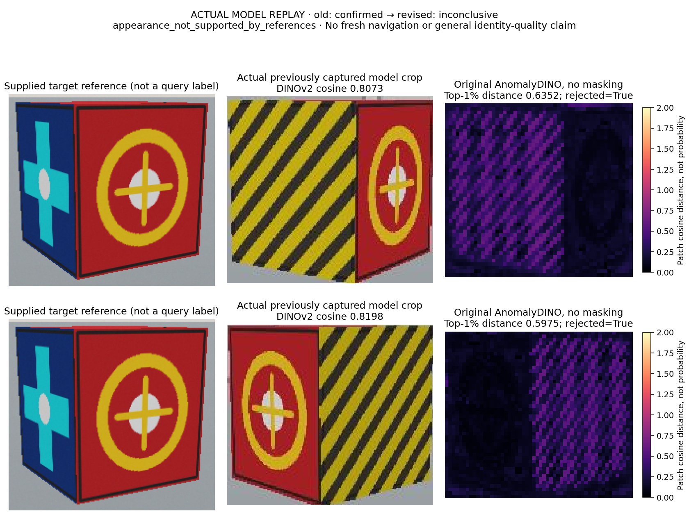
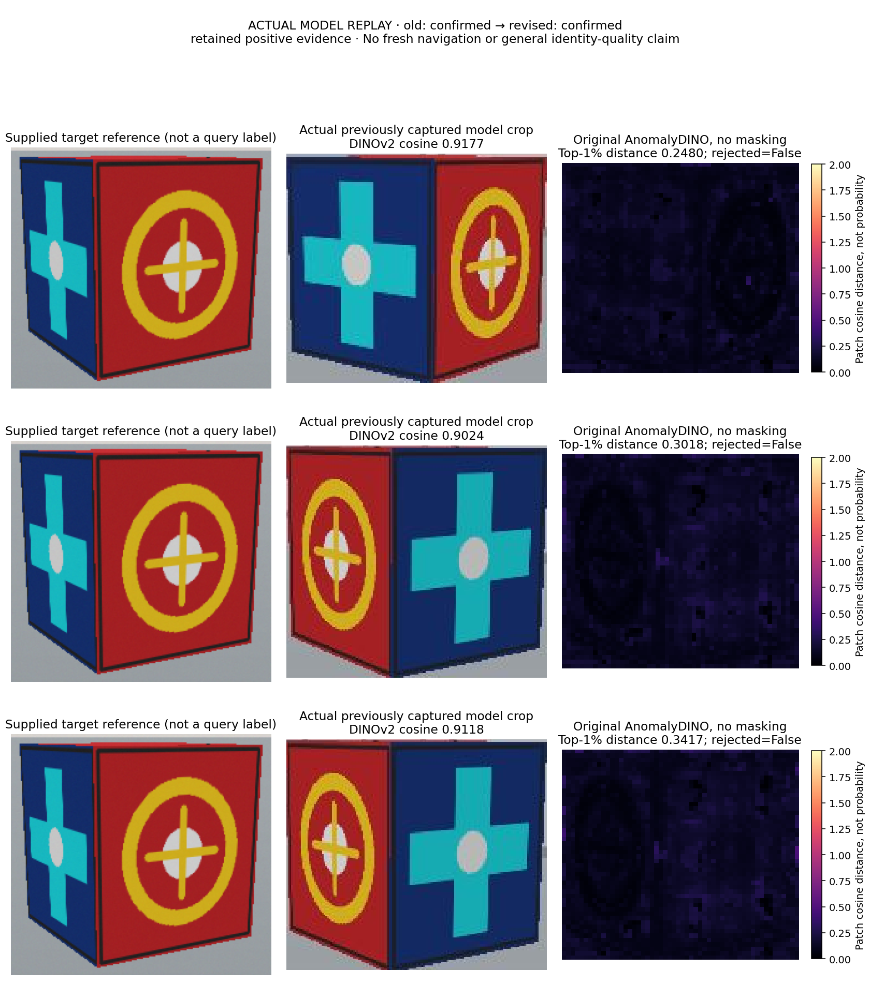
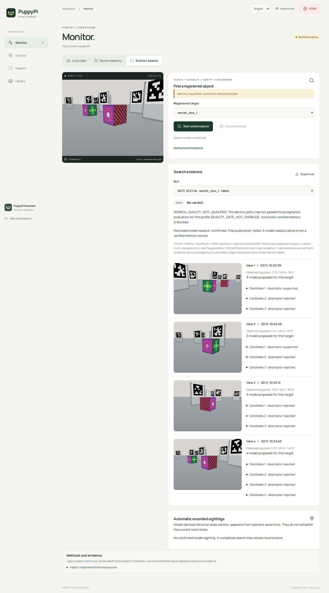
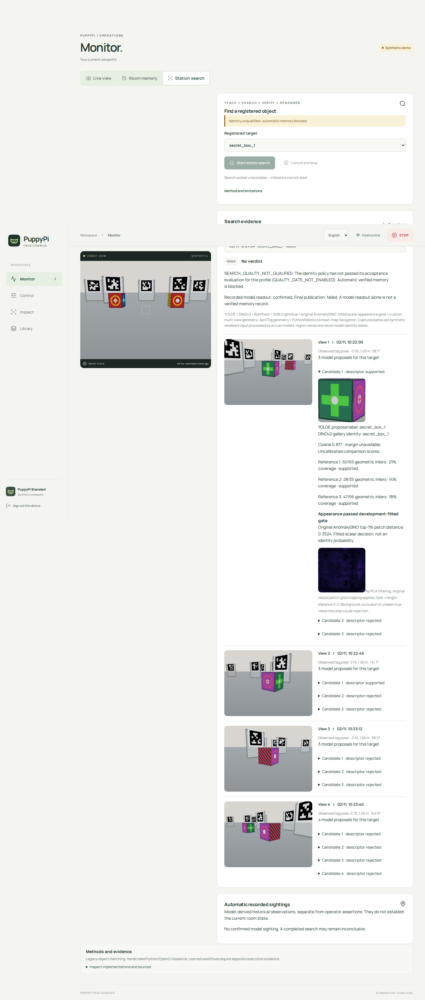
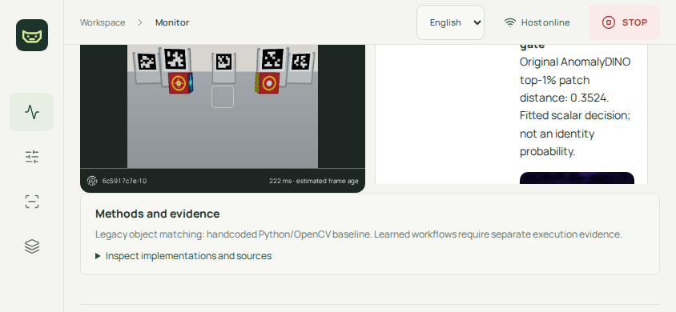

# Identity correction: genuine inference, regression fixes, qualification FAIL

Date: 2026-11-02. **The complete teach → search → verify → automatic-memory
feature remains FAIL.** The original shared-front/different-side false
confirmation is rejected by the new executed appearance path. A repeated full
app evaluation still fails a required positive case at the geometric support
stage. Automatic verified memory stays disabled; no sighting/history success
is claimed. The critical incident remains OPEN and the user's 0/10 rating is
unchanged.

## What actually changed

The [fixed-before-implementation contract](../../31-identity-contradiction-fix.md)
requires original AnomalyDINO scoring in addition to existing YOLOE proposals,
DINOv2 gallery comparison and DISK/LightGlue correspondence. The adapter extracts
and executes the complete author notebook `score_single_image` function verbatim,
imports the original backbone wrapper and uses CPU FAISS. It preserves original
672-edge preprocessing, patch-grid cropping, normalized distances and top-1%
aggregation. PCA masking and rotation augmentation are explicitly disabled.

The separate `.venv-anomaly` process verifies original source/function hashes,
the released DINOv2 checkpoint and all 175 loaded state tensors. A corrupt
same-name Torch cache fails initialization. One request runs at a time, only
after acknowledged stationary disarm; cancellation closes the subprocess.
There is no model substitute or frame backlog. The host and original vision
worker retain `.venv-dev` and `.venv-vision`; existing environments are preserved.

The scalar decision is **original scikit-learn 1.7.2**
`DecisionTreeClassifier(max_depth=1, random_state=0).fit/predict`, fitted on five
disclosed development scores: three target crops and two unknown-object crops.
The [fit artifact](development-fit.json) records the labels and fitted threshold
0.4695830345. This small application decision is not calibrated identity
probability, vision-model training or demonstrated generalization. Thresholds
were frozen before evaluation and were not changed after failures.

Every descriptor-supported candidate receives original appearance inference.
A rejected candidate vetoes confirmation of its spatial cluster even when other
views match. Missing source, model, interpreter, assessment or fit artifact is
terminal failure. Required multiple views, gallery-reference coverage and
spatial gates remain. New search profile/payload v3 preserves v2 historical
semantics. Qualification binds critical source bytes, executed environments,
fit hash and exact evaluated gallery references; it cannot qualify arbitrary
newly enrolled objects.

The [material manifest](materials.json) records fetched paper, source revisions,
licenses and hashes. Actual reuse is in
[anomaly_model.py](../../../teach_and_find/anomaly_model.py),
[anomaly_worker.py](../../../teach_and_find/anomaly_worker.py),
[anomaly_adapter.py](../../../teach_and_find/anomaly_adapter.py) and
[search_verification.py](../../../teach_and_find/search_verification.py).
AnomalyDINO source revision is `b9d1c2648e3a5247437d4d953d907a8f3d994457`;
DINOv2 revision is `7764ea0f912e53c92e82eb78a2a1631e92725fc8`.
This is reuse of the anomaly-scoring implementation, **not** a reproduced
AnomalyDINO paper benchmark or a claim that its paper proves instance identity.

## Actual results, including the repeated failure

All images below are **authored kinematic-simulator input processed by actual
models on CPU**, not physical PuppyPi recordings, renderer-derived identities,
scripted model scores or GPU runs. The worker receives observed pixels and
supplied map/calibration; renderer truth is retained separately for evaluation.

| Experiment | Actual result | Interpretation |
| --- | --- | --- |
| Original false-confirmation replay | Old confirmed → new inconclusive; original patch distances 0.6352 / 0.5975 reject | Specific known failure corrected; recorded-input replay only |
| True-target replay | Confirmed retained; distances about 0.248 / 0.302 / 0.342 | Positive regression, not fresh navigation |
| Development target seed 3001 | Four observed views, confirmed readout | Publication deliberately blocked |
| Development unknown seed 3808 | Four views, inconclusive; actual appearance rejection | Single-gallery unknown regression |
| First frozen 13-case app batch | 13/13 pass, four confirmations, nine inconclusive | Pre loaded-state-guard source; not active certification |
| Same frozen cases repeated after state verification | **11/13 pass; two required positives fail** | Final full-batch result remains FAIL |
| Camera cadence regression under three concurrent apps | 3/3 reach four views, confirmed readouts, no stale-camera error | Narrow same-case transport regression; no new quality qualification |
| Required-component and stationary-inference Stop probes | 5/5 pass their declared failure/cancellation expectations | Software failure handling, not physical stopping evidence |

The [first protocol](protocol-v3.json) froze fresh appearance/scene seeds before
execution. The [repeat protocol](protocol-v3-state-verified.json) explicitly
identifies repetition of the same cases without retuning. Preserve both
[first-pass audit](qualification-pre-state-guard.json) and
[failed-repeat audit](qualification-state-verified-failed.json); do not choose
the earlier pass as the final release result. The repeat contains no false
confirmation but misses two mandatory positives, which still fails acceptance.





### Remaining algorithm defect: planar fit on a multi-face 3D object

In repeated `hidden-20202`, both actual query crops pass DINOv2 and original
AnomalyDINO. The required reference lacks geometric support: the existing single
homography keeps 43/77 and 46/87 matches, below the frozen 0.60 ratio. A native
OpenCV fundamental-matrix diagnostic on **the identical recorded learned
correspondences** keeps 72/77 and 75/87. This supports a geometric-model mismatch;
it does not establish identity or warrant removing the appearance veto.

The [illustrated geometry case and concrete revision](../../review/2026-11-02-multiplane-geometry-case.md)
record inspected OpenCV/glue-factory source, missing reference-camera intrinsics,
exact diagnostic configuration and a proposed native USAC/MAGSAC path. **The
revision is not integrated; user approval is pending**, as required by AGENTS.
No threshold, required reference or failed record was removed to force a pass.

### Camera scheduling defect: fixed and rerun

Repeated `single-target-20404` fails with `SEARCH_CAMERA_STALE` after three views.
The old camera loop waited a full poll period after rendering, adding capture
work to the period. Recorded adjacent intervals reached 0.4137 seconds, exposing
the unchanged 0.6-second frame-age gate under concurrent load. See the
[original gap evidence](stress-camera-gap.json).

The corrected loop subtracts capture/render work from the period and skips
missed deadlines without catch-up. It does not relax the stale-frame bound,
renew a stale lease or rearm after a fault. Three simultaneous genuine-model
repeats of that exact case reach all four views and return confirmed model
readouts. Captured-frame maximum gaps are 0.2031 / 0.2052 / 0.2022 seconds;
[raw regression summary](camera-cadence-regression.json) binds their result hashes.
All three still end with `SEARCH_QUALITY_NOT_QUALIFIED`, zero automatic sightings.
This camera change does not requalify the separate SAM/Cutie tracking FPS gate.

### Genuine failure and Stop probes

The [failure summary](failure-handling.json) binds original report hashes.
Missing source, missing interpreter, corrupt fit and a deliberately corrupted
**isolated** Torch cache fail before navigation, with explicit errors and no
sightings. No user model cache is modified. Global Stop during stationary
inference cancels the task with no late view/result or motion. Its one 11.2-ms
API request occurs while already disarmed: it is neither physical stop latency
nor P95 latency. Hardware watchdog and physical stopping are unverified.

## UI and audit evidence

The app exposes actual patch maps, score, fitted-decision limitation and
confirmation veto beside each candidate. Export keeps raw map/provenance hashes.
Desktop and 844×390 landscape Chromium screenshots were inspected. The expanded
historical-evidence preview uses a copied store and a separate fresh camera
session; its current camera image is **not** the old evidence capture.







The audit now compares browser-exported numeric values with the immutable SQLite
payload before hashing the original snapshot. JavaScript normalizes `2.0` to
`2`; this formerly caused a spurious digest mismatch. Changed numeric settings
still fail. [Normalization evidence](audit-json-normalization.json) records both
representations; this is an audit correction, not changed model quality.

## Reproduction and evidence locations

Optional setup is `make search-setup`. Existing paid API authorization is not
used: **zero API calls, no GPU, no ROS, no live robot** in these experiments.
Original source checkouts/materials and complete immutable app outputs remain
under ignored `runs/identity-fix-2026-11-02/`; sources are linked from `.upstream`.
Historical batches recorded exact critical-source/fixture digests. Source files
for those batches were subsequently reconstructed under
`runs/identity-fix-2026-11-02/source-archives/<profile_signature>/`, each verified
against the recorded digest. This is a **post-run forensic reconstruction**,
not a claim that source files were copied at execution time. Later code changes
invalidate those historical source signatures for current qualification.

Reproducers execute real optional models and take minutes. Always use a new
output path; never overwrite preserved runs. Examples:

```bash
PYTHONPATH=. .venv-dev/bin/python scripts/replay_identity_fix.py \
  --run runs/search-qualification-v2-2026-11-02/unknown-hidden-808 \
  --output runs/identity-replay-new

PYTHONPATH=. .venv-dev/bin/python scripts/research_search_app.py \
  --scenario target --seed 20404 --appearance-seed 90003 --target-only \
  --readout-only --port 18850 --output runs/camera-regression-new

PYTHONPATH=. .venv-dev/bin/python scripts/research_search_safety.py \
  --fault missing-source --port 18851 --output runs/identity-fault-new
```

`fit_anomaly_decision.py` consumes recorded development probe output;
`qualify_search.py freeze` records model/source/fixture settings before execution;
`run_search_protocol.py` runs up to three owned disposable apps with deadlines;
`qualify_search.py audit` requires every declared case. Never promote a historical
pass with a stale source signature or label repeated failures fresh held-out data.

Validation: **143 Python tests, 10 Chromium browser tests, frontend build,
wheel/sdist build and `make check` pass**. Tests are offline/synthetic; optional
actual-model runs above provide separate evidence. Logs are under the ignored
execution root. All owned test/preview host, worker and browser processes were
stopped. No physical acceptance is claimed.

Next required work: approve/reject the concrete geometry revision, then implement
only the approved method and freeze a fresh full app evaluation. Keep the known
failure as a regression. Publish and test Library reload/Room timeline only after
all required quality cases pass. That path is still unverified today.
