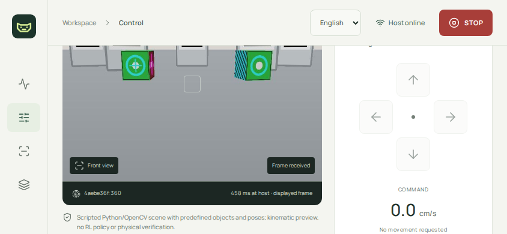

# Public-tunnel remote-control measurement

Date: 2026-11-02. Profile: remote-only, AI off. This is application transport and
kinematic simulator evidence, not perception quality, ROS or physical-robot evidence.

## Method and source path

Command: `make phone-benchmark`. The successful run is
`runs/phone/20261102-040238-326347/` (UTC directory timestamp). Full browser inputs,
frame events, evaluator trace and logs remain there. Selected original
[summary](benchmark-summary.json) and [age windows](age-windows.json) are retained
beside this report. No pairing code, cookie, model weight or private recording is
included. The screenshot is the actual authored simulator view after Stop.

The driver uses the real [session launcher](../../../scripts/phone_session.py),
[host wrapper](../../../scripts/phone_app_server.py),
[Chromium touch driver](../../../web/scripts/benchmark-phone.mjs) and
[trace evaluator](../../../teach_and_find/phone_benchmark.py).
Commands originate in actual direction-button touch events. The evaluator matches
each event to an actual same-direction applied simulator command, then to the first
painted frame showing changed kinematic yaw before the next touch. Missing command
or visual feedback is counted explicitly. Simulator pose is evaluator-only; it is
not supplied to the app as recognition or navigation output.

Browser and Python run on the same host OS clock; the browser nevertheless reaches
the app through the public Cloudflare HTTPS URL. Viewport is 844×390, touch enabled.
There are 24 alternating left/right pulses with a 300 ms hold, over 60.0032 seconds.
The image event is a decode/two-requestAnimationFrame callback: a paint proxy, not
a physical screen measurement. HTTPS RTT is measured separately with eight actual
timing requests and must not be subtracted as a universal one-way delay.

The already-installed official cloudflared 2026.10.1 executable uses HTTP/2 and IPv4.
There is no ROS bridge, physics engine, physical phone, robot or AI worker in this
run. All scene geometry and motion are the explicitly labeled kinematic preview.
The current `Settings.mobile.frame_poll_s` is 0.20; command lease remains 0.45 s
and required host frame age remains 1.0 s. Existing control gates are preserved.

## Observed results

| Observation | Result |
| --- | --- |
| Host captures / unique painted images | 300 / 235 |
| Host FPS / delivered FPS | 4.9997 / 3.9165 |
| Input → applied command p50 / p95 | 19.405 / 20.520 ms |
| Input → changed-pose paint p50 / p95 / max | 665.300 / 778.990 / 789.200 ms |
| Capture → paint p50 / p95 / max | 514.510 / 623.142 / 675.875 ms |
| Paint interval p50 / p95 | 250.000 / 299.335 ms |
| HTTPS RTT p50 / p95 | 55.850 / 187.865 ms |
| Missing commands / visual feedback | 0 / 0 |

The four successive 15-second windows have median frame ages 509.438, 528.630,
520.333 and 493.653 ms. This run shows bounded age, not cumulative minutes of
delay. It is a short observation, not a long-duration or physical-phone guarantee.
Delivered FPS is constrained by this configured 5 Hz JPEG pipeline and its network/
browser service time; no maximum hardware throughput is established.

## Failures preserved and corrections

- In `runs/phone-tunnel-20261102-034052/`, initial tracking startup could not find
  the configured upstream checkout. The existing verified author checkouts were
  selected explicitly; no substitute model was used. That AI-enabled startup and
  later control smoke check are separate from the remote-only measurement here.
- The original UI aborted an active JPEG request on every newer frame metadata
  update and revoked the displayed object URL before its replacement decoded.
  That caused starvation and a silently ineffective Arm action. The corrected
  [latest-image reader](../../../web/src/latestFrame.ts) coalesces pending IDs
  while completing the active request; decoded URLs have explicit lifetimes.
  A public-tunnel hold/release/Stop smoke check then passed. The slow-JPEG browser
  regression passed on the disposable synthetic server.
- `runs/phone/20261102-035618-689098/` completed browser pulses but could not
  produce a command-latency report: Uvicorn re-raised SIGTERM before the outer
  trace writer ran. No missing trace was synthesized. Export moved into runtime
  shutdown. An intermediate incorrect `runtime` reference was caught by Ruff;
  that attempt, `20261102-040008-841970`, was stopped and preserved. The successful
  run above wrote its actual trace during shutdown. A regression checks that
  trace export executes after base runtime close.
- An initial browser check collided with a concurrent `npm ci`; it failed on a
  missing package. Dependency setup and browser execution were then serialized.
  A delayed-route cleanup test issue was fixed using Playwright's actual
  `unrouteAll({behavior: "wait"})` API. The final suite passes all ten tests.

Source snapshots are automatically retained for **subsequent** launcher sessions;
that inventory feature was added after the measured run and is not claimed to
have captured its starting bytes. The application/stream/evaluator logic did not
change between this successful run and that operational inventory addition.

## Scope of acceptance

The remote-only launcher, real public transport, image-reader correction and
short simulator measurement are demonstrated. The full requested
`phone → tunnel → host → ROS → simulator/robot → render/camera → phone` path is
not present: ROS and physical stages remain unmeasured. No recognition accuracy,
AI-under-load throughput, mobile radio performance, physical stop time or long-run
release qualification follows from these numbers. Paid API calls: zero.

A separate launcher smoke run, `runs/phone/20261102-041351-020651/`, started all
three original local AI workers and observed `alive: true`, `status: ready` for
search, vision and tracking through the public authenticated API. Guest access
returned 401 and the pairing cookie was Secure. All owned smoke processes were
then stopped. This checks optional worker startup/readiness, not new inference,
concurrent performance or accuracy; those metrics above remain AI-off only.

The final user-requested remote-only session is
`runs/phone/20261102-041448-789560/`, intentionally left running. Its first reused
smoke helper did not scroll the Forward button into the viewport and failed to
observe motion; that output remains in `phone-smoke.json`. A separate
`phone-smoke-visible.mjs` explicitly scrolls the real button into view and checks
the touch hit target before dispatching input. That repeat passed with three
painted frames, nonzero Forward command, zero on release, and disarmed after Stop;
guest access returned 401, the cookie was Secure and browser errors were empty.
The URL/code are available through `make phone-status`, not committed here.
This control smoke is not a second performance measurement.

Validation: `make check`, `make test` (151 passed), `make build`, `make app-build`,
`make app-test` (10 passed), focused lifecycle checks and the dedicated public
benchmark. Follow [the operating guide](../../33-phone-tunnel-and-latency.md).
