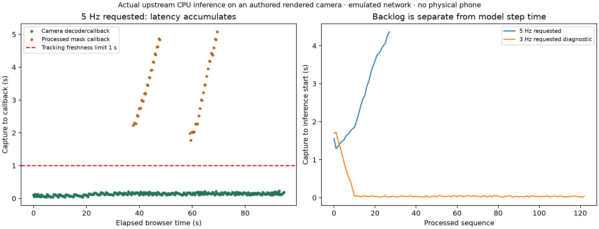
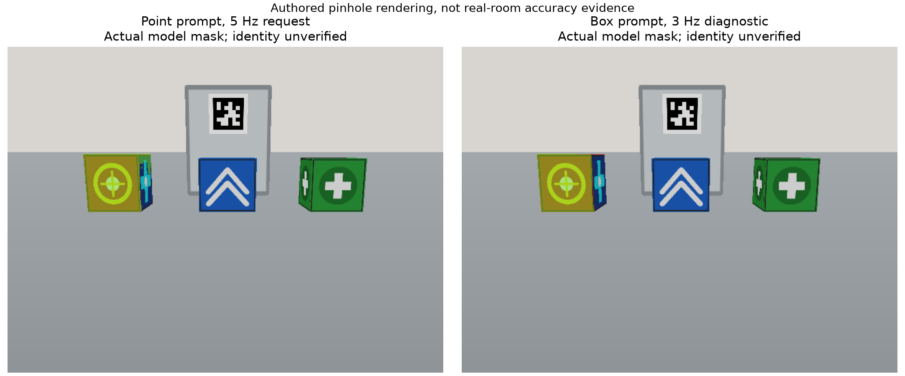
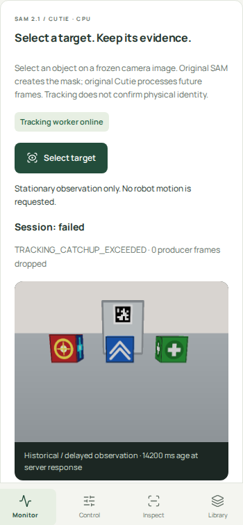
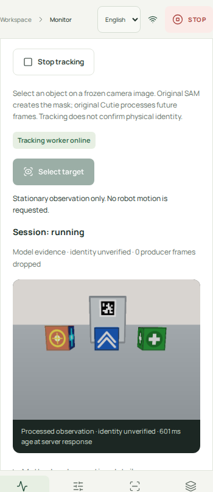

# Full app CPU execution, browser timing and concurrent load

Date: 2026-11-02 (Asia/Tokyo). Input: **authored pinhole-rendered images**;
original pretrained inference executed on CPU. Chromium used a 390 × 844 mobile
viewport/touch emulation. **No physical phone, room, Pi or robot was tested.**
The critical incident remains OPEN; this is not an identity-accuracy certificate.

## Result

The app now executes frozen-image selection → original SAM 2.1 preview → explicit
mask approval → persistent original Cutie inference on future camera frames.
At a requested 5 Hz, both sessions **FAIL** with `TRACKING_CATCHUP_EXCEEDED`.
Backlog grows; old masks remain attached to their own source images and are labeled
historical/delayed. The independent camera continues updating.

An explicitly configured **3 Hz diagnostic**, using a box prompt, processes 123
observations over approximately one minute, then stops on operator request.
Its actual displayed update rate is about 2.02 FPS. This separate experiment does
not lower or pass the agreed 5 FPS / five-minute release gate. Find-again,
automatic identity recovery, full session export and quality gates remain unfinished.



[Vector figure](latency.svg) · [two-page PDF](figures.pdf) · [machine-readable metrics](metrics.json).

## What ran and where

| Process/location | Actual implementation | Evidence boundary |
| --- | --- | --- |
| Host `.venv-dev/` | Existing FastAPI app, camera/control loops, new tracking API/spool, schema v7, existing memory/vision job APIs | No model imported into the HTTP camera/control loop |
| Host `.venv-tracking/` | Original SAM 2.1 tiny image predictor, original Cutie base-mega `InferenceCore.step` | Explicit CPU/FP32, eight Torch threads; no GPU fallback |
| Host `.venv-vision/` | Existing pinned author YOLOE SAVPE → original DINOv2 → disclosed custom comparison → Ultralytics ByteTrack | One actual 12-frame job; execution completed, quality not certified |
| Host `.venv-memory/` | Existing pinned Mind Palace through `MindPalaceAdapter`, actual returned model `gpt-6-luna` | One captured-image description and one recorded question, eight API attempts total |
| Chromium | Existing Preact app with the new tracking panel, real authenticated HTTP/WebSocket requests | Emulated viewport/touch/network/CPU; not phone hardware |
| Renderer | Existing `SimulatedLabWorld.render_camera`, three authored objects, small sinusoidal translation | Authored geometry/motion; not physics or perception truth |
| Pi / ROS / Docker | None in this experiment | Physical transport, camera exposure, actuation and watchdog timing untested |

Selected research code is genuinely invoked, not replaced with rectangles,
handwritten tracking or stored answers. Human clicks/boxes select the desired
extent; they do not establish physical identity. Custom lifecycle, freshness,
empty-mask and time-gap rules are explicitly heuristic operational checks.

Actual model provenance, including original revisions, checkpoint digests, loaded
configuration and Torch version, is retained in [execution metrics](metrics.json).
Sources are [SAM 2](https://github.com/facebookresearch/sam2/tree/2b90b9f5ceec907a1c18123530e92e794ad901a4)
and [Cutie](https://github.com/hkchengrex/Cutie/tree/ec5cdd4cf16f75c73ad785a2f96fb97dbad4125a).
License/checkpoint review and upstream-example execution remain in the earlier
[source review](../2026-11-02-interactive-tracking/report.md) and
[component report](../2026-11-02-tracking-execution/report.md).

## Timing protocol and limitations

The camera timestamps **host render completion**, not physical camera exposure.
The UI emits an event after image load and two `requestAnimationFrame` callbacks;
the paired mask event waits for both the immutable source PNG and mask PNG.
These are **decode/render-callback timing proxies**, not independently observed
screen photons. Offscreen compositor painting is not verified: the operator
scrolls between camera, selection and result panels. Do not call these measurements
physical phone display latency or sustained visible camera-and-mask FPS.

Eight `/api/timing` requests estimate server-minus-browser clock offset by the
request midpoint. The lowest-RTT estimate is +1.56 ms with ±2.5 ms half-RTT in
the full run, and +1.20 ms ±3 ms in the diagnostic. Browser and host share a
machine clock; no external-phone clock synchronization was established.

The baseline runs 15 s on loopback, then 15 s with Chromium CDP HTTP latency
parameter 40 ms, download 1,250,000 B/s, upload 625,000 B/s and CPU throttle 2×.
These are emulation inputs, not measured Wi-Fi RTT or a specific phone's compute
speed. An already-established WebSocket is not a validated network-emulation
measurement. HTTP benchmark actions use browser `fetch`, not Playwright's direct
request client. The diagnostic repeats these phases before 60 s of tracking.

FPS below counts distinct source frame IDs over their active callback interval.
The failed-session tracking rate covers only its short pre-failure interval;
it must not be represented as an uninterrupted service rate for the whole phase.

| Full-run phase | Camera callback FPS | Camera latency P50 / P95 | Mask callback FPS before failure | Mask latency P50 / P95 |
| --- | ---: | ---: | ---: | ---: |
| Loopback baseline | 4.01 | 81 / 123 ms | — | — |
| Emulated network, camera only | 3.99 | 134 / 178 ms | — | — |
| Tracking CPU | 3.91 | 148 / 188 ms | 2.78 | 3,206 / 4,749 ms |
| Concurrent jobs | 3.85 | 147 / 192 ms | 2.62 | 3,117 / 4,845 ms |

The rendering/capture loop itself produces approximately 4 FPS, despite the
tracking feed's requested maximum of 5 Hz. Cutie steps average 302 and 317 ms in
the two full-run sessions; disk/preprocessing/polling/publication add overhead.
Input arrives faster than the complete worker can consume it. Selection/preview
also creates initial catch-up work. The previous 4.05 **compute-step** FPS from a
12-image component probe never established this full path's throughput.
No paper-quality failure can be concluded from this scheduling failure.

The 3 Hz diagnostic delivers 2.02 callback FPS because the offered maximum is
sampled from the approximately 4 Hz capture loop; the cap is not a guaranteed
source rate. Across all 123 mask callbacks, latency P50/P95 is 708/1,248 ms,
including initialization. Excluding sequences 0–9 as an explicitly reported
warm-up diagnostic: 113 frames, P50/P95 699/766 ms, maximum 801 ms. The all-frame
numbers remain authoritative; warm-up exclusion is not a release-gate change.
The active tracking-stop request returns in 320 ms under emulation. A subsequent
in-flight observation is recorded as discarded after stop, without publication.
This measures tracking cancellation, **not physical emergency-stop latency**.

## Actual concurrent work and paid authorization

| Job | Queue to finish | Worker duration | Result |
| --- | ---: | ---: | --- |
| Mind Palace description | 6.29 s | 6.21 s | Succeeded; one API call |
| YOLOE/DINOv2/ByteTrack | 12.57 s | 12.34 s | Execution completed; identity quality not certified |
| Mind Palace recorded question | 14.88 s | 14.68 s | Answered; seven API calls |

The second tracking session overlaps capture, vision, and part of QA before
failing after about ten seconds of processing. This is a concurrent-load failure
measurement, **not** a five-minute all-features stability pass. The diagnostic
has no vision/QA jobs and makes no extra paid calls.

Authorized total: **15 API attempts**. Observed: **8**, all completed with returned
model `gpt-6-luna`; no retries or alternative model. A locked, fsynced ledger
reserves each attempt before the provider call and survives worker restarts;
failed provider calls would also consume an attempt. Both runs share that ledger.
[Ledger](full-paid-attempts.json) and [actual job records](full-jobs.json) retain
calls, timing and provenance. The worker-wide cap now also overrides old queued
profiles so an older job cannot bypass the current authorization.

The recorded answer describes red/yellow crosshair, blue/white chevrons and
green/white plus symbols, consistent with visual review of this authored capture.
That single answer is not a real-room accuracy estimate or research advantage.

## Actual selection behavior and figures



The point prompt at source (150, 200) is operator-authored. SAM's highest-scoring
candidate covers a small symbol/part of the red box, rather than reliably selecting
its entire body. Its quality score is not an identity probability. The box-prompt
diagnostic selects a larger visible extent. Later Cutie masks in the point run
also expand over the front face; no ground-truth extent evaluation was performed. These are different prompts and
rates, not a controlled accuracy comparison. Neither establishes re-identification,
occlusion recovery, calibrated confidence, a world model or held-out segmentation
quality. No simulator identity or manually filled mask enters inference.

| Actual phone-size tracking failure | Actual phone-size diagnostic running state |
| --- | --- |
|  |  |

[Desktop monitor](full-desktop-monitor.png) · [desktop recorded-memory answer](full-desktop-memory.png)
· [diagnostic desktop](diagnostic-desktop-monitor.png).
These are screenshots of the hosted app, not UI mockups. The original full-page
memory screenshot captured a lazy image before it entered the viewport; it is
preserved. A separate historical readback from a disposable copy waits for the
cited PNG to decode, with workers stopped and no new inference/API calls:
[desktop answer](readback-desktop-answer.png) and [phone answer](readback-phone-answer.png).
`research_stream_app_readback.py` reproduces that inspection without modifying
the source run. The later snapshot is not concurrent-run performance evidence. Original source and mask
PNGs for the two displayed examples are retained; complete camera streams remain
ignored under `runs/`.

## Reproduce and operate

See the [app operating guide](../../27-live-tracking-app.md) for provisioning,
worker/app separation and visible failure handling. This experiment requires
already-provisioned vision/memory dependencies and Chromium. The two upstream
tracking sources were reused from the verified G0 directory; the reproducer sets
that path explicitly. To repeat paid work, use a new evidence directory and an
explicitly authorized budget; do not rerun merely to get a favorable answer.

```bash
make app-build
# Only with explicit authorization for this new paid run:
.venv-dev/bin/python scripts/research_stream_app.py \
  --directory runs/NEW-stream-run --allow-paid-api --max-api-calls 15
# Optional lower-rate diagnostic, sharing the SAME authorization ledger:
PUPPYPI_TRACKING_OFFER_HZ=3 .venv-dev/bin/python scripts/research_stream_app.py \
  --directory runs/NEW-diagnostic --allow-paid-api --max-api-calls 15 \
  --budget-file runs/NEW-stream-run/paid-attempts.json --scenario tracking-diagnostic
.venv-dev/bin/python scripts/research_stream_app_report.py \
  --full runs/NEW-stream-run --diagnostic runs/NEW-diagnostic \
  --output runs/NEW-reviewed-report
```

The launcher refuses an occupied port and existing output directory, strips the
API key from app/tracking/vision children, and stops its four processes in `finally`.
Both recorded cleanup manifests confirm all task-owned processes stopped.
[Artifact hashes](sha256.json) cover exported evidence as generated; they are not
an independent certification of claims. The manifest includes exported metadata, figures, screenshots and this report.

## Remaining acceptance obligations

- 5 FPS for five minutes: **FAIL**, with concrete overload errors; not rescued by
  lower-rate diagnostics. Provisioned GPU execution or measured host scheduling
  improvements require a new run, not a throughput promise.
- Target extent / segmentation / identity / occlusion quality: **not passed**.
  Improve operator refinement and evaluate actual model outputs on held-out data.
- G1 coordinate/device/race coverage: partial tests and actual UI selection; full
  transforms/reconnect/browser matrix still pending.
- G3 transient-reference Find again, automatic recovery, correction generations
  and full UI timeline/export: unfinished; stopping and explicitly selecting a
  new target is available but does not substitute for these accepted components.
- Physical camera, phone, network, robot stop and navigation: **not tested**.
  No live robot was discovered, contacted or actuated.

## Software validation

`make check`, `make test` (113 passed), `make app-build`, `make app-test`
(9 passed), `make build` and `make hooks` completed. Default tests use explicit
offline fixtures and a disposable server; they make no paid API calls, download
no model and use no GPU/robot. Existing Starlette/httpx deprecation remains a
warning. Desktop/phone screenshots and paired source/mask figures were visually
inspected. Required-model absence is visibly rejected with HTTP 503 and no
substitute output. These checks establish software behavior, not model quality.
