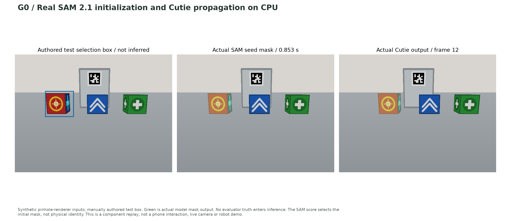
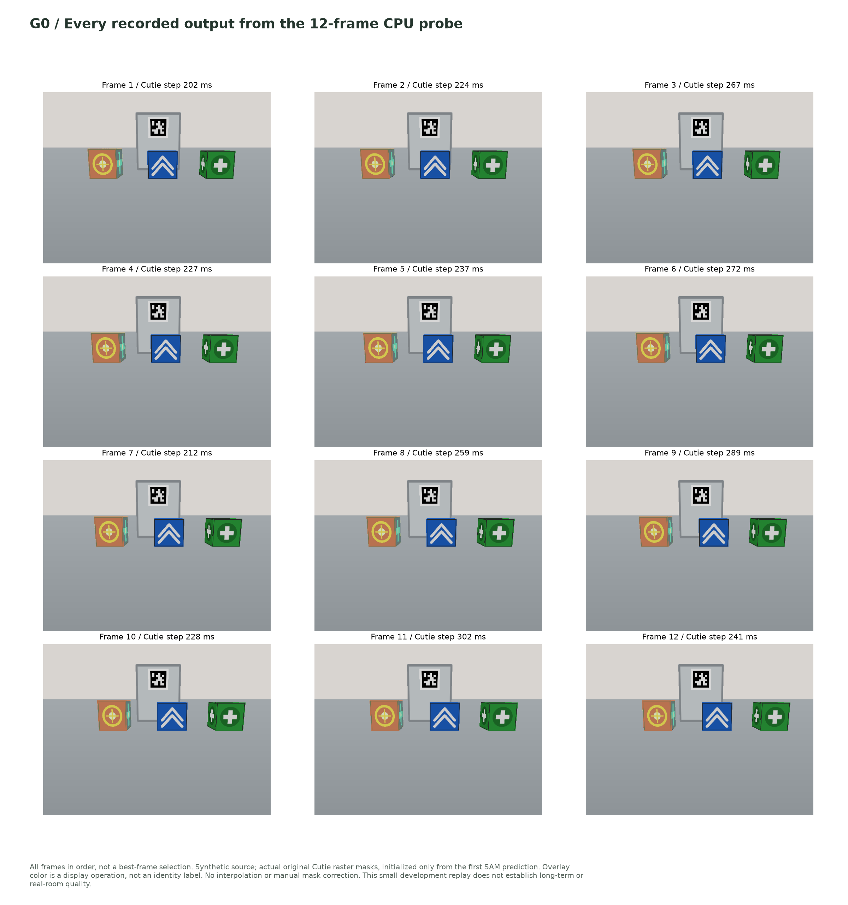
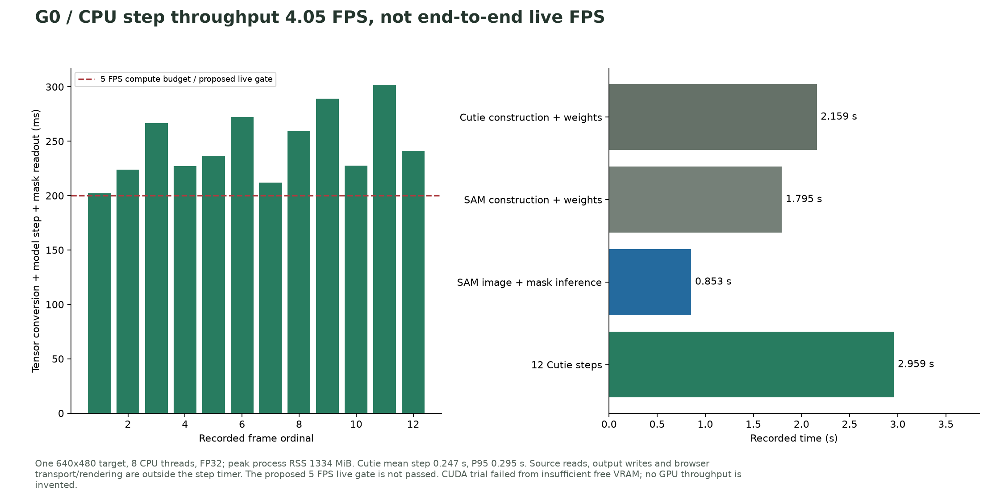

# SAM 2.1 + Cutie: actual CPU execution and CUDA memory failure

Date: 2026-11-02. User authorized trying the selected models on this machine
before deciding whether another host is necessary. This is a component feasibility
experiment for [design 26](../../26-interactive-target-tracking.md), not a delivered
phone interaction or completed tracking acceptance gate.

**Observed result: original SAM 2.1 tiny + original Cutie base-mega completed on
CPU. The explicit CUDA trial failed with out-of-memory during SAM inference.**
The proposed 5 FPS live gate is not passed and the broader incident remains OPEN.
No robot actuation, paid API, model substitution, training or other workload
termination occurred.

## Actual output figures

[Three-page figure PDF](figures.pdf).







SVG exports: [initialization](01-seed-and-tracking.svg),
[every frame](02-all-twelve-frames.svg), [timing](03-observed-cpu-timing.svg).
The selection rectangle is an authored test prompt; tinted regions are actual
model masks. No evaluator boxes/masks alter the model outputs. The original
source RGB and full per-frame model results remain under ignored
`runs/tracking-probe-2026-11-02/`, with the selected figures and records committed.

The [execution manifest](execution-manifest.json) binds the final reproducer,
artifact hashes, verified masks and failure checks. A local ZIP of the report,
synthetic inputs and final CPU outputs is available at
`runs/tracking-probe-2026-11-02/tracking-component-evidence.zip`; it excludes
weights, credentials and the upstream example photographs.

## Machine and environment

The inspected host has two Xeon Silver 4514Y sockets, 64 logical CPUs, about
251 GiB system RAM and three RTX 6000 Ada GPUs with 49,140 MiB each reported by
`nvidia-smi`. Immediately before the trials, free GPU memory was 478, 1,032 and
1,032 MiB. GPU utilization was 0%, but existing allocations were still present.

[Environment record](environment.json), [dependency freeze](environment-freeze.txt)
and [post-execution GPU snapshot](resource-after.json). The new isolated
`.venv-tracking/` contains Python 3.12.13, PyTorch 2.6.0+cu124 and torchvision
0.21.0+cu124. CUDA availability was true in this environment. Existing `.venv/`,
host, memory and vision environments were preserved.

The original SAM package was installed editable from its pinned source with
`SAM2_BUILD_CUDA=0`, `SAM2_BUILD_ALLOW_ERRORS=0`, `--no-build-isolation` and
`--no-deps`. This explicitly selected image profile disables extension-dependent
hole/sprinkle postprocessing and dynamic postprocessing; it does not catch a
kernel error and return another algorithm. Cutie imports its actual source via
the supplied source path; unused GUI/training dependencies are not installed.

## Reused implementation and downloaded assets

- Original SAM source `2b90b9f5ceec907a1c18123530e92e794ad901a4`:
  `build_sam2`, `SAM2ImagePredictor.set_image` and `predict`.
- Original Cutie source `ec5cdd4cf16f75c73ad785a2f96fb97dbad4125a`:
  `CUTIE`, `CUTIE.load_weights`, `InferenceCore.step` and
  `InferenceCore.output_prob_to_mask`.
- Real artifacts: SAM 2.1 tiny, Cutie base-mega, original ResNet-18 and ResNet-50
  constructor checkpoints. [Download URLs, sizes and measured SHA256](assets.json).
  SAM's download matches the previously observed LFS hash; Cutie matches the
  author's MD5 and now has an independently observed SHA256.
- Cutie model-state keys and shapes must exactly match the downloaded state.
  After calling the original loader, every loaded tensor is checked against
  that checkpoint. No missing/randomly initialized parameter is accepted.
- The inference process blocks Python socket connections. Required constructor
  weights are pre-provisioned; a missing artifact produces failure, not a runtime
  download or a synthetic mask. Source revisions and clean tracked source are
  checked before inference.

The project script orchestrates these original components and records results.
It does not implement a new tracker, trained model or identity classifier. Loader
changes are explicit CPU/device mapping, isolated configuration, local artifact
paths and output serialization. Original tracked model source was not patched.

## Input and initialization provenance

The paired CPU/CUDA target input is the 12 `moving-*.png` images from the existing
pinhole-renderer acceptance directory. They contain simple authored objects and
slow displacement, not physical robot video or a broad tracking benchmark.

An authored XYXY test box `[124, 150, 238, 253]` initializes SAM on the first RGB
frame. SAM returns three masks; the script selects the maximum **upstream mask
quality score**, not the mask with the best evaluator overlap. In the final CPU
run those raw scores are approximately 0.9713, 0.7747 and 0.9651. They are not
physical identity probabilities. The selected mask contains 8,165 foreground
pixels and is the sole initialization for Cutie. No future frame is manually
corrected or supplied a ground-truth mask.

Cutie receives float RGB tensors in [0,1]; normalization is performed by the
original network. Its original `generic` evaluation configuration enables its
long-term memory, with `max_internal_size=480`, FP32, no flip augmentation and
one tracked label. Each subsequent image executes original `step(image)` using
the same processor. Exact binary masks and source/output hashes are saved.

A separate [upstream bike-example replay](cpu-upstream-bike.json) uses the four
images and the supplied first-frame **reference mask** from Cutie's own example.
It exercises the same original sequential calls as `scripting_demo.py`, adapted
for explicit CPU mapping and saved output instead of GUI `.show()`. It is not an
unmodified CUDA-demo run and does not establish automatic mask initialization.
Those example inputs remain in the ignored pinned upstream checkout; their hashes
are recorded. No full paper benchmark or DAVIS-quality reproduction is claimed.

## Observed executions, including failed attempts

| Trial | Outcome | Observed details |
| --- | --- | --- |
| [Initial CPU request](cpu-moving.json) | FAIL | Original SAM constructor warmed a CUDA positional cache because CUDA was visible, despite `device=cpu`; failed on GPU 0 memory. Not a CPU-only timing result |
| [Explicit isolated CPU, 4 threads](cpu-moving-isolated.json) | Completed | SAM + 12 Cutie frames; exploratory mean step 0.412 s; ran concurrently with bike replay |
| [Upstream bike, CPU](cpu-upstream-bike.json) | Completed | 4 frames, 2 supplied-mask labels; mean step 0.729 s; exploratory concurrent timing |
| [Isolated CPU, 8 threads](cpu-moving-8threads.json) | Completed | 12 frames; mean step 0.258 s; historical source snapshot retained |
| [Final CPU reproducer](cpu-final.json) | Completed | 12 frames; mean step 0.2466 s, P95 0.2949 s; 4.05 compute-step FPS |
| [Explicit CUDA device 1](cuda-moving.json) | FAIL | Cutie and SAM loaded, but SAM forward raised CUDA OOM; no CUDA-tracked frames produced |
| [Missing weights](missing-weights.json) | FAIL as required | Preflight FileNotFoundError; zero frames, no substitute |
| [Corrupt SAM checkpoint](corrupt-checkpoint.json) | FAIL as required | Digest mismatch before model loading; zero frames, no substitute |

The final reproducer explicitly hides CUDA for a requested CPU profile before
CUDA discovery, seed initialization or SAM construction. This prevents original
SAM's optional constructor cache warmup from touching a GPU. A CUDA request never
changes into a CPU request. Prior failures and their source snapshots are retained
in [probe history](probe-history.json), [original probe](probe.py) and
[intermediate probe](probe-v2.py); they are not supported production adapters.

The CUDA experiment capped its own PyTorch allocator at 768 MiB to avoid taking
unbounded memory from the already occupied card. After CUDA context creation,
`mem_get_info` reported about 602 MiB free. At failure the allocator had about
509 MiB allocated and the error reported about 12 MiB physical free memory when
another 24 MiB allocation was attempted. Thus this was an observed shortage of
available VRAM, not proof that the GPU hardware or CUDA installation cannot run
these models on an otherwise available card. No minimum full-pipeline VRAM
requirement or GPU speed was established.

[CUDA traceback](cuda-moving-traceback.txt) and
[initial CPU/cache traceback](cpu-moving-traceback.txt) preserve the actual errors.
The post-execution GPU snapshot returned to the pre-trial allocation values.

## Timing interpretation

Final CPU run: 640×480 synthetic images, one target, eight CPU threads, FP32.

| Measurement | Observed |
| --- | ---: |
| Cutie construction/checkpoint loading | 2.159 s |
| SAM construction/checkpoint loading | 1.795 s |
| SAM first-image embedding and mask prediction | 0.853 s |
| Twelve Cutie step calls, total | 2.959 s |
| Mean / P95 Cutie step | 0.247 / 0.295 s |
| Compute-step throughput | 4.05 frames/s |
| Internal probe elapsed, including preflight and saved outputs | 9.021 s |
| Peak process RSS | 1,334 MiB |

The step timer includes tensor preparation, original Cutie step and its mask
readout, with CUDA synchronization when relevant. It excludes source-image reads,
output file writes and browser transport/rendering. Internal elapsed starts after
Python/torch import and is not full cold process-launch time. The CPU probe
overlapped a lightweight missing-file preflight process briefly, but no second
tracking inference or default test/build ran during its model steps. This remains
a small exploratory measurement on a shared host, not a sustained latency study.

The 5 FPS live target in design 26 remains unchanged. The observed compute rate
already falls below it, and a five-minute live camera/app test was not run. Do not
report this replay as passed live acceptance, real-room accuracy, long occlusion
recovery, correct absence or exact-instance identification. No J/F/identity-quality
evaluation was performed in this feasibility trial.

## Reproduce the final component run

Prerequisites are the pinned source directories and four verified artifacts.
The historical [download script](download_assets.py) records the actual asset
retrieval used here; paths are repository-relative and it must be run deliberately.
It is not an automatic inference dependency or a default test.

The executed optional environment setup was:

```bash
uv venv .venv-tracking --python 3.12
uv pip install --python .venv-tracking/bin/python torch==2.6.0 torchvision==0.21.0 \
  --index-url https://download.pytorch.org/whl/cu124
uv pip install --python .venv-tracking/bin/python hydra-core==1.3.2 \
  iopath==0.1.10 einops==0.8.1 tqdm==4.67.1
SAM2_BUILD_CUDA=0 SAM2_BUILD_ALLOW_ERRORS=0 uv pip install \
  --python .venv-tracking/bin/python --no-deps --no-build-isolation \
  --editable runs/interactive-tracking-research-2026-11-02/sam2
```

The complete observed dependency versions, including the CUDA wheel dependencies,
are in the freeze file. The command list alone is not a transitive lock for a
future production setup. The existing main project dependency lock is unchanged.

Run from the repository root, with a new output directory:

```bash
OMP_NUM_THREADS=8 MKL_NUM_THREADS=8 .venv-tracking/bin/python \
  scripts/research_tracking_probe.py \
  --sources runs/interactive-tracking-research-2026-11-02 \
  --weights data/models/tracking \
  --input runs/tracking-probe-2026-11-02/moving-input.json \
  --output runs/my-new-cpu-tracking-probe --device cpu --threads 8
```

The existing input spec lists actual saved source files. A different machine
needs those inputs or a newly authored input specification; do not silently
substitute another scene. This CLI is a research reproducer, not `make
tracking-worker` or a camera/phone server. GPU execution must be explicitly
requested and provisioned; there is no automatic CPU retry.

## Practical decision and remaining work

This machine can execute the selected learned components on CPU, so moving hosts
is not necessary to continue G0/component development. The current CUDA trial
cannot proceed with the observed occupied VRAM. A GPU trial requires released
capacity on this host or a separate available host, followed by actual measurement;
no other process was stopped to create that capacity.

The earlier inference from `.cuda()` in the demo to a general GPU requirement
was too broad. Original component execution is now demonstrated on CPU with
explicit device configuration. This does not prove that CPU meets the requested
live product target.

G0 now has genuine source/weights/output and failure evidence, but production
adapters, adapter parity, full quality checks and G1–G4 remain incomplete. F40 is
still a planned app feature. The next implementation step is the immutable
point/box-to-mask API/UI slice backed by these actual components, followed by
the bounded persistent session/feed. Do not claim that tapping an object on a
phone already invokes this research-only CLI.

Verification: `make check`, 106 default Python tests and package build passed.
Those software checks do not evaluate the optional models. No production UI was
changed, so no new app/browser acceptance run is claimed. Model and setup
processes exited; no project-owned server or model worker remains running.
