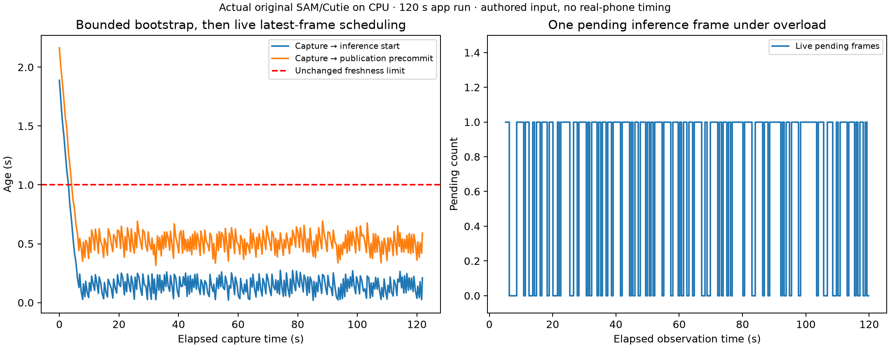
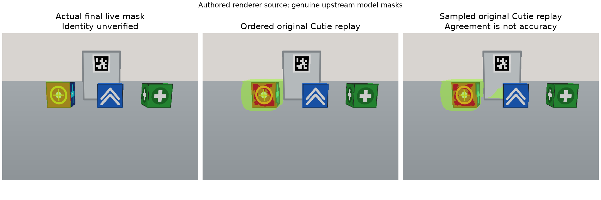

# Live scheduling correction: actual model execution under overload

Date: 2026-11-02. Base: `74be1ff` plus the uncommitted scheduling revision.
**Specific FIFO backlog defect corrected in the observed run. Full F40 and the
5 FPS/five-minute gate remain FAIL / incomplete.** Inputs are authored pinhole
renders; timing uses Chromium mobile/network/CPU emulation, not a physical phone.

## Design change and result

The user explicitly authorized revising the failed live scheduling design.
[Decision and contracts](../../28-live-stream-scheduling.md) separate bounded
initialization from a latest-value live inbox. Original SAM 2.1 and original
Cutie/checkpoints remain unchanged. The temporal sampling policy is explicitly
custom orchestration, not an upstream tracker replacement or GStreamer reuse.

Actual hosted app execution, at the unchanged requested maximum of **5 Hz**:

- **120 seconds**, **292 published observations**, 279 claimed in live phase.
  The session stops on operator request, without `TRACKING_CATCHUP_EXCEEDED`.
- **477 source frames admitted**, **172 pending live replacements**, **184
  skipped admitted frames** across bootstrap/live. Source production is faster
  than consumption; replacements prevent an ordered replay backlog.
- Live inbox peak and maximum sampled pending count: **1**. Raw producer mailbox
  replacements: zero in this run; its capacity-one behavior is separately tested.
- First/last 20 seconds of live inference: capture-to-inference-start P50
  **157 / 121 ms**, P95 **243 / 226 ms**. These descriptive windows show no
  accumulating queue delay during this experiment; they do not prove all workloads.
- One genuine concurrent YOLOE → DINOv2 → custom comparison → ByteTrack job
  succeeds with `execution_completed_quality_not_certified`.
- No memory worker or paid inference is started. **Zero additional API calls**;
  the previous experiment's ledger remains **8/15**.



[SVG](freshness.svg) · [two-page PDF](figures.pdf) · [metrics](metrics.json)
· [all published observation metadata](observations.json).
Browser exports retain all original timing events and selected poll fields;
repeated per-poll model configuration is omitted and exported once in metrics.
Full original browser records remain in the ignored raw run directories.

The previous two 5-Hz failures remain preserved in the [original report](../2026-11-02-stream-app/report.md).
They motivated this explicit revision; they were not replaced by the new run.

## Architecture and patterns actually implemented

| Responsibility | Actual implementation | Guarantee / limit |
| --- | --- | --- |
| Raw-frame admission | `LatestMailbox`, standard-library condition/lock | One waiting raw frame; newest replaces old; close wakes waiter; no model/PNG work on capture thread |
| Inbox persistence | `FrameInbox` repository adapter, SQLite migration 8 | Persistent monotonic sequence allocator; bounded bootstrap history; at most one unclaimed live record |
| Temporal selection | Pure `select_frame` domain function | Bootstrap takes newest reachable retained source; live takes the head; positive gap ≤0.6 s and stale-input checks |
| Model orchestration | Refactored `TrackingRunner` state machine | Separate preview, seed, advance, inference and publication methods; one native call in flight |
| Learned inference | Existing pinned `TrackingModels` adapter | Actual original SAM image predictor and Cutie `InferenceCore.step`; explicit CPU FP32 / eight Torch threads |
| Cancellation | Generation checks and transactional publication; compare-and-set finish | Late output cannot resurrect a stopped generation; native execution is not forcibly interrupted |
| Presentation | Existing Preact panel | Exact paired source/mask, phase/pending/replacement/skipped counters and method disclosure |
| Domain errors | `teach_and_find.errors` | Pure scheduler does not import SQLite, OpenCV, Torch or FastAPI; old storage imports remain compatible |

The model inbox capacity is **one pending frame plus the independent in-flight
snapshot**. There is also one waiting raw frame and possibly an active PNG write
in another stage. Bootstrap can retain 60 history records plus the original
anchor. These are separate bounded stages, not one image total across the system.

Unconsumed source PNGs retained for provenance still count toward the existing
session byte budget. A live record is disposable work; processed evidence remains
historical storage. The worker never scans that archive to find old live work.
The counters distinguish producer replacement, inbox replacement and skipped
admitted sequences; they are not interchangeable loss counts and must not be
added as if all represented distinct camera captures.

Profile v2 and schema v8 explicitly identify this policy. Historical v1 runs
have no v2 stream state; old active work is interrupted, not silently resumed
under different sampling. The selected models and 0.6 s gap / 1 s result budget /
10 s bootstrap limit were not widened to obtain success. Bootstrap advances from
the original SAM-approved mask using actual reachable images; it never transfers
that old mask directly onto the current camera image.

## Timing, throughput and acceptance boundary

| Measurement | P50 | P95 | Maximum |
| --- | ---: | ---: | ---: |
| Live capture → inference start, 279 observations | 140 ms | 247 ms | 274 ms |
| Live capture → publication precommit | 513 ms | 633 ms | 693 ms |
| Actual original Cutie step in live phase | 356 ms | 422 ms | 469 ms |
| Live capture → browser callback proxy | 747 ms | 959 ms | 1,072 ms |
| All capture → browser callback, including bootstrap | 750 ms | 1,003 ms | 2,319 ms |

The browser callback rate is **2.41 FPS** for processed masks and approximately
**3.90 FPS** for camera images over their active recorded intervals. This fixes
freshness scheduling; it does not make the CPU process five frames per second.
The exact five-minute, five-FPS acceptance gate is **not passed**, and this run
lasts two minutes. All-frame latency includes bootstrap; the live-only subset is
reported separately, not used to conceal initialization cost.

As in the original experiment, capture time means **host render completion**.
Events wait for paired PNG load and two animation callbacks; they are not screen
photon measurements. Offscreen compositor painting is not independently verified.
Chromium uses 390×844/touch emulation, CDP HTTP latency parameter 40 ms, download
1,250,000 B/s, upload 625,000 B/s and CPU throttle 2×. These are emulation inputs,
not measured phone/Wi-Fi specifications. An established WebSocket is not a verified
network-emulation measurement.

Clock midpoint calibration chooses the lowest-RTT of eight browser requests:
server-minus-client estimate **−18.73 ms ±24 ms** half-RTT. HTTP emulation makes
that estimate uncertain; the near-one-second browser P95 must not be presented
as a precisely certified latency-gate pass. Queue and model timing use host
capture/inference timestamps and are independent of that browser offset.

A source gap or single inference exceeding the existing deadline can still end
a session. Bounded admission removes accumulating stale work, not model compute
latency, absent observations, arbitrary motion gaps or hardware/network outages.
[End-of-run resources](resources.json) account for 11,867,583 session evidence
bytes; source PNGs total 12,224,081 bytes including library references, and model
mask PNGs 188,970 bytes. Source-file totals and session accounting have different
scopes and are not expected to match. No sustained RAM/VRAM timeseries or
five-minute resource soak is claimed.

## Cancellation and screenshots

The main run's stop reaches the committed stopped state in **105 ms** in the
browser benchmark. A native call finishing afterward emits `observation_discarded`
for sequence 476 instead of publishing. This is tracking cancellation, not
physical motor stopping time.

The original desktop screenshot was captured immediately after backend stop,
before the UI had settled, and still displays the prior running snapshot. It is
preserved. A separate **six-second actual-model Stop check** waits for both the
backend stopped state and the visible `Session: stopped` UI; it passes with no
browser errors. The later screenshot hides only fixed navigation chrome to keep
the captured panel readable; it does not alter model evidence.

[Main phone screenshot](phone-tracking.png) · [main desktop snapshot](desktop-tracking.png)
· [Stop-check settled UI](stop-check-desktop-tracking.png)
· [Stop-check responses](stop-check-stop.json).

## Temporal sampling changes model output: not an accuracy certificate

A paired component diagnostic executes actual original SAM once, then original
Cutie separately on the same 12 authored moving images with the same SAM seed:

- Ordered indices: 0–11.
- Sampled indices: 0, 2, 4, 6, 8, 10, 11.
- Six non-seed shared-frame mask IoU **agreement**, mean **0.902**, range
  **0.800–0.992**. Seed agreement is 1.0 because both arms use the same seed.

These are real output differences. This fixed-stride comparison is a small
sampling diagnostic, not the full live scheduling policy or ground-truth accuracy.
Visible background leakage occurs in the paired replay; the sampled last mask
also includes an extra background region. Neither arm establishes good segmentation
or exact-instance identity. The larger authored seed box and highest-score SAM
selection in this diagnostic differ from the live app's box and approval action;
it is not a controlled comparison of prompts.



[Raw sampling metrics/config/provenance](sampling.json), original seed and selected
source/mask PNGs are retained beside this report. Full model outputs and logs
remain under ignored `runs/tracking-sampling-2026-11-02-v2/`. No model was trained,
no mask was manually filled, and simulator identity never enters inference.
The changed sampler needs held-out segmentation/identity/occlusion evaluation;
this performance correction does not fulfill that quality gate.

## Reproduction and software verification

```bash
make app-build
.venv-dev/bin/python scripts/research_stream_app.py \
  --directory runs/NEW-latest-test --no-paid-api --scenario latest-overload
PUPPYPI_TRACKING_SOURCES=runs/interactive-tracking-research-2026-11-02 \
  CUDA_VISIBLE_DEVICES=-1 PYTHONPATH=. .venv-tracking/bin/python \
  scripts/research_tracking_sampling.py \
  --inputs runs/dual-vision-app-2026-11-01-final --output runs/NEW-sampling-test
.venv-dev/bin/python scripts/research_tracking_freshness_report.py \
  --run runs/NEW-latest-test --sampling runs/NEW-sampling-test \
  --output runs/NEW-freshness-export
```

Source/checkpoint revisions and the full original model configuration are in
[metrics](metrics.json) and [sampling evidence](sampling.json). Sources remain
[SAM 2](https://github.com/facebookresearch/sam2/tree/2b90b9f5ceec907a1c18123530e92e794ad901a4)
and [Cutie](https://github.com/hkchengrex/Cutie/tree/ec5cdd4cf16f75c73ad785a2f96fb97dbad4125a).
No alternate model, GPU fallback, paid API or live robot is used. The original
12-image diagnostic input directory must exist; missing inputs fail.

Offline tests cover 10,000 offers to a stalled consumer, waking on close,
latest-wins selection, bootstrap/gap/staleness/clock regression, monotonic sequence
allocation after claims, ownership of in-flight snapshots, post-stop suppression,
legacy profile handling and domain import boundaries. Default tests do not load
models, download weights, call paid APIs, use GPU or actuate hardware.

All task-owned servers/consumers stop through launcher cleanup, including the
Stop check. [Artifact hashes](sha256.json) describe the exported files, not
independent validation of quality. The parent FATAL / CRITICAL / LETHAL incident
remains OPEN; Find-again/recovery, full export and physical acceptance remain
unfinished. No numerical project rating is raised by this correction.

Final software checks: `make check`, `make test` (**120 passed**),
`make app-build`, `make app-test` (**9 passed**) and `make build` passed. The
existing Starlette/httpx deprecation remains a warning. Phone/desktop screenshots,
latency/queue plots and paired mask figures were visually inspected.
