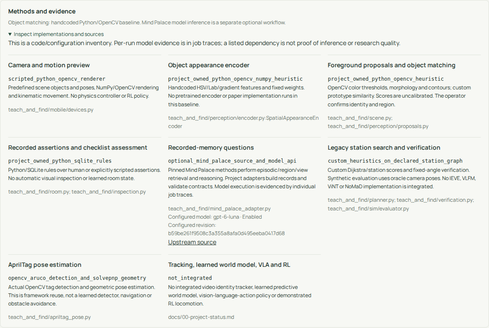
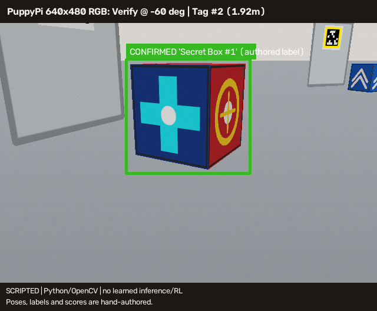

# Code-integrity audit: actual methods, authored data and research reuse

Date: 2026-11-01. Base revision: `81b3a6d`.
Scope: project-owned runtime, operator API/UI, legacy perception/planning,
ROS teaching helper, synthetic evaluator and visualization generators. Vendor
assets and historical outputs are preserved. This is not a line-by-line security
review of every dependency or a new evaluation of model quality.

**Verdict: real defects and misleading labels remained.** The corrections below
remove identified substitutes and disclose their actual implementations. Much
of the legacy core remains project-owned Python/OpenCV/NumPy heuristic code;
it does not become research integration because its labels were corrected.
The [FATAL / CRITICAL / LETHAL incident](2026-10-31-fatal-critical-lethal-capability-integrity.md)
remains OPEN / FAIL for the missing promised capabilities. The user's 0/10 rating
is unchanged. No blanket claim that all code is clean is made.

## Findings and corrections

| ID / severity | Observed defect at the base revision | Correction / evidence boundary |
| --- | --- | --- |
| CI01 / P0 | `build_encoder` chose `SpatialAppearanceEncoder` for every backend other than `torch_hub`, including misspellings | Only explicitly supported backends are selected; unknown names raise. Regression forbids constructing a heuristic substitute when a selected model fails |
| CI02 / P0 | Both encoders returned a zero embedding for an empty crop, without running the required feature/model computation | Empty crops raise instead of producing a synthetic embedding; both branches tested without downloading models |
| CI03 / P0 | ROS teaching silently used a central crop when foreground proposals were empty | Shared frame-teaching helper returns failure and does not enroll an object. Node reports `TEACH_FAILED`. The helper is exercised with actual OpenCV on a blank synthetic frame; ROS/hardware execution remains untested |
| CI04 / P0 | Single-view evaluation reused the overview crop when close-view proposals were missing | Candidate stays unverified; no substitute crop is passed to verification. A regression makes the verifier fail if that unsupported call occurs |
| CI05 / P1 | Any robot mode other than `mock` selected `RelayRobot` | Unknown backends now fail before selecting an adapter; regression forbids implicit relay construction |
| CI06 / P0 | HOME success log said `Returned safely` after graph-distance addition and logical node assignment | Report explicitly says logical search, graph-distance estimate, unexecuted/unmeasured HOME return and `physical_return_verified=false`; no navigation executor was added |
| CI07 / P1 | `calibrated_score`, `posterior_prob` and confidence docstrings implied statistical calibration | Fresh match/report/evidence records use `heuristic_score` and explicit semantics. Legacy Python read aliases are deprecated and documented as uncalibrated; arithmetic/thresholds are unchanged |
| CI08 / P1 | Missing reference angles became sequential indices or zero degrees | Missing angles remain `None` through teaching and restore; measured angles are not invented |
| CI09 / P0 | Experiment dashboard prewrote `FAILED` for baseline and `SUCCEEDED` for the full method | Labels derive from the trace, including contradictory-to-showcase outcomes tested explicitly. Trial-count heading now uses the requested count |
| CI10 / P0 | Storyboards authored camera paths, target/decoy identities, comparison scores and HOME completion | New PNG/GIF frames have a permanent scripted Python/OpenCV notice; fake probability/similarity labels are removed or marked authored. Outputs go to ignored `runs/`; original artifacts remain historical |
| CI11 / P1 | Method/source was too implicit on the app; reference images could look like observation evidence | Always-visible method summary plus expandable source inventory, explicit scene/inspection methods, reference-only captions, and model-answer limitations. English/VI resources and phone/desktop browser checks added |
| CI12 / P1 | Presence of framework/paper names could be mistaken for execution of those implementations | Authenticated inventory separates custom scripts, OpenCV geometry, operator assertions, configured optional adapters and actual Mind Palace components. Inventory explicitly is not per-run execution evidence |

Scene-confirmation quality/visibility also use fixed operator-assertion defaults;
this is now explicit in observation provenance and the app. They are not measured
image quality or model confidence.

Severity concerns capability/reporting integrity; it does not assert physical harm.
Changing labels does not satisfy the original acceptance criteria for learned
recognition, tracking, navigation, locomotion or world modeling.

## Actual implementation inventory

| Feature / entry point | Actual main code and inputs | Research/framework reuse and current evidence |
| --- | --- | --- |
| Foreground proposals | `CandidateProposalGenerator.propose`: Python/OpenCV Lab/HSV thresholds, morphology, contours, fixed filters/weights | Real OpenCV operations; custom heuristic, no detector-paper implementation/checkpoint |
| Taught-object matching | `SpatialAppearanceEncoder` plus `ObjectMemoryBank`: handcrafted HSV/Lab/gradient features, prototype similarity, authored margin weights and a fixed competitor prior | Custom baseline. No pretrained backbone runs in the default profile; scores are uncalibrated and candidates are not autonomous identity assertions |
| Optional Torch Hub encoder | Generic configurable `torch.hub` loader | Prototype. A declared revision string is not independently verified source/weights provenance. No genuine checkpoint execution is established by this audit; do not claim DINO integration from this adapter's existence |
| Multi-view verification | Fixed arc choices, distance/novelty weights and sigmoid thresholds | Custom implementation; no upstream IEVE code, learned likelihood or calibrated posterior |
| Station search | Project-owned Dijkstra and authored entropy/cost/novelty ranking on a supplied graph | Default graph is a hardcoded synthetic layout. No VLFM/ViNT/NoMaD/navigation-policy integration |
| Search evaluator | Renderer uses known station/object positions to place inspection cameras | Oracle-assisted synthetic test harness, not navigation/physical closed-loop evidence. Visual heuristic matching is computed; camera acquisition is supplied by fixture truth |
| AprilTag pose | `cv2.aruco` detection and `cv2.solvePnP` with IPPE-square | Actual OpenCV framework execution and synthetic geometry tests. No obstacle avoidance or verified physical calibration |
| Legacy Room queries / inspection | Python/SQLite rules over operator or explicitly scripted assertions | Genuine persistence/rule processing; no autonomous visual inspector or paper memory pipeline in these legacy routes |
| Default app camera | `MockRobot`, procedural NumPy/OpenCV scene, fixed objects and initial pose, kinematic update | Explicit synthetic preview, not physics, learned gait or measured robot telemetry |
| Manual control / relay | Project-owned leases, bounded commands and separate transport/watchdog code | Software/loopback evidence only; ACK is receipt, not measured execution |
| MuJoCo animation | Official CAD assets rendered with MuJoCo; `qpos` assignments, sinusoidal leg motion and `mj_forward` | Actual rendering framework/assets; authored animation, not RL or dynamics-based locomotion evaluation |
| Mind Palace app path | Project record/transport adapters invoke actual pinned episodic/room/view selection, image checking, belief history and EQA methods | Genuine scoped source reuse. Historical real API execution exists; fresh offline probe verifies nine actual upstream entries. Not the full active VoI/MDP/navigation method |
| App/UI/backend/queue | Preact/Vite, FastAPI, SQLite and Huey are actually used | Established software frameworks; this alone does not prove perception/research integration |
| Tracking / learned predictive world model / VLA / RL | No accepted integrated policy/model path | FAIL / not delivered for those promised capabilities |

The Mind Palace scene graph is assembled by the project adapter from registered
regions and model descriptions. Missing geometry is unknown. Semantic region
formation, exact-instance association and current state are not inferred merely
by constructing upstream graph objects. The upstream class named `WorldModel`
is used to retrieve images here, not to predict learned future dynamics.

## What the app now discloses

`GET /api/implementation` is paired-session protected and uncached. Its payload
is a **declarative configuration/code inventory**, not a claim that a configured
model was loaded, source was available, a provider was healthy or a task succeeded.
Per-job records remain the inference evidence. Scene/report outputs additionally
identify their custom algorithm and input provenance. Model answers state that
citation membership checks do not independently verify factual correctness.



[Phone screenshot](evidence/2026-11-01-code-integrity/phone-methods.png).
The fixed navigation chrome is hidden only in these cropped screenshots.



## Verification and reproduction

- Default Python suite: **92 passed**, one existing Starlette/httpx deprecation warning.
- Chromium suite: **7 passed**, including source/method disclosure, phone overflow,
  pairing, legacy proposals/confirmation, cancellation, stop and offline behavior.
- Frontend and wheel/sdist builds plus `make check`: recorded in the
  [verification manifest](evidence/2026-11-01-code-integrity/verification.json).
- Actual OpenCV heuristic experiment: two trials per variant, explicitly synthetic
  with oracle viewpoints; [raw summary](evidence/2026-11-01-code-integrity/heuristic-summary.json).
  These small fixture outcomes are not generalization accuracy or research superiority.
- CPU storyboard generator executed, producing 56 authored GIF frames and disclosed
  PNGs under ignored `runs/capability-audit-2026-11-01/storyboard/`.
- MuJoCo generator changes were source checked; no new GPU/ROS/physical robot
  execution or Android build was performed. No paid model call was made in this audit.

Reproduce from the repository root, preserving `.venv/`:

```bash
make check
make test
make app-build
make app-test
make build
UV_PROJECT_ENVIRONMENT=.venv-dev uv run --locked --extra dev python scripts/run_experiments.py \
  --trials 2 --output-dir runs/my-heuristic-audit
UV_PROJECT_ENVIRONMENT=.venv-dev uv run --locked --extra dev python scripts/render_mission_visuals.py \
  --output-dir runs/my-authored-storyboard
```

Optional fresh **offline control-flow** probe, requiring the already prepared
`.venv-memory` and pinned upstream source:

```bash
PYTHONPATH=. CUDA_VISIBLE_DEVICES=-1 MPLBACKEND=Agg .venv-memory/bin/python \
  scripts/audit_mind_palace_execution.py --offline-contract-probe \
  --output runs/my-upstream-control-flow.json
```

The [probe output](evidence/2026-11-01-code-integrity/upstream-control-flow.json)
records actual upstream function filenames/counts/hashes and confirms benchmark
`move_robot` was not called. Its client responses are explicitly injected
`offline_contract_fixture` values; **it does not execute a vision model or prove
answer quality**. It is a source-call audit, not a product fallback provider.
Historical [actual model runs](../research/2026-11-01-mind-palace-app/report.md)
remain separately labeled evidence at their recorded source revisions.

## Compatibility and unresolved gates

Fresh match JSON replaces `calibrated_score` with `heuristic_score`; serialized
mission/view records use the same honest score name. Legacy Python read aliases
remain for existing callers, without any calibration guarantee. Consumers must
update JSON field reads. Existing SQLite embeddings/results, vendor assets,
research manifests and output images are not rewritten or reinterpreted.

Open requirements include verified optional model source/checkpoint artifacts,
real-room perception/identity/abstention evaluation, calibrated geometry and a real
route executor, physical stop measurements, learned locomotion and upstream
tracking/world-model integration if still promised. No missing research model is
replaced by the now-disclosed baseline. The original acceptance remains FAIL
where its required components are absent. A follow-up implementation must start
from verified suitable upstream code and checkpoints and pass its own gates.
