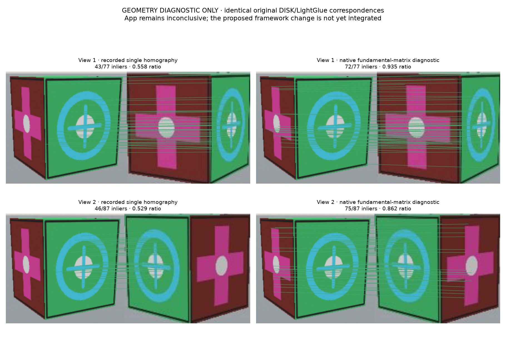

# Repeated positive failure: one homography over a multi-face object

Date: 2026-11-02. **New finding; proposed geometry revision, not implemented.**
The appearance contradiction fix rejects the original unknown-object false
confirmation and retains a true-target replay. The first frozen 13-case run
passed. The repeated run with loaded-weight verification exposed a positive
abstention in `hidden-20202`; this prevents full qualification. Do not discard
the repeated failure or promote the earlier pass as the final release result.

## Actual repeated app evidence

The target is a rigid 3D box with differently oriented visible faces. Both real
captured views passed the actual original AnomalyDINO/fitted appearance gate:
distances 0.3621 and 0.3181. DINOv2 candidates also passed, at cosines 0.8825 and
0.8985. The final readout was inconclusive because reference 1 had no accepted
homography support in either view; references 2 and 3 were supported.

| Actual recorded match set for reference 1 | Homography inliers | Ratio | Fundamental-matrix diagnostic inliers | Ratio |
| --- | --- | --- | --- | --- |
| View 1 | 43 / 77 | 0.5584 | 72 / 77 | 0.9351 |
| View 2 | 46 / 87 | 0.5287 | 75 / 87 | 0.8621 |

The existing ratio threshold is 0.60. No threshold was reduced. These are the
**same original DISK/LightGlue point correspondences**, not detections rerun with
more favorable parameters. Native OpenCV `findFundamentalMat` with USAC_MAGSAC,
3-pixel threshold, confidence 0.999 and 2000 iterations produced the diagnostic.
The [raw diagnostic](../research/2026-11-02-identity-fix/geometry-diagnostic.json)
retains the matrices and measured counts. It does not change the app verdict.

A single homography models a planar projective relationship, whereas general
two-view 3D correspondence uses epipolar geometry. The diagnostic supports a
geometric-model mismatch as the cause of this rejection; it does not prove all
matched points correct or establish identity. Original AnomalyDINO must still
veto shared-front/different-side objects. A geometric fit alone is insufficient.

## Concrete proposed revision

Replace the project-selected homography support test for 3D-object reference
matching with native OpenCV fundamental-matrix USAC/MAGSAC estimation. Keep the
original DISK/LightGlue implementation and all appearance, reference-coverage,
minimum-inlier/ratio/coverage, observed-view-baseline and spatial gates. Use an
explicit deterministic robust-estimator configuration, and expose matrix type,
configuration, raw matches, inliers and rejection reasons in each record.
Failure remains unsupported/inconclusive, never a switch to another backend.

The proposed deterministic native configuration was also executed separately:
confidence 0.995 (matching the current homography setting), threshold 3 pixels,
2000 iterations, nonparallel execution, seed 0, `SCORE_METHOD_MAGSAC`,
`LOCAL_OPTIM_SIGMA`, local sample size 50 and 10 local iterations, through
`cv2.UsacParams` / `cv2.findFundamentalMat`. Three repeated calls retain identical
masks and 72/77 and 75/87 inliers. The [configuration and actual diagnostic](../research/2026-11-02-identity-fix/geometry-deterministic-diagnostic.json)
are separate from the earlier confidence-0.999 diagnostic above. These local
optimization settings follow the inspected native non-homography MAGSAC preset;
the proposed support thresholds remain eight inliers, ratio 0.60 and reference
coverage 0.12. No application verdict or supported adapter was changed.

Reference crops do not have registered camera intrinsics. Do not invent those
intrinsics or poses to call a calibrated essential-matrix estimator. OpenCV's
uncalibrated fundamental-matrix API accepts the actual two sets of image points.

Sources fetched/inspected locally:

- [OpenCV 5 geometry documentation](https://docs.opencv.org/5.0/main_modules/d_projection.html),
  actual installed OpenCV 5.0.0 API and successful native diagnostic call.
- Official `opencv/opencv` 5.0.0 checkout at
  `runs/identity-fix-2026-11-02/opencv`, revision
  `40738fb16ceddb5fb3fea747585f7ce6abb0605b`. This is inspected reference source;
  the diagnostic uses the installed framework wheel, not a claimed local build.
- Original `cvg/glue-factory` checkout at
  `runs/identity-fix-2026-11-02/glue-factory`, revision
  `2d17e3b3bd7d30f0c828d4c4d3eac4ecefbf283d`, Apache-2.0. Its inspected
  `OpenCVRelativePoseEstimator` requires both camera models; it is not used here
  and must not be claimed integrated when reference intrinsics are absent.

This is a specific algorithm revision requiring user approval under AGENTS.
If approved, version the geometry profile, run the genuine framework path,
preserve both failed batches, and freeze fresh positive/negative/ambiguity app
cases. Do not retune the appearance classifier or relax the quality criteria.
Automatic verified memory remains blocked until the final required run passes.
