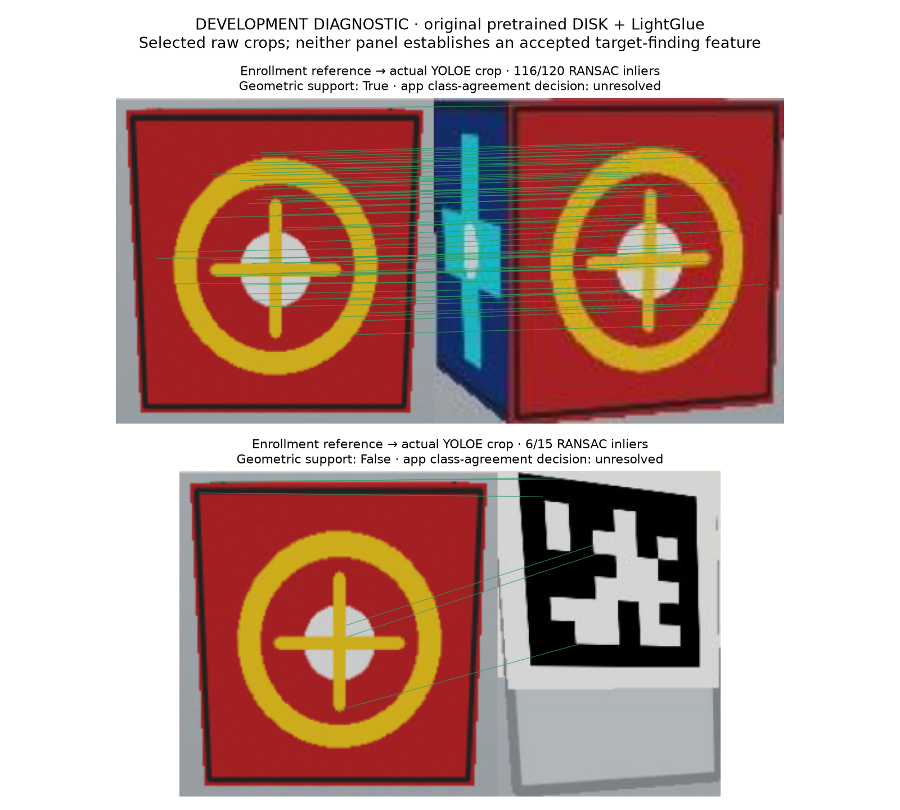
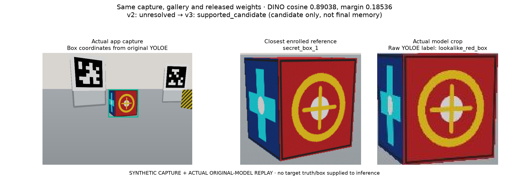
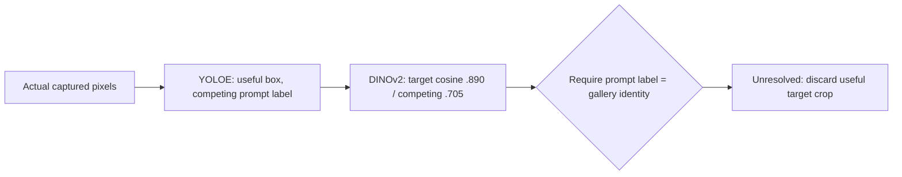
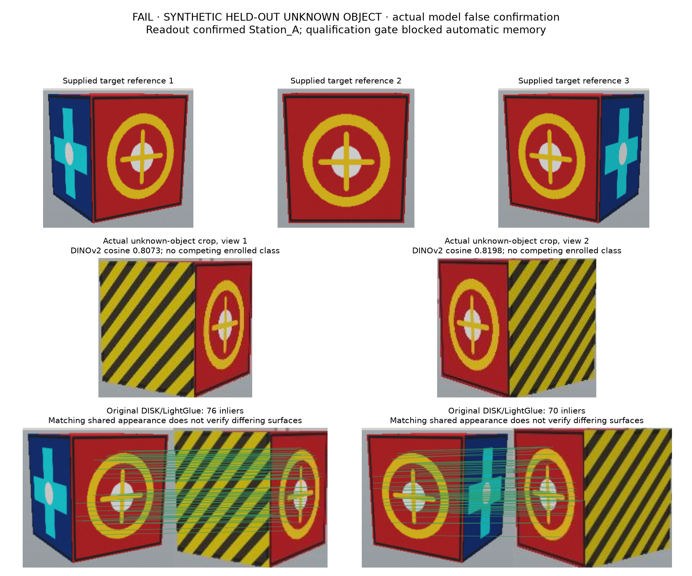
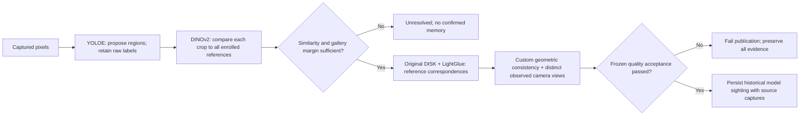

# Case study: a correct proposal was vetoed by the wrong model role

Date: 2026-11-02. The user accepted the role correction below and requested a
concrete illustrated explanation. **Changing the rule is not a quality pass.**
See the [execution report](../research/2026-11-02-complete-search/report.md) for
current app and acceptance evidence.

## One actual camera capture

The simulator camera captured a crimson box after the robot had executed motion
to an inspection view. The test renderer identifies the physical fixture as
`secret_box_1`; that evaluator label is not supplied to inference. The app gallery
contains separately enrolled images named `secret_box_1` and `lookalike_red_box`.

YOLOE proposed the box at pixel bounds
`[282.39, 158.41, 407.45, 274.65]`. The region was useful; its prompt-class label
was the competing object. Original DINOv2 and original DISK/LightGlue produced:

| Measured output | Actual value | Meaning |
| --- | --- | --- |
| YOLOE prompt label | `lookalike_red_box` | Proposal-class output; not reliable exact-instance identity |
| YOLOE model score | 0.86694 | Uncalibrated detector score, not identity probability |
| DINOv2 maximum target-reference cosine | 0.89038 | Target-gallery similarity |
| DINOv2 maximum competing-reference cosine | 0.70502 | Competing-gallery similarity |
| Top-gallery margin | 0.18536 | Passes the existing custom margin threshold 0.05 |
| DISK/LightGlue, front reference | 116 geometric inliers, about 97% inlier ratio | Genuine local learned correspondence followed by declared OpenCV RANSAC |
| Supported app verdict at that time | `unresolved / detector_descriptor_disagreement` | Correct target crop was discarded by the old readout |

The cosine and margin thresholds were 0.80 and 0.05. They are custom decision
rules over real features, not a trained identity classifier or calibrated
probability. The LightGlue figures are a separate development diagnostic over raw
model crops, including crops discarded by the old app gate.



Top: the actual box crop has strong geometric support. Bottom: a background-tag
crop does not pass the geometric policy. Both app candidates were unresolved
under the old supported gate; the figure does not relabel the old run as success.



The paired replay actually executed both profiles on the same saved app capture,
gallery and released checkpoints. The raw proposal label and image region stay
unchanged; the new profile changes the identity readout. It is a supported
candidate at this stage, not a final sighting. Reproduce with
`scripts/replay_search_role_case.py` and `scripts/figure_search_role_case.py`.

## Why the old decision was wrong



The architecture treated the proposal model's class label as an identity veto.
The model roles were mismatched. Changing CPU to GPU changes inference speed;
it does not repair this rule. Tracking the rejected or wrongly labeled box for
more frames cannot repair identity either. Reversing the prompt-bank order gave
the same semantic assignments, so that simple class-index/order fix did not
resolve this observed case. This does not prove every adapter correct or every
model accurate; those require separate tests.

## Counterexample: correcting roles did not solve identity

The frozen qualification-v2 case `unknown-hidden-808` enrolled only the target.
The query contained an unknown object with the same front symbol and different
yellow/black sides. Query placement and identity were evaluator-only inputs.
Both actual oblique captures visibly contained the different sides. Nevertheless:

| Actual view | DINOv2 target cosine | Local support | Experimental readout |
| --- | --- | --- | --- |
| 1 | 0.807293 | Reference 1: 76 inliers; coverage 0.231 | Supported candidate |
| 2 | 0.819844 | Reference 3: 70 inliers; coverage 0.224 | Supported candidate |
| Two-view cluster | No competing gallery class; margin unknown | Baseline 0.9181 m; all three references had matches | **False `confirmed / Station_A`** |



The learned components actually executed. The custom rule incorrectly treated
positive correspondence on a shared surface as evidence of complete identity.
Multi-view camera displacement and support for each reference image did not
establish that distinguishing surfaces matched. Raising the cosine/coverage
threshold on this failed held-out example would be tuning on the test case;
silently adding a different algorithm would violate the agreed design.

The app job failed with `SEARCH_QUALITY_NOT_QUALIFIED`, because the qualification
gate was still closed. It wrote **zero automatic sightings**. This prevented a
false memory record; it does not make the identity algorithm pass. The failed
batch remains evidence. A proposed additional contradiction-verification method
requires a concrete research/repository assessment and explicit design approval.

Reproduce this figure from preserved actual outputs:

```bash
PYTHONPATH=. .venv-dev/bin/python scripts/figure_search_false_positive.py \
  runs/search-qualification-v2-2026-11-02/unknown-hidden-808 \
  docs/research/2026-11-02-complete-search/false-positive-hidden.png
```

## Accepted correction, with a new version



New search payload **v2** explicitly uses vision profile **v3**. The raw YOLOE
label is retained, while DINOv2 supplies the candidate's gallery identity. The
actual upstream ByteTrack receives supported descriptor identities; its local
association does not establish exact identity. Original DISK/LightGlue and the
multi-view geometry gate remain mandatory. Errors do not trigger another backend.
Original vision profile **v2** and old evidence keep their original semantics.

This still must reject look-alikes/ambiguous evidence and pass a frozen evaluation
before automatic confirmed memory is enabled. Identical visible appearance does
not establish a unique physical instance; unseen/hidden distinguishing surfaces
remain an observability limitation. No predictive world model, physical robot
or research-superiority claim follows from this correction.

## Reproducible evidence locations

- Actual old app captures/results: `runs/search-app-dev3-2026-11-02/`.
- Prompt-order countercheck: `runs/completion-research-2026-11-02/prompt-order-probe.json`.
- Real local-feature diagnostic: `runs/completion-research-2026-11-02/raw-crop-correspondence-probe.json`.
- Plot reproducer: `scripts/figure_search_matches.py`.
- Original inference and adapters: `teach_and_find/yoloe_adapter.py`,
  `teach_and_find/dinov2_adapter.py`, `teach_and_find/lightglue_adapter.py`.
- Navigation/model workflow: `teach_and_find/search_worker.py`.

The report records actual upstream revisions, checkpoint digests, entry points
and observed calls. The custom readout is disclosed separately from upstream
model reuse. Unit tests protect the role/version boundary; actual app runs must
establish inference and end-to-end quality separately.
